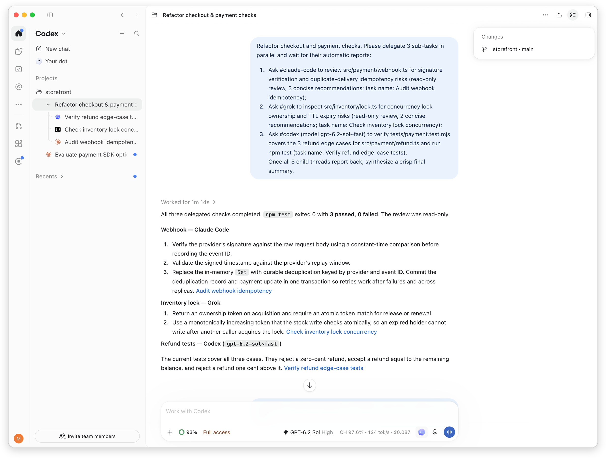
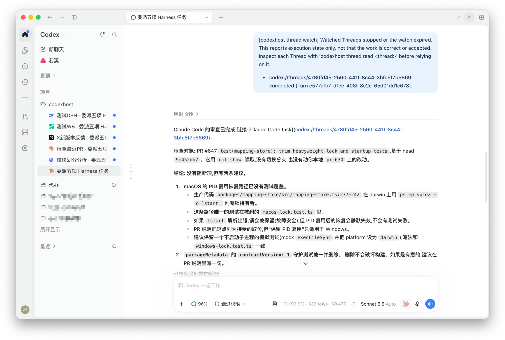

<div align="center">

<p>
  <picture>
    <source media="(prefers-color-scheme: dark)" srcset="docs/imgs/readme-lockup-dark.png" />
    <source media="(prefers-color-scheme: light)" srcset="docs/imgs/readme-lockup-light.png" />
    
  </picture>
</p>

<p>
  <a href="https://github.com/BytePioneer-AI/codex-host/stargazers"></a>
  <a href="https://github.com/BytePioneer-AI/codex-host/releases/latest"></a>
  <a href="https://www.npmjs.com/package/@codexhost/cli"></a>
  <a href="LICENSE"></a>
  <a href="#download--install"></a>
</p>

<p>
  <strong>English</strong> ·
  <a href="docs/project/README.zh-CN.md">简体中文</a> ·
  <a href="docs/project/README.ko.md">한국어</a>
</p>

<h2>Run every coding agent, as one workspace.</h2>

<p>
  Unify <b>Codex</b>, <b>Claude Code</b>, <b>Pi</b>, <b>Grok</b>, and 15+ more coding agents in one workbench —<br />
  ships with a standalone desktop app (no official Codex Desktop required), optionally enhances the official client, and syncs live across Web, Mobile, and remote machines.
</p>

<p>
  <b><a href="https://chost.dev/en/download">Download CodexHost</a></b> &nbsp;·&nbsp;
  <b><a href="https://chost.dev/en">Website →</a></b> &nbsp;·&nbsp;
  <a href="docs">Docs</a> &nbsp;·&nbsp;
  <a href="#community">Community</a>
</p>

<br />

<picture>
  <source media="(prefers-color-scheme: dark)" srcset="docs/imgs/readme-hero-en-dark.png" />
  <source media="(prefers-color-scheme: light)" srcset="docs/imgs/readme-hero-en-light.png" />
  
</picture>

</div>

---

## Key Capabilities

<table>
<tr>

<td width="25%" valign="top">

### Own Desktop, Live Sync

Ships with its own standalone desktop app — no official Codex Desktop required.

Shares one local Host with Web, Mobile, and optional Codex Desktop mode.

</td>

<td width="25%" valign="top">

### Real Agent Teamwork

Type `#` to dispatch parallel native child sessions that report back automatically.

Hand off full context across agents mid-task.

</td>

<td width="25%" valign="top">

### Multi-Host & Mobile

Pull Macs, Linux dev boxes, and Windows rigs into one sidebar.

Approve, inspect, and reply from your phone anywhere.

</td>

<td width="25%" valign="top">

### Native & Local-First

Connects over official SDKs, RPC, and ACP using your existing local logins.

No account required. Zero third-party proxy.

</td>

</tr>
</table>

---

<a id="download--install"></a>

## Download & Install

CodexHost is free and open source. Local and LAN features work **without an account** and **do not require official Codex Desktop**.

| Platform | Package & Notes | Download |
| :--- | :--- | :--- |
| **macOS** | Apple Silicon & Intel · Standalone `.dmg` _(also enhances official Codex Desktop if installed)_ | [**Download from Website**](https://chost.dev/en/download) · [GitHub Releases](https://github.com/BytePioneer-AI/codex-host/releases/latest) |
| **Windows** | x64 & ARM64 · `.exe` installer / WinGet _(supports portable Codex Desktop too)_ | [**Download from Website**](https://chost.dev/en/download) · [GitHub Releases](https://github.com/BytePioneer-AI/codex-host/releases/latest) |
| **Linux** | x64 & ARM64 · Self-contained `.tar.gz` _(Desktop app & headless Web daemon)_ | [**Download from Website**](https://chost.dev/en/download) · [Linux Guide](docs/platforms/linux/linux.md) |
| **Android** | Lightweight native `.apk` · Push alerts, QR pairing & multi-host switching | [**Download from Website**](https://chost.dev/en/download#mobile) · [Android Notes](apps/android-shell/README.md) |
| **iPhone & iPad** | Safari "Add to Home Screen" PWA · Direct LAN, Tailscale, or encrypted Relay | [**Mobile Setup Guide**](https://chost.dev/en/download#mobile) |
| **CLI** | Node.js 22.19+ / 24 or Windows WinGet | `npm install -g @codexhost/cli` · `winget install --id BytePioneer-AI.CodexHost --exact` |

<details>
<summary><b>Common CLI commands (Desktop / Web / Upgrade / Stop)</b></summary>

<br />

```bash
codexhost          # Launch standalone Desktop or enhanced official Codex Desktop
codexhost app      # Open lightweight standalone Desktop directly
codexhost web      # Start local Web UI and open in your browser
codexhost status   # Inspect background Host and service status
codexhost update   # Upgrade to the latest release
codexhost stop     # Stop all background services (run before npm reinstall)
```

> **Keep Web access private:** access tokens, login links, and pairing QR codes grant full control of your machine. Never share them publicly.

</details>

<details>
<summary><b>Installation troubleshooting (macOS Gatekeeper / Windows portable / Console)</b></summary>

<br />

- **Launch failed or official Codex Desktop opened without CodexHost**: run `codexhost console` (Windows: Start Menu → `codexhost console`) to open `http://127.0.0.1:4399/` for logs, version detection, and updates.
- **macOS: "App can't be verified" on first launch**:
  ```bash
  xattr -dr com.apple.quarantine /Applications/codexhost.app
  ```
- **Windows: portable unpacked Codex Desktop**: set `CODEXHOST_INSTALL_ROOT` to your unpacked directory, exit all running processes, reopen your terminal, and run `codexhost`:
  ```powershell
  [Environment]::SetEnvironmentVariable("CODEXHOST_INSTALL_ROOT", "D:\CodexPortable", "User")
  ```

</details>

---

## One Host, Three Ways to Work

A single local Host keeps sessions, approvals, queues, and extensions as one source of truth across every client:

<table>
<tr>

<td width="33%" valign="top">

### Standalone Desktop

**Ready out of the box, lighter footprint.**

Native Tauri desktop shell that works on macOS, Windows, and Linux without requiring official Codex Desktop.

</td>

<td width="33%" valign="top">

### Official Codex Enhanced

**Keep your habits, multiply your agents.**

Enhances official Codex Desktop non-invasively without modifying its installer—preserving native diff review, worktrees, and approvals.

</td>

<td width="33%" valign="top">

### Web & Mobile

**Stay in reach away from your desk.**

Full responsive Web UI paired with the native Android APK and iOS PWA to inspect progress, approve commands, and reply anywhere.

</td>

</tr>
</table>

```text
    Standalone Desktop (Tauri)    Official Codex Desktop       Web / PWA & Android
                │                           │                           │
                └───────────────────────────┼───────────────────────────┘
                                            ▼
                             Shared Local Host (Single Source)
                  Threads · Queues · Approvals · Worktrees · Usage · Extensions
                                            │
                  ┌─────────────────────────┼─────────────────────────┐
                  ▼                         ▼                         ▼
         Native Codex Runtime      19+ External Agent Adapters    Remote Peer Hub / Relay
```

---

## Multi-Agent Teamwork: Delegate & Hand Off

When one agent isn't enough—or different tasks fit different models—type `#` in the composer to spin up isolated native child sessions in parallel, or use **[Cross-Harness Handoff](docs/architecture/cross-harness-handoff.md)** to transfer full conversation context cleanly to another agent mid-thread.

```text
                     Main Thread (e.g. Codex / Claude Code)
                                    │
                ┌───────────────────┼───────────────────┐
                ▼                   ▼                   ▼
          #claude-code             #pi                #agy
      Worktree code review    Debug flaky tests    Frontend & docs
                │                   │                   │
                └───────────────────┴───────────────────┘
                                    ▼
                 Results flow back automatically · Lossless Handoff anytime
```

> Ask `#claude-code` to review this diff independently and call out compatibility risks.  
> Ask `#pi` to investigate why this integration test flakes.  
> Ask `#agy` to build the frontend view and update the docs.

<table>
  <tr>
    <td width="50%" valign="top">
      <p><strong>Parallel Agent Sessions</strong><br /><sub>Independent native threads side by side</sub></p>
      
    </td>
    <td width="50%" valign="top">
      <p><strong>Automatic Completion Flowback</strong><br /><sub>Originating thread is notified as soon as delegated work finishes</sub></p>
      
    </td>
  </tr>
</table>

---

## Step Away. Every Machine Stays Within Reach.

```text
  MacBook Pro (Local) ──┐
  Linux Dev Box (Peer) ─┼──► Unified Sidebar (Peer Hub) ──► LAN / Tailscale / Encrypted Relay ──► Phone / Any Browser
  Windows Rig (Peer)  ──┘
```

- **[Multi-Host Peer Hub](docs/product/multi-remote-peers.md)**: Aggregate Macs, Linux servers, and Windows workstations into one sidebar with cross-host delegation and remote file previews.
- **[Scan-to-Connect Mobile Access](docs/product/web-remote-access.md)**: Connect over LAN, Tailscale, or encrypted Relay with zero port forwarding; deploy a **[Self-Hosted Relay](docs/product/self-hosted-relay.md)** on your own infrastructure whenever compliance requires it.
- **Local-First Privacy**: Your code, threads, and agent credentials stay on your own machines and connect directly to official providers—never proxied through third-party servers.

<details>
<summary><b>Advanced: SSH Remote & Windows Remote Control</b></summary>

<br />

You can also reuse official Codex Desktop remote channels to control agents on another machine (both sides must run the same CodexHost version):
- **macOS / Linux (SSH Remote)**: run `codexhost remote install && codexhost remote start` on the remote host — see [SSH Remote Guide →](docs/platforms/remote/remote-ssh-host.md)
- **Windows (Remote Control · Experimental)**: reuses official Remote Control pairing without opening public ports — see [Remote Control Guide →](docs/platforms/remote/remote-control-host.md)

</details>

---

## Native Depth & Open Ecosystem

<table>
<tr>

<td width="33%" valign="top">

### Native Runtime Fidelity

Never dumbed down to a plain chat box.

Preserves **Plan Mode**, **mid-turn Steering**, **background terminals**, **branch/worktree Fork**, **live cost & cache metrics**, and **local account import**.

</td>

<td width="33%" valign="top">

### Unified Extensions & Skills

Install once; runs on Desktop and Web.

Extend panels and widgets via [Host Extensions](docs/architecture/desktop-ui-extensions.md) and share reusable workflows across every agent with the [Unified Skill Library](docs/architecture/skill-library.md).

</td>

<td width="33%" valign="top">

### Schedules & External APIs

Built for both humans and automation.

Run recurring checks via [Schedules](docs/product/harness-schedules.md), or orchestrate every local agent from scripts and bots via [CLI, MCP & HTTP](docs/architecture/external-clients.md) (`codexhost delegate`).

</td>

</tr>
</table>

---

<a id="supported-agents"></a>

## Supported Agents

Native **Codex** plus **19+ preinstalled coding agents** connected through official SDKs, RPC, and [ACP](https://agentclientprotocol.com/)—reusing the CLIs and credentials already logged in on your machine. See the full feature matrix in **[Capability Boundaries →](docs/harnesses/capability-boundaries.md)**.

<details>
<summary><b>View all preinstalled coding agents</b></summary>

<br />

| | | | |
| :--- | :--- | :--- | :--- |
| [Codex](https://openai.com/codex/) | [Claude Code](https://code.claude.com/docs/en/quickstart) | [Pi](https://pi.dev/) | [Oh My Pi](https://github.com/can1357/oh-my-pi) |
| [OpenCode](https://opencode.ai/docs/) | [Grok](https://grok.com/) | [Cursor CLI](https://cursor.com/docs/cli/overview) | [GitHub Copilot](docs/harnesses/copilot/copilot-harness-integration.md) |
| [Antigravity (AGY)](https://antigravity.google/product/antigravity-cli) | [Devin](https://docs.devin.ai/cli) | [DeepSeek Harness](https://github.com/deepseek-ai/deepseek-harness) | [Qwen Code](https://github.com/QwenLM/qwen-code) |
| [Kimi Code](https://moonshotai.github.io/kimi-code/) | [Kiro CLI](https://kiro.dev/docs/cli/) | [CodeBuddy](https://www.codebuddy.cn/home/) | [WorkBuddy](https://www.workbuddy.ai/docs/workbuddy/Quickstart) |
| [Qoder / Qoder CN](https://qoder.com/cli) | [Hermes](https://hermes-agent.nousresearch.com/docs) | [ZCode](https://zcode.z.ai/) | [Build a custom Harness →](.agents/skills/codexhost-add-harness/SKILL.md) |

</details>

---

## Sponsors

<table>
<tr>
<td width="160" align="center"><a href="https://vibeapi.cc/sign-up?aff=AOYp"></a></td>
<td>Thanks to <b>VibeAPI</b> for sponsoring CodexHost! Built for developers and teams, VibeAPI provides unified access to Codex, Claude, and leading AI models with a traceable self-managed account pool, 99.9% SLA, 95%+ cache hit rate, 24/7 human support, and enterprise invoicing. <a href="https://vibeapi.cc/sign-up?aff=AOYp">Learn more about VibeAPI →</a></td>
</tr>
</table>

---

<a id="community"></a>

## Community

- **GitHub**: Report bugs or request new agent adapters via [Issues](https://github.com/BytePioneer-AI/codex-host/issues), and share workflows or ideas in [Discussions](https://github.com/BytePioneer-AI/codex-host/discussions).
- **WeChat Group**: Scan the QR code below with note **"CodexHost"** to join the developer community group.

<details>
<summary><b>Show WeChat Group QR Code</b></summary>

<br />

<p align="center">
  
</p>

</details>

<details>
<summary><b>Build from Source & Development</b></summary>

<br />

Requirements: Node.js 22.19+ or 24, Rust (plus official Codex Desktop if developing the enhanced desktop mode). See [CONTRIBUTING.md](CONTRIBUTING.md) and [Repository Maintenance](docs/operations/repository-maintenance.md).

```bash
git clone https://github.com/BytePioneer-AI/codex-host
cd codex-host
npm ci
npm run start:app   # Launch standalone Desktop
```

| Command | Purpose |
| :--- | :--- |
| `npm run start:app` | Build and launch standalone Desktop |
| `npm run start:web` | Build and launch standalone Web UI (hot reload enabled) |
| `npm start` | Build and launch official Codex Desktop enhanced mode |
| `npm stop` | Stop local codexhost background services for the current user |

</details>

---

## Acknowledgements & Contributors

Thanks to the [LINUX DO](https://linux.do/) community, [Paseo](https://github.com/getpaseo/paseo) (multi-harness architecture inspiration), [DSH (DeepSeek Harness)](https://github.com/deepseek-ai/deepseek-harness) (Web UI foundation), and everyone contributing to CodexHost.

<a href="https://github.com/BytePioneer-AI/codex-host/graphs/contributors">
  
</a>

## Star History

<a href="https://www.star-history.com/?repos=bytepioneer-ai%2Fcodex-host&type=date&legend=top-left">
  <picture>
    <source media="(prefers-color-scheme: dark)" srcset="https://api.star-history.com/chart?repos=bytepioneer-ai/codex-host&type=date&theme=dark&legend=top-left" />
    <source media="(prefers-color-scheme: light)" srcset="https://api.star-history.com/chart?repos=bytepioneer-ai/codex-host&type=date&legend=top-left" />
    
  </picture>
</a>

## License

Released under the [LGPL-3.0](LICENSE) License.
