<div align="center">

# CodexHost

**Use 15+ Agents like Claude Code, Pi and Grok inside Codex Desktop, without switching apps**

They get the same Diff review, Fork and approvals as Codex, and can hand work to each other.

There is also a **Web app**: the same Codex interface with lower memory use, so you can use every Agent on this computer remotely from your phone or any other computer.

⭐ If CodexHost is useful to you, please give it a star! ⭐

<p align="center">
  <a href="https://pi.dev/"></a>
  <a href="https://openai.com/codex/"></a>
  <a href="https://code.claude.com/docs/en/quickstart"></a>
  <a href="https://opencode.ai/docs/"></a>
  <a href="https://grok.com/"></a>
  <a href="https://github.com/can1357/oh-my-pi"></a><br />
  <a href="https://github.com/deepseek-ai/deepseek-harness"></a>
  <a href="https://github.com/QwenLM/qwen-code"></a>
  <a href="https://docs.devin.ai/cli"></a>
  <a href="https://antigravity.google/product/antigravity-cli"></a>
  <a href="https://kiro.dev/docs/cli/"></a>
  <a href="https://www.codebuddy.cn/home/"></a><br />
  <a href="https://www.workbuddy.ai/docs/workbuddy/Quickstart"></a>
  <a href="https://cursor.com/docs/cli/overview"></a>
  <a href="https://hermes-agent.nousresearch.com/docs"></a>
  <a href="https://qoder.com/cli"></a>
  <a href="https://moonshotai.github.io/kimi-code/"></a>
  <a href="https://zcode.z.ai/"></a>
  <a href="docs/harnesses/copilot/copilot-harness-integration.md"></a>
</p>

<p align="center"><a href="https://github.com/BytePioneer-AI/codex-host/releases"><strong>Download</strong></a> · <a href="#quick-start">Quick Start</a> · <a href="#desktop">Desktop</a> · <a href="#collaboration">Cross-Agent Collaboration</a> · <a href="#join-the-community">微信交流群</a> · <a href="docs/project/README.zh-CN.md">简体中文</a> · <a href="docs/project/README.ko.md">한국어</a></p>

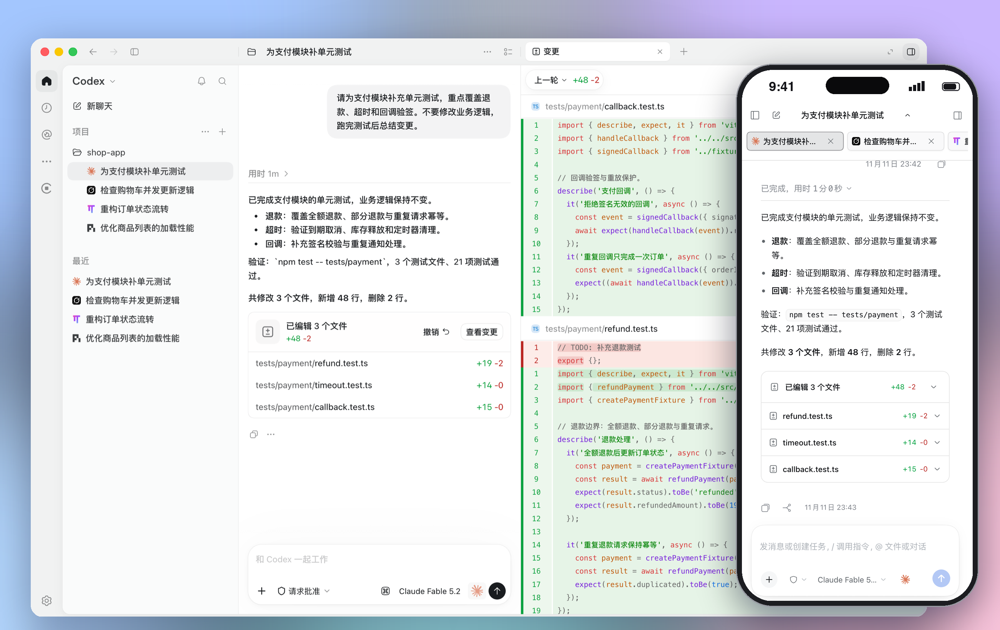

</div>

## Sponsors

<details open>
<summary>Click to collapse</summary>

<table>
<tr>
<td width="180"><a href="https://vibeapi.cc/sign-up?aff=AOYp">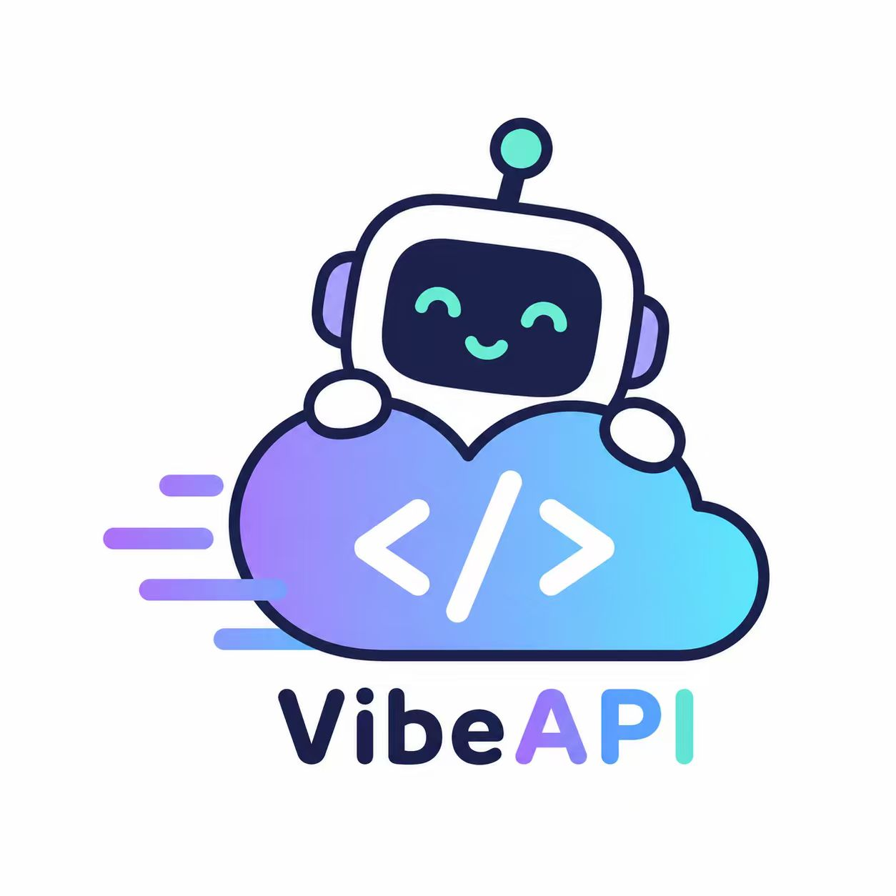</a></td>
<td>Thanks to <b>VibeAPI</b> for sponsoring this project! Built for power developers and teams, VibeAPI provides unified access to mainstream AI models, focusing on the Codex and Claude series with a self-managed, traceable account pool. It offers ultra-fast time to first token, 99.9% SLA availability, and cache hit rates of 95%+. Human technical support is available 24/7, with corporate invoicing and enterprise partnerships fully supported. <a href="https://vibeapi.cc/sign-up?aff=AOYp">Grab some cyber goodies →</a></td>
</tr>
</table>
</details>

<a id="quick-start"></a>

## Quick Start

**Option 1: npm** (macOS / Windows / Linux)

```bash
npm install -g @codexhost/cli
codexhost          # start Codex Desktop
codexhost web      # start Web and open it in your browser
codexhost stop     # stop all CodexHost background services
```

**Option 2: Installer** (macOS / Windows)

Grab the installer for your platform from [Releases](https://github.com/BytePioneer-AI/codex-host/releases). For Web: open codexhost after installing, then visit http://127.0.0.1:4400 locally.

> Linux is supported on x64 and ARM64. See the [Linux guide](docs/platforms/linux/linux.md).

**Upgrade and stop:** run `codexhost update` to upgrade, and `codexhost stop` to stop all background services. Before installing over an existing npm installation, run `codexhost stop` first.

<details>
<summary>Installation troubleshooting</summary>

**codexhost does not start, or Codex opens without codexhost features**

Run `codexhost console` (Windows: Start Menu → "codexhost console") to open the local console at `http://127.0.0.1:4399/`. It shows why the last start failed, the Codex Desktop version and Host Runtime logs, and can update codexhost while Codex is not running.

**macOS: "App can't be verified" on first launch**

```bash
xattr -dr com.apple.quarantine /Applications/codexhost.app
```

**Windows: using a portable Codex Desktop**

1. Point `CODEXHOST_INSTALL_ROOT` at the folder where you extracted Codex Desktop:

   ```powershell
   [Environment]::SetEnvironmentVariable("CODEXHOST_INSTALL_ROOT", "D:\CodexPortable", "User")
   ```

2. Quit Codex Desktop completely, open a new terminal, and run `codexhost`.

</details>

<a id="desktop"></a>

## Use every Agent in Codex Desktop

No more switching apps: **Pi, Claude Code, Grok Build and 15+ other Agents** all run in the same Codex Desktop window. Every session is in the sidebar, and you can switch Agents from the bottom-right of the composer.

https://github.com/user-attachments/assets/c48192d7-23ff-4f6e-b61a-6345a655bb76

<table>
  <tr>
    <td width="33%" valign="top">
      <p><strong>Diff review panel</strong><br /><sub>Every turn summarizes its changes; click Review to open the full Diff</sub></p>
      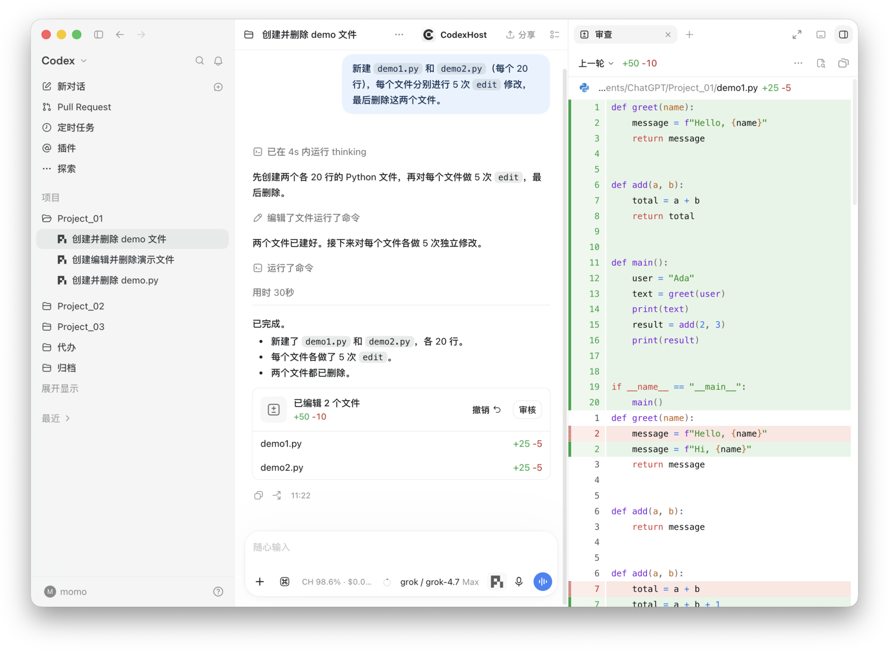
    </td>
    <td width="33%" valign="top">
      <p><strong>Fork from any message</strong><br /><sub>Branch in the current workspace, or in a new Worktree for parallel work</sub></p>
      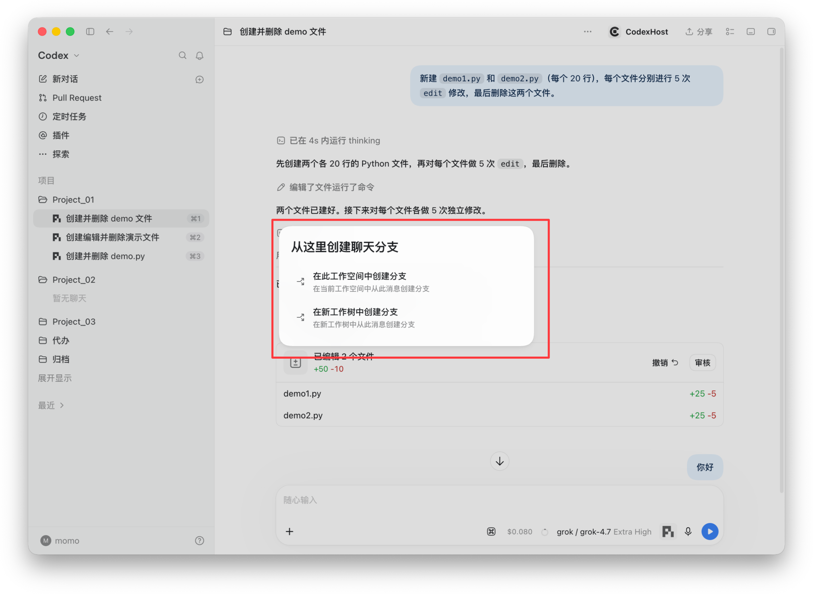
    </td>
    <td width="33%" valign="top">
      <p><strong>Visible Subagents</strong><br /><sub>Each Subagent has its own icon; open its full conversation on the right</sub></p>
      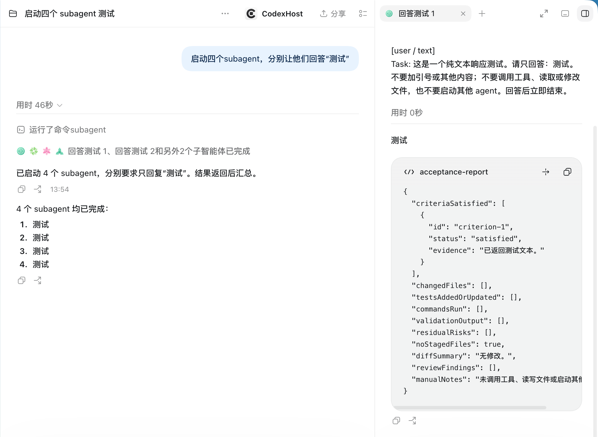
    </td>
  </tr>
</table>

<details>
<summary>More: tool details, usage, account import, diagram rendering</summary>

<table>
  <tr>
    <td width="50%" valign="top">
      <p><strong>Tool calls and thinking</strong><br /><sub>Expand any edit, command or thinking step to see the details</sub></p>
      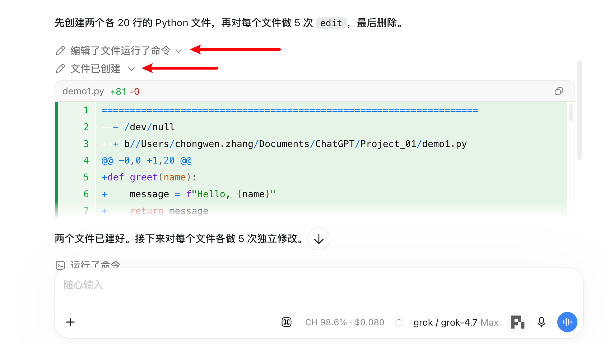
    </td>
    <td width="50%" valign="top">
      <p><strong>Usage at a glance</strong><br /><sub>Cache hit rate, cost estimate and context usage, live</sub></p>
      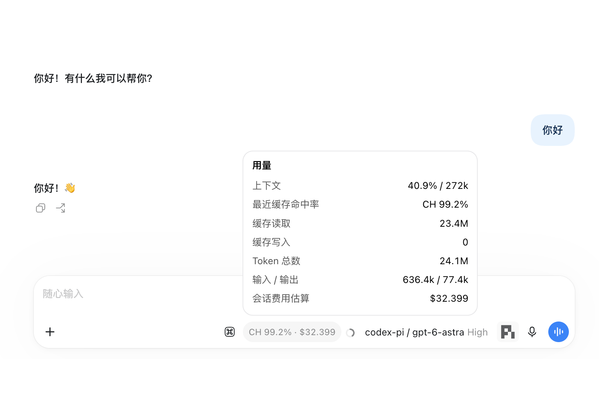
    </td>
  </tr>
  <tr>
    <td width="50%" valign="top">
      <p><strong>One-click account import</strong><br /><sub>Copy your locally signed-in Codex and Grok credentials to Pi, with live quota</sub></p>
      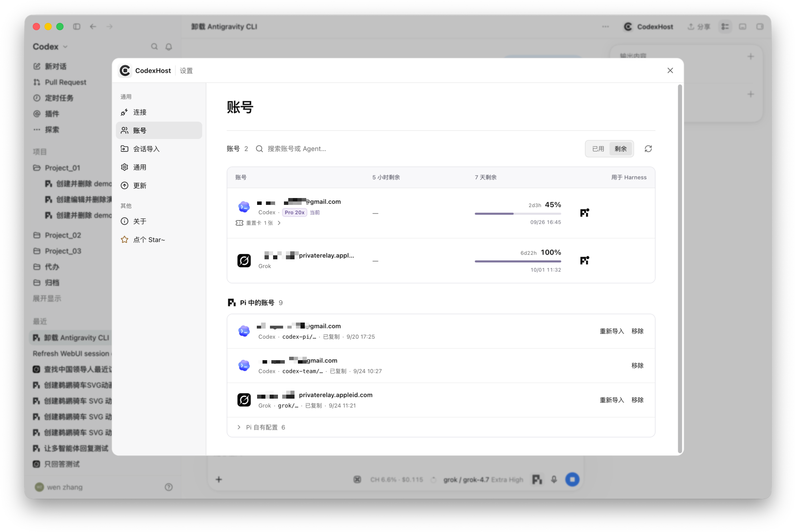
    </td>
    <td width="50%" valign="top">
      <p><strong>Better than a terminal</strong><br /><sub>Left: Codex Desktop + Pi renders the Mermaid diagram; right: the Pi TUI only shows the source</sub></p>
      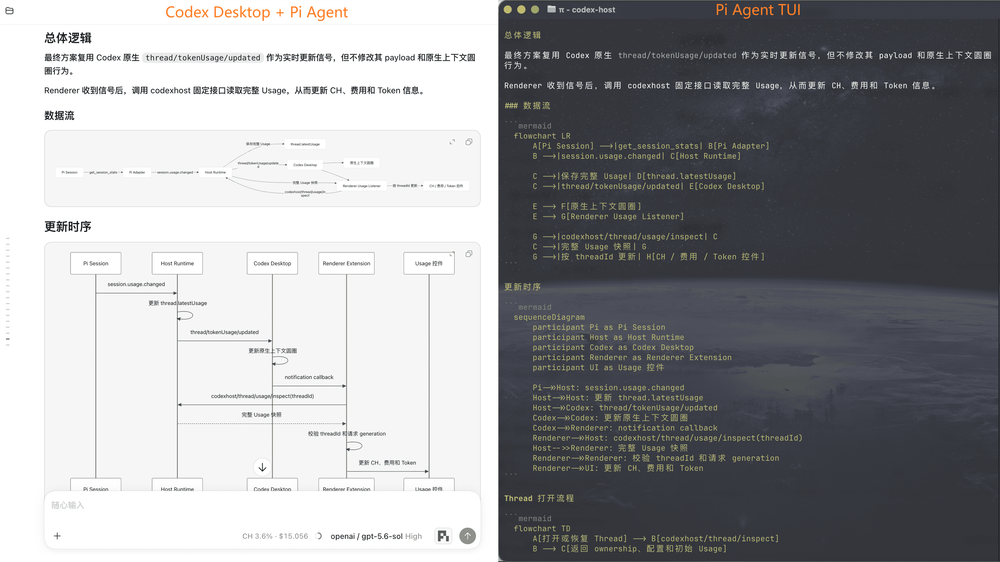
    </td>
  </tr>
</table>

</details>

<details>
<summary>Feature support by Agent</summary>

| Capability | <a href="https://pi.dev/"></a> | <a href="https://github.com/can1357/oh-my-pi"></a> | <a href="https://code.claude.com/docs/en/quickstart"></a> | <a href="https://opencode.ai/docs/"></a> | <a href="https://grok.com/"></a> | <a href="https://github.com/deepseek-ai/deepseek-harness"></a> | <a href="https://antigravity.google/product/antigravity-cli"></a> | <a href="https://www.codebuddy.cn/home/"></a> | <a href="https://www.workbuddy.ai/docs/workbuddy/Quickstart"></a> | <a href="https://cursor.com/docs/cli/overview"></a> | <a href="https://hermes-agent.nousresearch.com/docs"></a> | <a href="https://qoder.com/cli"></a> | <a href="https://moonshotai.github.io/kimi-code/"></a> | <a href="docs/harnesses/copilot/copilot-harness-integration.md">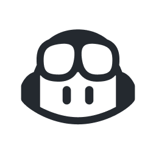</a> | <a href="https://github.com/QwenLM/qwen-code"></a> | <a href="docs/harnesses/devin/devin-cli-acp-integration.md"></a> |
| :--- | :---: | :---: | :---: | :---: | :---: | :---: | :---: | :---: | :---: | :---: | :---: | :---: | :---: | :---: | :---: | :---: |
| Streaming responses | ✅ | ✅ | ✅ | ✅ | ✅ | ✅ | ✅ | ✅ | ✅ | ✅ | ✅ | ✅ | ✅ | ✅ | ✅ | ✅ |
| Tool status | ✅ | ✅ | ✅ | ✅ | ✅ | ✅ | ✅ | ✅ | ✅ | ✅ | ✅ | ✅ | ✅ | ✅ | ✅ | ✅ |
| Edit Diff | ✅ | ✅ | ✅ | ✅ | ✅ | ✅ | ✅ | ✅ | ✅ | ✅ | ✅ | ✅ | ✅ | ✅ | — | ✅ |
| Questions / cancellation | ✅ | ✅ | ✅ | ✅ | ✅ | ✅ | ✅ | ✅ | ✅ | ✅ | ✅ | ✅ | ✅ | ✅ | ✅ | — / ✅ |
| Model / Thinking selection | ✅ | ✅ | ✅ | ✅ | ✅ | ✅ | ✅ | ✅ | ✅ | ✅ | ✅ | ✅ | ✅ | ✅ | ✅ / — | ✅ / ◐ |
| Tool approvals | ✅ | ✅ | ✅ | ✅ | ✅ | ✅ | — | ✅ | ✅ | ✅ | ✅ | ✅ | ✅ | ✅ | ✅ | ✅ |
| Permission modes | — | ✅ | ✅ | ✅ | ✅ | ✅ | ✅ | ✅ | ✅ | ✅ | ✅ | ✅ | ✅ | ✅ | ✅ | ✅ |
| Cross-Agent task collaboration | ✅ | ✅ | ✅ | ✅ | ✅ | ✅ | ✅ | ✅ | — | ✅ | ✅ | ✅ | ✅ | ✅ | ✅ | ◐ |
| Usage | ✅ | ✅ | ✅ | ✅ | ✅ | ✅ | ✅ | ✅ | ✅ | — | ✅ | ✅ | ✅ | ✅ | ✅ | — |
| Fork | ✅ | ✅ | ✅ | ✅ | ✅ | ✅ | ✅ | ✅ | ✅ | ✅ | ✅ | ✅ | ◐ | ✅ | — | ◐ |
| Context compaction | ✅ | ✅ | ✅ | ✅ | ✅ | ✅ | — | ✅ | ✅ | — | ✅ | ✅ | ✅ | ✅ | — | — |
| Slash commands | ✅ | ✅ | ✅ | ✅ | ✅ | ✅ | ✅ | ✅ | ✅ | ✅ | ✅ | ✅ | ✅ | — | — | — |
| Edit previous message | ✅ | ✅ | ✅ | ✅ | ✅ | ✅ | ✅ | ✅ | ✅ | ✅ | ✅ | ✅ | ✅ | ✅ | — | ◐ |

</details>

<a id="collaboration"></a>

## Agents hand work to each other

Type `#` in the chat input, pick an Agent, and hand it a self-contained task:

> Have `#claude-code` review this change on its own and flag any compatibility risks.
>
> Have `#pi` figure out why this test is flaky.
>
> Have `#omp` implement this feature while I keep working on the docs.

Every delegated task runs as a separate native session in the target Agent. It shows up in the conversation list, so you can open it anytime to check progress or continue the conversation. When it finishes, the result returns to the session that started it.

<table>
  <tr>
    <td width="50%" valign="top">
      <p><strong>Agents work in parallel</strong><br /><sub>Each in its own session, without interfering</sub></p>
      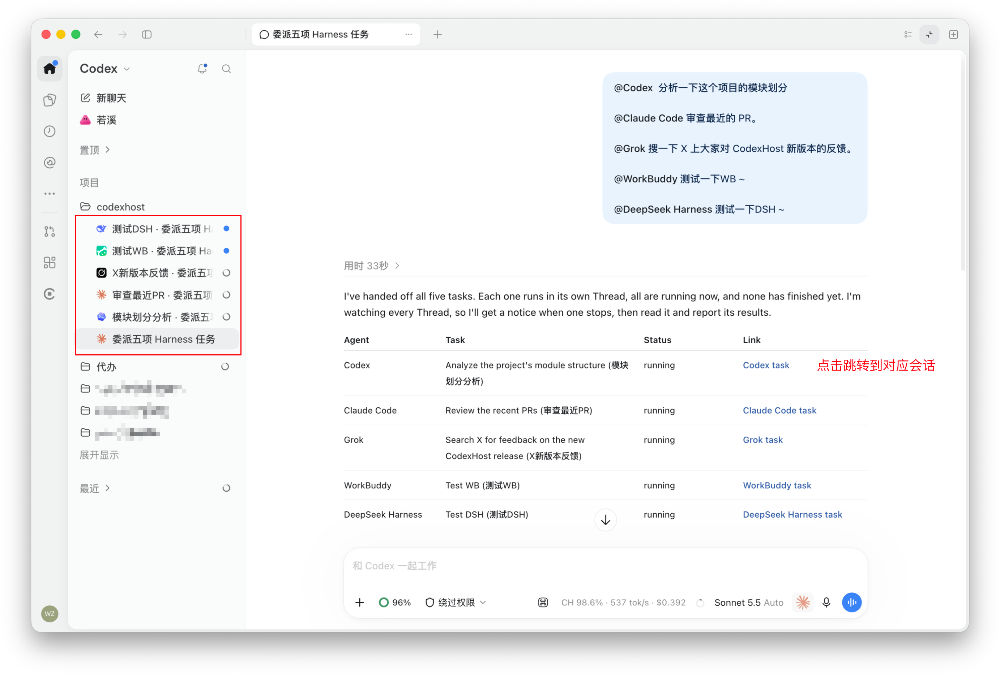
    </td>
    <td width="50%" valign="top">
      <p><strong>Reports back when done</strong><br /><sub>The originating session is notified when a delegated task ends</sub></p>
      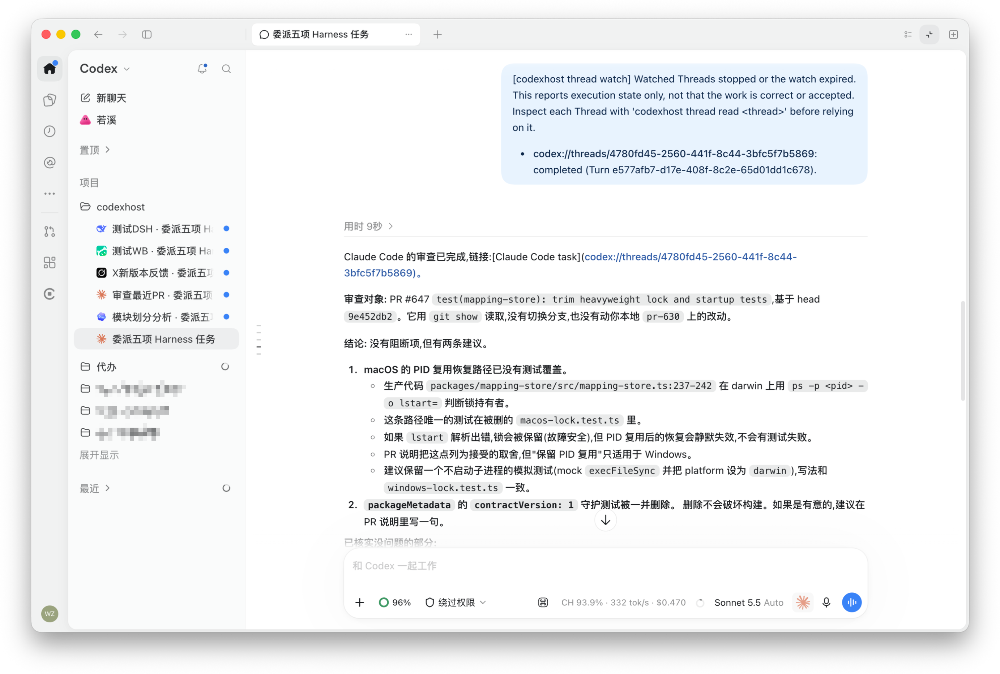
    </td>
  </tr>
</table>

**For developers:** local programs such as terminal scripts, Claude Desktop and always-on bots can also hand tasks to these Agents and wait for results through the `codexhost delegate` / `codexhost thread` commands or MCP. See [external clients](docs/architecture/external-clients.md).

<details>
<summary><h3 id="remote-harness">Advanced: use Agents on another machine from your local UI</h3></summary>

Tasks run on the other machine while the UI stays in your local Codex Desktop. Both machines need the same CodexHost version.

| Remote machine | How to connect |
| --- | --- |
| macOS / Linux | [SSH](#ssh) |
| Windows | [Remote Control](#remote-control-experimental) (experimental) |

#### SSH

Before you start, add the remote machine in Codex Desktop under **Settings → Connections → SSH**. Your local machine can run macOS, Linux or Windows.

<div align="center">
  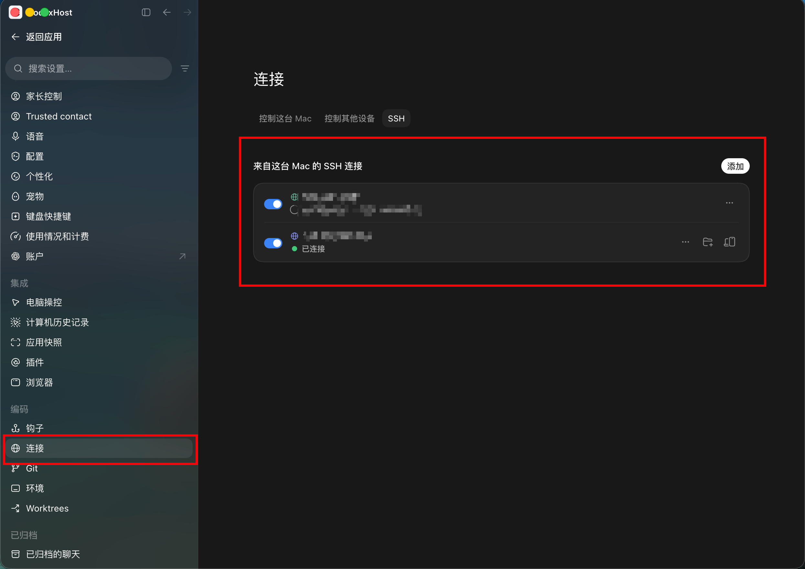
</div>

1. Install and start codexhost on the remote machine:

   ```bash
   npm install -g @codexhost/cli
   codexhost remote install
   codexhost remote start
   codexhost remote status
   ```

2. On your local machine, launch Codex Desktop through codexhost and open the SSH workspace.
3. Pick an Agent from the composer's Agent / Model selector.

[SSH setup, diagnostics and uninstall →](docs/platforms/remote/remote-ssh-host.md)

#### Remote Control (Experimental)

Use Agents on a Windows machine from another computer, built on the pairing and sign-in of Codex Desktop's official Remote Control.

Before you start, make sure official Remote Control can already run Codex tasks. No public services or ports are opened, and Agent credentials never leave the Windows machine.

[Remote Control setup, transport boundary and diagnostics →](docs/platforms/remote/remote-control-host.md)

</details>

<a id="join-the-community"></a>

## 微信交流群

<table align="center">
  <tr>
    <td>
      <strong>微信交流群</strong><br />
      <sub>Scan the QR code to add me on WeChat (note “CodexHost”) and I will invite you to our WeChat group.</sub>
      <ul>
        <li><sub>Get help with installation</sub></li>
        <li><sub>Share feature ideas and feedback</sub></li>
        <li><sub>Talk about development</sub></li>
        <li><sub>For bugs, please open an <strong>issue</strong></sub></li>
      </ul>
      <sub><strong>Contributions are welcome.</strong></sub>
    </td>
    <td align="center">
      
    </td>
  </tr>
</table>

<details>
<summary><h3>Architecture and development</h3></summary>

#### How it works

Most multi-agent clients build their own chat UI and plug Agents in through a common protocol. CodexHost does it differently:

- **Desktop:** extends the official Codex Desktop via CDP / Electron Inspector, with no rebuilt chat UI and no patched installer
- **Protocol:** a CLI Shim sits in front of the official app-server and passes native Codex requests through untouched
- **Agents:** each Agent is integrated through its own native interface where one exists (Pi over RPC, Claude Code via the Agent SDK), falling back to [ACP](https://agentclientprotocol.com/) otherwise. Streaming, tool status, diffs, approvals and questions all render in Codex Desktop's native UI
- **Orchestration:** delegated tasks run as independent native sessions in the target Agent; the caller can wait for the result or let it run in the background
- **Web:** Desktop and Web connect to the same background Host, so there is one copy of each session, approval and question, and both sides see the same state

#### Development

Please read the [contributing guide](CONTRIBUTING.md) before opening an issue or PR. See [repository maintenance automation](docs/operations/repository-maintenance.md) for PR title labels, CI summaries and pre-release checks.

Requirements: the official Codex Desktop, Node.js 22.19+ or 24, and Rust.

```bash
git clone https://github.com/BytePioneer-AI/codex-host
cd codex-host
npm ci
npm start
```

| Command | Purpose |
| --- | --- |
| `npm start` | Build and start Desktop. |
| `npm start web` | Build and start Web with Web UI hot reload (default). |
| `npm start web -- --no-watch` | Build and start Web without hot reload. |
| `npm stop` | Stop the current user's local codexhost services across worktrees. |

#### Runtime architecture

Using Pi as an example, here is how a single request flows from left to right: Desktop → shared layer → Pi plugin → native process.

<div align="center">
  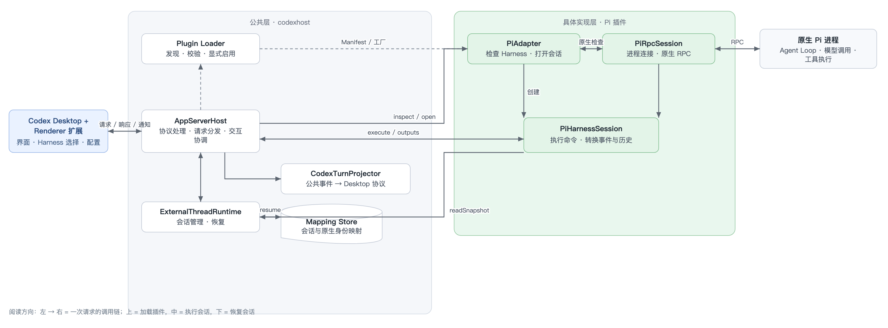
</div>

#### Adding a Harness

Most of the work is implementing the plugin's Manifest, factory, Adapter and Session, plus the native communication and translation logic. The Renderer still has some hard-coded wiring, so full Desktop integration takes extra work.
Tip: point your coding Agent at the in-repo [codexhost-add-harness Skill](.agents/skills/codexhost-add-harness/SKILL.md). It covers plugin structure, the shared Adapter interface, capability implementation and testing requirements.

</details>

## Acknowledgements

- Thanks to the [LINUX DO](https://linux.do/) community for their ongoing support.
- Thanks to [Paseo](https://github.com/getpaseo/paseo), whose approach to multi-Harness integration and architecture inspired ours.
- Thanks to [DSH (DeepSeek Harness)](https://github.com/deepseek-ai/deepseek-harness); CodexHost's Web client is built on DSH Web.

## Contributors

Thanks to everyone who has contributed to CodexHost.

<a href="https://github.com/BytePioneer-AI/codex-host/graphs/contributors">
  
</a>

## Star History

<a href="https://www.star-history.com/?repos=bytepioneer-ai%2Fcodex-host&type=date&legend=top-left">
  <picture>
    <source media="(prefers-color-scheme: dark)" srcset="https://api.star-history.com/chart?repos=bytepioneer-ai/codex-host&type=date&theme=dark&legend=top-left" />
    <source media="(prefers-color-scheme: light)" srcset="https://api.star-history.com/chart?repos=bytepioneer-ai/codex-host&type=date&legend=top-left" />
    
  </picture>
</a>

