<div align="center">

<p>
  <picture>
    <source media="(prefers-color-scheme: dark)" srcset="docs/imgs/readme-lockup-dark.png" />
    <source media="(prefers-color-scheme: light)" srcset="docs/imgs/readme-lockup-light.png" />
    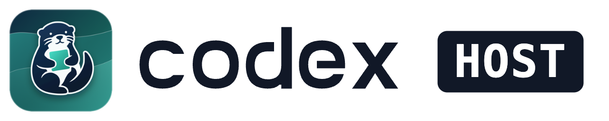
  </picture>
</p>

<p>
  <strong>English</strong> ·
  <a href="docs/project/README.zh-CN.md">简体中文</a> ·
  <a href="docs/project/README.ko.md">한국어</a>
</p>

<h2>Run every coding agent, as one workspace.</h2>

<p>
  Unify <b>Codex</b>, <b>Claude Code</b>, <b>Pi</b>, <b>Grok</b>, and 15+ more coding agents in one workbench —<br />
  ships with a standalone desktop app (no official Codex Desktop required), optionally enhances the official client, and syncs live across Web, Mobile, and remote machines.
</p>

<p>
  <b><a href="https://chost.dev/en/download">Download CodexHost</a></b> &nbsp;·&nbsp;
  <b><a href="https://chost.dev/en">Website →</a></b> &nbsp;·&nbsp;
  <a href="docs">Docs</a> &nbsp;·&nbsp;
  <a href="#community">Community</a>
</p>

<br />

<picture>
  <source media="(prefers-color-scheme: dark)" srcset="docs/imgs/readme-hero-en-dark.png" />
  <source media="(prefers-color-scheme: light)" srcset="docs/imgs/readme-hero-en-light.png" />
  
</picture>

</div>

---

<a id="sponsors"></a>

<details open>
<summary><b>Sponsors</b></summary>

<br />

<table>
<tr>
<td width="160" align="center"><a href="https://vibeapi.cc/sign-up?aff=AOYp">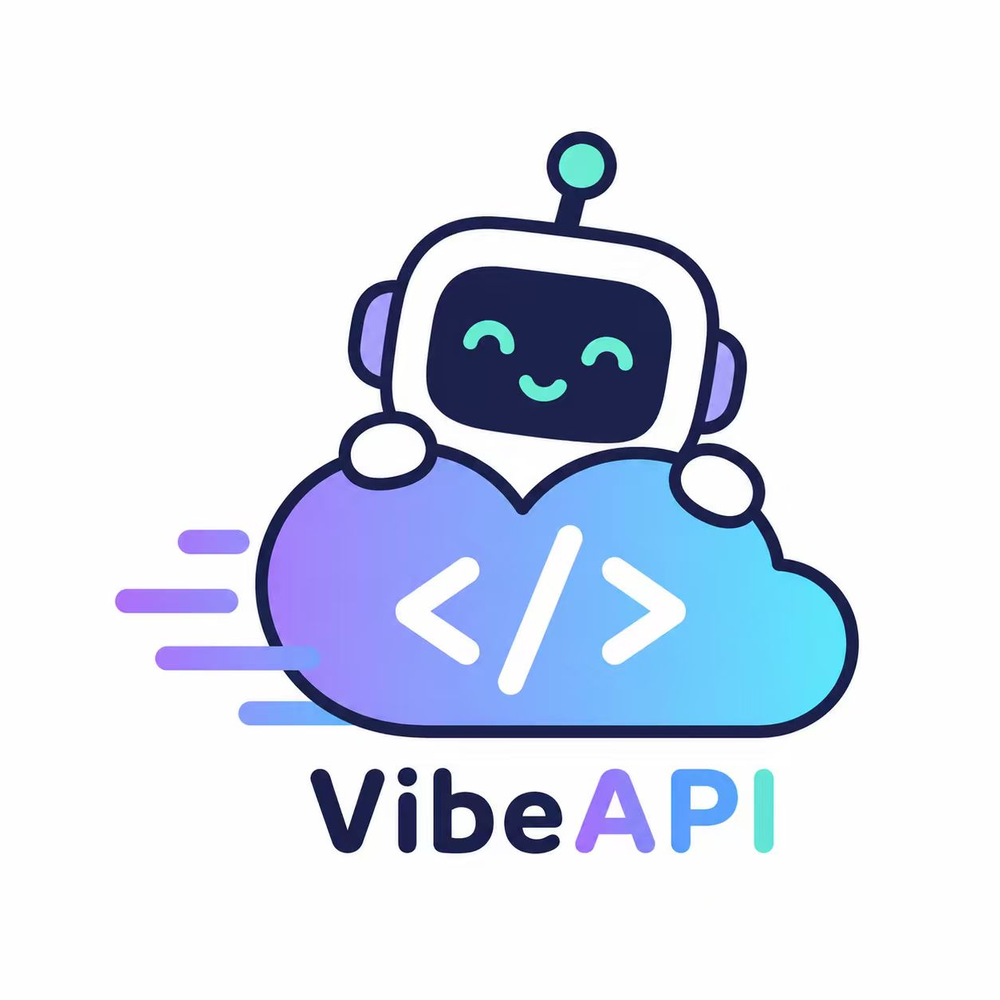</a></td>
<td>Thanks to <b>VibeAPI</b> for sponsoring CodexHost! Built for developers and teams, VibeAPI provides unified access to Codex, Claude, and leading AI models with a traceable self-managed account pool, 99.9% SLA, 95%+ cache hit rate, 24/7 human support, and enterprise invoicing. <a href="https://vibeapi.cc/sign-up?aff=AOYp">Learn more about VibeAPI →</a></td>
</tr>
</table>

</details>

---

## Key Capabilities

<table>
<tr>

<td width="25%" valign="top">

### Lightweight & Synced

Ships with a lightweight standalone app and also enhances official Codex Desktop.

Standalone, official Desktop, Web, and mobile stay live-synced in real time.

</td>

<td width="25%" valign="top">

### Real Agent Teamwork

Type `#` to dispatch parallel native child sessions that report back automatically.

Hand off full context across agents mid-task.

</td>

<td width="25%" valign="top">

### Multi-Machine Mesh

Bring Mac, Linux, and Windows into one sidebar—delegate across machines and collaborate across nodes.

Approve and reply from your phone anywhere.

</td>

<td width="25%" valign="top">

### Native First-Class

Built on each agent's native **SDK / RPC**; even over **ACP**, native APIs and CLIs fill in full capabilities.

Reuses your local logins—no extra account or third-party proxy.

</td>

</tr>
</table>

---

<a id="download--install"></a>

## Download & Install

### 1. Installers & Apps (Recommended)

<table>
<tr>
<td width="50%" align="center">

[**Download from Website (Recommended) →**](https://chost.dev/en/download)<br /><sub>macOS · Windows · Linux · Android · iOS (PWA)</sub>

</td>
<td width="50%" align="center">

[**GitHub Releases →**](https://github.com/BytePioneer-AI/codex-host/releases/latest)<br /><sub>All release binaries · <a href="docs/platforms/linux/linux.md">Linux Guide</a></sub>

</td>
</tr>
</table>

Windows WinGet: `winget install --id BytePioneer-AI.CodexHost --exact`

> [!NOTE]
> **macOS "App can't be verified" on first launch**: run `xattr -dr com.apple.quarantine /Applications/codexhost.app` in Terminal.

### 2. npm

```bash
npm install -g @codexhost/cli
```

```bash
codexhost          # Launch desktop (standalone app or enhanced official Codex Desktop)
codexhost app      # Open the lightweight standalone app directly
codexhost web      # Start local Web UI
codexhost status   # Check service status
codexhost update   # Upgrade to the latest release
codexhost stop     # Stop background services (run before npm reinstall)
```

<details>
<summary><b>More troubleshooting (Local Console / Windows portable Codex Desktop)</b></summary>

<br />

- **Launch failed or official Codex Desktop opened without CodexHost**: run `codexhost console` (Windows: Start Menu → `codexhost console`) to open `http://127.0.0.1:4399/` for logs, version detection, and updates.
- **Windows: portable unpacked Codex Desktop**: set `CODEXHOST_INSTALL_ROOT` to your unpacked directory, exit all running processes, reopen your terminal, and run `codexhost`:
  ```powershell
  [Environment]::SetEnvironmentVariable("CODEXHOST_INSTALL_ROOT", "D:\CodexPortable", "User")
  ```

</details>

---

## One Host, Three Ways to Work

A single local Host keeps sessions, approvals, queues, and extensions as one source of truth across every client:

<table>
<tr>

<td width="33%" valign="top">

### Lightweight Standalone App

**Ready out of the box, lighter footprint.**

Native Tauri desktop client that works on macOS, Windows, and Linux without requiring official Codex Desktop.

</td>

<td width="33%" valign="top">

### Official Codex Enhanced

**Keep your habits, multiply your agents.**

Enhances official Codex Desktop non-invasively without modifying its installer—preserving native diff review, worktrees, and approvals.

</td>

<td width="33%" valign="top">

### Web & Mobile

**Stay in reach away from your desk.**

Full responsive Web UI paired with the native Android APK and iOS PWA to inspect progress, approve commands, and reply anywhere.

</td>

</tr>
</table>

<p align="center">
  <picture>
    <source media="(prefers-color-scheme: dark)" srcset="docs/imgs/readme-ch-desktop-en-dark.png" />
    <source media="(prefers-color-scheme: light)" srcset="docs/imgs/readme-ch-desktop-en-light.png" />
    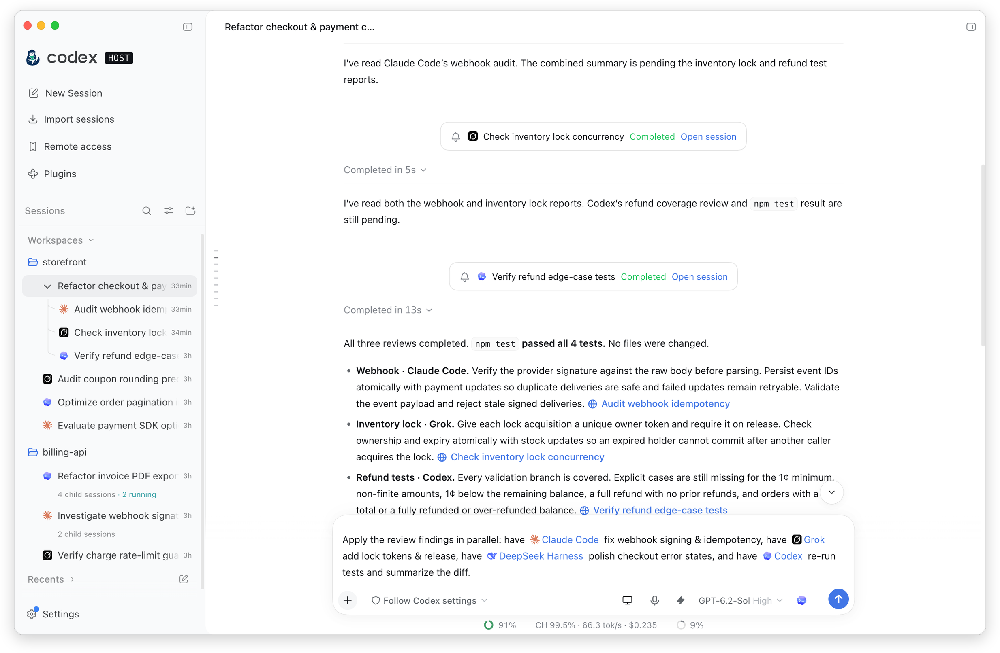
  </picture>
  <sub>Lightweight CodexHost standalone desktop app — shares one local Host with the Codex Desktop view above, syncing the exact same sessions, delegation trees, and live status in real time.</sub>
</p>

<p align="center">
  <picture>
    <source media="(prefers-color-scheme: dark)" srcset="docs/imgs/readme-feat-mobile-en-dark.png" />
    <source media="(prefers-color-scheme: light)" srcset="docs/imgs/readme-feat-mobile-en-light.png" />
    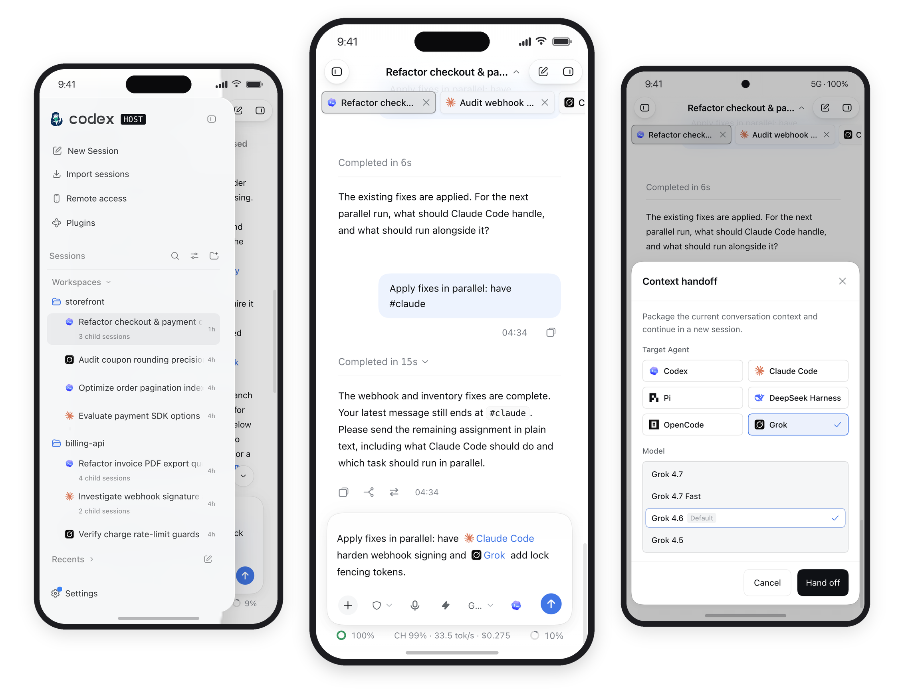
  </picture>
  <sub><b>Mobile Companion (Android APK / iOS PWA)</b> — browse workspaces &amp; delegation trees, review multi-agent updates, and trigger cross-agent handoffs right from your phone.</sub>
</p>

<p align="center">
  <picture>
    <source media="(prefers-color-scheme: dark)" srcset="docs/imgs/readme-diagram-arch-en-dark.svg" />
    <source media="(prefers-color-scheme: light)" srcset="docs/imgs/readme-diagram-arch-en-light.svg" />
    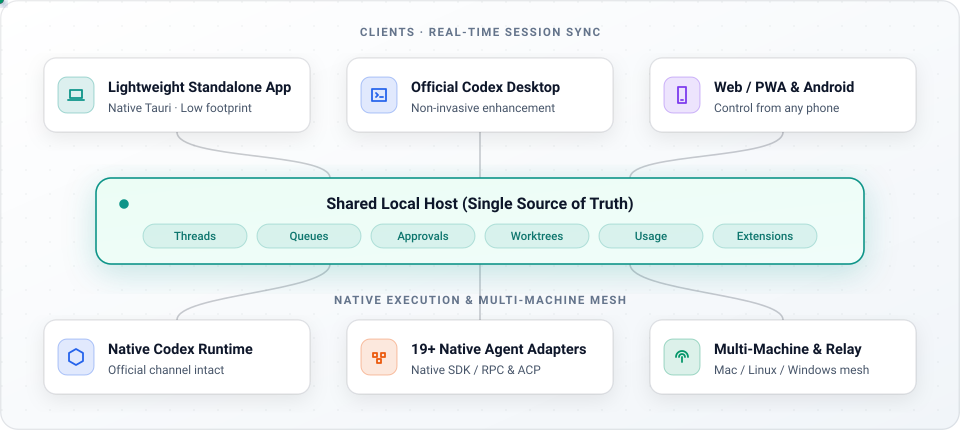
  </picture>
</p>

---

## Multi-Agent Teamwork: Delegate & Hand Off

When one agent isn't enough—or different tasks fit different models—type `#` in the composer to spin up isolated native child sessions in parallel, or use **[Cross-Harness Handoff](docs/architecture/cross-harness-handoff.md)** to transfer full conversation context cleanly to another agent mid-thread.

<p align="center">
  <picture>
    <source media="(prefers-color-scheme: dark)" srcset="docs/imgs/readme-diagram-teamwork-en-dark.svg" />
    <source media="(prefers-color-scheme: light)" srcset="docs/imgs/readme-diagram-teamwork-en-light.svg" />
    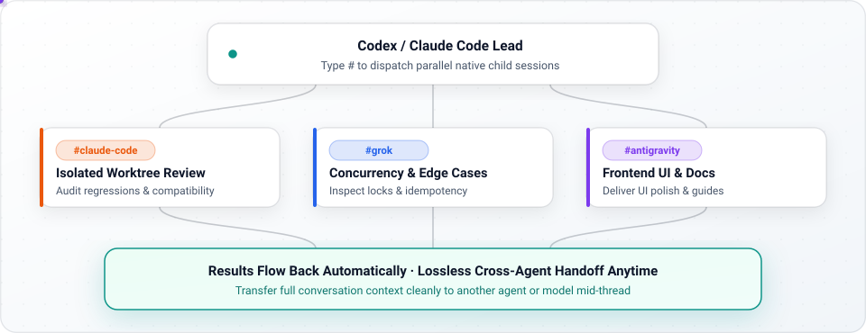
  </picture>
</p>

> Ask `#claude-code` to review this diff independently and call out compatibility risks.  
> Ask `#grok` to audit concurrency and edge-case risks in this module.  
> Ask `#antigravity` to build the frontend view and update the docs.

<p align="center">
  <picture>
    <source media="(prefers-color-scheme: dark)" srcset="docs/imgs/readme-feat-hash-menu-en-dark.png" />
    <source media="(prefers-color-scheme: light)" srcset="docs/imgs/readme-feat-hash-menu-en-light.png" />
    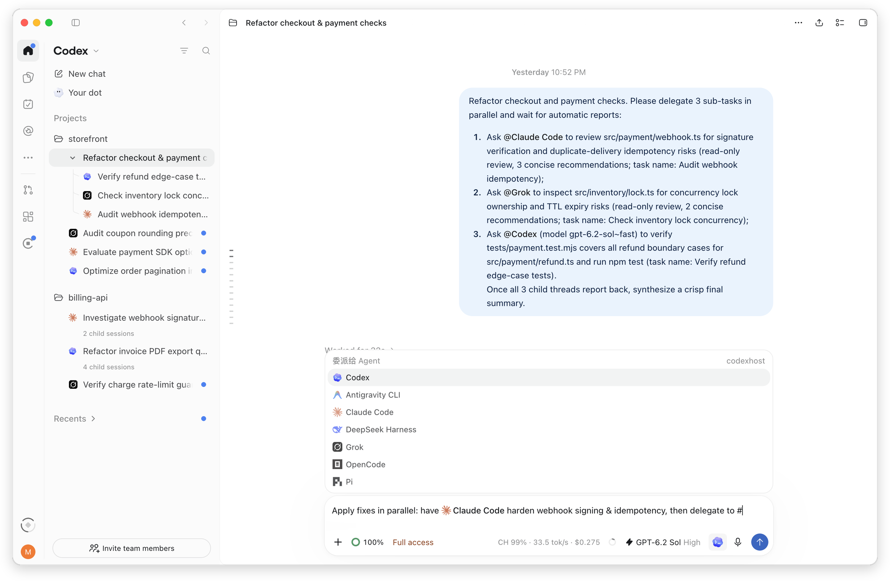
  </picture>
  <sub>Type <code>#</code> to summon every locally available agent (Codex, Antigravity CLI, Claude Code, DeepSeek Harness, Grok, OpenCode, Pi, and more) and delegate parallel child sessions right from the composer.</sub>
</p>

<p align="center">
  <picture>
    <source media="(prefers-color-scheme: dark)" srcset="docs/imgs/readme-feat-handoff-en-dark.png" />
    <source media="(prefers-color-scheme: light)" srcset="docs/imgs/readme-feat-handoff-en-light.png" />
    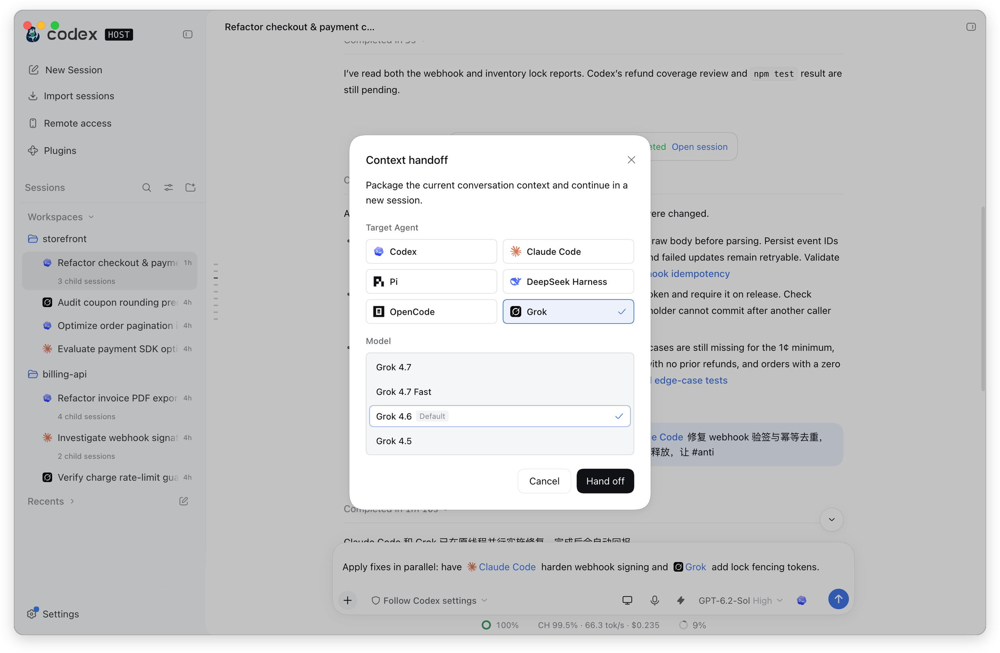
  </picture>
  <sub><b>Cross-Agent Context Handoff</b> — pick a target agent and model on any turn to continue with full conversation context intact.</sub>
</p>

---

## Native Workbench: Diff Review, Plugins & Usage

<p align="center">
  <picture>
    <source media="(prefers-color-scheme: dark)" srcset="docs/imgs/readme-feat-diff-en-dark.png" />
    <source media="(prefers-color-scheme: light)" srcset="docs/imgs/readme-feat-diff-en-light.png" />
    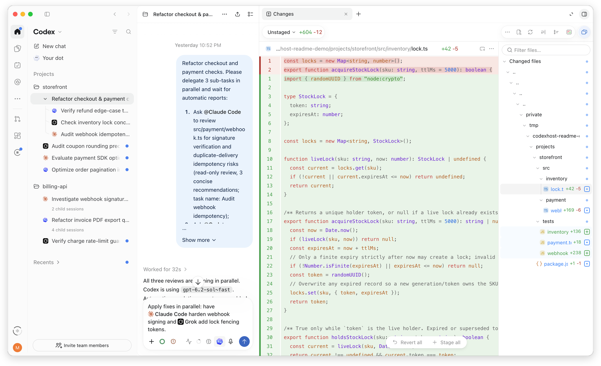
  </picture>
  <sub><b>Native Git Diff Review</b> — inspect unstaged changes (<code>+604 -12</code>), changed files tree, and line-by-line hunks right next to active multi-agent sessions, with one-click stage or revert.</sub>
</p>

<table>
  <tr>
    <td width="50%" valign="top">
      <p><strong>Cross-Client Plugin Marketplace</strong><br /><sub>Install themes, MCP Sync Hub, Sidebar Thread Tree, and Context Insights across both Codex Desktop and CH Web</sub></p>
      <picture>
        <source media="(prefers-color-scheme: dark)" srcset="docs/imgs/readme-feat-plugins-en-dark.png" />
        <source media="(prefers-color-scheme: light)" srcset="docs/imgs/readme-feat-plugins-en-light.png" />
        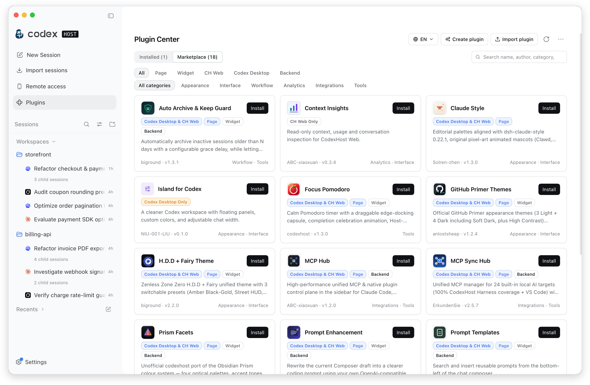
      </picture>
    </td>
    <td width="50%" valign="top">
      <p><strong>Unified Multi-Agent Usage & Cost</strong><br /><sub>Track spend, tokens, cache hit rate, and trends across Codex, Grok, Claude Code, and OpenCode — exportable to CSV</sub></p>
      <picture>
        <source media="(prefers-color-scheme: dark)" srcset="docs/imgs/readme-feat-usage-en-dark.png" />
        <source media="(prefers-color-scheme: light)" srcset="docs/imgs/readme-feat-usage-en-light.png" />
        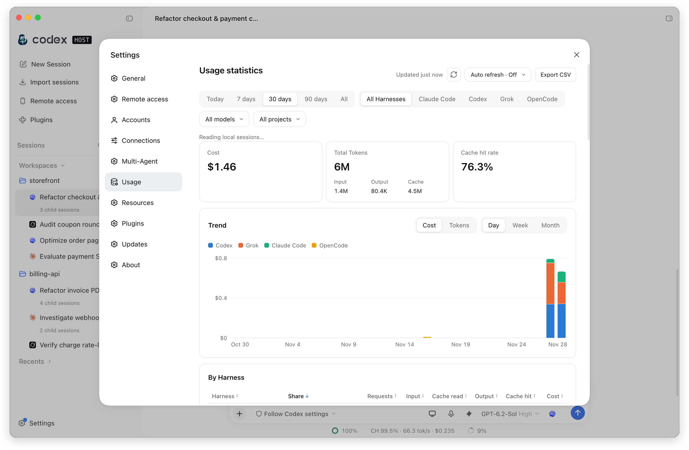
      </picture>
    </td>
  </tr>
</table>

---

## Step Away. Every Machine Stays Within Reach.

<p align="center">
  <picture>
    <source media="(prefers-color-scheme: dark)" srcset="docs/imgs/readme-diagram-mesh-en-dark.svg" />
    <source media="(prefers-color-scheme: light)" srcset="docs/imgs/readme-diagram-mesh-en-light.svg" />
    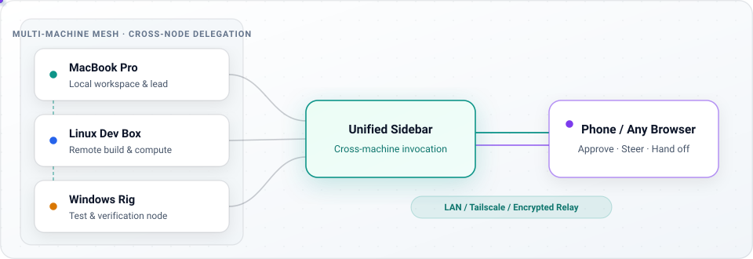
  </picture>
</p>

- **[Multi-Machine Interconnection & Cross-Node Collaboration](docs/product/multi-remote-peers.md)**: Link Macs, Linux servers, and Windows workstations into one unified sidebar—sessions on different machines can invoke each other so multiple nodes collaborate to finish one task together.
- **[Scan-to-Connect Mobile Access](docs/product/web-remote-access.md)**: Connect over LAN, Tailscale, or encrypted Relay with zero port forwarding; deploy a **[Self-Hosted Relay](docs/product/self-hosted-relay.md)** on your own infrastructure whenever compliance requires it.
- **Local-First Privacy**: Your code, threads, and agent credentials stay on your own machines and connect directly to official providers—never proxied through third-party servers.

<details>
<summary><b>Advanced: SSH Remote & Windows Remote Control</b></summary>

<br />

You can also reuse official Codex Desktop remote channels to control agents on another machine (both sides must run the same CodexHost version):
- **macOS / Linux (SSH Remote)**: run `codexhost remote install && codexhost remote start` on the remote host — see [SSH Remote Guide →](docs/platforms/remote/remote-ssh-host.md)
- **Windows (Remote Control · Experimental)**: reuses official Remote Control pairing without opening public ports — see [Remote Control Guide →](docs/platforms/remote/remote-control-host.md)

</details>

---

<a id="supported-agents"></a>

## Supported Agents

Native **Codex** plus **19+ preinstalled coding agents** connected through official SDKs, RPC, and [ACP](https://agentclientprotocol.com/)—reusing the CLIs and credentials already logged in on your machine:

<p align="center">
  <a href="https://openai.com/codex/"></a>
  <a href="https://code.claude.com/docs/en/quickstart"></a>
  <a href="https://pi.dev/"></a>
  <a href="https://opencode.ai/docs/"></a>
  <a href="https://grok.com/"></a>
  <a href="https://github.com/can1357/oh-my-pi"></a><br />
  <a href="https://github.com/deepseek-ai/deepseek-harness"></a>
  <a href="https://github.com/QwenLM/qwen-code"></a>
  <a href="https://docs.devin.ai/cli"></a>
  <a href="https://antigravity.google/product/antigravity-cli"></a>
  <a href="https://kiro.dev/docs/cli/"></a>
  <a href="https://www.codebuddy.cn/home/"></a><br />
  <a href="https://www.workbuddy.ai/docs/workbuddy/Quickstart"></a>
  <a href="https://cursor.com/docs/cli/overview"></a>
  <a href="https://hermes-agent.nousresearch.com/docs"></a>
  <a href="https://qoder.com/cli"></a>
  <a href="https://moonshotai.github.io/kimi-code/"></a>
  <a href="https://zcode.z.ai/"></a>
  <a href="docs/harnesses/copilot/copilot-harness-integration.md"></a>
</p>

<p align="center">
  <a href="docs/harnesses/capability-boundaries.md"><strong>Capability Boundaries →</strong></a> &nbsp;·&nbsp;
  <a href=".agents/skills/codexhost-add-harness/SKILL.md">Build a custom Harness →</a>
</p>

---

<a id="community"></a>

## Community

- **GitHub**: Report bugs or request new agent adapters via [Issues](https://github.com/BytePioneer-AI/codex-host/issues), and share workflows or ideas in [Discussions](https://github.com/BytePioneer-AI/codex-host/discussions).
- **WeChat Group**: Scan the QR code below with note **"CodexHost"** to join the developer community group.

<details>
<summary><b>Show WeChat Group QR Code</b></summary>

<br />

<p align="center">
  
</p>

</details>

<details>
<summary><b>Build from Source & Development</b></summary>

<br />

Requirements: Node.js 22.19+ or 24, Rust (plus official Codex Desktop if developing the enhanced desktop mode). See [CONTRIBUTING.md](CONTRIBUTING.md) and [Repository Maintenance](docs/operations/repository-maintenance.md).

```bash
git clone https://github.com/BytePioneer-AI/codex-host
cd codex-host
npm ci
npm run start:app   # Launch standalone Desktop
```

| Command | Purpose |
| :--- | :--- |
| `npm run start:app` | Build and launch standalone Desktop |
| `npm run start:web` | Build and launch standalone Web UI (hot reload enabled) |
| `npm start` | Build and launch official Codex Desktop enhanced mode |
| `npm stop` | Stop local codexhost background services for the current user |

</details>

---

## Acknowledgements & Contributors

Thanks to the [LINUX DO](https://linux.do/) community, [Paseo](https://github.com/getpaseo/paseo) (multi-harness architecture inspiration), [DSH (DeepSeek Harness)](https://github.com/deepseek-ai/deepseek-harness) (Web UI foundation), and everyone contributing to CodexHost.

<a href="https://github.com/BytePioneer-AI/codex-host/graphs/contributors">
  
</a>

## Star History

<a href="https://www.star-history.com/?repos=bytepioneer-ai%2Fcodex-host&type=date&legend=top-left">
  <picture>
    <source media="(prefers-color-scheme: dark)" srcset="https://api.star-history.com/chart?repos=bytepioneer-ai/codex-host&type=date&theme=dark&legend=top-left" />
    <source media="(prefers-color-scheme: light)" srcset="https://api.star-history.com/chart?repos=bytepioneer-ai/codex-host&type=date&legend=top-left" />
    
  </picture>
</a>

## License

Released under the [LGPL-3.0](LICENSE) License.
