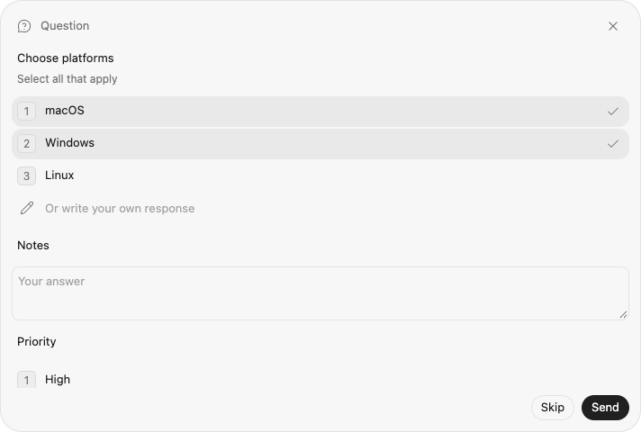
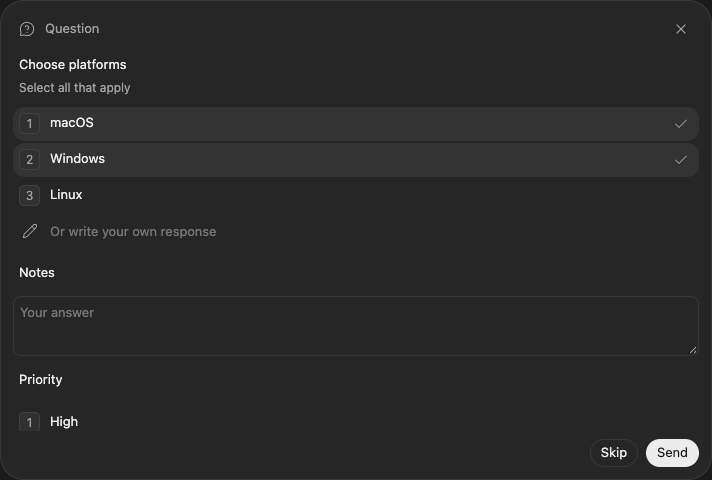

# External Harness multi-select questions

External Harness interactions containing at least one choice field with `multiple: true` use a shared codexhost card above the active chat Composer. The complete interaction stays together: any accompanying single-choice and non-secret text fields are answered in the same card. Other interactions, including single-choice questions with Other, plain text questions, and tool approvals, retain the existing native Desktop projection. Official Codex traffic is unchanged.

## Ownership and answers

Adapters keep emitting the existing `HostQuestionInteraction` contract. No Harness-specific protocol or optional native capability is added by the UI. The card returns declared Host option **values**, not display labels; the Adapter remains responsible for its native response format.

The Host retains shared cards in the same pending-question lifecycle as native questions. Synthetic tool items and their completion remain projected into Desktop, but a shared group is never also sent as `item/tool/requestUserInput`.

- `codexhost/thread/questions/list` takes `{ threadId }` and returns `{ questions }` for the loaded external Thread's active Turn only. It does not resume sessions, start work, or query the official app-server. Unknown/official Threads return an empty list.
- `codexhost/thread/question/respond` takes `{ threadId, turnId, interactionId, answers, cancelled? }`. The Host checks the live owner, active Turn, pending interaction and expiry, then validates required answers, declared values, cardinality and duplicate values before calling `interaction.respond`.
- Cancellation must contain no answers. A rejected validation leaves the card pending. Answer delivery uses the existing per-Thread request queue, so it cannot overlap a queued interruption; unrelated Threads remain responsive. Duplicate submissions are rejected after the first delivery. Successful delivery retires the question; ambiguous Adapter exceptions retire it rather than allowing a second write.
- Native withdrawal, Turn completion, Session cleanup and existing Host `expiresAt` handling retire pending cards. Late/replayed responses are rejected. A guessed native response ID cannot answer a shared card.
- Existing shared-Thread routing carries these methods to the Session owner; multiple GUI viewers do not create multiple native questions or permit duplicate answers.

Secret text remains unsupported and fails closed, including in a mixed multi-select group. This feature does not expose Grok-specific countdowns, activity resets, plan actions or native preview controls. It does not change what Pi, OMP or another single-choice-only Harness can ask.

## Grok integration

The [Grok Adapter](../harnesses/grok/questions.md) handles native `_x.ai/ask_user_question` requests and maps them into this existing public contract. Multi-select groups use the shared card; single-choice/text-only groups retain native Desktop cards. Grok owns native answer encoding, cancellation and timeout withdrawal. Updating only the card does not add this capability to an older Grok plugin.

## Renderer lifecycle

The versioned Renderer binding chooses one visible external Composer and its existing Host route. Ambiguous, hidden or official Composers show no shared card. The component is mounted **outside** the native Composer, with an open Shadow DOM to isolate Desktop CSS resets and keep question inputs out of chat-editor discovery. Its header preserves the interaction title, falling back to “Question” when untitled.

Only one list request is in flight; polling runs every 750 ms and Composer scans also refresh context. Responses are bound to the initiating connection, Host, Thread and Composer. Answer acknowledgements invalidate older in-flight list results. A failed list refresh hides the stale card. An old Host returning method-not-found disables polling for that connection.

Selections and text survive refreshes, DOM remounts and chat switching within the Renderer lifetime. The bounded in-memory draft cache holds at most 50 groups, keyed by Host, Thread, Turn and interaction. Answered or withdrawn visible groups are discarded. No draft is written to disk. Controls are disabled while sending; rejected submissions preserve the draft for retry. Disposal removes the card and stops polling.

Both the Host and Renderer must contain this feature. An older Renderer cannot display a new Host's shared cards; there is no silent conversion of a multi-select into single-choice. Update both ends, including remote Hosts. Browser fixtures exercise the component and full binding; they are not installed Desktop or per-Harness acceptance.

## Native question and approval isolation

Native Desktop surfaces marked with `data-codex-composer-request` or `data-codex-composer-request-navigation` own their answer editors and submission actions. A marker on a Composer, its ancestor, or a descendant suspends chat controls for that Composer only. Agent/Model/permission/usage controls do not mount into it; existing controls are disposed and native controls restored when the surface appears. The shared multi-select card is also hidden until the native surface closes, retaining its draft.

Input, Enter, submission and button capture handlers check live ownership before interception, including the interval before the next DOM reconciliation. Late ownership/model responses cannot render into a suspended Composer. Native answer buttons are excluded from send-button discovery and the unlabelled-button fallback. Neither answers nor native disabled states are rewritten.

Adding/removing the markers or inserting/removing a request subtree triggers reconciliation, including inside a rich-text editor. When the surface disappears, normal chat controls are discovered again. Unrelated Composers and ordinary Chat/Orbit surfaces retain their existing behavior. Detection uses these explicit DOM markers, not question text, button labels or a Harness ID; a Desktop version changing the markers needs renewed binding verification.

Browser regressions cover both markers, ancestor/root/descendant placement, same-task native event propagation, dynamic appearance/removal, native button states, delayed ownership replies, unrelated Composers, and shared-card draft restoration. These are fixture tests, not installed Desktop acceptance.

## Browser preview

These screenshots use the real component with synthetic multi-select, text and single-choice fields. They are browser-fixture previews, not installed Desktop screenshots or proof of a specific Harness's support.

## Attribution

The card, isolated styles, polling-controller foundation and native-request marker helpers are adapted from [karlorz/codex-host](https://github.com/karlorz/codex-host/pull/12), revision [`07d8f010`](https://github.com/karlorz/codex-host/tree/07d8f010ae2e969007c611e035e49f3310b73a9d), under the same LGPL-3.0-only license. This implementation limits routing to multi-select groups, omits the fork's native timer/activity features, and integrates with upstream's existing pending-question lifecycle. karlorz is credited as a co-author for the reused implementation.
