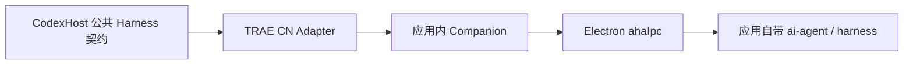

# TRAE CN Desktop 原生桥接

开发中的 TRAE CN 接入以国内桌面应用的原生 Agent 为执行者，复用应用登录、模型配置和 Session。当前包含插件 Manifest / 工厂、桌面 Companion、本机传输、公共 Adapter、文本会话、文件编辑与 Diff、结构化提问、RunCommand 单次审批和已确认身份的活动恢复。插件 Bundle 与 Companion VSIX 已验证；其他工具审批、配置写入、历史派生和预装发行尚未完成，仍为开发版本。

## 构建与安装

在仓库根目录安装开发依赖后运行：

```sh
npm run build:plugin --workspace=@codexhost/adapter-trae-cn
npm run build:companion --workspace=@codexhost/adapter-trae-cn
```

第一个命令编译公共依赖，并生成 `packages/adapters/trae-cn/dist/plugin/manifest.json` 和独立的 `plugin.mjs`。第二个使用固定版本的官方 `@vscode/vsce`，生成 `packages/adapters/trae-cn/dist/trae-cn-bridge.vsix`；只打包列出的 Companion 资源、README 与仓库许可证，不发布到 Marketplace。打包工具及 ZIP 验证工具仅为开发依赖，不进入插件 Bundle 或 VSIX。

在 TRAE CN 扩展面板选择 **Install from VSIX...** 安装 VSIX，按提示重新加载窗口。将 `dist/plugin` 的内容放到 CodexHost 受信任插件根中的 `trae-cn` 子目录，在该根的 `enabled.json` 中加入 `trae-cn`，保留已有条目，然后按当前 Host 的方式重启。插件要求包含公共活动恢复扩展的 API 2 Host；旧 API 1 Host 会拒绝加载。此处是独立插件安装，尚未加入预装清单。插件展示与启动路径设置由公共 Loader 和 Manifest 驱动。

TRAE CN 必须打开并信任目标工作目录，并在应用内完成登录。安装设置中的应用路径会经 `context.launchCommand` 传到工厂，优先于 `CODEXHOST_TRAE_CN_APP`；它限定允许连接的应用安装目录，不会自动启动桌面。连接页路径改变后需要重启 Host。`CODEXHOST_TRAE_CN_BRIDGE_DIR` 可以指定双方一致的绝对发现目录。

## 原生边界

验证环境为 TRAE CN 3.4.12、VS Code core 1.107.1、Windows x64。应用将 `harness.dll` 加载到其受管理进程中，并通过 Electron 自带的 `ahaIpc` 暴露 `ai-agent` RPC。测试扩展在应用的 Extension Host 中连接这个服务；普通 Node 进程不能据此直接加载 Electron 私有绑定。

数据路径如下。公共 Adapter 的普通对话、空闲恢复和提问答复已实测，其他能力仍在开发。



`assets/companion/native.cjs` 实现已验证的 RPC 包格式、响应解包、流注册、反向配置回调和连接清理。流监听在处理订阅响应时注册，避免紧随响应的首条事件丢失。反向回调目前仅允许少量只读配置命令；原生文件读取、提问和命令审批已实测，其他工具投影与审批仍待实现。

TRAE CN 的 `rpc.stream.cancel` 会取消原生生成，因此客户端解除订阅只分离观察者，由 Companion 的共享原生连接继续接收直到原生结束。主动取消单独调用 `lite.stop_chat_session`；请求确认不代表取消完成，必须核对事件和持久历史。关闭 Companion 或桌面应用仍可能中断其原生连接。

`assets/companion/extension.cjs` 仅在 `applicationName=trae-cn` 的应用中激活。它在受信任的工作区内连接应用的 `ai-agent`，不启动独立 CLI。`server.cjs` 监听随机的 `127.0.0.1` 端口，凭据来自仅供本机桥接使用的随机能力令牌，保存在用户目录 `~/.codexhost/native-bridges/trae-cn` 的实例文件中；可用绝对路径环境变量 `CODEXHOST_TRAE_CN_BRIDGE_DIR` 覆盖。拒绝浏览器 Origin、错误 Host 和未认证请求。原生登录令牌与 Provider 密钥始终留在应用进程内。

`src/discovery.ts` 与 `src/bridge.ts` 只读发现当前工作目录对应的运行中实例，核对国内版应用元数据和实例标识；不启动桌面、不创建 Session、不自动重试写入。连接直接使用本机 HTTP，不读取代理配置或跟随重定向。事件流正确处理拆开的 UTF-8 字符和提前 EOF，长时间思考或等待审批不以空闲超时结束。

创建 Session 前必须先通过 `lite.get_or_create_project_v2` 绑定真实工作目录，再将原生 Project ID 传入 `lite.create_chat_session`。单独给创建 Session 请求传 `workspace_folders` 会落入桌面临时目录。快照、发送、取消和订阅均重新核对原生 Project 的工作目录；发送也拒绝原生忙碌状态并串行化本机请求准入。

## 模型与认证

模型目录来自 `model.model_list_by_function`，按目标原生 Agent function 查询。`model.model_list` 属于模型管理范围，不能作为对话菜单的完整来源。可选规则沿用应用：`status` 与 `selectable` 任一明确为 `false` 时隐藏；不为新会话自动指定默认模型。

`assets/companion/models.cjs` 将公开目录限制为标识、标签、Provider 与多模态能力。原生模型请求 DTO 在应用内构造，保留 `client_connect` 对应的 `use_remote_service` 路由以及原生配置来源。Provider 密钥、应用登录凭据和自定义服务地址不进入公开目录。

桌面登录与 Provider 鉴权分别验证。桌面接口可用不能证明某个自定义 Provider 的密钥仍有效；原生模型服务返回的 HTTP 401 应保留为该模型的调用失败，不要求用户重新登录独立 CLI。

## 公共会话核心

`src/adapter.ts` 提供只读检查、同作用域目录缓存、延迟创建和空闲恢复；`src/session.ts` 在首个已接受 Turn 时创建原生身份，并将原生流投影为公共输出。新会话要求调用方先手动选择模型，`initialState` 不把请求模型当作生效状态；原生 metadata / model_config 确认后才更新 effectiveModel。模型 Ref 为按原生 Agent 和模型 ID 生成的 opaque 标识，保留自定义模型中斜杠等原生身份信息而不暴露给 Host 路由。

`src/history.ts` 用原生用户消息 ID 标识逻辑 Turn，原生 Assistant 的 reply_to_message_id 与其对齐；重复读取和重启后身份不变。原生 completed、failed、canceled 分别保留为成功、失败和取消；缺少终态时为 unknown。`finish.summary` 是最终答复，普通工具保留名称、参数及原生提供的结果；缺失的持久工具输出不会被补造。

`src/live-items.ts` 将累积文本转换为增量事件，每个 Item 只开始和完成一次。Builder 会暂时把最终文本放入 thought，然后转入 finish.summary；只有确定属于普通工具的 thought 才作为 commentary 发布，避免把同一最终答复显示两遍。EOF、关闭观察者和停止请求确认均不作为成功终态；成功需要从同一原生历史读到完成记录。

文件工具在生成参数时会先发送空对象和不完整的路径，只有原生执行准入后才建立公共工具 Item。Edit 的流和历史会省略编辑前后正文，不能从空字符串或当前文件系统拼出 Diff。Companion 0.1.1 的 `diffs.cjs` 在原生消息完成后，按已验证的 Project、Session 和原用户消息 ID 调用 `snapshot.get_message_ai_edit_file_diff_list`，只导出文件路径、操作和完整前后文本。`file-changes.ts` 生成统一 patch 与稳定的 fileChange 身份，关联对应工具 Item；已应用的编辑保留为成功，即使之后的工具使整轮失败。文件内容合计超过 2 MiB 时明确拒绝，快照错误也保留为错误。旧 Companion 缺少快照时提示升级，不伪造空 patch。

活动任务的 Assistant 记录可能尚未落盘。普通活动读取返回 sessionBusy；恢复时先只读原生状态及历史，仅允许一个末尾待完成用户消息与 Host 已确认映射相符。Session 缓存该次 unknown 快照，返回原 Host Turn ID 和 NativeTurnRef 的 recoveringTurn，并重新观察同一原生消息及交互。没有映射、队列创建中、回退中或无法确定身份时明确拒绝恢复，不重发输入。SSE 结束可以稍早于历史提交；Session 会对同一个原生身份短暂轮询，只在持久终态可读后发布完成。

原生准入后发布公共 turn.identity.confirmed，Host 在终态之前持久化原 Turn 身份；通用恢复路径校验归属后重建投影，Broker 同样转发可选恢复字段。旧 API 1 插件不接收新输入，缺省行为不变。关闭或故障结束本次观察作用域，报告原生任务可能仍运行并释放本机订阅；不会发送原生取消。只有显式取消操作会停止任务。观察超时或失败不能作为自动重启理由。

当前配置写入、其他工具审批和历史派生操作明确返回未实现或受限错误，能力字段不声称支持。已完成的核心路径不代表全部 P0 / P1 已验收。

## 用量口径

Companion 0.1.2 只转出 token_usage 中的非负安全整数计数，不转出账号、模型请求配置或格式化 input/output 字符串。实测 3.4.12 持久历史保留的是最后一次模型请求的 prompt_tokens / completion_tokens / total_tokens，累计字段 prompt_tokens_total / completion_tokens_total 为占位 0；它们不能作为会话总消耗。

`src/usage.ts` 只用原生 last_turn_total_tokens 与 max_tokens 映射上下文已用、窗口及占用百分比。初始值来自同一原生 Session 的最新 Assistant；实时 token_usage 按所属 Host Turn 发布完整的 session.usage.changed。只读刷新不发送模型请求，活动时不以旧历史覆盖新事件，查询失败也不使 Turn 失败。缺失数据保持未知，不推算累计 tokens、缓存命中率或费用。真实只读验收确认 initialUsage 与原生历史一致，且新 Node 进程恢复后不变；实时映射另由自动测试覆盖。

## 结构化提问

`assets/companion/settings.cjs` 从桌面配置读取主动提问的 IDE / SOLO 开关和原生 featureOverride，并读取国内版的 ask_user_question_v2 实验值。发送时在应用内构造 ask_question_config；不修改用户开关，不接受客户端覆盖，也不导出其他实验数据。缺失这组请求字段会改变原生工具可用性，不能据此宣布桌面不支持提问。

待回答的 AskUserQuestion 只存在于原生事件流中，get_messages 尚未返回其 Assistant 记录。Companion 按 Session、用户消息、Plan Item 和 interaction_instance_id 记录当前确认状态；观察者解除订阅后，应用仍接收原生结束和确认更新来使旧状态失效。答复前重新核对原生 Project 与运行状态，只允许当前实例写入一次。不确定回执不会触发自动重发。

`src/interactions.ts` 将原生问题映射为公共 Question Interaction，保留选项、多选及原生菜单的其他答案入口。模型预填的 answers 不视作用户提交；只有显式 interaction.respond 才发送答复。原生确认、取消、过期和替换关闭相应 UI 实例；已关闭实例不会被迟到的事件重新打开。其他答案沿用原生界面的 1000 字符上限。

RunCommand 的确认实例也来自原生事件流，显示命令和工作目录，提供允许一次与拒绝。Companion 重新核对 Session、任务、Plan Item 和确认实例后，通过原生 `lite.send_user_decision` 传 `permission_scope: execution` 或 `none`；不修改任务或全局授权。未实现的其他工具确认明确报 unsupported。发送请求在消息顶层使用原生 `permission_profile_id: manual_approval`；这不是已实现的权限模式切换。

RunCommand 投影为公共 commandExecution，保留原生输出、目录、退出码、耗时与失败；后台命令仍待验收。沙箱重试可能把同一个 Plan Item 暂时覆盖成 `_sandbox_retry` 确认回执，之后才恢复真正命令结果。确认回执不结束命令，也不当作执行成功。真实允许与拒绝序列已加入回放用例。拒绝沙箱外执行可能保留原生 `failed` 和 exitCode=1，不能强改为整轮 cancelled。

提问答案是后续写回的结果，不属于已准入工具的固定参数，因此通用工具参数排除这个可变字段，答案仍保留在原生工具结果中。参数按结构比较，JSON 对象键顺序不同不算参数更改；原生没有执行时间的参数校验失败也保留为失败工具 Item，不因最终回复成功而隐藏。

## 验证与剩余工作

仓库中的聚焦测试覆盖原生响应、立即到达的流事件、批量消息、回调 ID 为零、回调允许列表、观察者分离、模型目录过滤、凭据隔离、本机 HTTP 授权、目录隔离、UTF-8 事件分帧、原生忙碌与并发准入。

真实桌面验收已完成一条最小对话：通过 `lite.create_chat_session` 创建专用 Session，使用 Builder 与 Seed-Code 调用 `lite.send_message`，经 `lite.subscribe_events` 收到原生完成事件；随后建立新连接，通过 `lite.get_messages` 读到同一条 `completed` 消息，其 `finish.summary` 为 `CODEXHOST_TRAE_CN_OK`。测试没有使用独立 CLI 账号。

完整 Companion 另已实测同一 Session 续聊，持久历史的 `finish.summary` 为 `CODEXHOST_TRAE_CN_HTTP_OK`；原生 `Read` 工具在指定工作目录读取验收文件并回复其中字符串；观察者提前断开后原生历史仍为 `completed`；主动停止后历史为 `canceled`，同一 Session 随后的回复为 `TRAE_CN_CANCEL_RECOVERY_OK`。

公共 HarnessSession 实测完成文件读取和同一 Session 的第二轮答复 `TRAE_CN_PUBLIC_SESSION_OK`，实时及历史 NativeTurnRef 一致。随后由新 Node 进程使用 Adapter.open(resume) 恢复同一 NativeSessionRef，确认原历史前缀不变，再完成第三轮 `TRAE_CN_ADAPTER_RESUME_OK`。

公共提问验收中，原生 AskUserQuestion 产生一个公共问题，调用方显式选择“停止”；同一实例只答复一次，interaction.closed 为 responded，公共 Turn 和持久历史均为成功，最终答复为 `TRAE_CN_PUBLIC_QUESTION_OK_STOP`。这项验收没有依赖活动历史来重建问题，也没有把原生参数中的预填答案当作用户输入。

发行测试将插件搬到仓库外，用真实 Loader 加载两个独立实例，再由独立 Node 进程导入 Bundle，确认不借用 Workspace 依赖。VSIX 由独立 ZIP 读取器核对文件清单、身份、许可证和所有 CJS 文件的原始字节。Windows 中已实际安装 VSIX，核对扩展目录、代码 SHA-256 与激活进程；仓库外插件经这份已安装的 Companion 完成 `TRAE_CN_INSTALLED_PLUGIN_OK`，持久历史与实时身份一致。

文件编辑验收中，原生 Read / Edit 在专用文件中完成两轮内容替换。第二轮通过公共 Session 执行，实时 fileChange 与持久历史完全一致，最终答复为 `TRAE_CN_PUBLIC_FILE_EDIT_OK`；新 Node 进程 resume 后，两轮 Diff 的身份和正文均不变。此项使用开发 Companion 0.1.1；前述普通安装链路证明的是已安装 0.1.0，不代表用户普通窗口已加载新版本。0.1.1 的 VSIX 包含八个 CJS 资源。

活动恢复分别通过公共 Adapter 和隔离的真实 AppServerHost 验收。Host 使用仓库外插件和实际 Mapping Store，在提问或命令审批等待时关闭，再由新 Node 进程恢复同一 Thread。原 Host Turn ID、NativeTurnRef 和唯一映射均保持不变；答复后 thread/read 得到 TRAE_CN_HOST_RECOVERY_OK / TRAE_CN_HOST_APPROVAL_RECOVERY_OK。审批恢复选择拒绝，专用目标文件未生成。官方执行路径未启动，恢复不创建 Session、不再发送原输入。

这些证据覆盖插件加载、桌面 Companion、公共 Adapter 与隔离 Host 核心，仍需其他审批、配置写入、历史派生、预装发行，以及用户当前 CodexHost / Desktop 验收。逐项状态见 [CAPABILITIES.md](../../../packages/adapters/trae-cn/CAPABILITIES.md)。
