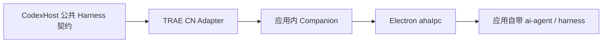

# TRAE CN Desktop 原生桥接

开发中的 TRAE CN 接入以国内桌面应用的原生 Agent 为执行者，复用应用登录、模型配置和 Session。当前包含桌面 Companion 扩展入口、本机传输及其 Node 客户端；公共 Harness Adapter 和预装插件尚未实现，不能在 CodexHost 中启用。

## 原生边界

验证环境为 TRAE CN 3.4.12、VS Code core 1.107.1、Windows x64。应用将 `harness.dll` 加载到其受管理进程中，并通过 Electron 自带的 `ahaIpc` 暴露 `ai-agent` RPC。测试扩展在应用的 Extension Host 中连接这个服务；普通 Node 进程不能据此直接加载 Electron 私有绑定。

数据路径如下。Companion 与 Node 客户端之间的本机传输已经实测；公共 Adapter 仍在开发。

`assets/companion/native.cjs` 实现已验证的 RPC 包格式、响应解包、流注册、反向配置回调和连接清理。流监听在处理订阅响应时注册，避免紧随响应的首条事件丢失。反向回调目前仅允许少量只读配置命令；原生文件读取工具已实测，完整工具投影、审批和提问仍待实现。

TRAE CN 的 `rpc.stream.cancel` 会取消原生生成，因此客户端解除订阅只分离观察者，由 Companion 的共享原生连接继续接收直到原生结束。主动取消单独调用 `lite.stop_chat_session`；请求确认不代表取消完成，必须核对事件和持久历史。关闭 Companion 或桌面应用仍可能中断其原生连接。

`assets/companion/extension.cjs` 仅在 `applicationName=trae-cn` 的应用中激活。它在受信任的工作区内连接应用的 `ai-agent`，不启动独立 CLI。`server.cjs` 监听随机的 `127.0.0.1` 端口，凭据来自仅供本机桥接使用的随机能力令牌，保存在用户目录 `~/.codexhost/native-bridges/trae-cn` 的实例文件中；可用绝对路径环境变量 `CODEXHOST_TRAE_CN_BRIDGE_DIR` 覆盖。拒绝浏览器 Origin、错误 Host 和未认证请求。原生登录令牌与 Provider 密钥始终留在应用进程内。

`src/discovery.ts` 与 `src/bridge.ts` 只读发现当前工作目录对应的运行中实例，核对国内版应用元数据和实例标识；不启动桌面、不创建 Session、不自动重试写入。连接直接使用本机 HTTP，不读取代理配置或跟随重定向。事件流正确处理拆开的 UTF-8 字符和提前 EOF，长时间思考或等待审批不以空闲超时结束。

创建 Session 前必须先通过 `lite.get_or_create_project_v2` 绑定真实工作目录，再将原生 Project ID 传入 `lite.create_chat_session`。单独给创建 Session 请求传 `workspace_folders` 会落入桌面临时目录。快照、发送、取消和订阅均重新核对原生 Project 的工作目录；发送也拒绝原生忙碌状态并串行化本机请求准入。

## 模型与认证

模型目录来自 `model.model_list_by_function`，按目标原生 Agent function 查询。`model.model_list` 属于模型管理范围，不能作为对话菜单的完整来源。可选规则沿用应用：`status` 与 `selectable` 任一明确为 `false` 时隐藏；不为新会话自动指定默认模型。

`assets/companion/models.cjs` 将公开目录限制为标识、标签、Provider 与多模态能力。原生模型请求 DTO 在应用内构造，保留 `client_connect` 对应的 `use_remote_service` 路由以及原生配置来源。Provider 密钥、应用登录凭据和自定义服务地址不进入公开目录。

桌面登录与 Provider 鉴权分别验证。桌面接口可用不能证明某个自定义 Provider 的密钥仍有效；原生模型服务返回的 HTTP 401 应保留为该模型的调用失败，不要求用户重新登录独立 CLI。

## 验证与剩余工作

仓库中的聚焦测试覆盖原生响应、立即到达的流事件、批量消息、回调 ID 为零、回调允许列表、观察者分离、模型目录过滤、凭据隔离、本机 HTTP 授权、目录隔离、UTF-8 事件分帧、原生忙碌与并发准入。

真实桌面验收已完成一条最小对话：通过 `lite.create_chat_session` 创建专用 Session，使用 Builder 与 Seed-Code 调用 `lite.send_message`，经 `lite.subscribe_events` 收到原生完成事件；随后建立新连接，通过 `lite.get_messages` 读到同一条 `completed` 消息，其 `finish.summary` 为 `CODEXHOST_TRAE_CN_OK`。测试没有使用独立 CLI 账号。

完整 Companion 另已实测同一 Session 续聊，持久历史的 `finish.summary` 为 `CODEXHOST_TRAE_CN_HTTP_OK`；原生 `Read` 工具在指定工作目录读取验收文件并回复其中字符串；观察者提前断开后原生历史仍为 `completed`；主动停止后历史为 `canceled`，同一 Session 随后的回复为 `TRAE_CN_CANCEL_RECOVERY_OK`。

这些证据仅证明桌面与 Companion 路径。交付仍需公共 Session / Item 投影、审批与提问、恢复和历史派生、Manifest、Companion 安装打包与预装发行，以及真实 CodexHost / Desktop 验收。逐项状态见 [CAPABILITIES.md](../../../packages/adapters/trae-cn/CAPABILITIES.md)。
