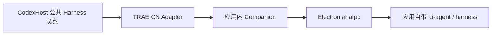

# TRAE CN Desktop 原生桥接

开发中的 TRAE CN 接入以国内桌面应用的原生 Agent 为执行者，复用应用登录、模型配置和 Session。当前包含插件 Manifest / 工厂、桌面 Companion、本机传输、公共 Adapter、文本会话、文件编辑与 Diff、结构化提问、命令 / 文件 / MCP 单次审批映射、已确认身份的活动恢复、模型 / Thinking / 本地权限选择及受限的 Fork / Rollback。插件 Bundle、Companion VSIX、预装清单、搬移 Host，以及隔离 Desktop 的真实新建 / 手动选模型 / 重启续聊已验证；MCP 审批与资源读取及日常窗口部署尚未完成，仍为开发版本。

## 构建与安装

在仓库根目录安装开发依赖后运行：

```sh
npm run build:plugin --workspace=@codexhost/adapter-trae-cn
npm run build:companion --workspace=@codexhost/adapter-trae-cn
```

第一个命令编译公共依赖，并生成 `packages/adapters/trae-cn/dist/plugin/manifest.json` 和独立的 `plugin.mjs`。第二个使用固定版本的官方 `@vscode/vsce`，生成 `packages/adapters/trae-cn/dist/trae-cn-bridge.vsix`；只打包列出的 Companion 资源、README 与仓库许可证，不发布到 Marketplace。打包工具及 ZIP 验证工具仅为开发依赖，不进入插件 Bundle 或 VSIX。

在 TRAE CN 扩展面板选择 **Install from VSIX...** 安装 VSIX，按提示重新加载窗口。Companion 需要单独构建和安装，不随 Host 的插件 Bundle 自动激活。发行清单已包含 `trae-cn`，`npm run build:typescript` 将生成相邻的预装插件和启用配置；Installer 与 npm 发行复用该清单。仅独立安装插件时，将 `dist/plugin` 的内容放到 CodexHost 受信任插件根中的 `trae-cn` 子目录，在该根的 `enabled.json` 中加入 `trae-cn`，保留已有条目，然后按当前 Host 的方式重启。不要同时在预装根和用户根安装同一 ID。插件要求包含公共活动恢复扩展的 API 2 Host；旧 API 1 Host 会拒绝加载。插件展示与启动路径设置由公共 Loader 和 Manifest 驱动。

TRAE CN 必须打开并信任目标工作目录，并在应用内完成登录。安装设置中的应用路径会经 `context.launchCommand` 传到工厂，优先于 `CODEXHOST_TRAE_CN_APP`；它限定允许连接的应用安装目录，不会自动启动桌面。连接页路径改变后需要重启 Host。`CODEXHOST_TRAE_CN_BRIDGE_DIR` 可以指定双方一致的绝对发现目录。

连接页的版本检查只读已选安装的 product.json，显示 TRAE CN 的 appVersion；不会把 VS Code core 的 version 当作应用版本。未指定路径时优先使用已验证且仍运行的唯一 Bridge 安装，不要求 Host cwd 与该窗口一致；多个安装要求明确选择，缺失或错误路径不会静默回退。没有运行的 Bridge 时，只检查平台标准安装位置。当前不能可靠识别此安装渠道的最新版本，故显示 Unknown，并提供官方手动更新入口。程序化 update 明确拒绝，不启动桌面、不发送模型请求、不更新 Companion 或中断会话；Companion VSIX 另行安装。

## 原生边界

Companion 0.1.11 在 TRAE CN 设置中提供 **CodexHost TRAE CN: Native Agent**（`codexhost.traeCn.nativeAgent`）。默认沿用 Builder (`builder_v3`)，可选择 SOLO Agent (`solo_agent`)；两者按原生 function 分别读取模型池。本机 3.4.14 分别返回 9 / 19 个可选模型，不将两套目录合并，也不指定默认模型。完成活动工作后运行 **CodexHost: Restart TRAE CN Bridge** 生效；不自动重启活动连接。已有 Session 必须使用原来的 Agent，不匹配时在历史读取或发送前返回配置错误。

SOLO 的原生 MCP 执行通过 `icube.common.commands.tooling.runAgentExtension` 回调进入桌面。`mcp.cjs` 将执行限制到已观察的原 Session、用户消息、Plan / tool-call、工作区、已加载 extension / server / tool 及原参数。等待原生审批、终态、重复、外部身份、未知别名或附加执行字段均拒绝。执行前占用身份，失败或丢失回执不重新开放；其他可执行桌面命令和 MCP 资源读取回调不在白名单内。分离 HTTP 观察者仍保留同一原生观察作用域，流结束后过期。

3.4.14 / SOLO / Seed-Code 的最终开发源码已实际调用专用 Echo MCP 一次，工具结果与服务审计一致。重开工作区及 Bridge 后，两个新 Node 进程精确读取同一 Session 和快照哈希，十三个 CJS 和 Manifest 哈希与源码一致，全局权限未变。本机原生策略没有额外审批，不能据此声称 MCP 允许 / 拒绝验收完成。该结果仍不是用户日常 Host / Desktop 部署验收。

验证环境为 TRAE CN 3.4.12、VS Code core 1.107.1、Windows x64。应用将 `harness.dll` 加载到其受管理进程中，并通过 Electron 自带的 `ahaIpc` 暴露 `ai-agent` RPC。测试扩展在应用的 Extension Host 中连接这个服务；普通 Node 进程不能据此直接加载 Electron 私有绑定。

数据路径如下。公共 Adapter 的普通对话、空闲恢复和提问答复已实测，其他能力仍在开发。



`assets/companion/native.cjs` 实现已验证的 RPC 包格式、响应解包、流注册、反向配置回调和连接清理。流监听在处理订阅响应时注册，避免紧随响应的首条事件丢失。反向回调目前仅允许少量只读配置命令；原生文件读取、提问和命令审批已实测，其他工具投影与审批仍待实现。

TRAE CN 的 `rpc.stream.cancel` 会取消原生生成，因此客户端解除订阅只分离观察者，由 Companion 的共享原生连接继续接收直到原生结束。主动取消单独调用 `lite.stop_chat_session`；请求确认不代表取消完成，必须核对事件和持久历史。关闭 Companion 或桌面应用仍可能中断其原生连接。

`assets/companion/extension.cjs` 仅在 `applicationName=trae-cn` 的应用中激活。它在受信任的工作区内连接应用的 `ai-agent`，不启动独立 CLI。`server.cjs` 监听随机的 `127.0.0.1` 端口，凭据来自仅供本机桥接使用的随机能力令牌，保存在用户目录 `~/.codexhost/native-bridges/trae-cn` 的实例文件中；可用绝对路径环境变量 `CODEXHOST_TRAE_CN_BRIDGE_DIR` 覆盖。拒绝浏览器 Origin、错误 Host 和未认证请求。原生登录令牌与 Provider 密钥始终留在应用进程内。

`src/discovery.ts` 与 `src/bridge.ts` 只读发现当前工作目录对应的运行中实例，核对国内版应用元数据和实例标识；不启动桌面、不创建 Session、不自动重试写入。连接直接使用本机 HTTP，不读取代理配置或跟随重定向。事件流正确处理拆开的 UTF-8 字符和提前 EOF，长时间思考或等待审批不以空闲超时结束。

创建 Session 前必须先通过 `lite.get_or_create_project_v2` 绑定真实工作目录，再将原生 Project ID 传入 `lite.create_chat_session`。单独给创建 Session 请求传 `workspace_folders` 会落入桌面临时目录。快照、发送、取消和订阅均重新核对原生 Project 的工作目录；发送也拒绝原生忙碌状态并串行化本机请求准入。

## 模型与认证

模型目录来自 `model.model_list_by_function`，按目标原生 Agent function 查询。`model.model_list` 属于模型管理范围，不能作为对话菜单的完整来源。可选规则沿用应用：`status` 与 `selectable` 任一明确为 `false` 时隐藏；不为新会话自动指定默认模型。

`assets/companion/models.cjs` 将公开目录限制为标识、标签、Provider 与多模态能力。原生模型请求 DTO 在应用内构造，保留 `client_connect` 对应的 `use_remote_service` 路由以及原生配置来源。Provider 密钥、应用登录凭据和自定义服务地址不进入公开目录。

桌面登录与 Provider 鉴权分别验证。桌面接口可用不能证明某个自定义 Provider 的密钥仍有效；原生模型服务返回的 HTTP 401 应保留为该模型的调用失败，不要求用户重新登录独立 CLI。

模型切换从下一次原生请求生效。桌面本身在每次发送时读取选择并构造 custom_model；Companion 0.1.4 的 prepareModel 刷新同一目录、验证目标 Session 并准备同一 DTO，只把确认的模型标识返回给插件，不发消息。公共 model.select 随后更新这份后续配置，Host 保存该选择，resume 时重新校验。正在执行的 Turn 固定其接受时的模型；旧 metadata / model_config 不覆盖新的选择，历史 Turn 仍报告实际原生模型。配置失败或关闭期间不发布新状态，配置准备与新 Turn 准入互斥；已有活动 Turn 不妨碍选择下一轮模型。旧 Companion 不声明此能力。

此路径不写桌面全局模型偏好。桌面另有 localThread.readSelection / writeSelection 命令，但写入仅支持官方模型，且当前 Builder 目录的原生探测返回 MODEL_UNAVAILABLE，因此没有依赖这条前端状态路径。

Companion 0.1.6 支持下一轮请求的 Thinking 选择。普通账号读取经过原生规则校验的 reasoning_effort_config，内部账号沿用其旧字段，自定义模型还要有有效的参数声明。只有策略布尔值离开凭据读取路径，登录信息始终留在应用内。实测普通账号 Builder 目录中 MiniMax-M3.1-Flash 提供 light / high / extra_high；其他模型不凭名称推测档位。公开选项按 Agent、模型、原生请求字段和档位生成 opaque ID，拒绝跨模型复用；未显式选择且无原生历史确认时不补默认值。prepareModel 校验精确字段和档位后才发布状态，发送时加入同一 custom_model DTO。活动请求固定已接受的选择，后续选择不被旧事件覆盖。切换模型替换完整 Thinking 列表并清除不适用的选择；恢复重新校验保存的选择，历史保留当时的原生配置。

## 公共会话核心

`src/adapter.ts` 提供只读检查、延迟创建和空闲恢复。检查每次重新发现并读取当前 Bridge，避免重启、切换原生 Agent 或登录失效后仍返回旧目录和 ready；原生自己的模型缓存及显式 refresh 语义仍保留，不创建 Session。`src/session.ts` 在首个已接受 Turn 时创建原生身份，并将原生流投影为公共输出。新会话要求调用方先手动选择模型；单独传入请求模型不视为已生效，显式配置准备成功或原生 metadata / model_config 确认后才发布 effectiveModel。模型 Ref 为按原生 Agent 和模型 ID 生成的 opaque 标识，保留自定义模型中斜杠等原生身份信息而不暴露给 Host 路由。

`src/history.ts` 用原生用户消息 ID 标识逻辑 Turn，原生 Assistant 的 reply_to_message_id 与其对齐；重复读取和重启后身份不变。原生 completed、failed、canceled 分别保留为成功、失败和取消；缺少终态时为 unknown。`finish.summary` 是最终答复，普通工具保留名称、参数及原生提供的结果；缺失的持久工具输出不会被补造。

`src/live-items.ts` 将累积文本转换为增量事件，每个 Item 只开始和完成一次。Builder 会暂时把最终文本放入 thought，然后转入 finish.summary；只有确定属于普通工具的 thought 才作为 commentary 发布，避免把同一最终答复显示两遍。EOF、关闭观察者和停止请求确认均不作为成功终态；成功需要从同一原生历史读到完成记录。

文件工具在生成参数时会先发送空对象和不完整的路径，只有原生执行准入后才建立公共工具 Item。Edit 的流和历史会省略编辑前后正文，不能从空字符串或当前文件系统拼出 Diff。Companion 0.1.1 的 `diffs.cjs` 在原生消息完成后，按已验证的 Project、Session 和原用户消息 ID 调用 `snapshot.get_message_ai_edit_file_diff_list`，只导出文件路径、操作和完整前后文本。`file-changes.ts` 生成统一 patch 与稳定的 fileChange 身份，关联对应工具 Item；已应用的编辑保留为成功，即使之后的工具使整轮失败。文件内容合计超过 2 MiB 时明确拒绝，快照错误也保留为错误。旧 Companion 缺少快照时提示升级，不伪造空 patch。

活动任务的 Assistant 记录可能尚未落盘。普通活动读取返回 sessionBusy；恢复时先只读原生状态及历史，仅允许一个末尾待完成用户消息与 Host 已确认映射相符。Session 缓存该次 unknown 快照，返回原 Host Turn ID 和 NativeTurnRef 的 recoveringTurn，并重新观察同一原生消息及交互。没有映射、队列创建中、回退中或无法确定身份时明确拒绝恢复，不重发输入。SSE 结束可以稍早于历史提交；Session 会对同一个原生身份短暂轮询，只在持久终态可读后发布完成。

原生准入后发布公共 turn.identity.confirmed，Host 在终态之前持久化原 Turn 身份；通用恢复路径校验归属后重建投影，Broker 同样转发可选恢复字段。旧 API 1 插件不接收新输入，缺省行为不变。关闭或故障结束本次观察作用域，报告原生任务可能仍运行并释放本机订阅；不会发送原生取消。只有显式取消操作会停止任务。观察超时或失败不能作为自动重启理由。

文件 / MCP 审批通过 Companion 能力标记协商；未知确认格式仍明确返回未实现或受限错误。已完成的核心路径不代表全部 P0 / P1 已验收，实时覆盖范围见下文。

## 本地权限模式

Companion 0.1.7 沿用 PermissionFeatureGuardService / PermissionModePort 的动态开关、用户配置、Auto 可见性、Custom Profile 存在性和默认规则。它只读应用返回的数据目录中的 permission/global.json，限制为 1 MiB；不转出资源授权或规则，不修改全局配置。远程与企业环境不声明此权限能力，未知活动 Profile 返回配置错误。

preparePermission 校验会话作用域及当前可用档位，确认后才发布下一轮的 effectivePermissionModeId；发送时在消息顶层和 client_info 中设置同一 permission_profile_id。已接受的 Turn 固定原选择，活动时切换只影响后续请求。没有显式选择时沿用原生当前默认；旧 Companion 保持既有手动模式行为。原生消息历史及 Session 元数据没有提供权限档位，恢复时重新校验 Host 保存的确认提示，不推测历史权限。Rollback 在原生写入前校验并保留显式提示，Fork 沿用 Host 已有的公共权限继承流程。无人值守执行意图仍明确拒绝，与手动选择 Full Access 分开处理。

实际 RunCommand 验收分别以 manual_approval / full_access 完成两条新任务，生成固定内容的两个专用文件；第一轮运行时选择 Full Access，下一轮在新进程中恢复该选择。两轮历史、源前缀和全局权限文件哈希保持不变。原生允许的命令在手动模式下也可能不弹审批，不能用是否出现弹窗代替策略核对。验收脚本先前错误要求必有审批，已保留原成功记录并只读核对，之后只发送新的 Full Access 任务，没有重发原命令。

冷恢复还发现了无 Thinking 档位模型的状态差异：实时状态有空列表，初始状态却省略该字段。回归用例先复现再修复，现明确保留空列表；只读核对原两轮的完整冷快照哈希与实时结果一致，没有额外模型请求。

## Fork 与会话回退

Companion 0.1.3 读取桌面 fork_chat 功能开关，使用原生 lite.fork_session 创建同一 Project 内的副本。公共 checkpoint 指向已完成 Assistant 消息；Fork 保留到该逻辑 Turn 为止的前缀，源 Session 不变。原生会重新分配消息 ID，插件验证复制后的输入、Items、结果和模型完全一致，再返回独立身份。末尾与中间边界均已实测，中间副本可继续使用继承的上下文。跨工作目录明确拒绝。

Rollback 同样不修改源 Session：多轮时复制到倒数第二轮；单轮时创建独立空白 Session，交由 Host 的替换事务接管。它保留已确认的当前模型和 Thinking，或明确传入的选择；显式权限提示在写入前校验并保留。历史仍保留原来的模型和 Thinking，不把后续选择改写进旧消息。空历史、活动源、非法边界、作用域改变或复制内容不一致均报错。不确定写入不自动重试；已知副本验证失败时保留并报告其 ID，不删除可能包含用户历史的资源。这些操作不回滚工作区文件。

TRAE CN 3.4.12 存在文件编辑复制限制：原生 fork_session 复制消息后，对应的 before-chat-turn 快照标签不存在，读取副本文件 Diff 会失败。插件据此在写入前禁用含文件编辑历史的 Fork，以及需要保留非空前缀的文件编辑 Rollback；不以可读消息冒充完整复制。单轮文件编辑可以回退到独立空白 Session，已实测新会话续聊、模型保留、源历史及实际文件不变，并由新 Node 进程恢复两个 Session 核对。

## 用量口径

Companion 0.1.2 只转出 token_usage 中的非负安全整数计数，不转出账号、模型请求配置或格式化 input/output 字符串。实测 3.4.12 持久历史保留的是最后一次模型请求的 prompt_tokens / completion_tokens / total_tokens，累计字段 prompt_tokens_total / completion_tokens_total 为占位 0；它们不能作为会话总消耗。

`src/usage.ts` 只用原生 last_turn_total_tokens 与 max_tokens 映射上下文已用、窗口及占用百分比。初始值来自同一原生 Session 的最新 Assistant；实时 token_usage 按所属 Host Turn 发布完整的 session.usage.changed。只读刷新不发送模型请求，活动时不以旧历史覆盖新事件，查询失败也不使 Turn 失败。缺失数据保持未知，不推算累计 tokens、缓存命中率或费用。真实只读验收确认 initialUsage 与原生历史一致，且新 Node 进程恢复后不变；实时映射另由自动测试覆盖。

## 结构化提问

`assets/companion/settings.cjs` 从桌面配置读取主动提问的 IDE / SOLO 开关和原生 featureOverride，并读取国内版的 ask_user_question_v2 实验值。发送时在应用内构造 ask_question_config；不修改用户开关，不接受客户端覆盖，也不导出其他实验数据。缺失这组请求字段会改变原生工具可用性，不能据此宣布桌面不支持提问。

待回答的 AskUserQuestion 只存在于原生事件流中，get_messages 尚未返回其 Assistant 记录。Companion 按 Session、用户消息、Plan Item 和 interaction_instance_id 记录当前确认状态；观察者解除订阅后，应用仍接收原生结束和确认更新来使旧状态失效。答复前重新核对原生 Project 与运行状态，只允许当前实例写入一次。不确定回执不会触发自动重发。

`src/interactions.ts` 将原生问题映射为公共 Question Interaction，保留选项、多选及原生菜单的其他答案入口。模型预填的 answers 不视作用户提交；只有显式 interaction.respond 才发送答复。原生确认、取消、过期和替换关闭相应 UI 实例；已关闭实例不会被迟到的事件重新打开。其他答案沿用原生界面的 1000 字符上限。

RunCommand 的确认实例也来自原生事件流，显示命令和工作目录，提供允许一次与拒绝。Companion 重新核对 Session、任务、Plan Item 和确认实例后，通过原生 `lite.send_user_decision` 写回；新权限系统使用 `permission_scope: execution` 或 `none`，旧权限系统省略该字段，不修改任务或全局授权。发送请求中的权限档位由前述本地权限配置决定。

Companion 0.1.8 通过 `interactions.fileAndMcpApprovals` 明确声明新增确认能力；旧 Companion 缺少标记时不生成无法执行的文件 / MCP 审批按钮，而是提示升级。文件操作的允许动作使用原生事件拥有的 `toolcall_id`，拒绝沿用工具名；删除沿用原生无新增权限范围的格式。MCP 和 ReadMcpResource 使用原生工具名，仅在对应新权限请求元数据存在时传 execution / none。界面保留文件及资源目标、MCP 服务器 / 工具 / 参数；超限或未知格式明确拒绝。不提供任务级或永久授权。

文件审批已在 3.4.12 做真实允许与拒绝验收：允许后目标内容准确改变，拒绝时另一份文件保持原样。允许路径还暴露了原生 Edit 的参数清空行为：执行完成后 old_string / new_string 从完整正文变为空串。插件将这两个原生可变字段排除在固定工具参数之外，实时与历史继续保留路径及其他稳定参数，实际改动来自原生消息快照 Diff。规范化真实序列先复现故障再通过修复；新的一次不同内容修改回复 TRAE_CN_FILE_EDIT_VERIFIED_OK，四轮历史、取消轮、源前缀和新进程冷快照均保留。没有重发旧任务，全局权限配置哈希未变。

DeleteFile 已用工作区外专用文件完成单次允许 / 拒绝真实审批：允许后文件删除，拒绝后原内容不变，Interaction 各关闭一次，全局权限未修改，新进程恢复两条原历史。工作区内另一次直接删除未产生审批，不将它计入审批证明。MCP 确认的决策格式有原生界面源码和聚焦测试，实时审批仍待验收。

MCP 服务就绪不等于原生 Agent 可调用。3.4.13 的独立项目 Echo MCP 已通过协议自测，用户开启项目级 MCP 后，桌面日志和工具目录均确认其已加载；实际 Builder 首轮仍返回工具不可用，没有工具执行或审批。只读 agent/get_agents 读取的内置 builder_v3.mcp_list 为空，原任务为 Finished。需继续核实原生 Agent 绑定 / 调用路径；未重发原任务，也未修改原生 Agent 配置或权限规则。

Companion 0.1.10 补齐删除历史快照：终态 DeleteFile / delete_file 即使没有 can_show_diff 也按原用户消息读取快照。原生 deleted.after_content=null（以及 added.before_content=null）仅表示该侧不存在，可归一为空字符串；不把其他缺失内容补成空值。真实工作区删除已恢复完整删除 Diff，并在新 Node 进程中精确读取，原工具与回复未变。工作区外测试文件的原生快照返回空列表，故仅显示实际工具结果，不从当前磁盘补造历史 Diff；旧 Companion 漏失删除快照时明确提示升级。

RunCommand 投影为公共 commandExecution，保留原生输出、目录、退出码、耗时与失败；后台结果观察及其限制见下文。沙箱重试可能把同一个 Plan Item 暂时覆盖成 `_sandbox_retry` 确认回执，之后才恢复真正命令结果。确认回执不结束命令，也不当作执行成功。真实允许与拒绝序列已加入回放用例。拒绝沙箱外执行可能保留原生 `failed` 和 exitCode=1，不能强改为整轮 cancelled。

提问答案是后续写回的结果，不属于已准入工具的固定参数，因此通用工具参数排除这个可变字段，答案仍保留在原生工具结果中。Edit 的原生可变正文同样不参与固定参数身份，完整修改由消息 Diff 表达。其余参数按结构比较，JSON 对象键顺序不同不算参数更改；原生没有执行时间的参数校验失败也保留为失败工具 Item，不因最终回复成功而隐藏。

## 验证与剩余工作

Companion 0.1.9 支持 RunCommand 后台结果观察。沿原 Session、原用户消息、Plan、llm tool-call 和 command ID 查询 check_toolhost_command_status，验证命令与目录后只转出输出和真实状态；不使用启动回执作为完成证据。命令通过公共 item.detached 保留，父轮及下一轮可先完成，再向原 Item 追加输出和真实终态。hasBackgroundWork 防止空闲释放；关闭观察者结束公共观察，不取消原生后台命令。后台中冷恢复明确返回 sessionBusy，完成后恢复完整历史；不复制派生前缀中的后台执行身份。Native 查询窗口最多 16,384 字符，实时超限会明确故障，冷读保留截断标志；目前没有独立的后台命令停止控件。

3.4.13 前端虽有 poll_pending_wakeups 和隐藏续轮代码，实际 Builder 后端对该路由返回 unknown route。插件保持 autonomousTurns.observe=false，不发送普通用户消息模拟唤醒。真实 Host 验收已确认后台结果在父轮及后续聊天之后返回；重建开发桥接及新 Host 后，同一三轮历史、命令输出 / 退出码和原前缀均精确恢复。

仓库中的聚焦测试覆盖原生响应、立即到达的流事件、批量消息、回调 ID 为零、回调允许列表、观察者分离、模型目录过滤、凭据隔离、本机 HTTP 授权、目录隔离、UTF-8 事件分帧、原生忙碌与并发准入。

真实桌面验收已完成一条最小对话：通过 `lite.create_chat_session` 创建专用 Session，使用 Builder 与 Seed-Code 调用 `lite.send_message`，经 `lite.subscribe_events` 收到原生完成事件；随后建立新连接，通过 `lite.get_messages` 读到同一条 `completed` 消息，其 `finish.summary` 为 `CODEXHOST_TRAE_CN_OK`。测试没有使用独立 CLI 账号。

完整 Companion 另已实测同一 Session 续聊，持久历史的 `finish.summary` 为 `CODEXHOST_TRAE_CN_HTTP_OK`；原生 `Read` 工具在指定工作目录读取验收文件并回复其中字符串；观察者提前断开后原生历史仍为 `completed`；主动停止后历史为 `canceled`，同一 Session 随后的回复为 `TRAE_CN_CANCEL_RECOVERY_OK`。

公共 HarnessSession 实测完成文件读取和同一 Session 的第二轮答复 `TRAE_CN_PUBLIC_SESSION_OK`，实时及历史 NativeTurnRef 一致。随后由新 Node 进程使用 Adapter.open(resume) 恢复同一 NativeSessionRef，确认原历史前缀不变，再完成第三轮 `TRAE_CN_ADAPTER_RESUME_OK`。

公共提问验收中，原生 AskUserQuestion 产生一个公共问题，调用方显式选择“停止”；同一实例只答复一次，interaction.closed 为 responded，公共 Turn 和持久历史均为成功，最终答复为 `TRAE_CN_PUBLIC_QUESTION_OK_STOP`。这项验收没有依赖活动历史来重建问题，也没有把原生参数中的预填答案当作用户输入。

发行测试将插件搬到仓库外，用真实 Loader 加载两个独立实例，再由独立 Node 进程导入 Bundle，确认不借用 Workspace 依赖。VSIX 由独立 ZIP 读取器核对文件清单、身份、许可证和所有 CJS 文件的原始字节。Windows 中已实际安装 VSIX，核对扩展目录、代码 SHA-256 与激活进程；仓库外插件经这份已安装的 Companion 完成 `TRAE_CN_INSTALLED_PLUGIN_OK`，持久历史与实时身份一致。

文件编辑验收中，原生 Read / Edit 在专用文件中完成两轮内容替换。第二轮通过公共 Session 执行，实时 fileChange 与持久历史完全一致，最终答复为 `TRAE_CN_PUBLIC_FILE_EDIT_OK`；新 Node 进程 resume 后，两轮 Diff 的身份和正文均不变。此项使用开发 Companion 0.1.1；前述普通安装链路证明的是已安装 0.1.0，不代表用户普通窗口已加载新版本。0.1.1 的 VSIX 包含八个 CJS 资源。

活动恢复分别通过公共 Adapter 和隔离的真实 AppServerHost 验收。Host 使用仓库外插件和实际 Mapping Store，在提问或命令审批等待时关闭，再由新 Node 进程恢复同一 Thread。原 Host Turn ID、NativeTurnRef 和唯一映射均保持不变；答复后 thread/read 得到 TRAE_CN_HOST_RECOVERY_OK / TRAE_CN_HOST_APPROVAL_RECOVERY_OK。审批恢复选择拒绝，专用目标文件未生成。官方执行路径未启动，恢复不创建 Session、不再发送原输入。

文本历史派生已验证中间 / 末尾 Fork、多轮 / 单轮 Rollback、源历史不变和冷恢复。中间 Fork 的新消息复述了继承的原答复；回退到空白的 Session 回复 TRAE_CN_ROLLBACK_EMPTY_OK。另一次单轮文件编辑回退回复 TRAE_CN_FILE_EMPTY_ROLLBACK_OK，实际文件仍是已编辑后的内容。实时上下文数值来自原生 token_usage，不再只依赖事件 fixture。Companion 0.1.3 的 VSIX 有九个 CJS 资源；这些新增功能使用开发窗口，普通窗口已安装版本仍为 0.1.0。

模型选择实测中，成功完成的四条原生 Assistant 记录分别确认 Seed-Code、Seed-2.1-Turbo、Seed-2.1-Turbo、Seed-Code；config_name 与 model_name 同时核对。第二轮在新 Node 进程中恢复尚未发送的选择，第三轮运行中切回 Seed-Code 只影响后续请求。验收脚本重复创建输出消费者曾使第四轮取消，该取消轮经原生历史核对并保留，随后独立的新消息回复 TRAE_CN_MODEL_RECOVERY_OK，没有重发原消息。最终五轮记录由新进程只读恢复一致，所检查的桌面模型选择存储哈希未变，原生任务已结束。这些新能力使用开发 Companion 0.1.4；普通窗口仍是已安装的 0.1.0。

Thinking 的真实验收使用开发 Companion 0.1.6。MiniMax-M3.1-Flash 的 Light 请求运行期间选择 High，原生持久记录仍确认第一轮 light；新进程恢复尚未发送的 High 选择后，第二轮持久记录为 high，分别回复 TRAE_CN_THINKING_LIGHT_OK / TRAE_CN_THINKING_HIGH_OK。第三个进程只读核对两轮历史，桌面模型偏好哈希不变。中间 Fork 与 Rollback 均只有第一轮 Light 历史，当前配置保留 High；源未改变，没有额外消息发送，两个派生会话冷恢复一致。

2026-11-02 本机应用已更新至 3.4.13。新 PID 的开发 Companion 0.1.8 已通过只读兼容检查，提供 9 个模型、4 个权限选项及文件 / MCP 审批能力标记；原四轮会话为 Finished，完整冷状态哈希不变。这次只调用 snapshot / preparePermission，没有创建 Session 或发送消息，不能替代新版本的实际推理与审批验收。

预装发行验收中，完整集合的真实 Loader、仓库外 Host / 插件以及 npm 文件集检查均通过，缺 Companion 时返回可重试的 configurationRequired。TRAE CN 3.4.13 的两轮实际对话通过预装插件进入隔离 AppServerHost；第二轮由新进程恢复同一 Thread / Native Session，精确读取原历史后复述第一轮的 TRAE_CN_3413_PREINSTALLED_OK。两轮各有唯一映射，原生状态为 Finished。Host 的真实委派入口则因固定要求 unattended-full-access 被插件明确拒绝，未改变父会话历史；该结果不代表可接收无人值守任务。

早期日常 CodexHost 0.17.0 的实际 Runtime 为插件 API 1，预装清单没有 trae-cn。开发插件要求 API 2，因此不能仅复制插件到该 Host，也不降级 Manifest 绕过校验。本机 CLI 随后已更新至 0.17.1，但本 PR 的 API 2 源代码与开发 Companion 未部署至日常窗口；没有替换或强制重启用户的活动 Desktop。

2026-11-04 在独立的官方 Desktop 26.1027.3384.0 副本中完成真实界面验收。该副本使用独立 profile、CODEX_HOME、APPDATA / LOCALAPPDATA 和 Host 数据目录，加载源代码 Host / Controller / Renderer；日常窗口保持运行。新建页选定已打开的 MCP 工作区后，TRAE CN 可选并显示 19 个 SOLO 模型；无默认模型时显示 Select model，必须显式选择，其他聊天的模型偏好不自动填入。手动选择 Seed-Code 并发送后，真实界面收到 TRAE_CN_DESKTOP_UI_OK。完全重启副本，新草稿仍不预选模型；打开原 Thread，Seed-Code 和原历史恢复，发送不包含答案的复述请求后仍收到原标记。

两个独立 Node 进程只读核对同一 Native Session 的两轮完整快照、原历史前缀和唯一 Host Turn 映射，哈希完全相同，没有创建新 Session、重发旧消息或执行工具。UI 验收暴露并修复了原生 RPC 包装绕过项目发布，以及无默认模型错误禁用模型菜单的问题；都是通用 Renderer 行为，没有 TRAE 专用 UI 分支。Head 1608dc9d 的四平台 CI 全部通过；该证据不代表其他 Desktop 版本、原生 macOS 或日常安装已验收。

这些证据覆盖预装插件加载、桌面 Companion、公共 Adapter、隔离 Host 核心和上述 Desktop 基础对话流程。用户选择暂不调整原生 MCP 确认策略，允许 / 拒绝保留待验证；原生资源读取、其他未验证能力与日常部署仍需独立验收；自主 Turn 和无人值守委派明确受限。逐项状态见 [CAPABILITIES.md](../../../packages/adapters/trae-cn/CAPABILITIES.md)。
