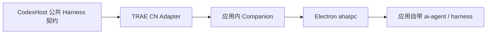

# TRAE CN Desktop 原生桥接

开发中的 TRAE CN 接入以国内桌面应用的原生 Agent 为执行者，复用应用登录、模型配置和 Session。当前代码仅包含原生 RPC 与模型投影基础；尚无可安装的 Companion 入口、公共 Harness Adapter 或预装插件，不能在 CodexHost 中启用。

## 原生边界

验证环境为 TRAE CN 3.4.12、VS Code core 1.107.1、Windows x64。应用将 `harness.dll` 加载到其受管理进程中，并通过 Electron 自带的 `ahaIpc` 暴露 `ai-agent` RPC。测试扩展在应用的 Extension Host 中连接这个服务；普通 Node 进程不能据此直接加载 Electron 私有绑定。

计划的数据路径如下。公共 Adapter 与应用 Companion 之间的本机传输尚未实现。

`assets/companion/native.cjs` 实现已验证的 RPC 包格式、响应解包、流注册、反向配置回调和连接清理。流监听在处理订阅响应时注册，避免紧随响应的首条事件丢失。反向回调目前仅允许少量只读配置命令；完整工具、审批和提问仍待实现。关闭观察连接不等于取消正在运行的原生 Turn，普通取消必须另行调用原生停止接口并核对终态。

## 模型与认证

模型目录来自 `model.model_list_by_function`，按目标原生 Agent function 查询。`model.model_list` 属于模型管理范围，不能作为对话菜单的完整来源。可选规则沿用应用：`status` 与 `selectable` 任一明确为 `false` 时隐藏；不为新会话自动指定默认模型。

`assets/companion/models.cjs` 将公开目录限制为标识、标签、Provider 与多模态能力。原生模型请求 DTO 在应用内构造，保留 `client_connect` 对应的 `use_remote_service` 路由以及原生配置来源。Provider 密钥、应用登录凭据和自定义服务地址不进入公开目录。

桌面登录与 Provider 鉴权分别验证。桌面接口可用不能证明某个自定义 Provider 的密钥仍有效；原生模型服务返回的 HTTP 401 应保留为该模型的调用失败，不要求用户重新登录独立 CLI。

## 验证与剩余工作

仓库中的聚焦测试覆盖原生响应、立即到达的流事件、批量消息、回调 ID 为零、回调允许列表、断连清理以及模型目录的过滤和凭据隔离。

真实桌面验收已完成一条最小对话：通过 `lite.create_chat_session` 创建专用 Session，使用 Builder 与 Seed-Code 调用 `lite.send_message`，经 `lite.subscribe_events` 收到原生完成事件；随后建立新连接，通过 `lite.get_messages` 读到同一条 `completed` 消息，其 `finish.summary` 为 `CODEXHOST_TRAE_CN_OK`。测试没有使用独立 CLI 账号。

这些证据仅证明桌面原生路径。交付仍需 Companion 生命周期和本机传输、公共 Session / Item 投影、审批与提问、取消与恢复、历史派生、Manifest 和预装打包，以及真实 CodexHost / Desktop 验收。逐项状态见 [CAPABILITIES.md](../../../packages/adapters/trae-cn/CAPABILITIES.md)。
