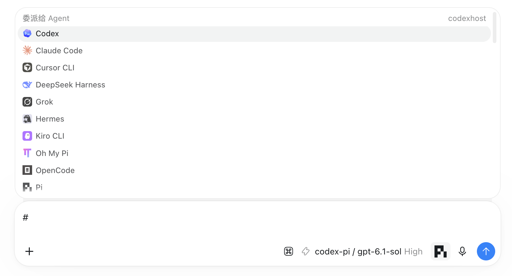
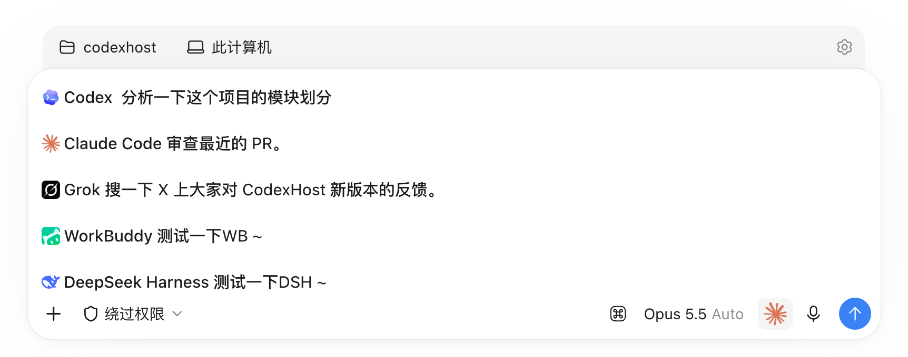
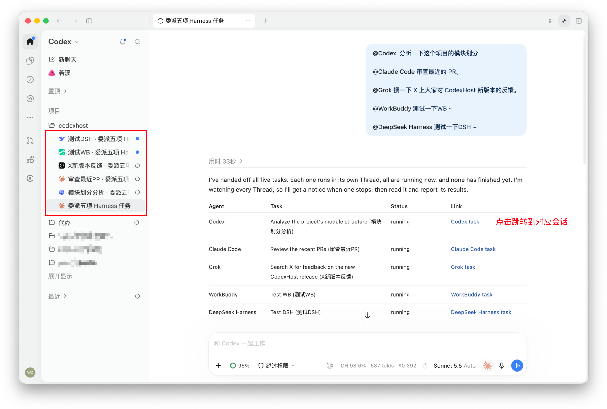
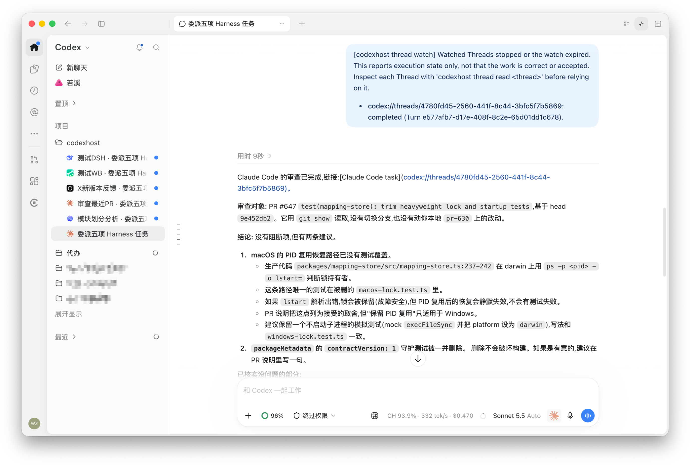
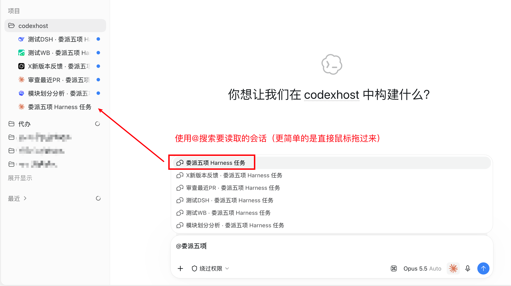
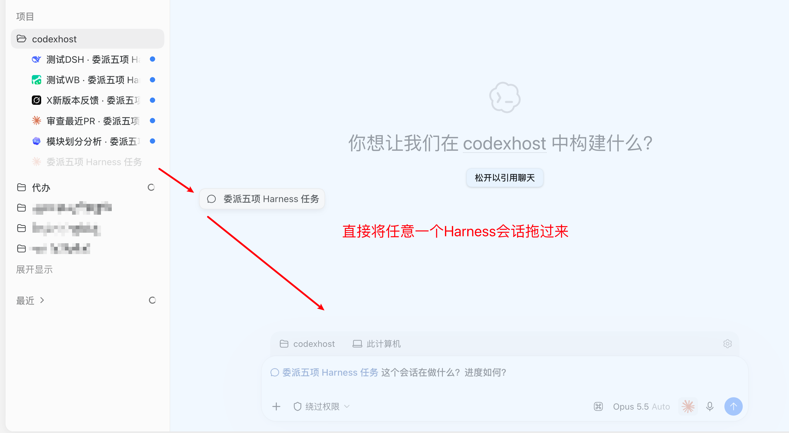
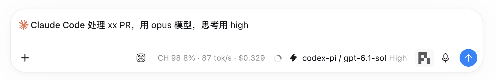

**【CodexHost】我每天都在用的功能：一个会话指挥 Codex、CC、Grok 同时干活**
本帖使用社区开源推广，符合推广要求。我申明并遵循社区要求的以下内容：

- **我的帖子已经打上 [开源推广](https://linux.do/tag/2234-tag/2234) 标签：** 是
- **我的开源项目完整开源，无未开源部分：** 是
- **我的开源项目已链接认可 LINUX DO 社区：** 是
- **我帖子内的项目介绍，AI生成、润色内容部分已截图发出：** 是
- **以上选择我承诺是永久有效的，接受社区和佬友监督：** 是

---

大家好，我是 Momo，今天看到有两个帖子的佬友在问 “[多 agent 协同大家都是怎么做的](https://linux.do/t/topic/3090107/11)”，我想再介绍一下 CodexHost，非常非常推荐它的多 Agent 协作能力。

先简单介绍一下 **CodexHost**：它能让 Pi、Claude Code、Grok Build、OMP 等 10 多个 Agent Harness 在 Codex Desktop 里**原生运行**，每个 Agent 都是左侧一个独立会话。

之前的帖子：https://linux.do/t/topic/2825164

用久了我发现一个问题：**每个 Agent 都有自己擅长的事**。
- Codex 审查代码比较好（虽然最近降智）；
- Claude Code 写代码很通畅（比codex拉一坨强多了）；
- Grok 能直接搜 X 上的最新消息；
- Pi 轻快（其实我是用 pi 代替 codex 用）。

但以前想让它们配合，只能我自己当“传话筒”：从这个窗口复制结果，粘到那个窗口，再把那边的输出复制回来……

所以我做了一件事：**让 Agent 之间自己沟通。** 

（这个功能其实已经上线两个月了，稳定性不用担心～）

---

## 1. `#` 一下，把任务派给别的 Agent

在输入框里输入 `#`，就能直接选择其他 Agent，把任务派给它。

比如在会话里说：

**每个 Agent 都会在左侧开一个独立会话，各自并行执行。** 它们是真实的独立 Session，有自己的上下文和历史，你随时可以点进去看进度，也可以直接接着聊。

会话被委派后，主会话可以选择**持续监听进展**，也可以选择**被动监听**。
如下方的，子会话执行完毕后，主会话接收到通知：

---

## 2. 引用另一个会话：读它、问它、指挥它

更好玩的是**跨会话协作**。在输入框里引用另一个会话，当前 Agent 可以：
- **读取**它的完整内容；
- **直接给它发消息**，让它继续干活。

我最常用的一句是：
> 总结一下这个会话做到哪了，理解这个任务背景，然后你继续做。（CC额度不够用的时候）

| @搜索会话                                                    | 直接把一个会话拖过来                                         |
| ------------------------------------------------------------ | ------------------------------------------------------------ |
|  |  |

委派时，新会话使用该 Harness 默认的模型，也可以明确说用哪个模型、什么思考强度。

---

## 怎么用

    npm install -g @codexhost/cli
    codexhost

打开后在任意会话的输入框里输入 `#` 就能看到。

## 结语

CodexHost 最初只是为了让 Pi 有个好用的桌面端。接入的 Agent 越来越多以后，我越来越觉得：**与其选一个“最强”的 Agent，不如让每个模型都在自己的主场干活。**

功能还在快速迭代，欢迎在评论区聊聊，也欢迎提 Issue 和 PR ~

GitHub：

https://github.com/BytePioneer-AI/codex-host

觉得有意思的话，求一个 Star ⭐

主贴：https://linux.do/t/topic/2825164