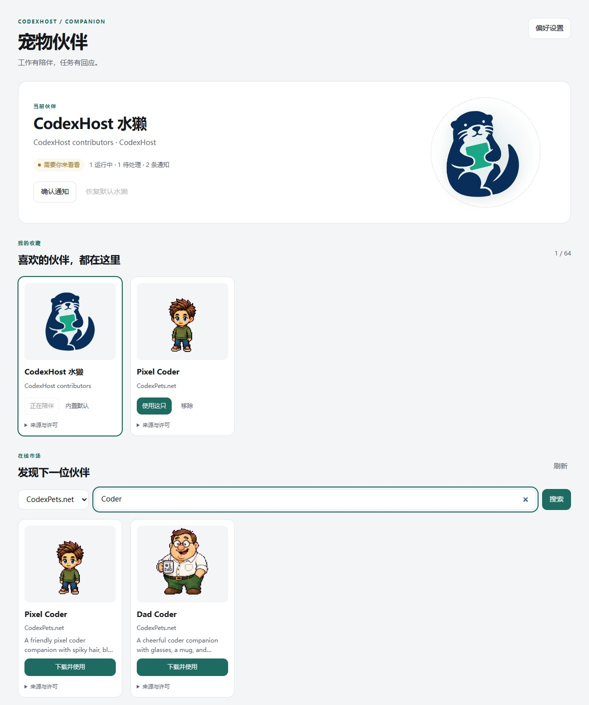
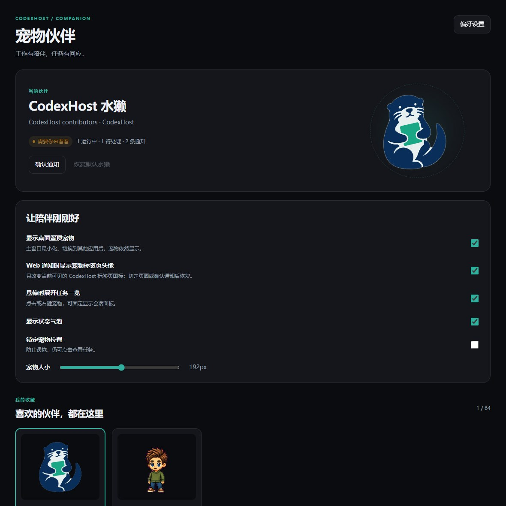
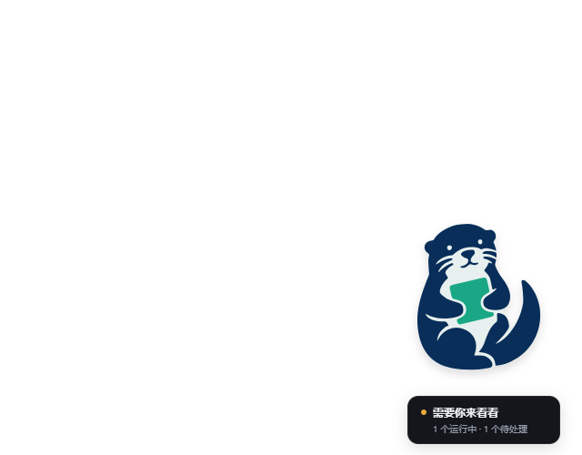
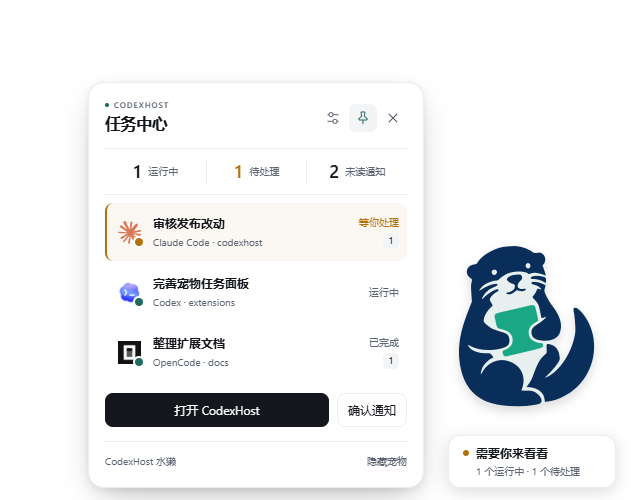
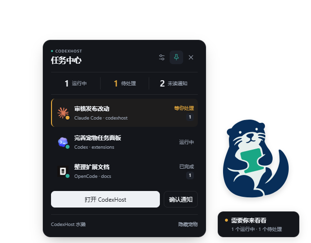
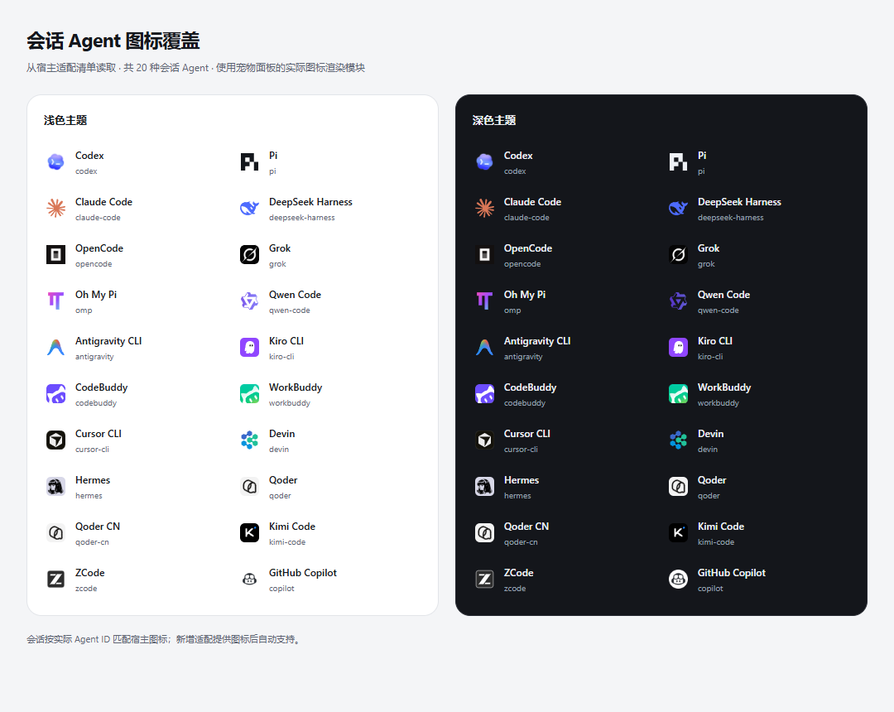
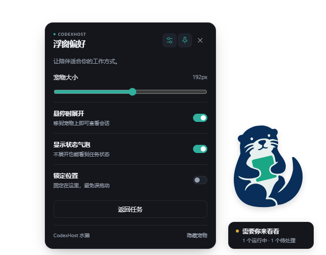

# Pet Companion extension

Pet Companion is an optional `manifestVersion: 2` Host extension. Its shared backend owns one selected pet library and one status loop for Desktop and Web. It starts with the built-in CodexHost Otter, reusing the official vector artwork and adding lightweight motion for the five task states. The otter works offline and remains available alongside up to 64 downloaded market pets. Market pets are validated as bounded image-only ZIP packages before they are persisted.

## Runtime behavior

- The Desktop entry opens a managed transparent native window when a pet is selected and the native shell is available. The window is always on top, skips the taskbar, follows the Host activity summary, and closes when the extension is disabled, uninstalled, or the Host exits.
- The window uses a loopback URL with a random path token. It serves only its own HTML, CSS, modules, current sprite, state, and bounded action endpoint. Native hit regions keep the transparent background click-through while the pet and controls remain interactive.
- Hovering the pet opens the CodexHost task center. A compact summary separates running tasks, waiting tasks and unread notifications. Each session row shows its actual Agent icon and name, bounded title, project basename and state; waiting sessions appear first, then running, failed and recent sessions. Icons reuse the installed Harness presentation, with a generic fallback when unavailable. Clicking a row brings the CodexHost Web surface to that session. The header switches to a separate preferences view, keeping position locking and appearance controls out of the session list. A deliberate click pins the overview; Escape or the close control collapses it.
- The Web entry contributes a PNG avatar to the current visible CodexHost document. It never changes another site or tab. The original icon links are restored when the document is hidden, the notice is acknowledged, or the extension is unloaded.
- The page exposes settings for native-window visibility, Web avatar notifications, pet size, hover expansion, the status bubble and position locking. A downloaded pet remains usable while the catalogs are offline. The floating panel keeps compact preferences available next to the pet.
- First activation selects the otter. Existing market selections are preserved; removing the selected market pet or choosing **Restore default otter** returns to the built-in character. The otter cannot be deleted. The vector renderer preserves the brand silhouette, respects reduced motion, and crops its head for Web notification avatars; market atlases retain their original animation.

The floating task center follows the native shell's white/slate surfaces, neutral text and teal accent in light and dark themes. Status colors are confined to small markers, counts and attention rows. The management page follows the host's `--cx-page-*` theme variables.

Agent icons cover all installed session adapters. The panel resolves each session's actual Harness ID through the Host's presentation metadata, including vector artwork, image backgrounds, corner radii and padding. There is no fixed list of Agent names; newly installed adapters with artwork appear automatically. Native Codex uses the same official mark as the Web sidebar. Usage-only plugins are not session Agents.

## Markets and attribution

The page reads Codex Pets, Petdex, and CodexPets.net. Each adapter validates HTTPS origins, refuses credentials and arbitrary ports, bounds response sizes, follows only bounded same-market redirects, and uses short request timeouts. CodexPets.net publishes its gallery as page data rather than a stable listing API; the adapter reads the public data frame and reports a format error if the site changes. Downloaded metadata retains the market source, author, and supplied license text. The extension does not infer a license when the market omits one.

## Distribution

Run `node tools/package-pet-companion.mjs` to create `dist/pet-companion.zip`. The script writes `manifest.json` at the package root and refuses symlinks and packages larger than 64 MiB. Import the ZIP from Desktop **Settings → Plugins → Import** or Web **Plugins → Import**, enable the extension, then open the enabled page from the Web top page switcher or the Desktop plugin page.

For publishing, attach the ZIP to a GitHub Release and keep its checksum in the release notes. Publish the source and release artifact together; do not check downloaded market packages into the repository.

## UI examples

These captures use isolated review data with the built-in **CodexHost Otter** selected. The downloaded **Pixel Coder** is by [CodexPets.net](https://codexpets.net/pets/pixel-coder); catalog cards retain each market contributor's name. Market images are UI demonstrations, not bundled pet atlases.

The following icon overview uses the floating panel's actual renderer and the artwork from every session adapter in the release catalog, plus native Codex. It is a coverage preview; the task center displays the Agents of observed sessions.

The floating-view capture renders the same page served to the native helper. Native helper readiness and disable cleanup were verified on Windows; dragging, click-through behavior, session navigation and macOS/Linux presentation still require manual platform checks.

The overview does not infer which session is selected in another frontend. It lists sessions observed through this Host's task events; it does not enumerate all saved history. Acknowledging a notification clears its unread indicator without answering an approval or question. Terminal filters and terminal fullscreen visibility rules do not apply to this Thread-based extension.
