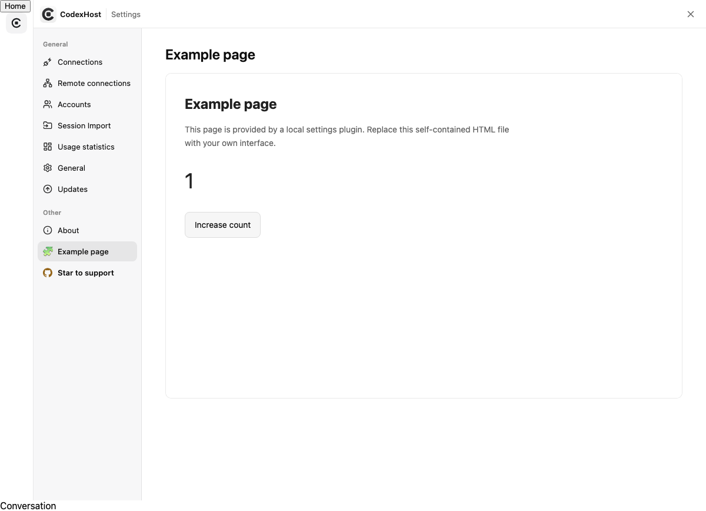

# 设置页插件

本地设置插件可以向 codexhost 设置导航注册自己的功能页面。核心只负责发现、导航和页面装卸，具体内容由插件的 HTML 文件提供，不预置业务分类或组织信息。

## 安装与启用

设置插件位于 `~/.codexhost/settings-plugins/`。设置了 `CODEXHOST_DATA_DIR` 时，使用该目录下的 `settings-plugins/`。该目录独立于 Agent Harness 插件目录，不需要实现 Agent 或 Adapter。

安装布局：

```text
settings-plugins/
  enabled.json
  example-page/
    manifest.json
    index.html
```

`enabled.json` 是显式启用清单；发现文件本身不代表授权加载：

```json
{"version": 1, "enabled": ["example-page"]}
```

`manifest.json` 声明插件标识、版本及页面：

```json
{
  "manifestVersion": 1,
  "id": "example-page",
  "name": "Example settings plugin",
  "version": "1.0.0",
  "pages": [
    {"id": "overview", "title": "Example page", "icon": "🧩", "entry": "index.html"}
  ]
}
```

插件标识必须与目录名相同，使用小写字母开头的字母、数字以及单个点、下划线或连字符分段，`codex` 为保留标识。页面标识使用小写字母、数字和单个连字符分段。图标支持 Emoji 或短文本，最多 16 个 UTF-16 代码单元；标题最多 64 个字符。

每个插件最多注册 8 个页面，总计最多展示 64 个页面。入口必须是插件目录内的相对 `.html` 文件，单页上限为 256 KiB。清单不接受任意脚本入口、绝对路径或远程网址。

完整的中性示例见 [`examples/settings-plugins`](../../examples/settings-plugins)。将示例插件目录放入自己的本地设置插件目录，并把其 ID 加入 `enabled.json`；已有配置应合并 ID，不要直接覆盖启用清单。

重新打开设置会重新读取清单，无需重启应用。页面内容在用户点击导航项时才读取。切换页面、关闭设置会卸载当前页面；再次进入时重新创建，页面内的临时状态不会保留。移除启用 ID 后重新打开设置，对应页面消失。新设置扩展能力需要先安装包含该功能的 codexhost 版本。

## 页面能力与隔离边界

页面运行在带 `allow-scripts` 的 sandbox iframe 中，可以使用自己的 HTML、内联 CSS 和 JavaScript 构建交互界面。需要使用构建工具时，应输出自包含的单个 HTML 文件。

页面不拥有宿主同源权限，不能读取宿主 DOM、Cookie 或 localStorage；也没有 Node.js、Electron、Host RPC 或聊天访问接口。宿主添加的 CSP 禁止外部脚本、样式、图片和 fetch 等资源请求，只允许内联脚本、样式和 data 图片；不授予弹窗、表单提交或顶层导航权限。它不是任意外部网站的嵌入入口。

启用表示信任该本地插件的页面代码。沙箱隔离数据访问，不提供 CPU 或内存配额隔离。

此版本不提供宿主数据读写桥。依赖宿主文件、服务认证或聊天内容的功能页，需要另行设计有权限边界的接口；不得通过同源 iframe 或直接注入宿主脚本绕过隔离。

宿主通过 `codexhost/settings-plugins/list` 返回 `{pages, unavailable}`，通过 `codexhost/settings-plugins/read` 接收 `{pluginId, pageId}` 并返回 `{html}`。这些接口用于本机设置导航装配，不向沙箱页面暴露。不同插件的页面注册为 `plugin/<pluginId>/<pageId>`，不占用内置页面 ID。

设置插件始终从本机 Host 加载，不随当前聊天的远程连接切换。组织专用页面及配置应保留在本地插件目录，不提交到社区仓库。

## 故障处理

损坏或缺失的插件清单会隔离该插件，其余页面继续展示；「扩展页面」提示检查本地配置后重新打开设置。页面文件无法读取时展示错误及重试按钮，不执行部分内容。关闭或切换页面后，迟到的读取结果不会重新挂载页面。

下图来自独立浏览器测试，使用仓库中的中性示例：


