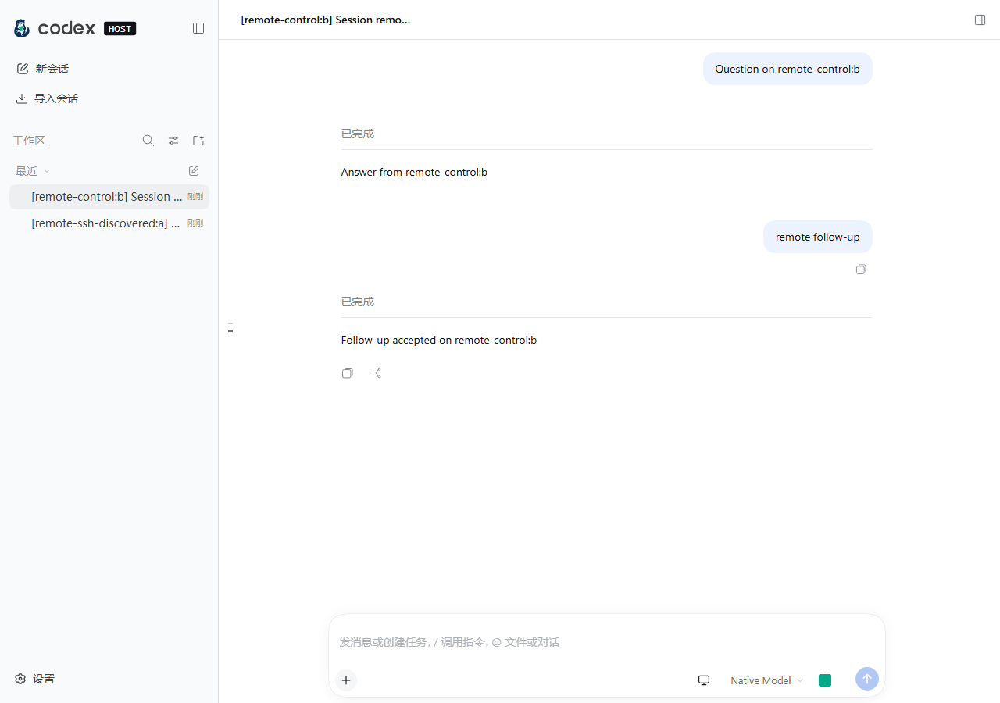

# 独立 Web 应用

Web 与 Codex Desktop 在同一仓库开发，浏览器通过 `packages/web-server` 的独立 Node 服务访问。默认 `codexhost` 会话来源按需启动或连接独立的本地 CH 后台，复用 CH 的 Thread 目录、创建、读取和操作；Web 网关不直接读写 Mapping Store、不为外部 Threads 启动第二份 Adapter，也不登记 Desktop 进程所有权。主列表同时展示本机原生 Codex Threads 和共享外部 Harness Threads，不按原生会话的 Model Provider 排除会话。原生 Codex 保留原始 Thread ID，通过共享 Host 使用 Desktop 相同的官方 app-server；外部 Harness 继续由共享后台的外部 Thread 运行时执行。Web/PWA 共用响应式界面；尚无 iOS/Android 原生封装。

### 本机原生 Codex 会话

已有原生 Codex 会话不需要“导入”即可查看历史、续聊、停止当前 Turn、重命名和归档。浏览器只是同一运行时的客户端，不为每个原生会话启动新的 `codex app-server`，也不把原生 ID 转成外部 Harness ID。消息、任务状态和待处理交互通过共享通道重新同步；断线后不自动重发结果未知的写请求。模型、Thinking 和权限可在 Web 切换，仅在官方 `thread/settings/updated` 确认后显示已生效；权限选项来自官方档案列表。官方 Thread 支持共享队列、`/compact`、`/review`、Skill 菜单、同目录 Fork、置顶和用量，Web 不开放其历史回退。

Codex 的 Fast 闪电仅在官方 `model/list` 为当前 Model 的 `serviceTiers` 声明 `priority` 时显示，不根据 Model 名、Thinking 或旧 `additionalSpeedTiers` 推断能力。普通和 Fast 复用公共 `fastModel` 引用契约，对应同一原生 Model；Host 将开启转换为 `serviceTier: "priority"`，显式关闭转换为 `serviceTier: null`。未指定 Model 选择时不覆盖官方默认或恢复配置。创建响应、恢复响应和 `thread/settings/updated` 中确认的档位决定选中状态，Desktop 的配置变化也会同步。

运行中切换通过 `thread/settings/update`，保留 Thinking，并等待成功响应及 Model、service tier 均匹配的通知后返回确认；省略 service tier 的 Thinking 或权限更新不会清除 Fast。后续 Turn 沿用官方 Thread 设置，不把 Fast 引用作为原生 Model 名发送，也不承诺改变正在运行的请求。Fast 可能增加额度消耗；目录声明仅表示能力，不保证账号可用额度、实际调度或速度。

选择器在官方程序可用时只显示一个“Codex”，首次发送创建官方 Thread，Desktop 使用同一身份；不可用时不显示 Codex，其他 Harness 不受影响。无项目时由 Host 分配默认生成目录，Web 不自行分配。官方历史直接以官方 Thread 显示。已有外部映射按普通列表规则处理，可能与官方历史重复；列表可见不保证对应 Harness 可用或可续聊。

本节描述本机共享 Host 的原生目录。Desktop 已有 SSH／Remote Control 主机通过上文的远程会话目录独立聚合并按 Host 路由；Relay、Tailscale 和局域网仅提供浏览器到 Web 的访问通道。

## 启动与核心内容优先

客户端模块激活后挂载页面框架；连接、项目、侧栏会话、设置、模型和权限目录分别加载，各自就绪各自展示，不通过全局等待把聊天与非必要目录、用量或更新检查绑定在一起。已有选中会话和 `?session=<id>` 直链通过 ID 解析摘要并打开最近历史，不等待完整侧栏或项目列表。ID 解析期间显示局部状态，失败保留错误及重试入口，不视为空目录；新的会话或页面导航会使旧解析结果失去导航资格；明确新建即使因项目尚未就绪而清空选择或拒绝初始化，也会使旧解析过期。

空白草稿的自动恢复仍等待真实项目归属和写入资格检查。会话历史未完成打开时禁用 Composer；模型／权限配置的加载或失败只影响对应控件及必要的发送前提，不隐藏已到达的聊天内容，也不把未确认的能力显示为可用。沿用既有认证、连接恢复、会话持有和历史分页，不增加持久缓存或过期数据回退。

## 安装为 PWA 应用

Web「设置 → 通用设置 → 其他设置」提供「安装 CodexHost 应用」入口。浏览器发出可安装事件后，点击「安装应用」唤起原生确认弹窗；确认、取消或失败后不重复使用同一次安装事件。用户接受安装请求不等于安装完成，只有浏览器确认完成或页面以独立应用模式运行时才显示已安装状态。安装事件由浏览器壳在异步加载插件前监听，设置入口通过客户端服务读取，不依赖设置页是否打开；浏览器没有提供事件、暂不满足条件或已在其他窗口安装时，显示「安装指引」，不据此断言浏览器不支持 PWA。

指引按当前设备说明安卓浏览器菜单、iOS/iPadOS Safari「添加到主屏幕」、macOS Safari「添加到程序坞」及桌面 Chrome/Edge 的入口；应用内浏览器建议改用外部浏览器。PWA 需要 HTTPS 安全上下文，本机 localhost 除外；普通局域网或 Tailscale IP 的 HTTP 访问会提示使用「连接设备」中已配置的 HTTPS 地址，不自动改写或跳转地址。是否提供安装及其形式由浏览器决定，创建快捷方式不等于安装 PWA；页面不能绕过用户确认。安装不下载原生 CodexHost、不请求通知权限，也不提供离线 Agent 执行，仍需连接运行中的 Web 与 Host。原生 Desktop 壳不显示此入口。

## Web Push 通知

Web「设置 → 通用设置 → 通知」为当前浏览器开启通知，并提供测试推送。需要浏览器授权、HTTPS 安全上下文（localhost 除外）和可用的系统通知设置；iPhone／iPad 需先添加到主屏幕，再在主屏幕应用内开启。电脑上的 Web 与 Host 必须保持运行且能连接浏览器推送服务，浏览器页面不必保持打开或订阅会话正文。

网关直接监听共享 Host 的回合完成和待交互事件，读取有界快照，向有效订阅推送原生 Codex／外部 Harness 的完成、失败、待审批或待回答通知；通知不代替用户回答交互。停止或取消的回合不发送完成通知。没有推送订阅时不为通知读取快照，正文增量也不触发通知读取。同一 Host 代次内近期回合／交互按身份去重；断线续接按事件日志处理，启动或无法续接的完整重置不扫描旧历史补发，通知不保证持久送达。点击通知打开对应会话。无论 Web 页面在前台、后台还是已关闭，Service Worker 收到推送后均请求显示系统通知，不因页面可见或获得焦点而跳过；实际呈现受系统通知权限与专注模式等设置影响。

## 安装版后台 Web

安装包和 npm 包均包含 Web，无须源码或运行中的 Codex Desktop。npm 用户可直接运行以下命令；macOS 安装包将 `codexhost` 替换为 `/Applications/codexhost.app/Contents/MacOS/codexhost`（按实际安装位置调整），Windows PowerShell 使用 `& "$env:LOCALAPPDATA\Programs\codexhost\bin\codexhost.exe"`。

```sh
codexhost web
codexhost status
codexhost web --host 0.0.0.0 --port 4500
codexhost stop
```

`codexhost web` 确保 Host 和 Web 在后台运行，输出本机登录链接并打开浏览器；SSH 或无图形界面时只输出链接。`codexhost` 打开 Desktop，同时在后台拉起 Web；未安装 Desktop 时说明原因并改为打开 Web。`CODEXHOST_WEB_SERVICE=0` 禁用 `codexhost` 随启动拉起 Web 的行为。Windows 的后台监管进程和 Node 服务均不创建控制台窗口。启动命令成功返回后，关闭原始终端、GUI 或浏览器不停止或重启后台服务；电脑休眠时手机仍无法连接。

首次后台启动默认监听 `127.0.0.1:4400`。`codexhost web` 的 `--host`、`--port`、`--public-url`、`--trusted-proxy`、`--relay` 经 Web 处理后保存在 `<web-data>/service.json`，后续启动沿用；传空字符串清除对应选项，无效值不覆盖保存内容。选项变化只重启 Web，Host 任务不受影响，Web 终端会断开。`--relay` 仅作为自建中转地址的开发覆盖，不改变官方中转卡片。本机连接设备页提供中转配置（无需重启）、首次启用设备访问和启动设置，见[远程访问](web-remote-access.md)。

版本、安装位置及选项一致时复用服务。`codexhost` 或 `codexhost web` 发现 Host 或 Web 的版本、运行入口不一致时切换为当前安装；Host 被替换会中断任务并输出任务数，会话记录保留，任务不自动续跑。后台 Web 就绪后崩溃会退避重启，启动阶段失败不重试。`codexhost status` 只读显示 Host/Web 状态与版本、不含 token 的 Web 地址、最近失败原因和自启状态，不启动服务。

`codexhost stop` 不确认，按 GUI、Web、Host、远程服务、Broker、Console 的顺序停止，并报告本地 Host 被中断的任务数；用户自行打开的 Desktop 不关闭。远程服务停止后，其他电脑重新连接可恢复远程服务。自启项、Serve 配置和会话数据保留。前台开发 Web 不属于此命令的停止范围，开发者使用下文的 `npm stop`。


## Desktop 已有远程会话

远程命令和文件审批复用 Web 的本地化审批组件，正文只展示命令、工作目录、文件路径和原因，不展示传输标识。远程工作区既不能作为本地工作区排序的拖动源，也不能作为放置目标。

Web 主列表合并当前 Codex Desktop 已知的 SSH / official Remote Control 连接上的未归档 Thread。侧栏项目显示原生主机名称与连接状态，本机项目显示“本机”；会话标题保持原名，最近列表及搜索结果也携带远程主机标识。引用保留 `{hostId, threadId}`；浏览器 Session ID 使用 `web-remote:` 加该二元组的 base64url 编码，因此不同主机上的同名 Thread 与本机 Thread 不会合并。此能力需要包含远程会话 Controller API 的 codexhost Desktop 正在运行；独立本机 Host 的运行不代表 Desktop 远程连接可用。

Web 读取 Launcher 的私有本机 runtime descriptor，经已有 nonce 鉴权的 loopback Controller 通道访问 Desktop 原生 manager，不创建连接配置、不复制远程凭据、不修改网络设置。发现过程读取原生 SSH/RC 目录，展示已配置但离线的主机；仅对原生 autoConnect 已启用且处于 disconnected 的连接，在本次 Desktop 生命周期内请求一次原生连接恢复，不打开被用户禁用的连接，不重试结果未知的恢复请求。Relay、Tailscale 只解决浏览器到 Web 的入站访问，不提供远程主机目录。

Linux 的 Web 与 Desktop 环境不同时，发现过程还检查当前用户标准 `/run/user/<uid>` 和 state 目录；每个候选都必须通过私有文件、所属用户和 Launcher 存活校验。存在多个不同的有效描述文件时拒绝选择。可为 Web 显式设置 `CODEXHOST_DESKTOP_RUNTIME_DESCRIPTOR` 为 Desktop 的私有 `desktop-runtime-v1.json` 绝对路径；发现失败会给出该诊断，不记录 nonce。选择在派发前完成，失去回执后不会换候选重发。

本机列表立即返回，远程目录在后台刷新并发布列表差量。侧栏归档/撤销使用原生远程归档操作，确认后合并本机与远程归档集合并广播给其他浏览器；已确认的远程归档行保留到本次 Web 进程结束，以便目录刷新后仍能撤销。远程归档状态不写入本机历史；完整远程归档目录的重新发现尚不提供。消息文本 `prompt.text` 最多为 8000 个 UTF-16 代码单元；发送前还会按完整 JSON 请求的 UTF-8 字节数（含转义、nonce 和分隔符）校验 16 KiB Controller 上限，两项限制均适用。超限提示缩短消息，不报告为已派发后的未知结果。

支持读取会话、空闲时文本续聊、停止当前 Turn、改名、归档，以及 manager 提供原生 pending request 和 responder 时的命令/文件变更审批（允许一次、拒绝）。线程 resume 和 turn/start 使用原生 ID，owner 和鉴权由原生 manager 保持。缺少原生审批方法的旧 manager 或其他交互类型会提示回 Desktop 操作，不伪造权限能力。远程文件上传、终端、本机路径打开、模型/权限切换、fork、编辑、队列和 steering 不提供；这些请求不会落到本机 Thread handler。远程项目来自 Desktop 保存的 remote-projects，按 hostId+项目 ID 隔离；归属优先使用原生项目分配，其次在该主机已登记项目的路径范围内匹配，未匹配的会话保留在对应主机分组。分组仅用于只读导航，不把远程路径交给本机目录创建、终端或文件操作。

列表每个 Host 最多读取 100 页，每页 100 条；超过限制不发布不完整目录。打开的会话每 1.5 秒读取不消费事件的绝对快照，多个浏览器独立可见；关闭跟随即停止读取。快照保留原生 Turn/Item ID，单次 Controller 响应上限 16 MiB，超大完整历史当前不可用，应在 Codex Desktop 打开；远程快照尚无端到端分段读取能力，调整浏览器消息页大小不能绕过这一上限。连接失败保留已见列表并标记离线；已打开的跟随保留订阅，读取按指数退避重试，最长间隔 30 秒，连接恢复后无需重新打开。关闭视图后停止重试。连接代际变化会使旧审批失效，重建浏览器投影。所有写请求只发送一次，超时或断线报告结果未知，不自动重发消息或审批；读后同步失败不否认已确认的写入。

本机 native Codex 目录及其共享 app-server 生命周期由本机来源负责，与此远程聚合独立。隔离 fixtures 覆盖复合身份、断线、代际、未知结果和审批路由；这些检查不代替 Windows/macOS 上真实 SSH、RC 活跃 Turn、Desktop 与多浏览器同时响应的实机验收。

下图来自隔离 Controller fixture，展示同名远程 Thread 与定向续聊，不代表实机连接验收。



## 手机会话标签栏

手机布局（AppFrame 实际宽度小于 640px、`data-phone`）保留当前会话标题及原有 lineage／父会话入口。标题旁箭头展开／收起会话标签栏，与「显示会话标签」共用浏览器偏好；方向和 `aria-expanded` 跟随已接受的值，不打开会话浮层。正式会话在首次成功打开时追加到右侧，重复打开保持原位置；当前会话保留并高亮，以 `aria-current` 标识。标签没有小数量硬上限，可按配置的闲置时长自动关闭，超宽使用原生横向滚动；没有「全部」、搜索或独立标签管理弹窗，完整查找仍用侧栏。空白／未正式会话不写入标签集，正式化和 CH 草稿身份绑定沿用已有导航流程。

标签按标题自然宽度排列，短标题收窄，长标题最多 164px 且不超过可用视口，超出单行省略。切换仅改变底色和边界，不改变字重或尺寸，避免选中标签撑动相邻项。左侧 14px Harness 图标通过独立 root identity slot 复用侧栏同一 `SessionHarnessIcon` 及插件 presentation，不猜品牌；身份缺失和资源失败使用原有回退。每项保留 32px 视觉面、44px 高度、8px 圆角和 6px 间距，以及主题 token 派生的半透明填充、8px backdrop blur（含 Safari）和实色可访问性回退。右侧关闭图标视觉为 12px，独立按钮热区为 44×44px，与会话切换按钮并列，不嵌套或共用点击处理；关闭事件不触发被关闭会话的切换按钮。标签不是业务资源 owner：关闭非当前标签只移除入口；关闭当前标签先切换右邻，无右邻则切左邻；关闭最后一个标签返回空白会话页。关闭不删除、归档会话、不停止任务，也不改变原有 keepalive 保留策略；可从侧栏重新打开并追加为新标签。

横向滚动位置由 Workspace 注册层持有，不存于随 Session 重挂载的 header 组件。滚动时更新该位置，点击切换或关闭前同步捕获，header 挂载后在布局阶段、绘制前恢复。切换不滚回最左、不调用标签的 focus／scrollIntoView，也不因选中项改变自动横滚；新开标签同样不强制滚到右侧。内容宽度或视口尺寸变化时允许浏览器按真实滚动边界夹取位置；全部标签关闭后重置为空栏位置。正文、Composer、手机抽屉横滚避让、原生惯性和双指缩放不变。

HTTP(S) 页面以当前 origin 的 localStorage 保存 `codexhost.web.session-tabs.v2:local`，格式为 `{version:2, entries:[{sessionId,target,lastVisitedAt}]}`，数组顺序就是标签顺序，时间不参与排序；不保存标题、状态、正文、草稿或认证信息。origin／local 不是机器 UUID 或身份授权证明。解析校验版本、异常体积、字段、Session ID、非未来访问时间和公共 `SubagentAddress`；去重但不排序。缺少访问时间的记录以恢复时刻作为本次闲置计时起点，不因缺失字段立即清除。`codexhost.web.session-tabs.v1:local` 和 `codexhost.web.recent-visits.v1:local` 可按原存储顺序迁入标签缓存，成功写入后移除来源记录；新缓存独立于仍运行的旧版页面。跨浏览器 tab 不增加实时协调协议：写入前读取最新缓存，只对本次打开的身份原位更新／追加，或移除明确关闭／失效项，不用旧页面的完整快照覆盖新缓存。闲置清理写盘前重新按已读取的最新访问时间判断，避免删掉其他页面刚访问的缓存身份；不承诺跨页面原子协调。异常缓存大小只作持久化安全保护，不用于正常标签淘汰；存储失败保留本页面能力，通过既有 Workspace Toast 提示一次。退出只清内存，不删除缓存；显示偏好关闭也不清标签。

缓存不是 Host 事实：恢复优先使用 Controller 已有摘要，缺失项通过公开 `loadSummary()` 以最多 4 个并发补齐，不分页遍历或递归打开父子历史。失败不阻塞选择，也不作为删除证据；已有成功头页刷新事实 `headRefreshRevision` 可触发后续摘要重试，不表示完整分页或删除。直接摘要的 `summaryOnlyIds` 不作为 keepalive 后台正文预热来源，不增加 retain／follow／已读操作。仅展示当前 Host 已确认的真实摘要与归档事实；地址型子会话还须匹配当前公共 catalog 的 parent／child 路由。删除、归档和权威子会话移除会清理对应入口；分页遗漏、pending、错误和子 Agent 离线不能当作历史删除。后台消息、updatedAt、运行结束及完成提醒不改变标签顺序，名称和运行／待交互状态来自已有真实投影。

「设置 → 通用设置 → 显示 → 显示会话标签」默认开启，标题旁以中性「移动端」标记说明适用范围；仅在勾选后，其下同组显示「自动关闭闲置标签」选择器，默认 60 分钟，可选不自动关闭、15／30／60 分钟、2／4／24 小时；选择器与显示开关共用保存中及失败反馈，值只跟随成功保存的偏好。显示偏好关闭时保留时长配置、隐藏下级设置并暂停自动清理。闲置时长为 `ui-workspace.tabIdleTimeoutMinutes`，0 表示关闭；该设置与 `ui-workspace.showRecentVisits` 一同沿用 `ConfigForms.registerBrowser()` 和 `BrowserPreferences` 的客户端 allowlist、存储校验及同源 `storage` 偏好同步。关闭时标签栏零高度，重新展开保留本页顺序与横向位置；保存失败保留已接受设置并提示。宽屏 Web 可修改偏好但不显示标签栏，Codex Desktop 原生 Renderer 不受影响。焦点回到标题箭头或稳定导航节点，不强制聚焦 Composer；真机触摸、横向惯性、键盘及无障碍表现仍需实际验收。

自动清理只读取现有目录的毫秒级 `updatedAt`，结合实际打开及离开当前会话时记录的 `lastVisitedAt`，取较新值作为闲置起点；它不是键鼠活动或正文采样。当前选择、过渡中 mainView 持有项、正在运行（含已知运行子会话）和待交互项保留；浏览器连接未确认、目录未就绪／正在刷新／读取失败、缓存身份／路由未确认或子会话运行状态未知时不判作闲置，ID 导航解析期间也暂停清理。启用且页面可见时每分钟进行一次本地检查，修改设置后重新安排检查；后台及关闭时不保留清理定时器，返回前台从下一分钟恢复，给既有连接和目录恢复留出时间，不承诺精确到秒。自动关闭与 × 一样只移除标签入口，不调用删除、归档、停止、额外历史读取或 Host 轮询；只保留剩余标签的原顺序与横向视口，不自动选择或关闭其他会话。

## 手机连接与恢复

浏览器在同一客户端生命周期内实时保留主目录中未归档的运行会话，以及最近访问或刚结束的最多 8 个已停止会话；当前会话若已停止也计入这 8 个，运行中的会话不占近期名额。切换页面只交接视图引用，后台引用继续使用同一个会话实例和正文事件流，多路订阅共享 WebSocket，不把后台会话标记为正在查看或已读，也不改变草稿、阅读位置或滚动。仅从主目录发现运行会话，不扫描全部历史或递归预热子会话；实际打开过的子会话可进入近期集合。运行结束进入近期集合，保留正文流以接收可能晚于状态元数据到达的最后输出。

近期容量淘汰、删除、归档或客户端退出会释放后台引用；其他消费者仍持有的会话不被强制销毁。超出实时保留范围的冷会话按需打开，可先显示最近 8 个已释放视图的静态缓存，再校验正文。首次打开、冷会话和真实断线／重连仍可能出现正文同步提示；实时保留不跳过同步确认。断线不主动清空暖会话，恢复沿用各正文流的 epoch/cursor 续接，历史被改写时回退到权威快照，不重放用户操作；页面隐藏也不主动取消这些订阅。

聊天标题下方的状态条独立显示浏览器到 Web 网关的连接，以及网关到 Host 的可用性；手机收起侧栏、未选择会话时也能看到浏览器连接提示。断线保留已显示的正文和草稿，提示上次历史同步时间；运行提示改为任务状态待确认，不把手机断线解释成后台任务停止。

Web 网关默认每 30 秒向浏览器发送 WebSocket 协议层 Ping，仅在连接建立后或上次收到 Pong 后连续 10 分钟无回应时，于下一次心跳检查关闭连接；收到 Pong 重新计时，后台停留时长本身不触发断线。该宽限不延迟已关闭或出错连接的清理，不改变电脑与 Relay 的心跳，也不能阻止手机系统或中间网络关闭连接。

浏览器 WebSocket 在前台空闲 25 秒后发送应用层心跳，默认容忍 10 秒的匹配回复等待时间。心跳只由网关回应，不读取历史、不调用 Harness；有效消息会推迟空闲探测。页面隐藏时不主动断开连接或取消会话订阅，并清除现有心跳期限，避免后台延迟回调误判断线。切回可见或从页面缓存恢复时，先立即发一次主动心跳，默认最多等待 2.5 秒，以缩短前台等待，同时为短暂网络抖动留出余量；`StreamHeartbeatOptions.restoreTimeoutMs` 可显式覆盖，与普通心跳的 `timeoutMs`（默认 10 秒）独立。收到匹配回复就继续使用原连接、代次和订阅。已建立连接明确断开、探测超时或恢复时连接已不在，则由现有 Connection 循环在旧代次释放后立即发起首次新连接；网络由离线转为在线也立即尝试一次。首次恢复失败后，连续尝试仍使用现有有界指数退避（默认 500 毫秒基数、2 倍增长、10 秒上限，等待为当前上限的 50%～100%），进行中的连接尝试或退避不因前台恢复事件反复重置。同一时刻的多个恢复事件合并处理，停止后取消待处理事件与心跳。恢复不刷新页面、不清空正文或草稿、不重发结果未知的写操作；手机系统回收页面后的冷启动及其他整页重载原因不在此恢复机制的覆盖范围内。浏览器的在线／离线事件用于辅助判断，设备在线不等于服务器可达。

连接正常时，首次读取、发送后的历史更新与 follow 基线重建均静默同步，不显示顶部加载横幅，也不因同步状态切换挤动正文。连接检查和重连持续超过 1 秒才显示状态条，运行状态同样超过 1 秒才改为“连接中断，任务状态待确认”，短暂恢复不打扰；浏览器报告离线、Host 不可用和同步失败立即显示。网关因 Host 改写历史而重建 follow 时，在标准错误输出记录 Thread、Harness 和原因，便于定位重复重建；连接正常时的这类重建不提示连接中断。同步错误保留旧内容并提供重试连接。历史 follow 基线仍须完成校验和发布才算同步完成，不以横幅隐藏代替同步确认。恢复不整页刷新、不重启 Host，也不自动重发发送、停止或其他结果未知的操作。主屏幕 Web App 的后台执行受浏览器与系统限制，不保证锁屏期间保持连接；真实 iOS／Android 的后台恢复和弱网体验仍需真机验收。

## 代码与构建

- `packages/adapters/*`：外部 Harness 接入实现；官方 Codex 由 Host 的 `codex-runtime` 接入，不经 Adapter。
- `packages/web-server`：Web 会话存储、HTTP/WebSocket、交互关联、Harness 事件到 DSH 界面协议的投影、认证与 Web Push。
- `apps/web-ui`：从 DSH 衍生的浏览器界面、Cordis 浏览器运行时与协议源码；仅保留所选界面依赖，来源和许可见其 README。未迁入 DSH CLI、独立 Agent Loop、原仓库 CI 或 Git 历史。

仓库统一使用 npm Workspace 和 `package-lock.json`。Web 消费公共插件上下文与命令类型；现有会话投影仍使用结构化类型子集，并不是新的 Harness 专属实现。旧 DSH 协议字段 `provider` 在本应用中携带 Harness ID，不表示 Model Provider。

```sh
npm ci
npm run build:web
npm start web
# 4400 已有旧 Web 服务时，不重启 Desktop；改用另一端口：
npm start web -- --port 4401
```

Web 默认端口为 **4400**，控制台默认端口为 **4399**；可用 `--port` 显式覆盖 Web 端口。`npm start web` 默认监听所有 IPv4 网卡；手机可通过终端输出的局域网或 Tailscale 地址访问，并用 Web 设置“连接设备”中的二维码或访问令牌登录，见[访问认证](#访问认证)。需要相应网络可达且防火墙允许入站，不会自动配置穿透或公网端口转发。不要将明文 HTTP 直接暴露到不可信网络；跨网络优先使用 Tailscale，或配置 HTTPS 反向代理。

`npm start web` 默认先执行 `build:web`，构建成功并验证产物后判断共享 Host 是否变化，再停止相同工作树、相同端口的旧 Web 开发服务并启动当前 Web。Host 未变时仅重启 Web；Host 变化且 Desktop 未开启时通过原生 `host restart` 重启 Host；Desktop 开启时，构建后提问是否重启 Host（`[y/N]`），输入 `y` 重启，输入 `n` 或回车保留；提示会说明重启将中断任务，提问期间旧 Web 保持运行。保留时提示新界面连接的是旧 Host。没有运行中的 Host 时不执行 restart，由界面后续的 `host ensure` 自动拉起。非交互（stdin 不是 TTY）遇到需要提问的情况时保留 Host，并警告可用 `--restart-host` 重启。两条启动命令都支持互斥的 `--restart-host` / `--keep-host`，分别强制重启已有 Host 或保留 Host，不再提问。Host 重启会中断其所有运行中的任务，另一端界面自动重连；Web 命令不会关闭 Desktop。

Web 按内容寻址快照的 runtime 路径（或 `--ch-host-runtime` 覆盖值）与存活 Host 的 ready 记录比较。不带 `web` 的 `npm start` 使用固定的源码构建入口，按 `packages/**/dist/**/*.js`（包含 Host 直接依赖的 `packages/desktop-control/dist`，排除 node_modules、`packages/web-server/dist` 和 `packages/renderer-extension/dist`）、`packages/host-runtime/dist/plugins/enabled.json`、该插件目录下各 `<id>/plugin.mjs` 与 `<id>/manifest.json`，以及 `package-lock.json` 的相对路径和内容计算 SHA-256 指纹；相同内容重写不改变指纹。GUI 命令在没有运行中的 Host 时记录本次构建，供后续 Desktop `host ensure` 使用；已有 Host 时仅在成功重启后更新 `<data>/dev-host-fingerprint.json`。运行入口和已记录指纹都相同才视为未变，无记录视为变化。GUI 在 Host 未变时仅重启 Desktop；Host 变化且没有 Web 服务运行时自动重启 Host，任意打包 Web 服务正在运行时使用相同的保留/重启提问。Desktop 存活检测复用 macOS/Windows 的开发进程识别，Linux 视为未开启。

成功构建仅显示进度和耗时；失败显示末尾最多 64,000 字符诊断，保留旧 Host 和 Web。完整构建输出可通过 `npm run build:web` 查看。`npm start web -- --no-build` 复用已有发行产物，仍应用同一 Host 判断并重启 Web。`npm run start:web` 保留兼容。Web 仅停止明确匹配的旧开发进程，不按端口直接杀进程；后台 Web 或其他程序占用端口时，输出端口占用错误并退出，不结束占用者、不自动换端口。可用 `npm start web -- --port 4401` 选择其他端口。开发重启要求本地共享 Host，旧 CDP 接入使用直接 preview 入口。

### 跨工作树停机

在包含此脚本的仓库目录运行 `npm stop`，可停止当前用户在不同工作树运行的本地 codexhost 服务，不要求当前目录已构建。它先停止 Web 热更新监听、后台 Web 监管进程及 Web 子进程（先停监管进程以防重新拉起），再通过停止 Desktop Controller 让原生 Launcher 关闭其管理的 Codex Desktop 和旧式 Host，随后停止 Host，最后停止 Console。macOS/Linux 向已确认身份的服务进程发送 SIGTERM，让现有退出逻辑和原生监督进程回收所属子进程；Windows 停止对应进程树。脚本等待服务及其原生监督进程退出；运行中的任务和 Web 终端会中断。会话、认证、配置和构建产物不会删除。

停机按 Node 入口路径及仓库/发行元数据识别服务，后台 Web 监管进程按原生 Launcher 的 `web-service serve` 命令识别，不按端口或模糊进程名杀进程，也不停止其他用户、远程机器或独立运行的 Agent。只读帮助：`npm stop -- --help`。重复执行且没有服务时正常退出。PID 已被其他进程复用时不会向替代进程发信号。无法验证 Host 监督进程或退出超时会报错，不会宣称停机完成；不要同时运行启动命令。通过相对路径手工启动、不符合仓库启动器布局的进程不在自动识别范围内。

切换到尚不支持共享 Host 的旧工作树前，先在含停机脚本的工作树执行 `npm stop`，再到目标目录执行 `npm start`；这不会为其他分支自动安装新命令。必须从独立终端执行停机，不要让需要停止的 Host 内部 Agent 执行，否则当前任务本身也会被中断。该命令提供停机能力，不保证修复其他构建或 Desktop 兼容性问题。

### 前端开发热更新

`npm start web` 默认开启前端热更新。在上述构建与 Host 保留/重启处理完成后，才启动 Web UI 监听构建（`apps/web-ui/scripts/build.ts --watch`）和 Web 服务，避免监听构建日志打断交互提问；Web 服务以 `--dev-web-ui <apps/web-ui>` 直接读取工作树的前端产物，而不是发行目录中的副本。修改前端源码后无须重启 Host 或 Web：

- `packages/*/*` 下的客户端插件（如 `ui-chat`、`ui-sidebar`）由 tsdown 增量重建，服务端轮询各插件的 `lib/client.js`，内容变化时经 `/plugins/events` SSE 推送 `rebuilt`，已打开的页面就地替换该插件，不刷新页面。被替换插件及依赖它的插件的 React 状态会重置；会话、工作区与连接保持。
- 静态链接进页面外壳的包（如 `ui-primitives`、`store`、`ui-slots`）及 `apps/web` 由 Vite 监听重建，服务端检测到 `index.html` 变化后推送 `shell`，页面整页刷新。
- 内容未变的重写（例如监听启动时的首次构建）不会触发替换。CodexHost 设置页（`renderer-extension`）、Web 服务与 Host 代码的修改仍需重新执行 `npm start web`。

浏览器侧沿用上游 `@deepseek-ai/dsh-client-hmr` 插件与 Client Modules 的替换逻辑；服务侧检测与推送由 `packages/web-server/src/web-hmr.ts` 实现。该插件只在 `--dev-web-ui` 时加入插件组合，发行包不包含。任一进程退出都会停止另一个。`npm start web -- --no-watch` 关闭监听构建和热更新，改为读取发行目录中的前端产物；显式 `--watch` 保持兼容，与 `--no-watch` 互斥。两种模式均可与 `--no-build`、`--port` 组合使用；`--no-build` 仅跳过初始完整构建，不关闭监听构建。直接运行打包发行入口不会默认开启热更新。

`build:web` 编译当前工作树的 CH 包并调用已有插件构建器，构建原生 Launcher，随后编译前端和打包。插件输入为 `packages/host-runtime/dist/plugins`，不是已安装的 CH.app 或另一个仓库。用量统计专用插件不作为聊天 Harness；官方 Codex 使用共享 Host 的官方后台。

发行目录为 `packages/web-server/dist/codexhost-web`，包含 Node 网关、Web 界面、同一 Host bundle、当前平台的原生 Launcher 和自包含插件；网关与 Host bundle 使用既有安装资源布局 `app/server.mjs`、`app/host-runtime.mjs`，原生 CLI 无须 Web 专用路径回退，根目录 `preview.mjs` 仍为隔离启动入口；外部会话与用量插件在后台显式启用，官方 Codex 不作为插件注册。整体目录可以移动到仓库外运行，无需源码目录或仓库的 node_modules，但原生 Launcher 不能跨 OS/CPU 使用。默认共享模式也不要求 Desktop 运行：Web、Desktop 均可独立使用，同时开启时共享后台，晚开启的一端读取最新事实；关闭任意界面不停止另一端或后台任务。需要本机受支持的 Node，Harness CLI 和其认证仍由用户安装、配置。

打包版 Web 在连接 Host 前，将随包的 Host bundle、原生 Launcher 与完整插件目录复制到 `<ch-data>/host-builds/<内容哈希>/`，完成后原子发布；相同内容复用同一路径。后台与 Web 自动重连始终引用这份快照，重新打包 Web 不会删除或替换运行中的 Host 文件，延迟加载的插件资源仍可读取。显式指定的外部运行入口、Launcher 或插件目录由调用方维护，不会自动复制。快照不包含用户凭据或会话数据，不自动清理；需要回收磁盘时，先停止相关 Web 与 Host，再清理不使用的构建。直接运行打包入口仍按共享生命周期复用已有后台；仓库开发命令 `npm start` 和 `npm start web` 重启对应界面，并按上述内容变化与另一端运行状态决定是否重启后台。

### 安装包和 npm 的 Web 资源

发行流程 `prepare-payload` 与 `prepare-npm` 共用 Web 构建入口，输出 `app/web-server.mjs`、`app/web/` 与 `app/web-modules/`。轻量入口加载 `web-modules/server.mjs`，其框架及原生依赖通过该目录的 `node_modules` 正常解析；Harness 插件复用 `app/plugins`。监管进程显式传入安装内的 Host、Launcher 与插件路径，不创建 `host-builds` 快照；独立 packed 入口在没有 `--ch-host-runtime` 时仍使用快照。

发行 Web 不提供 CDP、无认证和前端开发监听选项，也不带 `preview.mjs`；`node-pty` 仅保留目标 OS/CPU 的预编译文件。Office 入口包、worker 和 `koffi` 保留，LibreOffice 引擎不随包发布。`app/web-modules/office-engines.json` 从锁文件记录各引擎包的官方地址、版本与 SHA-512 integrity。发行版首次预览 Word、PPT 时从 npm 官方源下载组件，校验后用系统 `tar` 解压，原子安装到 `<web-data>/office-engine/<版本>/node_modules/@deepseek-ai/` 并清理旧版本。页面提示正在下载，每 3 秒重试，完成后自动显示预览；离开页面只停止重试，不取消 Web 进程中的下载。下载失败提示检查电脑网络，下次预览重试；Web 重启后的未完成下载重新开始。源码运行不下载。引擎通过临时 `NODE_PATH` 和 Node 私有接口 `Module._initPaths()` 加入模块搜索路径，随即删除环境变量，Web 终端不继承；Node 升级时需验证此接口。发行浏览器构建使用临时输出目录，不覆盖源码开发使用的 packed 目录。

### 登录后自动启动

安装时不注册自启项，默认关闭。用 `codexhost autostart on` 开启，`codexhost autostart off` 关闭；两者只改变下次登录的启动设置，不启动或停止当前服务。`codexhost autostart status` 只输出一行 `on`、`off` 或 `invalid <原因>`；开启、关闭失败时退出码非零，原因写入 stderr。

自启执行 `codexhost web --background`，只确保 Host 和 Web 运行，不主动打开界面，不输出登录链接；后台启动失败的原因可用 `codexhost status` 查看。Windows npm 版的控制台窗口限制见下文。`codexhost` 和 `codexhost web` 启动时刷新已存在的自启项，内容相同时不重写，也不调用 systemctl；npm 版保存当前 Node 和 JavaScript wrapper 的绝对路径，切换 Node 或移动安装后重新运行即可刷新；源码构建不自动刷新。刷新失败只警告，不阻止启动。`codexhost status` 只读显示自启状态，失效时提示重新运行 `codexhost` 修复；`codexhost stop` 不修改自启项。

- macOS：`~/Library/LaunchAgents/ai.bytepioneer.codexhost.autostart.plist`，`RunAtLoad`，不用 `KeepAlive`；写入和删除不调用 `launchctl`，下次登录生效。
- Windows：当前用户 `HKCU\Software\Microsoft\Windows\CurrentVersion\Run` 的 `codexhost` 值。安装包使用 GUI 子系统的 `bin/codexhost-start.exe --autostart`，由它隐藏控制台运行 Launcher 的 `web --background`。npm 版仍由 `node.exe` 执行 wrapper，登录时可能短暂出现控制台窗口；不增加中间脚本。完整命令行超过 260 个 UTF-16 字符时拒绝开启，需要缩短 Node 或安装路径。
- Linux：systemd 用户服务 `codexhost-autostart.service`，`Type=oneshot`、`RemainAfterExit=yes`，通过 `default.target` 启用；配置位于 `$XDG_CONFIG_HOME/systemd/user/`，默认 `~/.config/systemd/user/`。没有可用的 systemd 用户服务时开启失败。注销后是否保留用户服务由用户的 systemd linger 设置决定，codexhost 不修改 linger。

### 卸载与回退

Windows 卸载程序在删除文件前依次调用安装内的 `codexhost stop` 和 `codexhost autostart off`，完成页提示 Serve 配置保留；覆盖安装不执行这两个卸载动作，不移除自启项。

macOS 或 npm 卸载前，先运行 `codexhost stop` 和 `codexhost autostart off`（安装包使用本文开头的完整可执行文件路径），再移除应用或执行 `npm uninstall -g @codexhost/cli`。Tailscale Serve 配置仍会保留；如不再使用，先用 `tailscale serve status` 确认 HTTPS 443 根路径仍指向此 Web，再用 `tailscale serve --https=443 --set-path=/ off` 移除该根路径；使用其他 HTTPS 端口时替换为实际端口，不删除其他服务的转发。访问方式见[远程访问](web-remote-access.md)。回退到不支持后台 Web 的旧版前，也先停止服务并关闭自启。

## 访问认证

除 `--no-auth` 外，所有请求都要通过访问令牌认证。令牌只校验持有者，不绑定设备或浏览器，也不过期；不细分权限，因为持有者可以通过终端在电脑上执行命令，细分不构成真正的边界。

**访问令牌：** 其他设备共用一个，第一次在本机查看时生成（32 字节随机值的 base64url），明文保存在 `access-token.json`，本机页面可随时查看、复制。最近使用时间单独保存在 `access-token-usage.json`，按分钟节流。

**本机令牌：** 保存在 `auth.json`，不在界面中展示，不随重新生成改变，只用于启动输出第一行的本机链接（`?token=`），`--token` 只设置它。令牌文件权限均为 `0600`（Windows 上依赖用户目录权限）。

**登录：** 未登录的页面请求返回登录页，可手动输入令牌，也可打开 `#token=<token>` 链接；页面读取后立即从地址栏移除，所以访问令牌不会出现在请求 URL 或代理日志中。已登录时打开带当前令牌的链接会切换到该令牌。登录成功后写入 HttpOnly、SameSite=Lax 的 Cookie，HTTPS 访问（可信代理或中转）使用 `__Host-codexhost_token` 并带 Secure、Path=/、无 Domain，HTTP 使用 `codexhost_token`，只读取当前协议对应的名字；已有 HTTPS 登录升级后需重新登录一次；原生客户端可用 `Authorization: Bearer`。`?token=` 只接受本机令牌。

**本机访问：** 同时满足以下条件才算：已通过令牌登录；连接来自回环地址；`Host` 为 `127.0.0.1:<监听端口>` 或 `localhost:<监听端口>`；请求不带 `Forwarded` 和任何 `x-forwarded-*` 头。本机令牌在其他入口一律按无效处理。这个判断用于防止手机上误操作，不是严格的安全边界：`ssh -L` 等保留本机 `Host` 的转发无法区分，令牌持有者也可以通过终端读取本机令牌文件。只监听某个具体网卡地址时，这些条件无法满足，因此无法查看令牌，启动输出会说明。

Codex Desktop 的 codexhost 设置“远程连接”页顶部提供“手机和其他设备（Web）”区块及“打开连接设备页”按钮：手机或其他设备通过浏览器连接这台电脑，这台电脑需要保持开机和联网。下方“其他电脑（SSH）”则由这台电脑连接另一台 Mac 或 Linux 电脑。按钮通过本机 Host 调用当前安装的 Launcher `codexhost web --connect-devices`，确保后台 Web 运行，并在浏览器中直接打开“设置 → 连接设备”。开发构建保留按钮，但点击时提示 `Background Web is unavailable in a development build; run npm start web`，不运行 Launcher。`--connect-devices` 只在浏览器登录链接后添加 `#connect-devices`，不改变终端输出的登录链接或就绪记录。页面打开设置后清除该 hash，刷新不再弹出；不带开关的 `codexhost web` 仍打开首页。即使当前选择远程 Host，按钮仍只调用本机 Host；本机 Host 不可用时显示错误，不在远程机器打开浏览器。Console 不提供此入口。

**连接设备：** Web 设置的“连接设备”分区在所有访问方式下都显示。本机访问时可选择连接方式，已有入口直接显示二维码和可复制的链接；首次 IP 或 HTTPS 访问通过“启用并显示二维码”准备。页面下方直接提供令牌管理、启动设置和停止设备访问；非本机访问时只显示提示和退出登录，`codexhost/accessTokenGet`、`accessTokenRegenerate` 返回 `auth/local-access-required`；`--no-auth` 时返回 `auth/disabled`。地址默认依次选择配置的公开地址、已启用的 codexhost 中转、Funnel、Serve HTTPS（打开页面时用 `tailscale serve status` 检测已转发到当前端口的配置，不会修改 Serve），其次是 Tailscale IP 和局域网；次要入口折叠在“其他连接方式”中，启动输出也只在没有其他地址时才列出它们。没有命令行管理入口。

**远程地址与诊断：** 配置 `--public-url` 或 `CODEXHOST_WEB_PUBLIC_URL` 时，公开地址优先于 Funnel、Serve HTTPS 和网卡地址；只接受无用户信息、路径、查询和片段的 HTTP(S) 根地址，HTTP 以明文传输。`npm start web` 和 `preview.mjs` 会传递该值，但不据此增加可信代理或同源白名单。连接设备页读取 Tailscale 状态、占用目标及读取错误；本机用户点击启用后配置 Serve，“停止设备访问”确认后关闭；开启前重新确认根路径未占用，关闭只移除指向当前 Web 的根路径，结果以重新读取的状态为准。Funnel 标明互联网公开，仍需 token。启动第一行不变，其后读取并输出 Serve/Funnel 地址，检测最多 3 秒。Serve 配置在 Web 退出后保留，占用同端口的其他程序也会被转发。各方式的 TLS、代理和验证边界见[Web 远程访问](web-remote-access.md)。

**中转入口：** 连接设备页始终提供平级的“codexhost 中转”（固定 `relay.chost.dev`）与“自建中转”。自建卡片填入控制主机名后直接启用，同一步保存并连接；开启后控制地址只读，关闭后可编辑。访问地址和复制链接紧跟状态与开关，后面提供先准备域名和服务器、再获取源码的简短部署教程，未配置展开、有控制地址后折叠；官方未分配地址时显示地址名与邀请码，自建不显示或发送这两项。默认关闭，同一时间仅一个中转开启，切换类型或改址前先关闭，当前使用卡片有标识。本机通过扩展的 `codexhost/relaySet` 保存 `relayKind`、自建 `relayHost`、`relayEnabled`，页面保存与启停即时生效，不重启 Web / Host；`--no-auth` 拒绝开启。开发用 `--relay` 只预填或覆盖自建地址（支持 `localhost:端口`），空值清除自建地址，不改变官方地址或显式保存的当前类型；旧文件没有 `relayKind` 时，`relayHost=relay.chost.dev` 或无地址按官方读取，其他地址按自建读取；旧官方配置保留已分配地址、证书和注册字段，不要求用户重新注册。切换当前类型或有效控制地址会清除旧分配主机名、注册字段、证书和签发记录，不更换身份密钥。首次开启生成 `<web-data>/remote-relay/identity.pem`（0600），页面只显示数据目录相对路径与简短保管说明，不显示完整本机绝对路径，重启和更新沿用；丢失后地址无法恢复。注册成功后自动申请证书并保存为同目录的 `certificate.pem`、`certificate-key.pem`，在实际有效期的 2/3 处自动续期；私钥不离开电脑，新证书原子替换后立即生效。没有可用证书时仍保持注册、应答本轮证书验证，但不接受普通手机连接。支持 `HTTPS_PROXY` / `https_proxy` 的 HTTP CONNECT，详情见[中转访问](web-remote-access.md#relay-中转)。

**退出登录：** 只在非本机页面提供，确认后取消这个浏览器的推送订阅并清除 Cookie（`POST /api/auth/logout`，需同源），令牌和其他设备不受影响。重新登录要在电脑上查看令牌。

**重新生成：** 立即拒绝旧令牌的所有请求，销毁它的 WebSocket（`/api/remote.mux`、侧栏浏览器）、事件流和进行中的 HTTP 响应，并删除它的推送订阅；Host 上运行中的任务和 Web 终端不停止，本机令牌的连接不受影响。多个 Web 进程共用数据目录时，每次校验都会比较文件是否变化，所以其他进程的新请求会立即被拒绝，已建立的长连接最多延迟约 5 秒断开。

**发现失效：** 页面连接进入重连状态时请求 `GET /api/auth/status`，重连期间每 5 秒重复一次。返回 401 时刷新进入登录页；网络错误或其他状态码则保持当前内容和连接提示。这同时覆盖在线时和设备离线期间重新生成两种情况。

**电脑离线：** 登录状态探测限时 5 秒，连续两个失败的 5 秒窗口（约 10 秒）显示电脑离线；网络错误、超时、502 等非 200/401 状态均算无法到达。探测 200 或长连接恢复后清除；Web 可达但长连接未恢复时显示正在重连，Host 未就绪单独提示。除 token 失效外不清空内容或草稿。

**推送订阅：** 订阅关联到创建它的令牌。启用认证时，没有归属或归属已失效的订阅在启动时被丢弃；已开启通知的浏览器在打开页面时重新提交订阅，关联到当前令牌。

**可信代理：** 默认忽略 `x-forwarded-*`。用 `--trusted-proxy <ip>[,<ip>...]` 或 `CODEXHOST_WEB_TRUSTED_PROXIES` 配置后，只有直连地址命中时才用这些头判断客户端地址、外部 Host（同源校验）和协议（Cookie 的 Secure），且取最右侧的值，即相邻代理写入的值。经可信代理转发的请求不算本机访问。

**Serve 推导的可信代理：** 除显式列表外，检测到 HTTPS 根路径转发至当前 Web 时也信任回环地址上的转发头；启动、连接设备页读取和每 30 秒的 Serve 检测刷新该状态，撤销后约 30 秒恢复默认忽略。未启用认证或监听具体非回环网卡时不检测。该信任不改变本机访问条件。

**失败限速：** 携带无效令牌的请求按客户端地址计数，同一地址一分钟内失败 10 次后，该地址接下来一分钟内的登录和无效令牌请求返回 429。携带有效令牌的请求和公开静态资源不受影响，尚未登录（未携带令牌）也不计入。经代理访问但未配置可信代理时，所有用户共用一个地址，一人连续输错会影响其他人新登录，已登录设备不受影响。无效 Cookie 在响应中被清除，避免反复计入。

**页面隔离：** 所有入口页面带 `Content-Security-Policy: frame-ancestors 'self'`。中转请求按非本机 HTTPS 处理，忽略转发头，按 Relay 提供的手机 IP 限速并完整比较 HTTPS Origin；响应带仅限本子域的 HSTS。

**用户文件：** 所有响应带 `X-Content-Type-Options: nosniff`。`GET/HEAD /api/file` 只返回 PNG/JPEG/WebP/GIF 栅格图片，按文件内容判断，HTML 和 SVG 一律拒绝。HTML 预览运行在 `sandbox="allow-scripts"` 的不透明来源 iframe 中，无法读取 Cookie 或调用 Web 接口。

## Web 数据目录

Web 网关自有数据默认位于 `~/.codexhost/web/`，源码入口与打包预览使用相同默认值；指定 `--ch-data <root>` 或对应的 `--ch-control-directory <root>/client-hosts` 时，默认跟随为 `<root>/web`。显式 `--data`（直接 server 入口也支持 `CODEXHOST_WEB_DATA`）仍可选择独立目录，不修改 Host 的 Mapping Store 位置。

该目录包含访问令牌、设置、Push 密钥/订阅、上传附件和界面扩展的安装包、启用记录。用户项目代码、官方 Codex home 与外部 Harness 的原生数据保持原位。旧的 `<ch-data>/web-codex/` 隔离来源数据不再读取，也不由 Web 删除或迁移；同一 Codex home 的官方会话无需导入即可显示；其他 Harness 的通用导入不变。

启动使用当前数据目录，不探测、合并或迁移旧 Web profile，也不解析旧根目录迁移标记或附件兼容链接。旧目录与用户文件保持原位。图片读取继续校验本 profile 自有内容寻址对象，拒绝符号链接和任意路径读取。未发送上传回执不跨网关重启恢复。备份该目录含敏感令牌和密钥，应离线停写并安全保存；只备份 codexhost 目录不等于备份全部原生会话或项目。

## 界面扩展

设置中的「界面扩展」支持在本机登录后安装、启停和卸载预构建的 DSH Web 客户端包，作用于当前 Web 服务的所有页面。「添加扩展」接受 npm 包名、GitHub 仓库地址、本机绝对目录或安装包，并提供官方、镜像和自定义 npm 源选择。启停后重启 Web 并刷新页面生效，无须重启 CH Host；`/extensions`、`/?extensions=off` 和 `--safe-mode` 提供独立管理、单页恢复和整服务仅内置模式。当前支持边界、真实主题样本与验收限制见 [Web 界面扩展](web-ui-extensions.md)；codexhost 原生格式、完整主题配置和 GUI 插件运行时仍属后续范围。

## 手机侧栏

AppFrame 容器宽度小于 640px 时，左侧栏以覆盖会话的抽屉呈现（宽度为容器的 86%，最多 320px），右侧保留会话背景；不以 UA 或 coarse pointer 判定手机。抽屉右侧圆角、安全区与独立原生列表滚动适配窄屏、矮屏。仅抽屉内隐藏滚动条，保留触摸、惯性和键盘滚动；透明抽屉不绘制列表底部的实色渐变覆盖。材质使用当前主题的 sidebar fill、真实 backdrop blur、边缘高光和柔和阴影；手机遮罩为黑色 12%。减少透明度、高对比度及无 blur 支持时使用实色。桌面侧栏、菜单、遮罩和全局主题 token 不随之改变。

手机 Composer 工具栏保持单行，沿用 AppFrame 容器小于 640px 的判定，不按操作系统或触摸能力分流。模型入口保留真实名称与下拉箭头，名称最长 100px、单行省略，不压缩为纯图标；强度值保留在既有菜单与可访问名称中，独立 Harness 入口不变。按真实控件、限宽模型名称与间距测宽，放不下时，截图入口才收纳到已有＋菜单，作为搜索框下方的第一个操作项，先于界面操作、原生命令、Skills、会话和 Agent；沿用菜单搜索过滤，不加入手打 `/` 命令，两处不重复显示。宽手机放得下时保留原位置，恢复足够宽度后移回（恢复保留 2px 余量）；截图控件始终挂载，沿用同一截图状态、处理器、预览与会话目标，不因入口迁移取消捕获或上传。菜单打开或截图按钮持有焦点期间延后迁移，保持菜单搜索、选项与焦点稳定；＋在只读／准备态不可用时，截图入口留在工具栏，避免藏到禁用菜单中。收纳后仍不足则原生横向滚动中间操作，＋与发送／停止固定可见，不继续隐藏语音等功能。横滚保留惯性和键盘焦点显露，不放常驻滚动条；侧栏手势让出横滚区域，菜单与 Tooltip 使用 portal 避免裁剪。字体、语言、插件与容器尺寸变化会重新测量。桌面（含触摸桌面）工具栏布局与换行行为不变，不增加全局缩放或密度设置。

手机首页与会话内共用的 Composer 卡片使用当前主题 input fill 的 24% 半透明填充、14px 背景模糊（含 Safari 前缀）、轻微边缘高光和柔和阴影；模糊仅在背景伪元素上，不作用于文字、按钮，也不改变浮层的固定定位参照。普通输入框显示时，其底座保留 36px 阅读渐隐，将中段遮底减为主题 base 的 60%，末尾 28px 渐变回实色；接管 Composer 的面板仍用原遮底。编辑区无整面实色内层，不复制聊天纹理，空白背景不额外制造透底图案。＋与发送／停止的固定边座不另画实色底板或扩张遮挡阴影，共用整张卡片的材质；中间原生横滚视口按两端真实宽度（含同时出现的停止与发送）留位并裁切，滚动项不能进入固定动作区域。两端按钮保持 44px 独立热区及原有主题圆形填充，活动接管时沿用正常流布局。减少透明度、高对比度、强制颜色或不支持背景模糊时使用实色卡片和原底座；高对比度／强制颜色另加内侧清晰轮廓。仅沿用 AppFrame 的 `data-phone`，不修改宽屏 Web、触摸桌面、Codex Desktop、全局主题或输入框布局。

手机抽屉内的普通会话行保持单行 48px；桌面仍为 32px，原触控规则仍至少 44px。Harness 图标、右侧状态点／待交互短文案、普通时间及归档可打开性沿用真实 Web 投影。搜索、视图选项、添加工作区保持独立入口。视图选项、会话详情／操作、目录浏览及其确认／错误界面在同一抽屉内切换，返回恢复触发点（条目消失时回到视图选项）；菜单数据、插件 slots、WorkspacePickFlow 与 Host 目录选择能力不另建副本。工作区行的重命名／删除菜单和确认界面沿用既有浮层；抽屉不改变会话列或右栏的堆叠上下文。目录属于运行 Web 的 Host，不是手机文件夹；pending、失败与取消由原操作契约决定。收起抽屉不撤销已经提交的目录采用请求，迟到的失败保留在抽屉内，重开后处理，不另弹模态框。

左侧栏可从当前 AppFrame 内的正文非交互区域（包括页面中间）向右起拖，横移至少 8px 且达到纵移的 1.5 倍后直接跟手展开，遮罩按展开比例变化；抽屉右缘独立手势区与右侧空白遮罩均可起手向左跟手收起（包括内部详情视图），不扩大列表内部的关闭热区；可反向拖回、暂停或抓住动画继续拖，松手按距离与最近 90ms 的速度决定开关，再由局部弹簧收敛。轻点遮罩仍关闭，已识别的拖动会拦截后续点击，避免回弹后被误关。拖动预览不提交开关状态或自动聚焦，取消回到既有开关目标，不占用列表纵向滚动和行内按钮；按钮、Escape、遮罩仍可关闭，内部视图及搜索先处理自己的 Escape，完全关闭后归还焦点。减少动态时仍直接跟手，松手直接落位。抽屉关闭不停止后台 Thread，也不修改任务状态。

## GUI / Web 共享偏好

Web 的主题、字号、语言、工作详情密度、链接打开方式、忙碌时 Enter 行为与开发者工具开关保存在各浏览器的 localStorage。本机和远程访问使用相同规则：首次沿用 Web 服务中已有的对应界面偏好，随后独立保存，不写回服务器的 `settings.json`。同一浏览器、同一来源（协议、域名和端口）的标签页同步更新；不同浏览器或不同访问地址各自保存，清除网站数据会清除这些偏好。服务器仍提供设置 schema 和默认值，首屏主题与字号直接读取本地保存值。

共享模式下，空闲释放策略、模型收藏、新会话默认 Harness / Model / Thinking / Permission Mode 由共享 Host 持久化到 `$CODEXHOST_DATA_DIR/harness-preferences-v1.json`（默认 `~/.codexhost/harness-preferences-v1.json`）。Host 是唯一写入者；Renderer 与 Web 通过 `codexhost/harness/preferences/get|patch` 读取快照或提交修改，不直接写文件。写入串行合并、原子替换，只有成功保存后的值才作为确认状态；写入失败保留上次有效值。新会话默认配置仅用于之后创建的草稿，按实时 Harness 目录校验，不改动已存在会话。草稿创建或主动切换 Harness 时固定有效权限（包括原生默认权限）；提交和上传时将这份配置直接传给目标来源，不重新读取或保存全局默认值。并发上传的来源准备按草稿串行执行。

变更通过 Desktop 通知和带 cursor 的 Host client channel 广播，Web 转成浏览器事件。重连读取最新快照，不用旧浏览器缓存覆盖文件。正常 GUI/Web 连接不持续轮询偏好：Host 保留文件变更监听，GUI 在恢复焦点或切回可见时读取一次快照；仅没有事件通道的旧 CDP 连接保留 3 秒读取兜底。旧 localStorage 仅作为初始化来源，已存在的文件字段优先，初始化后不再向这些 key 写入。GUI 首次偏好快照晚于 Composer 挂载时，只补初始化未编辑、未提交且未主动配置的草稿；用户已有操作不会被迟到快照覆盖；初始化资格绑定逻辑草稿身份，保留原 DOM 或跨容器重挂载不会重置它。GUI 收藏保存期间暂时禁用对应 Harness 的收藏按钮，保存确认或失败后恢复，并以确认快照回显。收藏锁按连接代次隔离；重连核对最新快照后可继续操作，旧请求结束不会解锁新连接的请求。草稿文本与队列保持各自原有行为，本次不持久化队列。

`external` 偏好作用域也允许保存保留 ID `codex` 的模型、权限和收藏。偏好仅用于导航与之后的新会话，不覆盖已有官方 Thread 的配置或改变其执行所有权。

收藏、新会话配置与共享空闲释放设置由 Host 提供，空闲释放设置适用于 CH 管理的外部会话。旧 Host 不支持新接口时，普通会话仍可使用，收藏保存和共享设置不可用。

Web 设置在“通用”之后提供连接、资源管理、账号、用量统计、更新和关于，直接复用控制台的设置页代码（`renderer-extension` 的 `web-settings.js`，构建时复制为 Web 的 `codexhost-settings.js`，打开对应分区时按需加载并渲染在 Shadow DOM 中）。设置弹窗宽 1040px（不超过视口宽度减 48px）；页面声明 `codexhost-settings-page` 容器，宽度不足 720px 时沿用控制台的窄屏布局。请求经 Web 认证的 `/api/ch/v1/rpc` 发到 Host 客户端通道，所需设置方法已加入 `CLIENT_CHANNEL_METHODS`，共享后台（`externalOnly`）也接受 Codex 账号、模型价格和更新请求（发行版由共享后台统一协调，不要求 Desktop 运行；源码构建不支持安装更新）；Harness 安装更新沿用安装请求的长超时。“资源管理”与 GUI 通用设置中的同名分组相同：自动释放空闲会话开关、空闲超时（5～1440 分钟）及已加载会话列表，读写同一份 Host Harness 偏好，Web 不再单独提供简化的空闲释放行。会话导入继续使用 Web 侧栏的导入页；远程连接（SSH）依赖 Desktop，不在 Web 提供。Harness 排序在设置打开期间每 3 秒与 Host 核对。手机等非本机访问暂不限制安装与更新操作。

发行版 Web 的更新页可检查版本、开始更新和查看结果，手机访问与本机使用同一套认证和更新互斥。下载阶段保持服务和任务运行；安装时停止受管理 GUI、Web 和 Host，中断的任务不自动重发。只有 Web 在使用时恢复后台 Host 和 Web，不打开桌面窗口或浏览器；有受管理 GUI 时恢复该界面，并沿用后台 Web 的启用设置、数据目录和访问配置。页面在重启断线期间只查询状态，不重发更新；最多等待 10 分钟，无法连接时显示结果暂时无法确认，不能据此判断安装失败。安装失败后会尝试一次恢复可用安装，并保留更新失败和恢复结果；文件已损坏或电脑离线时仍可能需要电脑端处理。具体进程交接和安装方式见[控制台更新](../operations/codexhost-console.md#更新)。


输入框下方只显示 CodexHost 用量按钮（见[会话用量计量](usage-metering.md)）；DSH 原有的会话统计标签、每轮用量面板和“性能与用量”设置已移除。

## 输入框焦点与路径引用

手机和平板在打开、切换会话或输入框解除锁定时不自动聚焦 Composer；用户点击输入框后仍可正常编辑。设备识别沿用 DSH 的 Bowser 分类，并通过 Mac 平台标识与多触点识别桌面模式 iPad；对使用桌面或未知 UA 的设备，视口小于 640px、主指针为粗指针且不支持悬停时也禁止自动聚焦。宽屏触控桌面与窄屏鼠标桌面保留自动聚焦。本规则不改变发送后的焦点或软键盘策略。iPhone、iPad（含桌面模式 iPad）的所有浏览器均为 WebKit，启动时在 viewport 追加 `maximum-scale=1`，避免点击小于 16px 的输入框后页面自动放大且不回弹；iOS Safari 仍允许双指缩放，部分第三方 iOS 浏览器可能随之限制双指缩放。其他平台不加此限制。

Composer、模型菜单和命令选择弹窗共用同一设备焦点策略。手机和平板打开或进入模型列表时，焦点落在当前模型按钮（缺失时为首个可用模型），不自动进入搜索框；命令选择弹窗也不主动聚焦搜索框。用户点击搜索、清空搜索或使用显式键盘导航仍可正常进入搜索，返回与关闭继续恢复按钮焦点。桌面保持原有自动搜索聚焦；窄屏尺寸本身不等于移动设备，窄屏触控兜底同时要求粗指针和无悬停能力。

Composer 的 Lexical 视口补丁使用 `visualViewport.pageTop - window.scrollY` 对齐光标的 DOM 坐标，避免软键盘平移页面后重复滚动已经可见的光标，同时保留被键盘遮挡时的滚动露出和无 Visual Viewport API 时的回退。不增加全局视口尺寸、滚动锁定或安全区规则；真机 Safari／主屏 Web App 的软键盘行为仍需验收。

粘贴或输入的 `@src/a.ts`、`@README.md`、`@"dir/a b.md"` 等路径按完整 token 装饰，支持 Windows 路径，并排除未加引号路径尾部的常见中英文标点。普通 `@name` 仍须由引用词表认领；未闭合引号不把文件路径的目录前缀误标为完整引用，目录补全过程保留原有识别。装饰保持普通文本编辑与原文序列化，不自动上传或读取文件，也不生成不可拆分的附件卡片。

## 桌面截图

聊天输入框旁的「桌面截图」按钮按需截取运行当前 Web 服务那台电脑的主屏，以悬浮在页面上的小圆形缩略图显示临时预览：可拖动换位置（位置在本页内记住并限制在视口内），新截图成功后自动打开全屏查看器（重新挂载或切回时不重复弹出），关闭后缩为小圆，点击可再次打开，角上的小叉关闭；默认竖屏展示，可手动切到横屏（选择后记住），首次打开提示一次「双指缩放 · 双击还原」；查看器底部有一行输入框与「发送」：写一句话后把当前图加入当前草稿、把这句话追加到草稿末尾并立即提交（输入框聚焦时切回竖屏，避免旋转后键盘错位；键盘收起后按整个窗口重新布局）；查看器可「横屏」（整体旋转，竖屏手机上也能横看，可翻转方向）、「裁剪」（默认给出居中的选框，可拖动、拖四角或重新框选，完成后只保留所选区域，可还原原图）、「标注」（画笔、方框、箭头，三种颜色，撤销/清除，完成后合成为新图，可还原原图）、「添加到会话」（把当前图作为图片附件加入当前会话草稿，不改动文字，也不自动发送）；等待时圆内显示转圈与已用秒数，失败时显示错误摘要，点圆重试（输入框旁按钮也可重新截图，进行 3 秒后再点会放弃旧请求重新开始）。请求有超时：响应头 25 秒、传输中 20 秒无新数据即按超时失败，不无限等待。只有显式点击才采集，不定时刷新、不因重连重试，不改变草稿、提交消息或暂停 Harness。重新截图成功替换旧图；失败保留的旧图显示原时间和失败提示。关闭或切换聊天后取消在途请求并释放图片，不允许迟到结果重新打开预览。

支持 Windows、macOS，使用随包原生 Launcher 的 `desktop-screenshot` 一次性入口，不要求 Codex Desktop 运行，不新增常驻进程或截图历史。macOS 必须在运行 Web 的电脑端授予系统识别的实际启动程序屏幕录制权限，不是给手机浏览器授权。点击取图时先检查权限，无权限则请求系统授权；若申请已确认获准，继续本次取图，否则主动尝试打开这台 Mac 的录屏权限设置页，并返回权限不足，不采集图片。系统不保证每次弹出授权对话框，尤其是此前拒绝过的情况；打开设置页也不等于已获授权。界面说明「系统设置 → 隐私与安全性 → 屏幕录制／屏幕与系统音频录制」的手动入口，按系统列出的程序授权（可能是 CodexHost、Node 或终端），如系统要求则重启对应程序，再手动重新截图。打开聊天、刷新页面或重连不会请求权限或打开设置，不轮询授权状态或自动重拍。源码终端启动和实际后台/打包入口的授权归属可能不同。打包 Web 在启动时选定原生 Launcher 快照；更新 Rust 截图或权限行为后，须重新构建打包并重启 Web 才能加载新原生程序，仅刷新网页不会切换 Launcher，不需要因此重启共享 Host。Windows 只采集可访问的当前交互桌面，输入桌面不可访问或与当前线程桌面不同（例如锁屏、UAC 安全桌面）时拒绝采集。界面提示在电脑端登录、解锁、检查主屏并等待 UAC 安全桌面提示结束，不要求关闭 UAC 或提供不存在的 Windows 截图权限开关。Linux 暂不支持截图，相关采集依赖仅在 Windows/macOS 构建，不增加 Linux 图形运行依赖。没有主屏或不能可靠定位主屏时不回退到其他显示器，也不自动解锁或唤醒电脑。

`POST /api/desktop/screenshot` 沿用 Web 访问认证与同源校验，返回单张 PNG 和 `x-codexhost-captured-at` 拍摄完成时间，禁止缓存，不返回本地路径或 base64。每个 Web 进程只执行一项采集，不排队；15 秒超时、超出既有图片限制或客户端关闭时终止本次原生进程。图片最多 20 MiB、单边 8192 像素、总像素 6400 万；Retina/4K 的实际体积取决于画面，不能保证每张只有几百 KB。

预览仅在请求者当前页面的内存中保留，不写截图文件、不进入 Thread 历史或日志、不广播给其他查看者；只有用户在查看器里明确点「添加到会话」才登记为当前草稿的图片附件（标注在浏览器内完成，原图与标注不上传），不会自动添加或自动发给 Agent。整个主屏可能包含其他应用、通知和敏感信息；仅应允许可信用户访问 Web，不以 `--no-auth` 暴露到不可信网络。这不是实时桌面或远程控制，浏览器侧栏的页面推流保持独立。

Web、Desktop Payload 与 npm 原生包均携带 `licenses/DesktopScreenshot-NOTICES.txt`，保留 XCap 及 Windows/macOS 采集依赖的版权和许可文本；源文件位于 `scripts/release/licenses/desktop-screenshot-NOTICES.txt`，升级这些锁定依赖时同步更新。

## 语音输入

Web 输入框右侧的麦克风与所选 Harness 无关。输入框出现或页面返回前台时，查询 Host 本机 Codex ChatGPT 文件登录是否可用；无凭证、API Key 登录、仅钥匙串登录或身份字段无效时不显示。过期凭证仍显示入口，转写时提示登录失效，请用户使用一次 Codex 刷新登录后重试。旧 Host 不支持语音方法时不显示入口。

点击模型选择器左侧的麦克风或按 ⌘/Ctrl + Shift + Space 开始，再按一次结束；不因 HTTP 隐藏或禁用入口，也不强制跳转 HTTPS。录音条使用一体浅色底面，麦克风原位置变为小圆内的完成方块（结束录音并插入草稿），其左侧为取消（Esc）、按真实音量跳动的声波、计时，以及独立的蓝色小圆“转写并发送”图标；动作含义通过悬浮提示说明。无声时声波收成实线，约 3 秒后提示“没有听到声音”。横向空间充足时录音条在麦克风左侧展开并占据实际布局宽度，将相邻的左侧控件平滑推开，结束后收回并恢复原位；模型选择器等右侧控件和主发送按钮保持原位，录音条不覆盖其他控件，系统偏好减少动态效果时不播放展开、收回动画；录音中主发送按钮可在草稿为空时使用，点击与录音条的“转写并发送”相同，等待麦克风权限或转写时禁用。手机或横向空间不足时，录音期间工具栏变为一行浅色录音条（取消、声波或状态、计时、完成），占满主发送按钮左侧的宽度，不超出输入框、不改变输入框高度；权限、模型等其他控件暂时隐藏，结束后恢复；不另显示“转写并发送”，由主发送按钮承担。手机麦克风及录音条按钮点击区为 44px。转写提示替换声波区域，计时保留，完成与录音发送原位禁用、取消可用；超过 10 秒提示转写较慢。录音满 15 秒后取消，会在输入框内提供 5 秒撤销。最长 5 分钟自动停止；优先使用浏览器支持的 WebM/Opus，其次 MP4/AAC，按实际 MIME 上传，不转码。移动 Safari/Chrome 的格式接受情况须在对应真机验证，不保证所有浏览器格式都被服务接受。

停止后转写文字插入开始录音时捕获的草稿位置，不发送；录音中按 Enter（包括 Ctrl/Cmd + Enter），或点击主发送、录音条的发送按钮，会在触发时捕获当前草稿末尾，转写成功后追加并提交整份草稿，保留已有文字、引用与附件（Agent 运行中时按现有规则排队）。录音中的 Enter 优先于补全菜单和队列插话；Shift + Enter 仍换行，输入法确认和长按重复按键不触发发送，等待麦克风权限或转写时 Enter 不提交已有草稿。捕获位置后草稿变化、输入框锁定或会话切换时既不插入也不发送，结果以卡片显示在输入框内、草稿上方，可插入到光标处、复制或丢弃。错误同样显示在输入框内且不自动消失，按原因给出操作：转写失败保留浏览器内存中的录音，可“重试转写”或“重新录音”，不自动重试；权限被拒说明去站点设置开启；页面不允许录音提示用 HTTPS 或 localhost 打开。刷新页面会丢失这份临时状态。

Host 只读 `CODEX_HOME/auth.json`（默认 `~/.codex/auth.json`），复用凭证导入的身份校验，每次请求重新读取；文件读取或解析失败时仅重读一次。不启动或连接 Codex CLI、Codex Desktop，不刷新、缓存或写回凭证，也不向 Web 返回凭证。转写固定请求 `https://chatgpt.com/backend-api/transcribe`，禁止重定向、90 秒超时，不探测 workspace 的其他后端地址。登录失败、限流、服务拒绝、网络失败/超时、音频为空或格式不被接受分别提示。

音频经已认证、同源校验的 `POST /api/voice/transcribe` 上传，限制为 1 字节至 10 MiB。Web 写入自有数据目录下权限受限的临时文件，Host 客户端通道 `codexhost/voice/transcribe` 只接收路径与 MIME；Host 返回（成功或失败）后删除；Host 请求不可取消，客户端断开时仍等它返回再删除，只是不再回复。音频不登记为附件、不进入 Thread 历史或日志；客户端断开后已发往服务的转写可能仍执行，但不会自动重发。Web 与 Host 必须共用本机文件系统。

官方转写服务是内部接口，地址、请求头及额度规则可能变化，不保证长期兼容。请求携带固定的 Codex Desktop 客户端标识，服务端可能将其视为 Desktop 流量；仅用于用户主动发起、本人 Codex Account 的转写，与 Desktop 听写共享账号额度，不提供额度预测。其他 Harness 的 Account 不用于此功能，Desktop 的原生听写保持原样。

## 原生会话导入

侧栏“导入会话”读取当前连接的共享 Host 提供的 Harness 来源、候选列表与导入结果，沿用[公共导入契约](../architecture/harness-session-import.md)，不维护另一份原生会话索引。来源身份固定为当前列表的 Harness；候选行不携带或推断 Harness ID。搜索覆盖标题、原生 Session ID 和项目路径，可选每页 20 / 50 / 100 条并翻页；搜索或切换来源、每页数量后回到第一页，刷新会话重新读取 Host。

导入页不展示候选会话的运行状态、不显示并发写入警告，也不依据候选运行状态禁用导入；实际导入失败时显示 Host 返回的错误。提交导入及准备打开期间锁定来源、搜索与分页；离开页面后的迟到结果不会自动导航。Host 负责提交前重新验证、去重与持久化映射，浏览器只接收 Thread ID。导入不发送用户 Turn；打开后走既有原生历史读取与续聊路径，历史按需分页加载，不复制 Transcript。

Host 提交成功后，目录刷新失败不改变导入成功的事实。页面保留已提交的 Thread ID，打开失败显示单独提示并允许重试“打开”，不会重新提交导入。重新进入页面时，以 Host 的会话目录和已映射过滤为准；已导入会话可从侧栏打开。

## 官方 Codex 的新建与配置

Web 默认包含就绪的官方 Codex 与外部会话 Harness。`--harness <id,...>` 仍可限制选择目录；官方 Codex 通过独立的 `harness/inspect` 检查，不使用插件描述符。缺少官方程序不阻止 Web 启动，也不提供“Codex CLI”第二入口。

Host 优先使用 Desktop 自带程序，其次使用本机不低于 0.161.0 的 `codex`，拒绝 shim 或代理。Web 先启动时沿用最近记录的 Desktop 参数，没有记录时使用基线参数；Desktop 接入且参数不同时，空闲后台可替换，有活动 Turn 时保留。原生 home 取自 `CODEX_HOME`，未设置时为 `~/.codex`。不提供按会话自定义 CLI 路径或版本。

模型目录来自官方 `model/list`，权限选项来自 `permissionProfile/list` 中可选的档案，保留其 ID，不转换为 Host 自造的审批／沙箱组合。未保存显式权限偏好的新 Codex Thread 不传 `permissions`，也不把档案列表顺序当作默认值；界面显示“跟随 Codex 设置”。Model、Thinking、权限选择调用 `thread/settings/update`，等待匹配的 `thread/settings/updated` 后发布确认值，影响后续 Turn。未确认或未报告的配置不冒充已生效状态。

Turn 运行中排队发送进入官方队列，Web 可编辑、删除和立即发送，Desktop 看到同一队列。立即发送在活动 Turn 内使用原生 Steer，确认接受后删除原队列项；空闲时启动该队列项。拒绝或结果未知不自动回退或重发。官方停止中断 Turn，不保证结束原生后台终端；后台命令可以继续运行，Web 不隐式强杀或清理它们。`/compact` 与 `/review` 分别调用官方压缩和 Review 方法；Skill 菜单采用官方启用目录。置顶与用量复用同一官方 Thread。

官方会话被另一后台占用时仍可读历史，发送显示官方占用错误并提示先在另一端关闭会话；释放后继续使用同一 Thread。不删除锁文件、不强写、不自动 Fork。Web 可回答审批、非密码提问与表单询问；不能回答的请求有 Desktop 在线时由 Desktop 处理，否则立即失败并提示，不一直等待。

## 共享 CH 会话来源

默认发现本地 CH 的认证客户端通道 v1；没有健康服务时，调用同仓库/发行包原生 Launcher 按需启动后台，不启动/重启 Desktop、不重新注入 Renderer。通道描述文件默认位于 `~/.codexhost/client-hosts`。`--ch-data <dir>` 指定后台数据目录，和 Web 的认证/设置 `--data` 分开；还可显式指定 `--ch-launcher`、`--ch-host-runtime`、`--ch-plugins`、`--ch-codex-home`。自定义发现路径为 `--ch-control-directory <ch-data>/client-hosts`，不能用另一个目录暗中创建不同所有者。Desktop 必须使用同一 Host 数据目录和 Codex home，才能共享原会话。

两端通过动态端口与认证描述文件发现已运行的后台，复用其执行与存储；无可用后台时调用 `host ensure`。同一 Host 数据目录的 `ensure`、`stop`、`restart` 由 `shared-host-lifecycle.lock` 串行执行，`ensure` 持锁后重新检查并复用已就绪的后台，`restart` 持锁完成停止、清理、启动和就绪确认。该锁仅协调支持它的生命周期操作，不是运行期所有权锁，也不锁原生 Harness home；Mapping Store 保留自身的存储锁。关闭前台不停止任务。后台重启仅恢复原生历史与当前可读取事实，不重发写入，不保证崩溃时进行中的任务继续执行。显式维护可运行 `codexhost host stop`，该操作会停止任务并等待正常子进程清理；应先关闭会自动重连的界面。生命周期边界见[客户端通道](../architecture/host-client-channel.md)。

已运行的旧 Desktop-owned 通道仍可连接，但不会被接管或停止；迁移须用户另行更新并重启 Desktop。单独指定 `--ch-cdp http://127.0.0.1:<port>` 明确选择旧 CDP 入口；与 control directory 同用时，Thread 与置顶请求都使用事件通道，CDP 仅用于旧 Host 的项目读取。独立后台从原生保存文件只读读取项目，Windows 的共享聊天/项目读取不再要求 CDP。已选中的服务通道只重连或启动同一后台，不在 Web 网关创建执行 owner。仅重建 Web 不会升级正在运行的后台或 Desktop。

共享目录读取本机原生 Codex Threads，以及 `modelProvider: codexhost` 且 Host 确认属于 external 的 Threads，默认只枚举未归档记录，用户选择显示归档时才读取归档目录，远程 Hosts 由独立的 Desktop 远程会话目录聚合。原生 Codex 保持官方 Thread ID，外部 Harness 保持 CH Thread ID；列表、历史和操作均由同一个共享 Host 路由。Web 不新增会话索引、原生引用映射或历史文件，DSH 格式只作可丢弃的内存展示缓冲。事件模式按 Host 通知刷新正在订阅的历史，100ms 合并同一 Thread 的连续变化；普通历史 1.5 秒轮询不再运行。通知只表示状态失效，客户端读取最近 5 轮的权威完整状态，不直接拼接重放的 token。读取期间的新事件会安排下一次校验，不会被正在进行的读取吞掉。目录变化也合并处理；项目和置顶没有完整聊天事件覆盖，继续单独定期同步。首次目录通过 `session/list` 返回首批及全部外部会话；更早的官方会话按需加载。后续查询只广播已确认新增、修改、移除的条目，不将未变化的全部 Threads 重发为 `api-session/added`。比较覆盖标题、执行目录、更新时间、运行状态、父 Thread 和 Harness 归属；标题、模型、权限等全局投影走 `session/control`。快照查询失败不推进已发布目录基线，普通列表请求与定时刷新共用同一差量发布路径，避免会话数量较多时事件洪泛阻塞切换与历史帧处理。

`session/list` 与目录 upsert 只携带侧栏、身份和导航所需的投影事实，以及已加载会话的连接、子任务导航提示；不附带整套默认统计、权限、计划或已打开会话的其他全局投影。草稿摘要不读取能力与控制配置，打开会话仍通过既有详情、control 和 follow 路径取得完整状态。Web 通过 `codexhost/thread/catalog/read` 取得全部当前范围的本地外部元数据，以及官方 Codex 按 `updated_at desc` 排序的最新 20 条；普通刷新同样只读取这一页，不穷尽历史、不逐条探测本页未返回的旧会话。原生置顶独立并行读取，不在首批的置顶按 ID 有界并发补读摘要（`includeTurns:false`），与最近记录去重，保留原生置顶顺序；首批响应前完成补齐。完整项目定义独立获取，不依赖加载全部会话，不为项目计数扫描历史。Host 返回的 `officialCursor` 分别保存 live／archived 的原生续页游标，`null` 表示对应分支结束；Web 将它与归档 scope 封装为 `nextCursor`。列表内沿用「展开显示」入口，先展开已经加载但隐藏的条目；没有本地隐藏条目且官方目录仍有续页时，一次点击只读取下一页 20 条并合并去重。入口随列表滚动，不单独固定在侧栏底部；下一页是全局官方目录，不保证包含当前项目的会话，不为填满项目或搜索自动连续取页。各浏览器独立持有 cursor、加载状态与归档范围，旧代次请求不能覆盖新范围。局部结果不是删除或归档证据，已加载旧页、隐藏归档及未知手动顺序槽位均保留；明确命令、事件及完整外部来源快照才用于移除。直接链接通过 `session/list {sessionId}` 按 ID 读取，不必先加载所在页。Desktop 的混合 `thread/list` 分页、排序及游标修复语义不变。默认不读取官方归档；显式 `includeArchived:true` 以独立 live／archived 分支各读一页并按需续页，不表示已知全部归档成员。侧栏原有分批展示窗口继续作用于已加载目录。Host 不直接解析 Codex 私有数据库或会话文件。

工作区引用按完整快照批量同步：持久状态发生变化时仅保存一次最终结果，并只广播最终可见差异；未变化时不写盘、不重复广播。

`session/list` 始终保留 `Server-Timing` 响应头，可在开发者工具 Network → `session/list` → Timing 中查看阶段耗时。Web 与 Host 的详细性能 JSON 日志默认关闭，按需设置 `CODEXHOST_TRACE_SESSION_LIST=1` 开启；正常错误日志不受影响。开启、关闭方式及各阶段含义统一见[会话目录慢查询诊断](../operations/host-runtime-log.md#web-会话目录慢查询)。

### 聊天投影通道

`codexhostTurnChanges`（已加载 Turn 的文件摘要）和 `codexhostToolOutput`（运行中命令的输出尾部）仅通过对应会话的 `session/follow` 发送实时更新，不进入 `session/control` 的增量或初始 baseline，也不混入 `session/list` 或全局目录更新的摘要。每个 follow 快照仍携带该会话全部最新投影；切回会话或重连从快照恢复。多个页面同时 follow 同一会话时，各自都收到更新；未 follow 的页面不接收这两个 key 的实时变化。

follow 使用与 control 相同的 `projection { sessionId, key, value, seq }` 整值替换帧，复用现有按 key 去重和日志水位，不追加日志事件、不推进 assistant-stream revision。客户端经 Gateway 的 journal notification 路径应用到原有投影存储；同一流中的实时帧允许相同 seq 的最新值替换旧值，较低水位不能覆盖较高水位；follow 开场快照仅对这两个聊天 key 接受相同 seq 的替换，其他 key 仍保留跨通道的较高水位优先规则。control baseline 丢弃 cached 行，并按水位清除已经消失的全局 key；缺省的 follow 聊天投影不在它的清除范围内。侧栏、标题、模型、权限等其他投影仍通过 control 发给所有页面，运行状态沿用原有目录和状态事件。

### 累计文件差异按需读取

`codexhostTurnChanges` 的快照和实时帧只携带各 Turn 的文件路径、增减行数及内容 revision，不携带 `oldText` / `newText` 全文。摘要统计沿用差异卡片的行比较和大比较上限；revision 用于发现路径与行数未变、内容已变的情况。运行中的文件列表与 +/- 统计仍实时更新。

展开某个文件时，通过现有认证 RPC `codexhost/turnDiffs` 请求该会话、该已加载 Turn 和路径的完整差异；只并行请求已展开且尚未取到的文件，部分展开不读取整轮的其他文件；展开整轮时按路径并行读取缺少的差异，不预取全部会话的差异。RPC 沿用 Web 认证与同源检查，重新确认本地 external Thread 归属，并只在该会话的展示窗口内解析 Turn 坐标。未知、未加载或非 external 的目标不能借用其他会话的差异。卡片保留当前版本的已取正文，版本变化重新读取；失败显示错误和重试，不把旧正文当成新版本。各工具原始 edit/write 调用及结果仍保留在历史中，工具级差异查看继续使用其原始记录；按需读取负责累计 Turn 摘要的全文。Web 服务与浏览器须配套更新，旧页面需要刷新。

### 共享会话归档

事件连接正常时，每 10 秒仅同步项目归属和置顶，每 60 秒核对未归档目录与所有权；首次读取、会话开始/结束和重连仍立即核对未归档目录。浏览器的显式刷新按当前归档筛选请求对应范围。首批列表等待原生置顶顺序及缺失摘要补齐，不等待模型能力检查；置顶读取复用在途请求，失败记录错误并保留已确认置顶。首次列表返回前，侧栏显示“正在加载历史会话…”。组织查询复用已确认会话，失败保留上次视图，不修改执行 cwd。旧 CDP 保留 10 秒未归档目录查询，也要求 Host 支持聚合目录方法。

CH external Thread 的归档状态以 Host Mapping Store 的 `archived` 为唯一事实来源，与 Codex GUI 共用。Host 聚合目录随本地元数据读取提供已知的 external 归档成员，无须打开归档正文；官方归档目录只在用户选择显示归档时枚举。Web 不使用 `workspaces.json` 中遗留的共享会话归档标记，也不将这份投影写回该文件。GUI 的归档/恢复通知更新已知归档状态并触发目录刷新。普通查询保留已加载归档条目的状态，不因本次未查询而广播删除；多个浏览器各自决定是否显示归档，互不改写对方的筛选。未加载条目的手动排序槽位保留在原有偏好中，不生成可见行，也不因置顶或移动其他条目而丢失。后端可按 ID 确认归档 Thread 归属并读取，不需要枚举归档目录。

Web 的归档和恢复操作调用同一 Host 的 `thread/archive` / `thread/unarchive`，不删除历史、不另行停止活动轮。点击归档立即在前端投影为已归档并隐藏其置顶状态，不等待 Host 返回；后台确认后才显示带撤销入口的成功通知，拒绝或请求失败时移除临时投影、按最新 Host 状态恢复显示并通知原因。并行归档互不回滚，工作区流刷新不覆盖尚未确认的临时投影；已收到归档确认后的更新仍以 Host 为准。活动会话被拒绝时保留原有“停止并归档”确认，不自动停止工作。Host 拒绝写入时不伪造成功，写入已确认但后续读取失败时不自动重发，取消归档失败也显示通知。侧栏保留「隐藏已归档」「全部对话（显示已归档）」「仅显示已归档」三个筛选，作用于最近、项目、单列表及搜索；已归档会话不进入置顶区。每次打开或刷新页面均从「隐藏已归档」开始，不沿用浏览器上一次的归档筛选，分组与排序偏好仍保留。用户可在当前页面切换筛选、查看归档条目并恢复，无须独立归档子页面；归档提示保留撤销及显示归档入口。原生 Codex 条目的归档操作直接作用于同一个官方 Thread，Desktop 可看到该变化。

### 会话标题与首条消息摘要

Web 展示和搜索共用 `Host name → 首条用户消息 preview → 执行目录 basename → Thread ID`。搜索仅匹配当前浏览器已加载会话，不扫描未加载的官方历史。正式标题仅 trim，不截断；提示词摘要合并空白，显示前 80 个 Unicode 字符，超出加省略号。目录刷新还通过已有控制流更新曾打开过的 Thread 标题投影，即使当前已取消历史订阅，也不会被浏览器旧的 sequenced 投影挡住；标题更新不额外读取历史。

Host 在原生确认首轮开始后，将首条用户消息的文本规范化并限定为 1024 个 Unicode 字符，保存为 Mapping Store 的 `thread-metadata/<id>.json` 中的 `preview`。它独立于正式 `title`，不会阻止 Codex 后续生成标题，也不覆盖用户改名。列表直接读取摘要，不为列表逐个恢复 Native Session；重启后仍可显示。旧记录在已有历史读取/恢复时按需补齐，补摘要本身不改变会话活跃时间。首条消息没有文本时保存空摘要，不借用后续消息；回滚移除唯一一轮时清除摘要。Web 不新增独立标题模型服务，也不持续同步 Harness 原生改名。

### 页面内最近会话缓存

每个页面在内存中保留最近释放的 **8 个**会话的可显示数据：已加载事件窗口、分页状态和投影值，按最近使用顺序淘汰。阅读锚点仍由 Chat 在页面生命周期内按会话独立保存，不随这 8 个展示缓存的淘汰而丢失。当前仍有引用的运行时不属于这份释放后缓存。切走仍正常释放最后一个引用、销毁 scope / assembler 并取消 follow，不为缓存保活会话运行时或后台订阅。淘汰时也释放对应的 follow 重型投影；关闭页面或控制器销毁即丢弃缓存，不写 IndexedDB、localStorage 或服务器历史。

切回命中缓存的会话时，新运行时通过既有事件窗口替换入口重建 assembler，立即显示缓存正文并恢复阅读位置，同时携带缓存的日志代次与已确认持久游标打开 follow。相同代次且游标连续时只传新增事件，未变化时不重发历史；仍以最新投影、Assistant 流式基线和活动工具输出完成恢复。Web 重启、日志重建或游标失效时统一退回窗口快照。等待期间显示轻量“同步中”，阅读、滚动和复制可用，但不触发分页或加载未显示的历史；权威快照就绪后正常恢复分页。编辑、分叉、审批和提问回答在权威快照就绪前不可用。续传保留已加载窗口与分页边界，并以最新基线替换旧的流式展示；回退快照沿用完整窗口替换路径，不将缓存冒充已同步状态。同步失败保留可读内容及错误，历史相关操作仍不可用；未命中、已淘汰或已移除的会话沿用正常首屏加载行为。

### 中转工具输出

仅经 codexhost 官方或自建中转进入的浏览器连接，对已结束回合的工具文本使用 64 Ki 字符单项阈值、8 Ki 字符开头预览与每窗口 128 Ki 字符软预算；窗口预算从最新输出向旧输出分配，优先保留最新结果全文，记录返回顺序不变；预算不足时较旧的大结果改发预览。小结果、最小预览及活动回合不受软预算硬截断。localhost、局域网、Tailscale 和反向代理保持现有完整加载，共享历史缓存不被修改。

预览仍使用正常工具卡片，底部提供“显示完整输出（共 xx KB）”轻量操作，点击后原位替换为全文。每个输出只保留一个复制入口；原有卡片复制控件先取得全文，再复制。同版本的成功读取在当前页面的会话内存中复用，失败可重试，版本失效提示刷新，不后台预取。全文是现有投影经 100,000 字符上限裁剪后的文本，与本地可见内容一致；不回读原生 Item 绕过上限。读取经现有 Session Remote 命名空间，沿用认证和本机 Thread 所有权校验，引用绑定会话、日志代次、回合、工具条目与文本指纹；跨会话或失效引用不能取得其他内容。

### 历史首屏与按需分页

首屏遵循已核实的 Codex 本地最近 **5 轮 full/desc** 路径，按时间顺序显示。事件模式由 Host 快照一次提供元数据、最近页、生效配置和待处理交互；冷历史沿用 Host 的 `thread/turns/list`，热会话从同一投影器取得包含用户输入、Reasoning、工具进展的完整状态，而不是 Desktop 专用的精简 `pendingTurn`。旧入口先读 `thread/read(includeTurns: false)` 再读最近页。两种模式均不等待全部历史、不调用 `thread/resume`，也不把工具/推理裁成摘要。Harness 能力目录异步补入，不阻塞正文。

首屏 snapshot 发出后，仅后台预取 **1 页**较早历史，不自动全量遍历。用户向历史顶部滚动、接近顶部 240px 时自动通过 CH 原生 cursor 补一页，无须点击“加载更早”；滚轮、触摸上翻以及真实向顶部的滚动共享同一分页入口。短页即使尚不足一屏，也能由向更早方向的触摸/滚轮意图触发。初次打开、布局变化或程序恢复滚动位置不会自动遍历旧历史；嵌套工具滚动区和输入框不抢占外层分页。加载中显示轻量状态，复用原有阅读锚点；手指拖动与惯性滚动继续更新阅读位置，分页补偿由内容提交和尺寸变化触发，不在普通滚动事件中反复拉回旧锚点。到达底部后，浏览器原生回弹期间报告的超出底部边界位置不强制写回，避免自动跟随与回弹争抢滚动；内容增长后的正常底部跟随保持不变。同一边界不重复请求。失败保留已显示内容并提供“重试加载”，继续滚动不会形成自动重试循环。前台与预取共用在途请求，失败不推进 cursor。头部刷新与旧页请求独立执行，慢旧页不阻塞新消息。重新打开复用已加载窗口，不因多客户端打开而继续后台遍历。

为兼容现有 Web 事件协议，内存展示日志使用从 `2 ** 40` 起始的非负局部序号/Turn 坐标，向前插入时向小序号扩展、向后追加时递增；它们不是原生 Turn 编号，不持久化、不传给 CH、不代表未加载的消息数。旧页插入不重编号现有消息、工具引用或滚动锚点；范围耗尽明确报错。界面复用原有消息组件、折叠工具详情和分页滚动锚点，不复制 Codex 私有渲染器或状态存储。

旧 CDP 入口保留 30 秒空闲复用、60 秒最近页校验及 1.5 秒运行历史查询。事件模式每次打开和重连均读取权威快照，不依赖秒级 `updatedAt` 变化；Host/网关使用有界内存事件窗口、epoch 和递增序号恢复通知。窗口不足或 Host 换代时重新读取，已显示正文保留，连接状态显示“正在重连”。新增轮数超过 5 时继续读到已知尾部，避免漏轮。重复 cursor、跨页重复 Turn、原尾部消失或已显示流式正文被改写仍明确报错，要求重新打开历史，不伪造连续性。所有历史缓冲均仅在内存中；v1 是事件驱动的绝对状态收敛，不是逐 token 差量协议。

已创建 Thread 的模型选择使用 Host 配置写入回执中的生效模型与推理强度，通过 `session/control` 更新所有连接的浏览器，不等待历史读取或 Harness 能力发现。切换前发出的历史与控件查询不能覆盖已确认的新选择；回执已确认所请求的推理强度时不重复写入。模型已生效但后续推理强度选择失败时，保留已确认的模型并返回该操作的错误，不伪装成整组配置均已成功。

### 新会话与无工作区目录

共享模式的通用新会话和“最近”入口默认明确不选择工作区，不继承当前或最近使用的项目；项目行的新会话仍选择该项目目录。草稿可保持不选、选择已有工作区，或通过现有 Host 目录浏览器创建文件夹后选为工作区；切换选择保留输入正文与待发送附件。

发送前只是内存草稿，未选择工作区时不带 `cwd`、不创建目录或 Native Session。Harness/模型/权限可选择；首次发送通过 CH `thread/start` 创建并绑定 canonical Thread ID，再通过 `turn/start` 提交。显式 CDP 入口同样保留 Web 请求中完整的 Harness 路由，不受 Desktop 当前草稿的 Harness/模型/权限选择覆盖。创建后先核对 Host 确认的 Harness 与草稿选择一致，再绑定身份和发送消息；若旧 Desktop 桥改写了路由或归属无法确认，则保留草稿、拒绝发送且不重试创建，不删除可能已分配的 Native Session。仅更新 Web 不会替换运行中的旧 Desktop 桥，需另行更新 Desktop，或使用默认 Host 客户端通道后新建会话。无工作区的创建请求携带明确的 `projectlessWorkspace` 命名提示，由唯一 Host 分配新的执行目录，不随机选择已有工作区、不改变其他 Thread 的 cwd。

默认目录布局对齐本机 Codex 26.1007.21159 的策略：Host 用户的 `~/Documents/Codex/<本地日期>/<提示词命名>/`，取前六个 ASCII 字母/数字词、最多 80 字符，不能生成名称时用 `new-chat`；冲突先用 `-2` 至 `-100`，再尝试随机后缀，独占创建而非复用/覆盖目录。会话目录内创建 `outputs/` 与 `work/`，**实际 cwd 是会话目录本身，不是 `work/`**；子目录创建失败时沿用会话目录作为输出位置。当前使用该默认根目录，不读取或修改 Electron 私有的 `projectlessWorkspaceRoot` 设置。

外部 Harness 的生成路径与无项目事实由 Host 原有 Mapping Store metadata sidecar 保存，核心记录仍兼容旧 schema；新 Thread 在 metadata 与核心记录都写入后才发布。官方 Thread 直接使用官方身份和历史，不新增 Mapping Store 记录。`codexhost/workspace/read` 合并只读 GUI 项目事实与 canonical 无项目记录，Web 不新增索引、不写 `.codex-global-state.json`，也不把生成目录注册为侧栏项目。选择真实工作区仍使用其原路径，不创建 Codex GUI 项目或强设 `projectId`。草稿绑定仅导航仍查看它的浏览器，不跳转其他客户端。创建或发送结果未知时不自动重试，草稿在途创建也不允许换身份重发；不自动删除已分配且可能被 Native Session 引用的目录。原生 Fork 的目录语义不在普通新会话目录分配中改写。

执行 `cwd` 不等于用户选择了项目。Web 独立完整获取后台只读的 GUI 本地项目定义（`CODEX_HOME/.codex-global-state.json`），仅对已加载 Thread 获取项目归属与未选项目标记；没有已加载会话的项目仍显示，不能据此判断项目没有历史。Web 不维护项目会话的准确全量计数。旧 Host 沿用 CDP 读取项目元数据。按实际项目根目录补齐导航条目和项目名称；已关联项目的 worktree 归到所属项目，实际执行 `cwd` 保持不变。未选项目的会话保留，但其自动生成的目录不单独列为项目；历史临时目录也不凭路径名称猜测项目。Web 明确选择并实际提交的工作区仍保留。项目元数据不可读取时报错，不回退到全部 `cwd`；目录查询不创建 GUI 项目、不设置 `projectId`、不执行 `mkdir`。显式新建工作区和首次提交无项目会话的目录分配是上述独立写入流程，不由历史分组查询触发。复用已有 `workspaces.json`，旧版本误生成的导航条目仅在共享视图隐藏，不删除记录、会话或物理目录。已经失效的真实项目目录仍能显示历史入口。现有独立模式的历史文件保持原样，不自动迁入共享来源。

共享入口保留文本及图片路径附件发送、停止、原生模型/权限选择及改名。事件模式下，同一 Thread 的 GUI/Web 消息、普通工具进展、生效配置、审批和提问共用 Host 状态。Web 使用原生选项呈现交互，Host 校验并接受第一份有效响应，再通知其余端关闭；断线时撤下交互，重连只恢复仍待处理的请求，不因取消本地卡片而自动回答 Harness。Web/App 发出的用户输入也通过既有 Host 投影广播给 GUI，原生 `clientId` 用于撤下 Web 的乐观回显。已确认发送不会因随后读取失败变成“发送被拒绝”；连接中断导致结果未知时不自动重发。`turn/start` 的请求 ID 去重仅覆盖当前 Host 进程最近 256 条回执，不承诺跨重启或超窗口 exactly-once。同时发送不会另开会话并行执行：Shared Host 持有 Desktop/Web 共用的跟进队列；成功终态自动推进，停止、失败和 unknown outcome 暂停，用户可编辑、删除或显式继续单条消息。活跃窗口内的 Steer 由 Host 根据 Harness 当前能力选择原生同轮插入或 cancel → terminal → replacement；官方 Codex 保留原生 Steer 语义。Web 提交时已没有活动 Turn，则把输入送入同一 canonical 跟进队列；目标变化、已有替换在途等错误仍由 Host 校验并返回，不自动重试。Desktop 原有的 Steer 校验保持不变。

同轮插入的每条 `userMessage` 按 Host 条目顺序独立投影，保留各自的 `clientId → source.rpcId`，不把引导文本合入开头输入，也不借用其他消息的身份。实时追加复用当前历史流，首次快照、终态快照和较早历史页使用同样的顺序；重复快照不重复发布输入。已显示输入被替换、删除、重排，或新输入需要插到已显示输出之前时，通过既有 follow 重建恢复权威顺序。浏览器按每条发送身份清除本地回显，不把模型回复或 Turn 结束当成任意输入已送达的证据。引导输入或新叙述打开后续 Step 时，尚在运行的工具留在原 Step，直到真实工具结果到达再闭合，不把 Step 切换显示为工具中断。晚到的工具若需要插入已显示输入之前，或 Turn 结束后才收到工具及其完成结果，也通过历史重建恢复顺序和状态。

Web 不持久化第二份引导历史；刷新后能否恢复引导文本取决于原生记录及 Adapter 的历史读取。Claude Code 将有明确人类来源的 `queued_command` attachment 按原生追加位置恢复为同轮用户消息，不按排队时间重排，也不重建不存在的 Web 请求身份，见 [Claude Code 同轮插入](../harnesses/claude-code/claude-code-steer.md#历史)。

Web 编辑排队文本消息时，先请求 Shared Host 删除原条目，确认删除成功后回填当前浏览器中该会话的输入框；已有草稿、引用和附件保留，删除期间新增的输入也不覆盖。编辑期间消息不在共享队列中，GUI 和其他 Web 客户端同步撤下旧条目，草稿不跨端同步；用户重新发送后才生成新的排队条目。条目已被取走或删除结果未知时不回填、不自动重试；删除已确认后，投影刷新失败不改变删除结果。含非文本内容的排队消息仍不开放编辑。发往 Host 的 Web 文本输入，以及 Host 返回给 Desktop 的队列文本条目，均补齐原生 `text_elements` 数组；已有原生文本标注保持不变，避免 GUI 解析队列时失败。Web 连接建立新代次时重新创建队列控制流并读取初始状态，避免服务重启期间已经终止的旧流无法恢复、只能刷新页面才能看到后续队列变化。

通用 App 可通过 Web 原有认证访问 `/api/ch/v1/{events,rpc,snapshot,respond}`，不需要理解 DSH 渲染日志，也拿不到 Host 私有 token。协议、恢复顺序和部署边界见[客户端通道](../architecture/host-client-channel.md)。本地草稿、滚动位置和当前选中会话不共享。旧 CDP 模式的审批仍在 GUI 处理；共享 Web 的通用文件预览/下载、完整子会话/后台任务投影仍有边界。公开远程 Host 通道、原生 App、真机后台与推送生命周期不在本次接入内。

### 编辑已发送消息

Web 首次发送草稿时通过既有 `thread/start` 参数显式请求 `historyMode: "paginated"`，选中工作区和无项目创建均使用分页历史。已有 `legacy` 会话保持原模式，不显示已发送消息的编辑入口，也不自动迁移历史。

最后一个已结束 Turn 的用户消息提供“编辑消息”，原位显示编辑框及“取消 / 发送”，与 Codex GUI 的编辑入口一致。Enter 发送、Shift+Enter 换行；取消或 Escape 只撤下编辑框；普通 Composer 的草稿、引用和附件不受影响。发送期间冻结编辑操作。正在运行、有待发送队列、本地发送尚未确认、只读或子会话不开放入口；不支持回退最后一轮的 Harness、包含多个用户消息或多个文本输入的 Turn 也不开放。入口要求分页历史，复用已有 Harness 目录声明的 `history.rollbackLastTurn`，不为普通快照刷新额外查询 Thread；提交时通过 `codexhost/thread/inspect` 重新确认当前 Thread 的实际能力，不推广到任意历史位置。

Web 的 `user/message` seq 和分页 Turn 坐标只用于解析当前内存展示窗口。网关经 `ChThreadView` 找到 canonical Thread/Turn，调用 GUI 同用的 `thread/revert { threadId, beforeTurnId }`，确认响应中的 Thread 身份后才调用既有 `turn/start`；不使用普通 Fork，不新建 Thread，不复制或持久化另一套历史。原生图片输入和完整文件附件 envelope 保留，只替换用户正文并清空旧正文的 `text_elements`。旧 Host 未开放 client channel 的 `thread/revert` 时会拒绝编辑，不退化成 Fork 或按数量猜测回退。

同一网关只阻止同一 Thread 的重复编辑；普通发送、停止、队列及配置操作保持既有 Host 校验，不因编辑或其后的历史刷新被网关锁住。回退和重跑请求结束即释放编辑在途标记。活动与过期 Turn 边界继续由 Host 拒绝；回退与重跑是既有的两个操作，不是跨客户端原子事务，并发操作可能令回退或重跑被拒绝。回退或重跑结果未知时不重试、不自动重发，保留编辑文本及原消息的附件展示引用并禁用该次发送；明确显示是否已经确认回退，要求核对当前历史。编辑失败前的能力或边界校验不改变历史。Host 历史重写后，所有 Web 订阅通过既有快照重新打开，投影水位递增；前端不自行截断历史或伪造回退完成。编辑草稿只在当前聊天视图中保留，不跨浏览器同步或持久化。

### 会话引用

侧栏已创建的本地共享 CH external Thread 可拖入整个聊天主区域，包括正文、留白与 Composer。悬停时整个可接收区域有浅蓝色覆盖，明确显示“松开以引用聊天”及会话图标、标题预览；覆盖层不参与鼠标命中，跨内部元素移动不闪烁，离开、取消、拖动结束、窗口失焦或目标切换后撤下。只有当前 Composer 可编辑且来源受支持时才显示和接收，文件拖放沿用原有入口。

松开后仅向当前 Composer 插入一次蓝色「会话图标 + 标题」行内引用，在保留的当前编辑位置后插入；没有有效编辑位置时追加到末尾。引用可与正文混排、整体删除和撤销，不替换已有正文或附件。项目、置顶和“最近”均可提供引用拖动；拖入聊天区域不会打开目标、读取历史、自动发送或提交排序，“最近”仍固定按更新时间排列。

手机侧栏（AppFrame 小于 640px）中，受支持会话行的「···」菜单还提供“引用到当前草稿”（Reference in the current draft）。正在 A 会话时从 B 行使用此动作，只向菜单打开时绑定的 A 草稿插入与拖拽、输入候选相同的蓝色原子引用；保留正文、附件和撤销历史，沿用保留选区后的插入位置，无有效位置则追加末尾。成功后提示“已加入当前草稿”，关闭菜单及抽屉回到 A，不导航到 B、不读取 B 历史、不发起委派、不创建 Turn、不自动发送，也不改变 Harness 或 Model。来源沿用“复制会话链接”和桌面拖入引用的真实本地 Thread 身份，目标绑定 Session UI 当前实际显示的 Composer，不要求目标本身也是可供引用的来源，也不从分页根列表推断当前选择。来源归档、删除、自引用、投影缺失或当前没有现存草稿时隐藏入口；现存草稿暂时不可编辑时保留禁用项，恢复可编辑且 revision 未变后可用。原目标切换、移除或草稿 revision 改变后，该次菜单动作失效，不向新会话草稿插入、不自动重试。桌面菜单与鼠标拖拽不变。

同一会话的「···」菜单提供“复制会话链接”，复制 `thread://<canonical Thread ID>?hostId=local`，等待剪贴板写入后提示“已复制”或失败。拖入引用的剪贴板、草稿与发送文本均为 `[@标题](thread://<canonical Thread ID>?hostId=local)`；标题仅供展示并转义 Markdown 特殊字符，身份与来源不按标题猜测。同名会话保留不同 ID。已发送用户消息与队列预览中的显式 `[@标题](thread://<id>?hostId=...)` 也显示蓝色会话图标与标题，悬停可见原始引用文本；消息复制、历史原文及队列编辑仍保留完整链接，不增加点击跳转或自动读取。队列编辑沿用文本链接回填，不要求重新装饰；发送拒绝保留草稿，结果未知不自动重发。

在用户输入中手工粘贴裸 ID、`codex://threads/<id>`、`thread://<id>?hostId=...` 或 Markdown 链接仍是普通文本，不自动生成蓝色引用、不补充或改写来源。本机共享 external 目录与 Desktop 远程目录确认归属的已有 Thread 提供拖入和菜单复制；远程引用保留原生 Host ID 和 Thread ID，未创建草稿与未确认来源不提供入口。蓝色只表示引用，不表示已读取。

读取仍由当前 Agent 在用户明确要求时使用已有 Skill 和 `codexhost thread read`，遵循既有 CLI 的权限与错误语义；Web 不预读历史、不追加工具教程或调用指令，也不向目标启动 Turn。在已确认 Thread 引用来源的普通会话，或已具有 Harness 标识的空白草稿中，可以通过 `@`、`#` 或手机加号入口搜索并插入本机或远程 Thread 引用；子会话不提供该入口。候选排除当前会话、归档会话和来源不明的条目，仅刷新目录，不预读历史。手机入口不增加独立会话选择浮窗或新 RPC。当前不提供独立的历史预览面板；实际读取仍使用既有 CLI。浏览器自动化使用隔离 Host 验证输入与提交，不能替代真实 Harness/CLI 的端到端读取验收。

助手回复中的会话链接支持 `[标题](codex://threads/<id>)`、`[标题](thread://<id>?hostId=local)`，以及正文或列表中的裸 `codex://threads/<id>` 和 `thread://<id>?hostId=local` 地址；裸地址周围的常见中英文标点不属于链接，行内代码、代码块与已有链接的标题不自动转换。目标必须以精确 ID 存在于当前会话目录，且投影确认是已创建的本机共享 external Thread 或 Desktop 远程 Thread；远程链接以完整 host+thread 身份查找；链接标题不参与寻址；链接随目录更新重新检查，新委派的目标进入目录后可点击，目标移出后恢复为文本。普通点击通过 Web 原有会话导航切换当前页面，不唤起 Desktop；中键或修饰键点击使用同源 `?session=<id>` 地址在新的 Web 页面打开。未知目标、不受支持的远程 Host、缺失或重复来源及畸形地址保留原始标题或裸地址文本，不回退到同 ID 的本地会话。远程链接使用 `thread://<原生 Thread ID>?hostId=<原生 Host ID>`，导航使用对应的 Web 复合 Session ID。仅展示链接不预读目标历史，点击不启动 Turn；消息原文与复制内容保持不变。用户消息和排队预览中的蓝色引用仍只作展示。通用 Markdown 渲染器通过产品提供的裸地址匹配规则与链接解析回调获得安全 Web 地址，不直接放行自定义协议；HTTP(S)、邮件链接及危险协议的既有规则不变。

### 普通会话 Fork

共享模式的侧栏“分叉会话”和消息尾部“在新对话中分支”通过 `session/fork` 按 Thread 归属转发：官方 Codex 使用原生 `thread/fork`，外部 Harness 使用 CH 的 `codexhost/thread/fork`。侧栏选择最近已结束的轮次；消息入口必须对应当前内存历史窗口中的精确 `turn/end`，Web 将展示坐标映射成 canonical `lastTurnId`，包括已向前分页的历史，不把局部序号当成原生 ID，也不自动改到相邻轮次。过期窗口、空历史、草稿和不支持 Fork 的 Thread 明确拒绝；具体 checkpoint 是否可用及运行期间是否允许派生仍由 CH/Adapter 判断。

只实现原执行目录中的普通 Fork，不创建 worktree、不传 cwd 覆盖、不新建 Web 历史副本。CH 负责原生派生、身份及持久化，确认后 Web 刷新目录并使用返回的独立 Thread ID 打开新会话。官方 Codex 的派生会话保持官方身份并与 Desktop 共用，模型、Thinking、Fast 和权限以原生 Fork 响应确认为准，不覆盖来源会话配置。两个点击入口均显示失败原因；请求结果未知时不自动重试。Fork 已确认后目录刷新失败不改报创建失败，后续目录同步恢复可见性。客户端仍沿用既有的派生标题更新；标题更新失败不回滚已创建的 Thread。

### 编辑调用与本轮文件变更

消息流中的每条编辑/写入工具记录只展示该次调用的参数、改动及结果；一次真实调用修改多个文件时，才在该条记录中列出多个文件。再次修改同一文件保留为独立调用，不把先前调用的 diff 带入本条。失败和取消仍按该调用的真实结果展示。

底部实时变更框与轮末变更卡读取 Host 的本轮累计汇总，与逐条工具记录分开。原始调用及其相对非文件 Item 的顺序由 `codexhostFileOperations` 提供，Desktop 的单份文件汇总保持不变；实时读取、重新打开历史和向前分页使用同一规则。关联到已有工具调用的原生文件补丁只补充累计汇总，不重复生成工具调用。仅提供旧汇总格式的 Host 保留一条汇总记录，更新实时框，不把每次汇总增长伪装成新的编辑调用。

手机轮末变更卡沿用 AppFrame `data-phone`（容器小于 640px）的判定：摘要以小图标、标题、增删统计和折叠箭头单行呈现。文件行以约 13px 的 basename 为主体，过长时尾部省略；同名文件额外显示可换行的弱化目录以区分，展开后显示可选择的完整路径，屏幕阅读器也可读取完整路径，不依赖悬停。折叠／展开及复制／换行控件保留至少 44px 触摸区域。真实 Diff 原位展示，手机不重复绘制代码内的完整路径行，缩减嵌套留白；代码沿用主题约 11px／19px 行高基准，并跟随应用字号偏移，长行保留原生横滚和已有侧栏手势避让。卡片与代码滚动区局部使用标准及 WebKit `text-size-adjust: 100%`，避免长路径、max-content 代码引起自动文字膨胀；不修改 viewport、站点／双指缩放或聊天正文与 Composer 字体。Tab 仅按两列显示，空格缩进及复制按钮输出的原始路径、差异内容不改，不补造行号或 hunk 元数据。加载、失败重试、每文件展开状态和按需读取 Diff 沿用原逻辑，不自动展开或预取全部文件；桌面布局及其他 DiffBlock 调用点不变。

### Markdown 展示

本地文件链接支持 `src/file.ts:24`、`src/file.ts:24-30`、`src/file.ts:24:5` 及 `#L24` / `#L24-L30`；列号只消费不选中，片段优先于冒号后缀，非法行号打开文件但不定位。与 URI scheme 歧义的裸 `file.ts:24` 应写成 `./file.ts:24`；本机 `file://` 地址保留支持，远程 file URL、网络路径和外部协议不会作为本地文件打开。文件名中的字面数字冒号后缀须百分号编码。HTTP(S) 裸网址在中文标点、非 ASCII 符号及空白前结束，显式 Markdown 链接和尖括号网址仍以作者指定的目标为准；自定义会话链接仍沿用产品提供的解析器，不扩大协议白名单。

Assistant 流式投影缓存各内容块是否可见，同类型追加不反复扫描累计文本；块重置、类型切换、重试和最终消息重新计算必要状态，保留原始空白与首个可见内容的定位。

流式与完成态都只将双波浪号 `~~文字~~` 解释为删除线，单个 `~` 保持原文。完成态支持首行带公式内容、结束符位于末行尾部的多行 `$$` 公式；结束符后仍有正文时按行内公式处理，不吞入后续块。Windows 文件链接与图片目标保留反斜杠分隔符，包括 `.github` 等以标点开头的路径段；普通 URL 转义、本机 `file://` 路径解析及本地图片恢复规则不变。

四列及以上的非引用块表格可以超出正文列宽，初始内容仍与正文左边缘对齐；拖拽正文宽度不是宽表的硬边界。可悬停设备在悬停或键盘聚焦时显示横向滚动条，无悬停的触屏设备保持原生横向滚动，不要求先悬停。

### 附件：落盘后沿用原生路径上下文

本地共享模式支持 PNG/JPEG/WebP/GIF 的粘贴、文件选择及拖放；图片先在浏览器草稿中预览，只有点击发送才上传。服务端验证整批图片后，将收到的原始字节保存到 `<--data>/attachments/images/<sha256>.<ext>`，目录/文件默认权限为 0700/0600，不使用用户文件名或路径作为落盘位置。内容寻址用于去重与完整性校验，不建立新的 Thread 索引。

转交 Host 的仍是文本输入，沿用 Desktop/CH 的 `# Files mentioned by the user:`、绝对文件路径、`Image attachment: true`、附件指令隔离提示和 `## My request:` 上下文；不是把 base64 发给 Harness，也不是扩展 Harness 的图片协议或声称所有 Model 支持视觉。Harness 是否能读取该路径、是否需要审批以及如何理解图片，仍由其原生工具、权限和 Model 能力决定。适用范围是 Web 与本地 Host 共用文件系统；不将本机路径冒充 SSH/远程/WSL 执行环境中的路径，也不修改 Codex 配置文件。

限制为每张 20 MiB、每条消息 20 张/合计 32 MiB、单边 8192 像素、总像素 6400 万；只检查受支持栅格格式的签名和头部尺寸，不转码或压缩。RPC 请求在解析前限制为 48 MiB（包括 base64/JSON 开销），保留原有认证及同源校验。非法上传在分配原生 Thread 前拒绝。`image-size` 仅用于头部尺寸检查，其 MIT 许可随发行包保留。

共享消息的执行输入与展示分开：`ChAttachments` 从完整的原生文件上下文及 `## My request:`（兼容 `for Codex`）拆出用户正文、标记为图片的引用和普通文件卡片；支持任意原生文件标签、行号及 quoted pasted-file 标签，不要求 Web 的 `image-N` 或 SHA256 命名。普通路径提及、代码示例及不完整/未知上下文仍保持原文，不误删用户 Markdown。结构化 `localImage`、`image` 的 data/file URL 使用同一图片展示入口，优先于冗余的序列化附件信息，不重复显示图片。原生普通文件卡片呈现名字/路径，不读取其内容或假造大小；本 Web 上传的文件卡片显示其实际名字和字节数。历史展示不开放任意文件下载或自动解析文件预览。执行文本及 CH 的原生历史不被改写，界面仍使用 DSH 的既有组件。

正文 Markdown 的本地绝对路径、按会话 cwd 解析的相对路径及本机 `file://` 地址，通过已认证的 `GET/HEAD /api/file?path=...` 显示 PNG/JPEG/WebP/GIF，复用现有图片及放大组件。此入口只读 Web 服务进程可访问的本机栅格图片，沿用既有图片读取与尺寸/字节限制，不提供普通文件下载；`file://` 仅用于解析路径，不由浏览器直接打开。它与按 Thread 授权的附件 RPC 不同，持有 Web 登录权限的用户可通过该入口读取本机可访问的图片。Markdown 的本地图片及图片文件链接预览在挂载时为解析后的 URL 添加独立 `load` 参数，避免文件被覆盖后新回复复用旧图；同一次挂载的重渲染保留参数，不轮询或自动刷新已显示图片。作者直接写出的 HTTP(S) 图片和 data/blob URL 不添加此参数。

`session/attachment` 同时核对当前 external Thread 已加载原生用户消息中的图片来源和其内存展示引用；native `ch-image` ID 不携带可由客户端解码的路径，并按 Thread 隔离。读取接口不接受浏览器传入的路径、标签或元数据作为授权；猜测 ID、其他 Thread 的引用、工具输出和正文中的普通路径不能通过附件 RPC 取得文件。原生本地图片（包括 `codex-clipboard-<UUID>` 临时文件和原始文件路径）在其原位置只读访问，不复制到 Web 数据目录，也不新增持久图片映射。Web 自有文件仍按 SHA256 校验；原生文件在当前展示窗口中捕获内容指纹，读取时变化则拒绝。刷新、Web 重启及较早分页均从 CH 历史重建引用；尚未加载的旧页不会授予读取权限。

本地文件读取拒绝路径遍历、符号链接（包括附件路径内的目录链接）、非普通文件和超限图片；仅容许系统 temp/home 根目录的已知真实路径别名。读取有字节上限并检查过程中大小/修改时间的变化。服务端不抓取 HTTP/HTTPS、app/blob 或远程 file URL，避免图片预览变成任意下载/SSRF 接口。文件缺失、无法读取、不支持、超限或浏览器解码失败时保留用户正文并显示“图片不可用，点击重试”，不回退展开整段执行上下文，也不使整个历史失败；明确重试可恢复后来重新可读的图片。不转换 SSH/WSL/远程路径，不修改 Codex 配置或附件文件。

已建立会话的发送被拒绝时保留图片草稿；提交结果未知时不自动重发，也不删除可能已被 Native Session 引用的图片。Web 上传的文件保留在数据目录，不自动随会话删除；手动清理会使历史预览失效。原生临时文件仍遵循原生生命周期，Web 不保证其长期保留。

本地共享入口也支持任意类型的普通文件（TXT/PDF/Office/ZIP/未知扩展名等），不做 MIME 或扩展名白名单，不解压、转码或执行文件。选择或拖入后沿用 DSH 后台上传及进度/重试/移除组件；上传完成前不能发送。原始字节以流式方式写入 `<--data>/attachments/files/<sha256>/<安全文件名>`，保留常规扩展名及 Unicode 名字，清理路径分隔符、控制字符与平台保留名；目录/文件权限默认 0700/0600。零字节文件可上传，已有同内容同名对象校验后复用，不覆盖篡改或符号链接对象。

本地普通文件不设应用层的单文件大小、文件数量、消息总大小或待用回执数量上限。浏览器 Blob、Uint8Array 和流都走已认证、同源的 `POST /api/session/uploadFileBinary` 原始字节路径，不因文件大小转入 48 MiB JSON 聚合路径，也不整文件聚合到服务端内存。旧 `fileUploads/upload` base64 RPC 仅保留兼容，仍受通用 JSON RPC 传输上限，不是浏览器上传入口。磁盘空间、文件系统、浏览器/Node、代理和网络的实际约束仍然存在；图片限额独立保留，不将普通文件策略扩大为所有 Model/Harness 无限制。

断流、取消或存储失败不签发回执并清理本次未完成的临时文件。成功上传返回进程内、Session 专属的 opaque receipt，1 小时后过期，Web 重启也需要重新选择未发送文件。回执过期只回收内存授权，持久文件本身不自动删除；拒绝其他 Session 的回执、符号链接、字节篡改和原生执行权限边界均保持。

发送时先核对所有回执、所属 Session 及字节完整性，再保存图片或创建原生 Thread。首次创建只迁移回执的内存归属到确认的 canonical ID，不建立持久 Thread 索引。文件/图片混合输入仍只沿用一份原生路径上下文；Host 只接收文本路径，不接收普通文件字节或 base64。确认接受后退休回执；拒绝保留草稿与回执，结果未知不自动重发或删除文件。历史文件卡片从原生路径恢复，已发送的文件不依赖上传回执跨重启存在。单个文件的内容如何读取、是否需要审批、是否能解释其格式仍由原生 Harness/工具决定。

范围限已确认归属的本机普通 Thread，包括原生 Codex；子代理上传、远程/WSL 路径转换未接入。普通文件使用卡片，不声称实现了 PDF/Office/ZIP 等通用预览或下载。模拟测试验证路径可读取与字节保留，不等于每个真实 Harness/Model 的文件解释或图片理解能力均已验收。

## 会话侧栏

仅 AppFrame 容器宽度小于 640px 时，左侧会话抽屉采用上述正文向右跟手拖动；正文原有非交互区域（包括页面中间）向左起拖，当前会话的右侧栏从右边连续跟手进入，右侧栏原可起拖区域向右拖动退场、露出会话。横移至少 8px 且达到纵移的 1.5 倍后认领拖动，可反向或抓住尚未结束的动画继续拖；松手按距离与最近 90ms 的速度决定开关或弹回，沿用左抽屉的局部弹簧参数，减少动态时仍跟手、松手直接落位。右栏保持全屏、实色，不使用左栏玻璃、圆角或遮罩；桌面／触屏桌面不启用此手势，既有小于 768px 自动全屏规则不变。预览不提交开关或偏好、不自动聚焦；首次确认展开仍由原服务初始化标签，收起不关闭同会话标签或释放终端等资源，不同时打开左抽屉。仅当前有效会话面板绑定手势，保留的其他会话树不参与。仅 dock 主体、空面板及分隔条随位移移动，共同面板根不 transform、不裁剪或建立 stacking context，fixed 浮窗维持原位置和操作。

按钮入口及原焦点能力继续保留。输入控件、链接、已有文本选区、可横向滚动的内容（如宽代码块）、左侧抽屉和弹出菜单／模态弹窗不触发；正文中的按钮也不触发打开手势。右侧栏的导航按钮支持右滑返回，已识别的拖动拦截后续点击，轻点及键盘激活仍执行原操作。终端内容、浏览器画布、浮动面板及标签拖动／分隔条保留自己的操作，可从右侧栏正文或顶栏留白起滑返回；闭合动画中的 inert 内容仍保留这些保护区域。纵向滚动、多指和取消的触摸不提交导航；切换会话／主面板、外部开关变化、容器变宽或出现菜单／模态弹窗时取消拖动、回到既有开关目标，不误写偏好。系统保留的屏幕边缘返回手势仍由浏览器决定，可能优先于左抽屉边缘拖动；应用不全局拦截系统导航，冲突时可用按钮，右侧栏开关仍可从正文区域起滑。

Web 侧栏与空会话主视觉共用 `ui-brand-official` 提供的原版“抱块水獭”标记：倾斜模块、双道胡须、原始脸部与尾巴比例保留，使用 SVG 曲线路径，不嵌入截图或 PNG 遮罩。主体固定深蓝 `#082e59`，模块默认绿色 `#19a785`，不随文字颜色变黑或反色；暗色主题仅增加浅灰圆底并将主体缩小 10% 提供留白。该标记只代表 CodexHost，不替换会话的 Harness 身份图标，也不改变 Desktop 侧栏或应用图标。Web 侧栏搭配 DSH 式的 `codex` 几何字标与右侧居中的独立 `HOST` 小圆角标签。`codex` 使用固定 SVG 路径，不依赖系统字体，颜色跟随主题文字色；`HOST` 使用等宽大写文字，浅色主题为黑底白字，深色主题为浅底深字。水獭保持原有蓝绿配色、比例及主题适配。正文、页面标题及无障碍产品名仍写作 `CodexHost`。

侧栏以 DSH 的轻量视觉为底：项目与会话使用一致的 14px 字号，项目组之间保持 4px 间距，时间作为次要信息，保留 Harness 身份及柔和的选中/悬停底色。桌面端右侧操作仅在悬停、键盘聚焦或菜单打开时覆盖显示，不再为三个按钮常驻预留标题宽度；覆盖层与当前行同色，带轻量渐隐边缘。标题位置和宽度不因按钮出现而变化，文字保持静止，停留通过已有详情卡片查看完整标题。新会话入口使用轻量导航行而非突出卡片；未发送的草稿只留在 Composer，不作为“新会话”条目进入侧栏，首次提交并绑定真实 Thread 后才显示会话行。会话标题与 Harness 身份按当前 Codex GUI 的外观对齐：系统字体、14px/20px、字重 430，标题和 `currentColor` 图标共用 `text-primary/85`（浅色 `#1a1c1f`、显式深色 `#ffffff`）；侧栏 Harness 图形为 14px，与标题相隔 8px，不再继承 DSH 状态槽的浅灰色。插件显式品牌色（如 Claude）继续由原生 `iconStyle` 决定，项目文件夹/状态徽标仍保持各自语义，不创建 Web 专用 Pi 图标。整个侧栏（包括项目、导航和时间文字）共用系统字体与原生文字色阶，禁止合成字重；新会话导航为 14px/21px、字重 430，分组标题为 14px/21px、字重 500，弱化文字使用原生约 50% 透明度。外观对照包含实际 CJK/Latin 字体回退与截图，不以 CSS 参数相同推断整个界面像素一致；DSH 布局、浏览器字体栅格化和 Desktop 窗口材质仍可造成视觉差异。

“最近 / Recents”汇总所有工作区及未归属工作区的会话，不按执行目录再分组，固定按更新时间倒序，即使项目选择手动排序也不改变它；不提供会改写该顺序的拖动排序。同一会话可同时出现在项目与最近中，两处共享会话身份、选中及运行状态、改名和归档结果；展示行使用独立标识。最近沿用归档筛选，排除未发送草稿、子代理会话及已在独立置顶区展示的会话。项目分组/树形模式和 22px 子会话缩进保持，最近、置顶及单列表不继承项目缩进。“最近”标题带折叠箭头与同款 compose 新会话入口，不伪装成文件夹。

项目分组初始显示 5 个普通会话，平铺初始显示 10 个，每次再显示 10 个；置顶、运行中、已创建的当前会话及搜索定位目标保持可见，未发送草稿不计入窗口，也不为定位一个旧会话展开全部历史。展开到全部可见后不再显示收起控件：折叠该项目（点项目行或左方向键）再展开，窗口回到初始 5 个，最近段同样如此。这是已有目录的前端展示窗口，不是 Host 目录分页；仍使用同一目录、项目归属和原生 Thread ID。项目列表另有一个项目级窗口：默认显示前 5 个项目，其后是「展开显示」，展开后列出其余项目、该控件随之消失；折叠「工作区」段再展开即回到默认窗口。当前会话所属项目（树形分组下为其根项目）与搜索定位目标项目若在前 5 项之外，会按原顺序额外显示；若已在前 5 项中，切换会话不会额外补出其他项目。最近区不参与计数且保持自己的位置。项目窗口只是同一目录的展示窗口，不改变项目顺序、归属或最近的会话顺序。箭头键移动焦点，Enter/空格打开，左右键展开/收起项目，Home/End 定位首尾；移动焦点不会预读正文。右键或 Shift+F10 打开现有操作菜单，Escape/外部点击关闭，不因鼠标短暂离开而消失。手机端显示明确的菜单按钮，主要会话行及菜单按钮至少 44px，快捷归档/置顶收进菜单以避免误触。

「置顶」「工作区」「最近」三个分组标题都可折叠：标题行带展开箭头，右侧保留各自原有操作（最近的 compose 新会话入口），点击整行或左右键折叠/展开；标题行本身是树内的行，参与键盘走查与首尾定位。折叠只收起该组的行，不改变置顶集合、项目与会话归属或最近顺序，也不影响分组、排序与归档筛选。折叠状态随侧栏视图偏好持久化并在刷新后恢复。

新会话各入口统一使用原生 filled compose 的同一两条路径，Regular/Medium 不改变其几何，尺寸仍由控件决定；其余文件夹、搜索、置顶、归档、菜单和设置等通用图标沿用已有 DSH 图标，不混用另一套粗细和轮廓。文件夹保持 16px 轻量图形，轮廓与 Codex 侧栏一致（左侧页签、贯穿全宽的横档）：收起时描边与标题同色，展开时保持蓝色打开造型；颜色直接跟随展开状态，不要求先选中该项目内的会话；鼠标悬停、键盘聚焦和打开菜单时仍保留文件夹，不再替换为箭头。展开/收起继续通过整行点击或左右键操作，`aria-expanded` 保持原有语义。Harness 品牌、权限含义及真实状态保持原义，不替换为 Codex 身份，也不根据参考截图伪造远程连接状态。Codingns4DSH 只作为交互参考，不引入其插件代码、DOM/Fiber 注入或额外 Host。

### 置顶与 Desktop 同步

共享来源统一调用 Host 的 `codexhost/thread/pins/list` / `codexhost/thread/pins/set`，不调用 Renderer 的置顶服务。Host 复用原生 `threadSection/list`、`thread/list(section_position)` 和既有外部 Thread 分区移动逻辑；内置 Pinned 分区使用原生协议的保留标识，并通过原生查询确认存在，不按显示名称猜测或自行创建分区。官方 Codex Thread 的分区成员与顺序由官方 app-server 持久化，Host 通过 `thread/read` 确认当前分区，通过 `thread/section/move` 修改；外部 Thread 的归属与排序锚点只保存于 Mapping Store 的分区记录。`pins/list` 始终读取官方 Pinned 分区并合并可见外部成员，即使没有任何外部置顶也返回官方成员，和 Desktop 的原生 Thread 查询共用同一混合顺序；不修改 `.codex-global-state.json`，不创建镜像会话。展示未归档的本机官方 Codex 与 canonical external Threads 的置顶，不聚合远程 Threads。

分组、树形及平铺模式都将已置顶会话集中到顶部“置顶”分区，项目内不重复显示，不改变项目归属；项目折叠不影响置顶行。取消置顶后恢复普通列表位置；搜索仍只显示一个结果。置顶区为空时隐藏。行继续沿用 Harness 图标、菜单、键盘导航、当前选中态及手机触摸目标。置顶行不常驻显示独立图钉，也不为其预留时间旁的空位；支持悬停且使用精细指针时，悬停、键盘聚焦或菜单打开显示原有置顶/取消置顶快捷按钮。不支持悬停或使用粗指针时隐藏独立快捷按钮，常驻至少 44px 的 `…` 菜单入口，菜单提供「取消置顶」，不依赖长按；按输入能力而非屏幕宽度区分。暂不提供置顶区拖动排序，避免把浏览器本地顺序冒充 GUI 顺序。

Web 操作在持久写入并重新读取确认后才发布完整置顶集合；Host 的置顶查询、写入与 Desktop 分区移动共用串行边界，避免并发重写分区丢失操作。官方与外部 Thread 重复设置同一状态都不重复写入或改变顺序；取消未置顶会话不会移出它的自定义分区。Web 刷新后重新查询同一分区，两端的置顶与取消置顶均以各所有者的持久化结果为准。Host 的 `codexhost/thread/pins/changed` 通知触发 Web 目录校验，Desktop 的分区变化仍由 10 秒查询校验；多浏览器通过现有 `workspace/follow` 接收变更，无变化不重发。Desktop 后续原生查询读取同一分区记录，不依赖启动时补写。共享模式不读取旧 Web-only 或 GUI 全局文件中的置顶副本，也不写 `workspaces.json`。尚未产生 canonical Thread 的草稿不能置顶，也不会为了置顶创建原生会话。

Desktop 窗口未运行时，Host 使用同一条路径完成置顶和取消置顶；需要原生分区定义或混合排序时按需启动已安装的 Codex app-server，不启动 Desktop 窗口。完整置顶查询始终需要官方分区，即使没有 canonical external 置顶也不能省略官方读取；只读外部工作区元数据本身不启动原生后台。没有可用原生组件或分区协议不受支持时明确失败，保留最后确认的前端投影；不保存预置顶标记、不延迟补写、不回退到 Renderer 或本地置顶，也不自动重发未知结果的写入。`codexhost/workspace/read` 的置顶成员仅投影同一份外部分区记录，不承担完整置顶集合或官方与外部 Thread 混合顺序查询。隔离原生后台测试验证官方与外部成员的无窗口双向置顶/取消、Host 及官方后台重启恢复、原生协议读取与无镜像会话，不修改用户真实置顶；不同原生版本与运行中 Desktop 的即时界面刷新不在此验证范围内。

侧栏会话的 Harness logo 始终独立于运行状态。运行中在右侧原时间位置显示 16px 转圈，浏览器已有的“运行结束但尚未打开”完成提醒在同一位置显示蓝点；空闲/已查看后恢复时间，打开会话仍按原有逻辑清除完成提醒，不另建已读索引。置顶、项目、最近、单列表和搜索状态位置一致；置顶行也仅在悬停或键盘聚焦等操作态显示图钉快捷按钮，手机状态与 44px 菜单按钮并排而不重叠。审批/提问继续使用原有优先级和紧凑文字，归档与未发送草稿不显示新的活动标记，详情卡片保留状态说明。

状态继续来自已有投影；原生审批按事件通道能力呈现，完成提醒仅是当前浏览器观测到的运行结束状态，不冒充 Codex 的持久未读状态或跨端已读同步。正文通用运行文案使用“正在处理 / Working”，不暗示某个 Model、推理模式或深度研究能力。

## 右侧栏

右侧栏直接装配 DSH Web 的文件树、文档预览、终端和浏览器插件，并复用其宿主服务、限额、错误提示和恢复行为；CodexHost 补充本地 Thread 的工作目录、Web 草稿保存的工作区、沙箱策略的工作区根目录和终端所属会话适配。文件树与预览使用服务端保存的本地 Thread 或草稿工作目录，不采信文件请求中指定的作用域根目录；终端允许已登记的本地草稿和本地 Thread：有工作目录时使用该目录，未设置时默认使用运行 Web 服务的系统用户主目录，不会把该默认值写回会话或注册为工作区。没有工作区的草稿仍不提供文件树与预览；本机原生 Codex 条目使用官方返回的工作目录；远程/未知 Thread 不获得本地终端权限。打开终端不会创建 Thread、Native Session 或提交 Turn。右侧栏请求沿用现有 Web 登录认证与同源校验；不要以 `--no-auth` 暴露到不可信网络。

文件和预览请求、终端进程都以运行 Web 服务的系统用户权限执行，没有额外的 OS 用户隔离或容器边界。文件树列出目录时限制在 Thread 工作目录内，但 DSH 的文本/字节读取按文件系统读取权限运行，可读取该用户可访问的工作目录外绝对路径。终端使用系统用户默认 shell 与权限；关闭标签会结束对应进程，Web 服务退出时清理其保留的终端。Web 浏览器标签只接受 HTTP(S) 地址，由运行 Web 服务那台机器上的浏览器渲染，经已认证的同源 WebSocket 推送画面并接收输入，见下文。

终端复用 DSH 官方双向 `terminal/attach` 流：输入和尺寸调整共用有序命令序列，服务端接受后确认；客户端根据服务端公布的完整编码帧窗口连续发送，窗口满后有界排队。Web mux 每条流的上行缓存上限为 256 KiB，客户端另受原始 UTF-8 输入与编码帧总量限制，超限明确报错。切换控制权会禁用旧连接的输入但保留输出；重连恢复屏幕，不重放未确认命令。终端工作目录由服务端从本地草稿或 Host 保存的 Thread 解析，未设置时使用 Web 服务用户主目录；启动前校验目录存在，已设置但不存在或不是目录的路径会报错，不会静默回退到主目录。已有终端进程不会因草稿提交而自动切换目录，新建终端按当前会话目录启动。桌面继续由 xterm 处理按键、组合输入和粘贴。手机使用独立、可见的原生 DOM 文本框，停用 xterm 的键盘接收区域；中文选词、英文联想、选区替换和本地退格均只修改草稿，不逐字发送，也不根据终端画面推测编辑差异。客户端与 Web 服务端须配套更新，旧终端页面需要刷新；重启 Web 服务会结束其保留的终端进程。

手机终端按浏览器 `visualViewport` 收缩可用高度，让输入区保持在软键盘上方，不调整其他页面的布局；缩放手势仍交给浏览器。手机输入区采用紧凑的圆角编辑框，随文字增高并限制最大高度，右侧保留发送箭头；下方模式开关与快捷键保持单行，只有快捷键区域横向滚动。终端退格、Ctrl+D 等按键全部放在横向滚动栏，不使用“更多”菜单；等待确认、投递不确定及多行风险仍在输入区直接提示。两档开关选择输入法回车的行为：“仅输入”只送入文字，不追加回车；“发送并回车”先送入文字，再发送终端回车，默认为此档。选择在当前终端切换标签时保留，刷新页面恢复默认；改变档位本身不发送任何内容。“仅输入”档在草稿为空时不发送，输入框右侧发送箭头不受档位影响，始终执行“输入并回车”。Shift+Enter 保留本地换行；组合输入及其选词确认回车不发送。通过原生 `beforeinput` 的换行语义接收软键盘提交，不依赖软键盘一定产生 `keydown`，也不同时从两个事件重复发送。文字通过 xterm 的 `paste()` 规范化换行并按终端模式添加 bracketed-paste 包装；“输入并回车”和 Tab 会先等待文字被终端服务接受，再发送对应控制键。方向键、Esc、终端退格、Ctrl+C 和 Ctrl+D 直接作用于远端；方向键遵循终端的 application cursor 模式，Ctrl+C 在等待输入确认时仍可使用，并取消本次提交尚未发送的回车或 Tab。未启用 bracketed paste 时，多行文字可能立即执行命令，发送前要求再次确认。该模式面向手机命令、长文本和基本交互，不等同于桌面逐键编辑体验。

手机草稿仅在页面内存中按终端视图保留，切换标签不会丢失，刷新或关闭页面不持久化。仅在原生 `terminal/attach` 输入确认到达后清空未修改的草稿；确认表示服务接受输入，不代表命令执行成功。发送期间防止重复提交；断线、控制权被接管、缓冲拒绝或15 秒提交确认超时均保留草稿并提示先检查终端，重连不重发，手工重发还需确认。自动化覆盖原生文本框、本地编辑不发包、整段输入到 PTY、确认及失败边界；真实手机输入法体验仍需在对应设备验收。

文档预览支持文本、代码、Markdown、图片、PDF、HTML、CSV/TSV/XLSX 表格，以及经本地 LibreOffice 引擎转换的 DOC/DOCX/PPT/PPTX。Office 引擎按平台以 npm 可选依赖提供：macOS/Windows 使用原生包，Linux 使用 WASM 包；缺少对应引擎或终端原生预构建时，对应能力按 DSH 原有提示显示不可用，不回退为其他引擎，也不影响文件树、预览和浏览器。原生 Office 引擎约 150 MB，源码 packed 目录包含当前平台引擎及其许可证；安装包和 npm 包按上文所述按需下载。原生依赖必须与目标 OS/CPU 匹配，不能把 macOS 或 Windows 的发行目录直接复制到其他平台运行。终端依赖 node-pty 预构建；没有对应平台预构建的平台不提供终端。

文本预览按像素偏移保留阅读位置：自动或手动刷新后，按需继续读取分页直到记忆位置可达；内容暂时清空或缩短导致的底部钳制不会覆盖记忆位置，用户主动向上滚动则更新它。正文关闭浏览器滚动锚定。纯文本与代码预览声明 `sourceLines` 并响应源文件行号导航；Markdown 等不提供源行锚点的预览确认该导航但不跳转，也不会在之后切换为代码或纯文本时补跳。

打包时 `packages/web-server/scripts/pack.ts` 将 LibreOffice 引擎、node-pty 和终端私有 runner 一并放入发行目录的 `node_modules`/`app`，并在缺少引擎时保留 DSH 的 `unavailable` 错误。验证命令：

```sh
npx vitest run --config tests/vitest.config.js tests/dsh
node --import tsx --test packages/web-server/test/dsh-right-sidebar.test.ts
node --import tsx --test packages/web-server/test/dsh-terminal.test.ts
node --import tsx --test --test-name-pattern="right Sidebar" packages/web-server/test/browser/*.test.ts
npm run test:web:distribution
```

### 服务器浏览器推流

Web 侧栏在服务器浏览器中打开页面，因此 `localhost` 指向运行 Web 服务的机器，开发服务器的绝对路径与热更新按本机访问处理，也不受 iframe 嵌入限制。画面与输入共用已认证、同源校验的 `/api/sidebar-browser` WebSocket，不需要额外转发端口，可经支持 WebSocket 的 HTTPS 反向代理访问。

- **浏览器与登录**：优先使用 `CODEXHOST_BROWSER_EXECUTABLE`，否则依次尝试已安装的 Chrome、Edge 和 Playwright 管理的 Chromium；不自动下载。独立配置目录位于 Web 数据目录的 `sidebar-browser`，登录状态属于服务器浏览器，不使用查看者设备的登录。
- **画面与输入**：默认以 2 倍像素、PNG、最高 30 帧/秒推流，最长物理边上限 3200 像素；每个查看者只保留一个在途帧及最新待发帧，隐藏时暂停推流。支持导航、鼠标、滚轮、触屏滚动、键盘、中文提交及文本粘贴；断线后释放该查看者仍按住的按键和鼠标按钮。触屏滑动不聚焦输入框；鼠标或触屏点击画面中的可编辑文本区域时才聚焦本地输入框，点击普通内容只聚焦画布以接收方向键等导航按键，不唤起输入法。触屏生成的兼容鼠标事件不重复转发点击。服务端随画面发送可编辑区域坐标（含子框架与开放 Shadow DOM，不含字段值），使手机在用户轻点手势内同步请求键盘，不依赖异步焦点回包。
- **生命周期与限制**：最多 12 个标签页，已存在的标签允许重新连接；断线后最多保留 5 分钟，全部标签回收后浏览器空闲约 60 秒退出。弹窗的 HTTP(S) 地址作为新的侧栏标签打开。音频、文件上传下载、查看者剪贴板复制及开发者工具尚不提供；「在系统浏览器中打开」使用查看者设备访问原地址，不能代替服务器本机地址访问。

其中 `tests/dsh` 为迁入的 DSH workspace-files 与 terminal-controller 测试；浏览器测试覆盖文件树、聊天文件链接预览、DOCX/PPTX 转换、终端创建/输入/尺寸/重连/关闭和浏览器标签。自动化测试使用假 Harness 与模拟 CH Host，不替代真实 Office 文档、所有平台引擎或真机终端验收。

## 对话轮次导航

正文左侧的轮次导航参考已安装 Codex 的 `thread-user-message-navigation-rail` 与 `floating-navigation-rail-layout` 行为实现：距离正文滚动区左边缘 12px、每项间距 10px；根据正文实际左侧留白判断，少于 48px 时隐藏，不挤占窄屏内容。平时为短刻度，当前阅读轮次加深；悬停目标及相邻三项按距离依次加长。预览向右展开，限制一行提问和三行回复，悬停短暂延迟后出现，键盘聚焦立即显示。

点击沿用 Web 的语义锚点跳转；按住拖动可连续定位已加载消息，松开不会跳回起点，也不会为拖动经过的未加载项发起大量历史请求。导航本身可独立滚动并显示边缘淡出，不触发正文自动加载；保留键盘操作和减少动态效果偏好。标签按导航项位置编号，不暴露内存日志的内部坐标。导航仅呈现已有窗口/outline 中已知的项目，不为构建导航全量读取原生历史。未添加 Codex 的书签、音频可视化或其私有状态存储。

## Harness 与 Model 选择

Composer 的模型/推理等级控件旁提供独立的 Harness 图标按钮。菜单沿用 Desktop 的“图标、Harness 名称、当前勾选”方式；图标来自插件资源，不从 Model Provider 名称推测。就绪插件可选，检查失败的条目标记为不可用。

Harness 菜单与 GUI 共用默认顺序，Codex 固定在首位；排序继续由 Host 管理同一 CH 数据目录的 `harness-display-settings-v1.json`，保留已保存的 Main/More 顺序并扁平展示。不可用项同样按该顺序排列，排序不改变可用性、默认模型或路由。Host 保存成功后发送 `codexhost/harness/display-settings/changed`，client channel 对应 `display-settings-changed`；各入口在订阅后读取确认快照，已连接 GUI、Web 与 Console 自动同步，无需刷新。Console 通过自己的 HTTP 事件流转发 Host 通知，不访问浏览器本地文件。Web 目录从 Host 确认快照读取排序，`codexhost/display-settings/get|set|capabilities` 转发对应公共接口，`codexhost/display-settings-changed` 刷新浏览器目录及已打开的菜单；旧 Host 缺少排序读取方法时，保持同一文件的只读兼容入口。Host 监听排序文件的原子替换以覆盖独立 Host 进程之间的写入。

排序事件能力由独立的 `codexhost/harness/display-settings/capabilities` 请求确认，不在旧严格排序响应中增加字段。支持事件时没有 3 秒排序读取；明确缺少事件能力或通知传输的旧入口保留 3 秒兼容读取，不能通过通知超时推断能力。重连、恢复焦点或可见时补读；通知发生在初读或在途读取期间会合并，并在读取完成后再核对。写入失败保留确认排序，退役连接和旧请求的迟到响应不能覆盖当前视图。订阅和恢复监听随入口销毁清理。这条展示设置链路不加载 Codex 执行插件、不修改官方请求或 Session 所有权。

新会话可切换 Harness；选择时采用该 Harness 目录的首个可用 Model 及其默认推理等级，随后可单独选择其他 Model。模型菜单和 `/model` 只列当前 Harness 的模型。两个控件共用原来的目录、`session/selectModel` 和确认后的持久投影，不维护另一份选中状态。

Composer 模型入口采用 Codex-CH 式嵌套选择：主卡直接列出当前 Model 的原生思考强度，并以底部 Model 行打开左侧搜索列表；桌面端两卡并列保留上下文，窄屏切换为单卡并提供返回按钮。选择 Model 或思考强度成功后关闭整个浮窗，并将焦点恢复到入口按钮且不显示焦点环；点击当前 Model 或当前强度也直接关闭，不重复提交或重置强度。选择失败时保留菜单并显示错误提示，可继续重试。若请求等待期间用户已离开或重新打开菜单，迟到的成功响应只更新选择，不抢回焦点或关闭新打开的菜单。需要调整新 Model 的思考强度时重新打开入口，仍只展示该 Model 实际声明的等级。模型收藏由本地 Host 保存并与 Desktop 共享，用于收藏排序，不改变当前会话模型，也不把没有原生 reasoning metadata 的 Model 补成固定等级。

会话有原生历史后固定 Harness；菜单仍展示其他 Harness，但禁用切换并提示新建会话。当前 Harness 内的 Model 选择保持可用。重新连接或刷新按持久投影恢复，不把现有 Native Session 迁到另一个 Harness。

## 原生权限与会话标识

权限菜单及 `/permission` 读取当前会话的权限目录（官方 Codex 使用 `permissionProfile/list`，外部 Harness 使用 Adapter），保留原生模式 ID、标签、描述与危险标记；不再把 `auto` 解释成 DSH 的 Auto review，也不使用进程全局权限目录为不同 Harness 套用相同预设。危险模式有显式确认；无原生可选权限能力的 Harness 隐藏入口。`atCreate` 模式仅在原生会话创建前可选，之后锁定；原生拒绝显示错误，不伪造切换成功。未创建 Thread 时保存用户主动选择的 ID；官方 Codex 在 `thread/start` 传入该档案，外部 Harness 在 `Adapter.open` 时传入，已有会话通过各自原生配置接口下发。跨 Harness 的草稿切换采用目标 Harness 已保存且仍有效的权限偏好；外部 Harness 没有偏好时采用其目录默认值，官方 Codex 没有偏好时保持“跟随 Codex 设置”。界面与提交读取同一份选择，不继承其他 Harness 同名模式的语义。草稿中的主动权限选择保存为以后新会话的默认值，已创建会话的权限切换只更新当前会话。Codex 未报告活动权限档案时显示“跟随 Codex 设置”；其他未确认或不在目录中的有效权限显示“原生配置”，不自动选择某个标准档位。全局默认权限设置入口不再显示，因为各 Harness 的模式与生效范围并不相同。

左侧会话行读取服务端持久元数据中的绑定 Harness（草稿读取该会话的已选 Harness），显示插件品牌图标，不从当前 Composer 或其他会话的默认选择推测。未打开的历史会话同样显示，刷新可恢复；运行、审批和未读状态叠加在图标旁，归档保留身份。侧栏与 Harness 选择器通过同一展示组件消费 CH 插件的 `iconStyle`：优先绘制经过公共契约校验的矢量路径，`currentColor` 随主题变化；位图保留插件声明的背景、圆角和留白比例。不直接把固定黑色、带原始留白的 SVG 当成矢量展示，也不对 Pi 单独反色。展示元数据按目录共享读取，不逐会话请求。缺少图标资源或元数据读取失败时使用通用图标，不伪造其他品牌。

## 并发运行与预览

`npm start web` 默认监听 `0.0.0.0:4400`，允许局域网及 Tailscale IPv4 地址访问，并保留访问令牌认证与同源校验；可通过 `npm start web -- --host 127.0.0.1` 限制为仅本机访问，默认按需启动或连接同一个独立 CH 后台，无须先打开 Desktop。服务子进程不继承 `CODEXHOST_*`、`NODE_OPTIONS` 或 `NODE_PATH`。预览默认数据目录为 `~/.codexhost/web/`，工作区为 `~/codexhost-web-preview-workspace`；支持 `--port`、`--data`、`--workspace`，以及逗号分隔的 `--harness <id,...>`。默认与 `--harness all` 一样选择全部打包的会话插件（包括 Codex、Pi，不包括用量统计专用插件）。显式选择缺失插件或用量统计插件仍会在启动前报错；机器没有安装 CLI 或检查连接失败则是正常的不可用状态，不阻止 Web 启动，也不自动安装、登录或发送模型请求。

启用插件不等于机器已安装、认证对应 CLI，也不等于所有能力已完成 Web 验收。模型菜单只列检查就绪的 Harness；未安装的不会列为可用，检查失败由目录接口报告。Pi 不再被预览入口排除，但其 Web 能力仍需专项验收；官方 Codex 的目录、新建与控制路由由模拟协议和浏览器回归覆盖，真实模型仍需专项验收；其他插件所需的可选 Host 上下文以及完整界面能力也需逐项验收。不要从 CH 承载的 Agent 会话直接启动继承原环境的 `server.mjs`，也不要把 Desktop 的环境变量恢复到预览进程。

共享来源由唯一后台恢复/写入 Native Session；两个界面同时打开不是两个执行所有者。数据目录隔离不等于原生文件、CLI 账号或额度隔离。不同任务也不应同时修改同一工作目录。

## 验证与限制

```sh
npm run typecheck
npm run test:shared-host
npm run test:web
npm run test:web:distribution
npm run test:web:browser
npm run test:sidebar --workspace=@deepseek-ai/dsh-client-ui-workspace
```

服务端和浏览器测试使用假 Harness、模拟 CH Host/CDP 与临时数据，不提交真实模型请求。`test:shared-host` 另使用真实原生 Launcher/Node 进程及模拟 Codex 协议，隔离 HOME/Codex home/data，验证顺序启动复用、前台退出、原生参数保留、正常停止后的子进程清理及不重发；发行检查覆盖认证 Web-only 自动启动与晚到客户端。模拟协议与 macOS 本地执行不等于真实 Codex、所有 Harness 或其他 OS 已验收。共享来源检查覆盖 canonical 身份、已有 GUI 历史、Web 创建、自动目录分组和不新增会话文件；真实环境仅进行目录/元数据和页面只读检查。浏览器检查覆盖手机尺寸的设置、主题持久化、发送、断网重连和历史恢复；发行检查覆盖仓库外运行、插件资源和隔离启动参数。官方通道的配置、交互和只读历史回退由仓库 Vitest 配置定向验证。

CH 与 Web 后端纳入现有 TypeScript 检查；迁入前端由 tsdown/Vite 编译并接受浏览器回归，原 DSH 的完整前端类型检查与测试配置尚未迁入。自动化浏览器尺寸测试不替代真机键盘、后台生命周期和 HTTPS Web Push 验收。本地共享模式通过 `attachmentInput` 及独立的 `imageLimits` 声明附件路径能力；仅配置图片存储的连接仍可用 `imagesOnly` 限制图片入口。图片的接收与展示不代表 Harness/Model 的视觉能力；其执行继续沿用原生文件读取路径。`/` 菜单中的 `/model` 由前端模型选择模块提供，后端不重复声明同名命令；`/permission` 则由后端执行原生权限选择。

## 原生命令、Skills 与委派 Agent 菜单

输入框的 `@`、`#` 完全等价，按「委派 Agent」「原生命令」「Skills」「会话」「工作区文件」排序，搜索后工作区文件仍在最后。`/` 只提供界面操作、当前 Harness 原生命令和 Skills，不列委派 Agent、会话或工作区文件候选。输入框左下角的加号菜单依次提供界面操作、原生命令、Skills、会话引用和委派 Agent，委派 Agent 分组始终位于最下面；顶部搜索框过滤菜单候选，不改写输入正文或当前位置。会话默认最多列最近 5 条，输入关键词后列出全部匹配；无匹配时保留搜索框，Escape 关闭并回到输入框。打开菜单不主动聚焦搜索框，保留移动端对键盘的显式控制。加号中的文件操作打开浏览器文件选择器，粘贴和拖放上传保持可用。

`@`、`#` 及加号菜单中的「会话」分组在本地共享 external Thread 及已选 Harness 的草稿中可用。每次打开菜单刷新最新一批及本地外部会话，本次菜单内的搜索复用已加载目录，不为搜索读取全部官方历史，按标题或工作区名称做不区分大小写的子串匹配，不搜索聊天正文、不扫描或导入 Harness 原生历史。候选跨工作区，按最近活动排序；未输入关键词时最多显示最近 5 条，输入关键词后展示全部匹配会话。排除当前会话、归档、未发送草稿及不支持本地引用的来源，不受侧栏展开状态影响。同名会话通过工作区和 Thread ID 区分。选择复用侧栏拖入的蓝色原子引用与 `[@标题](thread://<id>?hostId=local)` 序列化，保留正文、附件、复制、撤销和草稿恢复；不打开被引用会话、不发送或创建任务，正文上下文仍由既有 Host 引用处理路径提供。

工作区文件来自当前本地会话或已选工作区草稿。空查询列根目录；裸文件名对工作区递归路径索引做模糊搜索，优先精确、前缀和子串匹配，再匹配字符子序列。输入 `src/` 等路径浏览指定目录；Tab／目录箭头继续下钻，Enter／点击主体插入文件或目录。下钻保留触发符，选定后统一插入 `@path`／`@"path with spaces"`。包含空格的路径自动加引号；候选只列路径，不读取内容、不创建原生 Thread，由 Harness 按需读取。

文件发现复用 DSH 的有界搜索：最多索引 50,000 个路径，每次返回 20 个候选；默认排除 `.git`、`node_modules`、`dist`、`build`、`target` 等依赖和构建目录，不跟随目录符号链接，不读取 `.gitignore`。裸查询隐藏点文件，显式以 `.` 开头可查询；目录浏览使用实时列表。Web 最多缓存 16 个工作区索引，复用期间每两秒后的查询将其标记为陈旧，旧结果立即返回并在后台刷新，后续查询读取新索引；服务退出时释放。没有工作区或读取失败时显示提示，未知身份不获得文件访问；终端目录由独立的本地会话规则解析，不扩大文件树和文件搜索的访问范围。

原生命令与 Skills 要求已创建、可输入的本机官方 Codex 或共享 external Thread；未发送草稿不查询原生命令目录、不创建或预热 Session。`@`、`#` 和加号菜单中的委派 Agent 同时支持未发送草稿，读取已有就绪 Harness 目录，引用随首条消息经既有创建路径发送。只读子会话和远程来源不提供新增原生能力分组。分类只采用 Host 元数据，未标记为 Skill 的条目按命令展示；同名条目按稳定 ID 寻址，与界面调用名冲突的原生条目显示禁用原因。各入口共用目录缓存、选择、执行与重连处理。

`@`、`#` 都在输入起始或空白后的词首触发，使用相同引号规则，允许数字文件名和长路径。转义符、词内和 URL 片段不触发；未加引号的触发词后输入空格会关闭菜单，`# ` 可继续写 Markdown 标题。键盘确认、Escape、组合输入保护及焦点恢复沿用既有编辑器，选择只替换光标前的当前触发片段。

每次打开菜单读取当前 Thread 的目录，搜索只过滤本次结果。静态目录会提示项目命令和 Skills 需要会话启动后加载；未提供来源字段不代表仍在加载。目录错误显示错误和重试，文件、模型、权限及已就绪的委派候选仍可使用。切换会话、连接换代及关闭菜单后到达的旧结果不能覆盖当前菜单。

官方 Codex 菜单中的 `/compact`、`/review`（审查未提交变更）和其他 Harness 的无参数命令直接提交默认参数，保留输入正文、引用、附件，不触发普通发送或附件提交；忙、断线和命令提交期间禁用，不自动停止、排队或重发。接受回执只表示 Host 已接受，执行进度与结果显示在当前会话。其他文本命令和 Skills 在选择位置插入显示原生调用的可编辑引用，保留已有正文、参数内部空格/制表符/缩进、其他引用及附件，供用户补充、删除、撤销和显式发送。复制与草稿恢复保留公共 `subagent://codexhost-command.<name>` carrier；发送沿既有普通消息、队列或 Steer 路径。Web 整理完文件或图片上下文后，由既有 Host 还原逻辑将调用放到执行文本开头，再按原生目录匹配；附件上下文仍作为命令参数保留，不降级成普通 Prompt。carrier 相邻分隔符沿用 Host 的既有归一规则。官方 Codex 的 `/review 指令` 调用原生自定义审查，`/compact 参数` 明确拒绝；两者不能排队或 Steer，也不作为普通提示词发送。其他 Harness 手工输入的 `/compact 参数` 保留参数，不套用菜单的默认执行规则。官方 Skills 的 `$name` 前缀保持不变，Host 按当前工作区目录附加官方 `skill` 输入（名称和路径），同名 Skill 保留列表中首个有效启用项；重名、坏条目和目录部分失败显示提示及重试，不使其他有效命令消失。拒绝和未知结果不会自动重发。

委派 Agent 候选复用 Web 已加载的就绪会话 Harness 目录、图标和排序，排除不可用目标及用量插件；可以搜索名称及 Harness ID，同名候选显示 ID，也允许选择当前 Harness。官方 `codex` 使用同一就绪目录，不补入 Web 目录之外的目标。首版范围并非 CLI 的完整委派目录，打开菜单不会逐个 inspect 或启动目标。

选择只在光标位置插入可删除、撤销和复制的目标引用，保留正文、其他引用及附件；序列化和发送保留 `[@名称](subagent://codexhost.<id>)` 的真实目标身份。输入框内的委派标签按引用中的真实 Harness ID 显示对应插件图标，草稿恢复后保留相同显示。用户消息、发送回显及排队预览也将此标记显示为 Harness 图标和名称；缺失图标时使用通用图标，历史与复制原文保持不变。此操作不切换 Harness、不发送消息、不创建任务或添加 watch。用户显式发送后，由既有 Host 引用处理和当前 Agent 的委派 Skill/CLI 决定执行；Web 不追加教程、模型或权限配置。普通名称、裸 `@名称` 和普通 Thread 引用不会被菜单升级为委派请求。子任务是否创建及完成以既有委派反馈为准。
