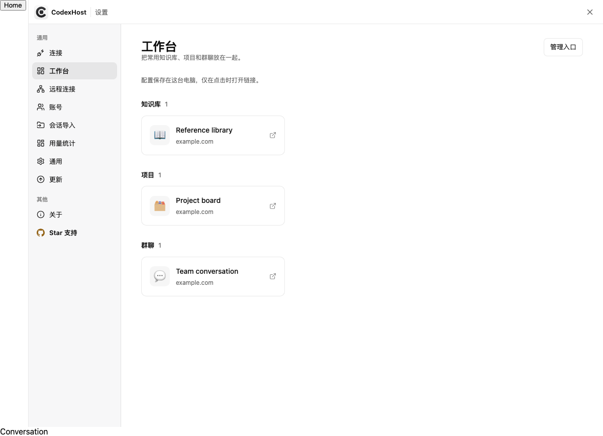

# 本地工作台

从 codexhost 设置导航打开「工作台」，把常用网址按「知识库」「项目」「群聊」分组。点击卡片打开对应网站。

## 管理入口

首次打开时点击「添加入口」，已有配置时点击「管理入口」。每个入口可以设置：

- 名称：最多 80 个字符。
- 图标：Emoji 或短文本，最多 16 个 UTF-16 代码单元。
- 分类：知识库、项目或群聊。
- 链接：HTTP 或 HTTPS 地址，不接受包含账号密码的链接。

可以新增、修改或移除入口，点击「保存更改」后生效；点击「取消」放弃本次编辑。最多保存 100 个入口。保存失败时保留当前编辑内容，可以修复本地文件权限后重试。

## 本地存储与边界

配置保存在本机 `~/.codexhost/workbench.json`；设置了 `CODEXHOST_DATA_DIR` 时，保存在该目录下。新建文件仅向当前用户开放读写权限（Windows 权限由系统 ACL 决定），通过临时文件和重命名替换配置，避免写入中断留下半份 JSON。多个窗口同时编辑时，以最后一次成功保存为准。

初始配置为空，不预置组织名称或网址。工作台始终使用本机 Host 读取和保存入口，不随当前聊天连接切换到远端 Host，也不会把入口作为聊天内容发送给 Agent。配置文件不是凭据库，请使用普通页面链接。

名称和图标作为纯文本显示。页面不会抓取网站图标、预加载链接或内嵌外部页面；用户点击后才打开链接。工作台提供网址入口，不同步知识库内容、项目状态或聊天消息。

配置文件损坏或无法读取时会显示错误和重试入口，不会自动以空配置覆盖原文件。

下面是使用中性示例网址的浏览器测试页面：

