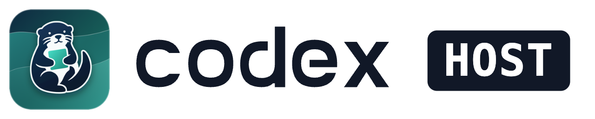
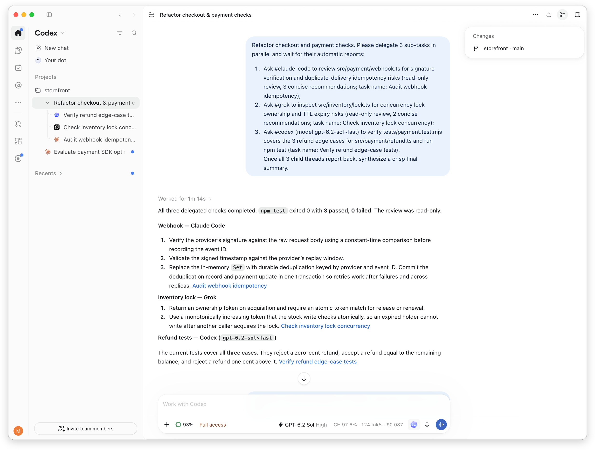
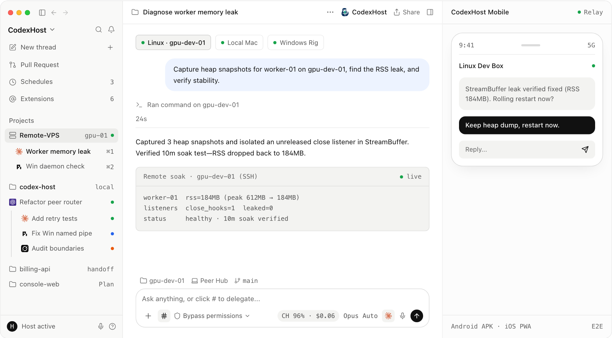
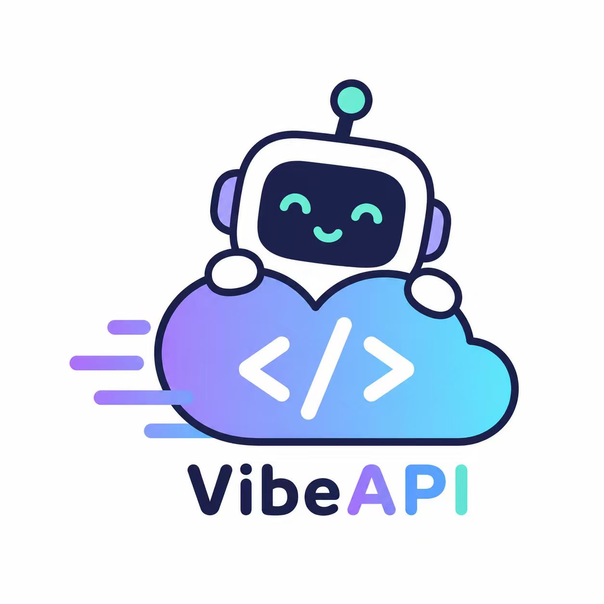

<div align="center">

<p>
  <picture>
    <source media="(prefers-color-scheme: dark)" srcset="../imgs/readme-lockup-dark.png" />
    <source media="(prefers-color-scheme: light)" srcset="../imgs/readme-lockup-light.png" />
    
  </picture>
</p>

<p>
  <a href="https://github.com/BytePioneer-AI/codex-host/stargazers"></a>
  <a href="https://github.com/BytePioneer-AI/codex-host/releases/latest"></a>
  <a href="https://www.npmjs.com/package/@codexhost/cli"></a>
  <a href="../../LICENSE"></a>
  <a href="#다운로드-및-설치"></a>
</p>

<p>
  <a href="../../README.md">English</a> ·
  <a href="README.zh-CN.md">简体中文</a> ·
  <strong>한국어</strong>
</p>

<h2>하나의 워크스페이스에서 모든 코딩 Agent를 지휘하세요.</h2>

<p>
  <b>Codex</b>, <b>Claude Code</b>, <b>Pi</b>, <b>Grok</b> 등 19개 이상의 코딩 Agent를 <b>CodexHost 자체 독립 데스크톱 앱</b>에 통합했습니다.<br />
  공식 Codex Desktop 없이 바로 실행되며(선택적 확장 지원), Web·모바일과 실시간 다중 머신 동기화를 제공합니다.
</p>

<p>
  <b><a href="https://chost.dev/en/download">CodexHost 다운로드</a></b> &nbsp;·&nbsp;
  <b><a href="https://chost.dev/en">공식 사이트 →</a></b> &nbsp;·&nbsp;
  <a href="https://github.com/BytePioneer-AI/codex-host/tree/main/docs">문서</a> &nbsp;·&nbsp;
  <a href="#커뮤니티">커뮤니티</a>
</p>

<br />

<picture>
  <source media="(prefers-color-scheme: dark)" srcset="../imgs/readme-hero-en-dark.png" />
  <source media="(prefers-color-scheme: light)" srcset="../imgs/readme-hero-en-light.png" />
  
</picture>

</div>

---

<a id="다운로드-및-설치"></a>

## 다운로드 및 설치

무료 오픈소스입니다. 로컬 및 LAN 기능은 **계정 등록 없이**, **공식 Codex Desktop 미설치 상태에서도** 바로 사용할 수 있습니다.

| 플랫폼 | 패키지 및 안내 | 다운로드 |
| :--- | :--- | :--- |
| **macOS** | Apple Silicon & Intel · 독립 데스크톱 `.dmg` _(공식 Codex Desktop 설치 시 확장 모드 전환 가능)_ | [**공식 사이트 다운로드**](https://chost.dev/en/download) · [GitHub Releases](https://github.com/BytePioneer-AI/codex-host/releases/latest) |
| **Windows** | x64 & ARM64 · `.exe` 설치 프로그램 / WinGet _(포터블 Codex Desktop 지원)_ | [**공식 사이트 다운로드**](https://chost.dev/en/download) · [GitHub Releases](https://github.com/BytePioneer-AI/codex-host/releases/latest) |
| **Linux** | x64 & ARM64 · 독립 `.tar.gz` 아카이브 _(데스크톱 앱 & 헤드리스 Web 데몬)_ | [**공식 사이트 다운로드**](https://chost.dev/en/download) · [Linux 안내](../platforms/linux/linux.md) |
| **Android** | 경량 네이티브 `.apk` · 푸시 알림, QR 페어링, 다중 호스트 전환 | [**공식 사이트 다운로드**](https://chost.dev/en/download#mobile) · [Android 안내](../../apps/android-shell/README.md) |
| **iPhone & iPad** | Safari 「홈 화면에 추가」 PWA · LAN / Tailscale / 암호화 Relay 연결 | [**모바일 설정 안내**](https://chost.dev/en/download#mobile) |
| **CLI** | Node.js 22.19+ / 24 또는 Windows WinGet | `npm install -g @codexhost/cli` · `winget install --id BytePioneer-AI.CodexHost --exact` |

<details>
<summary><b>주요 CLI 명령어 (데스크톱 / Web / 업그레이드 / 종료)</b></summary>

<br />

```bash
codexhost          # 독립 데스크톱 또는 공식 Codex Desktop 확장 모드 실행
codexhost app      # 경량 독립 데스크톱 바로 실행
codexhost web      # 로컬 Web UI 시작 후 브라우저에서 열기
codexhost status   # 백그라운드 Host 및 서비스 상태 확인
codexhost update   # 최신 버전으로 업그레이드
codexhost stop     # 모든 백그라운드 서비스 종료 (npm 재설치 전 실행)
```

> **보안 주의**: 원격 접속용 Access Token, 로그인 링크, 페어링 QR 코드는 컴퓨터 전체 제어 권한과 동일하므로 절대 외부에 공유하지 마세요.

</details>

<details>
<summary><b>설치 문제 해결 (macOS 보안 허용 / Windows 포터블 / 콘솔)</b></summary>

<br />

- **실행 실패 또는 확장 기능이 로드되지 않을 때**: `codexhost console`을 실행해 `http://127.0.0.1:4399/` 로컬 콘솔에서 로그와 버전을 확인하세요.
- **macOS 최초 실행 시 「확인할 수 없는 앱」 경고**:
  ```bash
  xattr -dr com.apple.quarantine /Applications/codexhost.app
  ```
- **Windows 포터블 Codex Desktop 사용 시**: 사용자 환경 변수 `CODEXHOST_INSTALL_ROOT`를 압축 해제 경로로 지정한 뒤 프로세스를 모두 종료하고 다시 실행하세요:
  ```powershell
  [Environment]::SetEnvironmentVariable("CODEXHOST_INSTALL_ROOT", "D:\CodexPortable", "User")
  ```

</details>

---

## 주요 기능

- **자체 독립 데스크톱 & 다중 기기 실시간 동기화**: macOS / Windows / Linux용 경량 Tauri 데스크톱 앱을 기본 제공해 공식 Codex Desktop 없이도 바로 실행됩니다. 공식 Codex Desktop 사용 시 비침습 확장 모드도 지원하며 Web·Android·iOS PWA와 하나의 로컬 Host를 공유합니다.
- **`#` 멀티 Agent 병렬 위임 & 무손실 인계**: 입력창에서 `#`으로 `Claude Code`, `Pi`, `Grok`, `AGY` 등의 독립 네이티브 하위 세션을 별도 Git Worktree에서 병렬 실행하고 결과를 자동 회수하며, 대화 중 [크로스 Agent 인계(Handoff)](../architecture/cross-harness-handoff.md)로 컨텍스트를 그대로 넘길 수 있습니다.
- **네이티브 런타임 완전 보존**: 공식 SDK / RPC 및 [ACP](https://agentclientprotocol.com/)로 직접 연결해 **Plan Mode**, **진행 중 개입(Steer)**, **백그라운드 터미널**, **임의 메시지 Fork**, **실시간 비용/캐시 지표**, 로컬 계정 가져오기를 그대로 유지합니다.
- **통합 확장, Skills & 자동화**: 한 번 설치한 [Host 확장](../architecture/desktop-ui-extensions.md)이 데스크톱과 Web에 동시에 적용되며, [통합 Skill 라이브러리](../architecture/skill-library.md), [Schedules](../product/harness-schedules.md) 예약 실행, [CLI / MCP / HTTP](../architecture/external-clients.md)(`codexhost delegate`) 외부 오케스트레이션을 지원합니다.
- **로컬 우선 프라이버시**: 코드, 대화 기록, 자격 증명은 모두 내 기기에 머물며 제3자 프록시 없이 공식 모델 서비스에 직접 연결됩니다.

---

## 멀티 호스트 & 모바일

Mac, Linux 개발 서버, Windows PC를 하나의 사이드바에 통합하고, 자리를 비워도 휴대폰에서 바로 승인하고 답장하세요.

<p align="center">
  <picture>
    <source media="(prefers-color-scheme: dark)" srcset="../imgs/readme-remote-en-dark.png" />
    <source media="(prefers-color-scheme: light)" srcset="../imgs/readme-remote-en-light.png" />
    
  </picture>
</p>

- **[멀티 호스트 Peer Hub](../product/multi-remote-peers.md)**: 원격 머신을 한 사이드바에 모아 크로스 호스트 위임과 원격 파일 미리보기를 제공합니다.
- **[QR 스캔 모바일 연결](../product/web-remote-access.md)**: 포트 포워딩 없이 LAN, Tailscale, 암호화 Relay로 접속하며 필요 시 **[자체 호스팅 Relay](../product/self-hosted-relay.md)** 배포도 지원합니다.

<details>
<summary><b>고급: SSH 원격 및 Windows Remote Control 연결</b></summary>

<br />

- **macOS / Linux (SSH 원격)**: 원격 호스트에서 `codexhost remote install && codexhost remote start` 실행 — [SSH 원격 가이드 →](../platforms/remote/remote-ssh-host.md)
- **Windows (Remote Control · 실험적)**: 공식 Remote Control 인증을 재사용하며 공용 포트를 열지 않습니다 — [Remote Control 가이드 →](../platforms/remote/remote-control-host.md)

</details>

---

## 지원 Agent

네이티브 **Codex**와 로컬 CLI·자격 증명을 그대로 재사용하는 **19개 이상의 사전 탑재 코딩 Agent**를 지원합니다. 상세 지원 표는 **[기능 경계 문서 →](../harnesses/capability-boundaries.md)**를 참고하세요.

<details>
<summary><b>지원되는 전체 Agent 목록 보기</b></summary>

<br />

| | | | |
| :--- | :--- | :--- | :--- |
| [Codex](https://openai.com/codex/) | [Claude Code](https://code.claude.com/docs/en/quickstart) | [Pi](https://pi.dev/) | [Oh My Pi](https://github.com/can1357/oh-my-pi) |
| [OpenCode](https://opencode.ai/docs/) | [Grok](https://grok.com/) | [Cursor CLI](https://cursor.com/docs/cli/overview) | [GitHub Copilot](../harnesses/copilot/copilot-harness-integration.md) |
| [Antigravity (AGY)](https://antigravity.google/product/antigravity-cli) | [Devin](https://docs.devin.ai/cli) | [DeepSeek Harness](https://github.com/deepseek-ai/deepseek-harness) | [Qwen Code](https://github.com/QwenLM/qwen-code) |
| [Kimi Code](https://moonshotai.github.io/kimi-code/) | [Kiro CLI](https://kiro.dev/docs/cli/) | [CodeBuddy](https://www.codebuddy.cn/home/) | [WorkBuddy](https://www.workbuddy.ai/docs/workbuddy/Quickstart) |
| [Qoder / Qoder CN](https://qoder.com/cli) | [Hermes](https://hermes-agent.nousresearch.com/docs) | [ZCode](https://zcode.z.ai/) | [커스텀 Harness 추가 →](../../.agents/skills/codexhost-add-harness/SKILL.md) |

</details>

---

## 스폰서

<table>
<tr>
<td width="160" align="center"><a href="https://vibeapi.cc/sign-up?aff=AOYp"></a></td>
<td><b>VibeAPI</b>의 후원에 감사드립니다! 개발자와 팀을 위해 Codex, Claude 등 주요 AI 모델의 통합 액세스, 99.9% SLA, 95%+ 캐시 적중률 및 24/7 기술 지원을 제공합니다. <a href="https://vibeapi.cc/sign-up?aff=AOYp">VibeAPI 알아보기 →</a></td>
</tr>
</table>

---

<a id="커뮤니티"></a>

## 커뮤니티

- **GitHub**: 버그 제보 및 기능 제안은 [Issues](https://github.com/BytePioneer-AI/codex-host/issues), 사용 팁 공유는 [Discussions](https://github.com/BytePioneer-AI/codex-host/discussions)에서 참여하실 수 있습니다.
- **WeChat 교류 그룹**: 아래 QR 코드를 스캔하고 메모에 **"CodexHost"**를 입력해 주세요.

<details>
<summary><b>WeChat 그룹 QR 코드 보기</b></summary>

<br />

<p align="center">
  
</p>

</details>

<details>
<summary><b>소스 빌드 및 로컬 개발</b></summary>

<br />

필수 환경: Node.js 22.19+ 또는 24, Rust (공식 Codex Desktop 확장 모드 개발 시 Codex Desktop 추가 필요). 자세한 내용은 [CONTRIBUTING.md](../../CONTRIBUTING.md)를 참고하세요.

```bash
git clone https://github.com/BytePioneer-AI/codex-host
cd codex-host
npm ci
npm run start:app   # 독립 데스크톱 실행
```

| 명령어 | 역할 |
| :--- | :--- |
| `npm run start:app` | 독립 데스크톱 빌드 및 실행 |
| `npm run start:web` | 독립 Web UI 빌드 및 실행 (핫 리로드 포함) |
| `npm start` | 공식 Codex Desktop 확장 모드 빌드 및 실행 |
| `npm stop` | 현재 사용자의 로컬 codexhost 백그라운드 서비스 종료 |

</details>

---

## 감사의 말 및 기여자

[LINUX DO](https://linux.do/) 커뮤니티, [Paseo](https://github.com/getpaseo/paseo)(멀티 Harness 아키텍처 영감), [DSH (DeepSeek Harness)](https://github.com/deepseek-ai/deepseek-harness)(Web UI 기반), 그리고 CodexHost에 기여해 주신 모든 분들께 감사드립니다.

<a href="https://github.com/BytePioneer-AI/codex-host/graphs/contributors">
  
</a>

## Star History

<a href="https://www.star-history.com/?repos=bytepioneer-ai%2Fcodex-host&type=date&legend=top-left">
  <picture>
    <source media="(prefers-color-scheme: dark)" srcset="https://api.star-history.com/chart?repos=bytepioneer-ai/codex-host&type=date&theme=dark&legend=top-left" />
    <source media="(prefers-color-scheme: light)" srcset="https://api.star-history.com/chart?repos=bytepioneer-ai/codex-host&type=date&legend=top-left" />
    
  </picture>
</a>

## 라이선스

[LGPL-3.0](../../LICENSE) 오픈소스 라이선스를 따릅니다.
