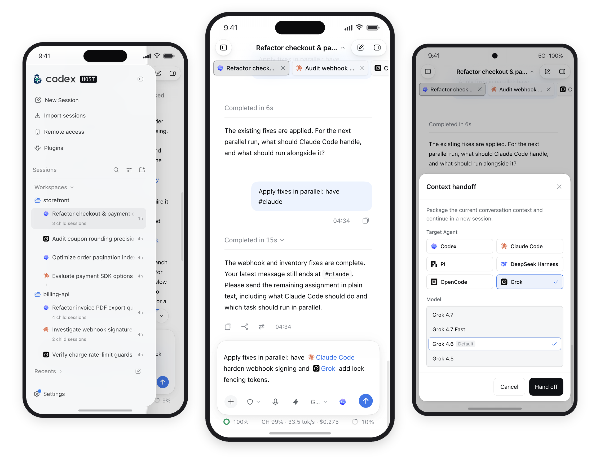
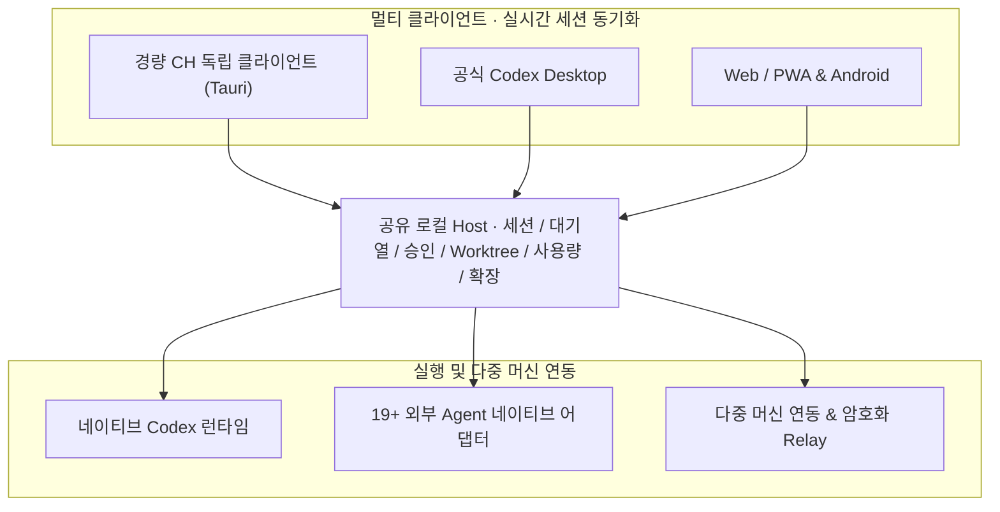
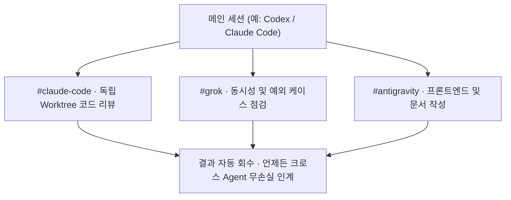
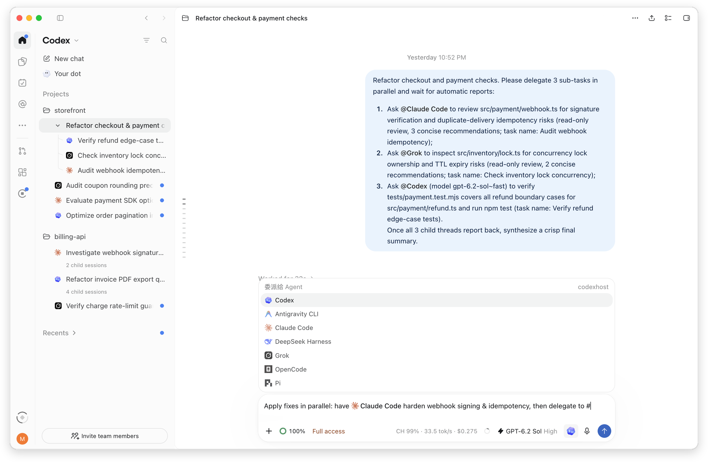
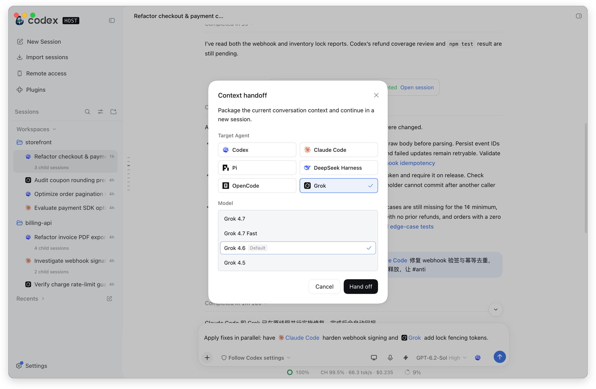
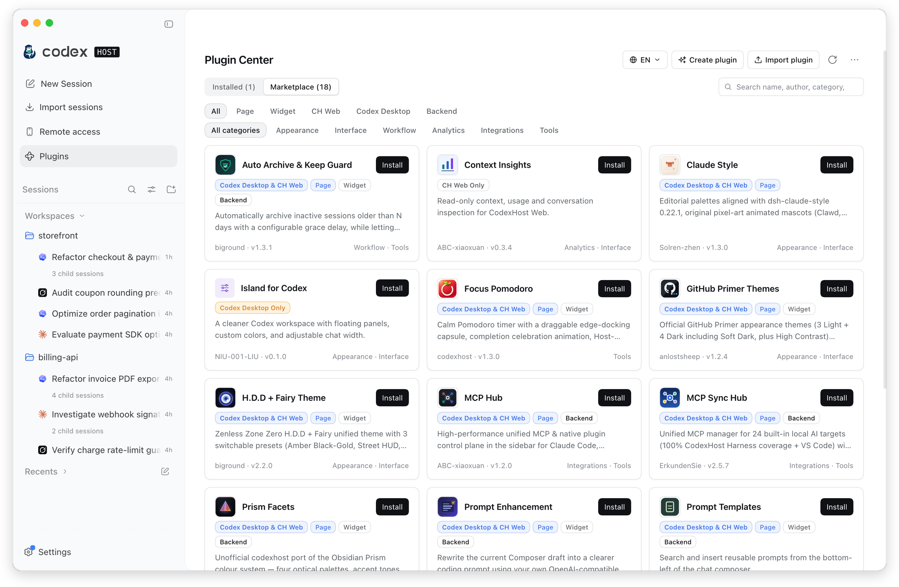
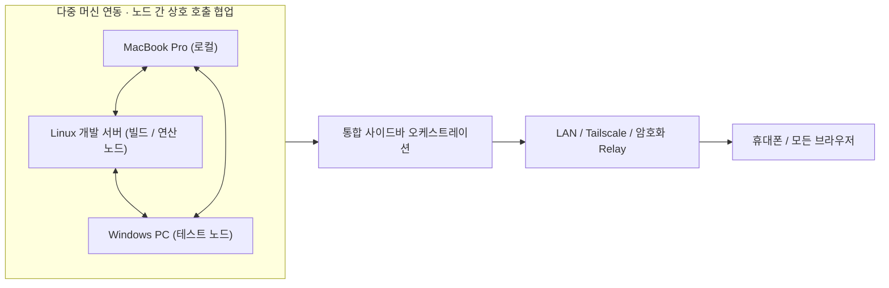
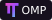

<div align="center">

<p>
  <picture>
    <source media="(prefers-color-scheme: dark)" srcset="../imgs/readme-lockup-dark.png" />
    <source media="(prefers-color-scheme: light)" srcset="../imgs/readme-lockup-light.png" />
    
  </picture>
</p>

<p>
  <a href="../../README.md">English</a> ·
  <a href="README.zh-CN.md">简体中文</a> ·
  <strong>한국어</strong>
</p>

<h2>하나의 워크스페이스에서 모든 코딩 Agent를 지휘하세요.</h2>

<p>
  <b>Codex</b>, <b>Claude Code</b>, <b>Pi</b>, <b>Grok</b> 등 19개 이상의 코딩 Agent를 하나의 워크스페이스에 모았습니다.<br />
  독립 데스크톱 앱을 기본 제공해 공식 Codex Desktop 없이 바로 실행되며(공식 클라이언트 확장도 지원), Web·모바일 및 여러 머신과 실시간 동기화됩니다.
</p>

<p>
  <b><a href="https://chost.dev/en/download">CodexHost 다운로드</a></b> &nbsp;·&nbsp;
  <b><a href="https://chost.dev/en">공식 사이트 →</a></b> &nbsp;·&nbsp;
  <a href="https://github.com/BytePioneer-AI/codex-host/tree/main/docs">문서</a> &nbsp;·&nbsp;
  <a href="#커뮤니티">커뮤니티</a>
</p>

<br />

<picture>
  <source media="(prefers-color-scheme: dark)" srcset="../imgs/readme-hero-en-dark.png" />
  <source media="(prefers-color-scheme: light)" srcset="../imgs/readme-hero-en-light.png" />
  
</picture>

</div>

---

<a id="스폰서"></a>

<details open>
<summary><b>스폰서</b></summary>

<br />

<table>
<tr>
<td width="160" align="center"><a href="https://vibeapi.cc/sign-up?aff=AOYp"></a></td>
<td><b>VibeAPI</b>의 후원에 감사드립니다! 개발자와 팀을 위해 Codex, Claude 등 주요 AI 모델의 통합 액세스, 99.9% SLA, 95%+ 캐시 적중률 및 24/7 기술 지원을 제공합니다. <a href="https://vibeapi.cc/sign-up?aff=AOYp">VibeAPI 알아보기 →</a></td>
</tr>
</table>

</details>

---

## 주요 기능

<table>
<tr>

<td width="25%" valign="top">

### 경량 멀티 클라이언트 동기화

가벼운 독립 앱을 기본 제공하며 공식 Codex Desktop 확장도 지원합니다.

독립 앱·공식 앱·Web·모바일 4개 환경이 실시간 동기화됩니다.

</td>

<td width="25%" valign="top">

### 진짜 Agent 협업

`#`으로 병렬 네이티브 하위 세션을 위임하고 완료 결과를 자동 회수합니다.

대화 도중 다른 Agent로 컨텍스트를 무손실 인계할 수 있습니다.

</td>

<td width="25%" valign="top">

### 다중 머신 연동 협업

Mac·Linux·Windows를 한 사이드바에 묶어 머신 간 작업을 위임하고 함께 처리합니다.

자리를 비워도 휴대폰으로 승인하고 이어갑니다.

</td>

<td width="25%" valign="top">

### 네이티브 최우선

각 Agent의 네이티브 **SDK / RPC**로 연동하며, **ACP** 사용 시에도 네이티브 API와 CLI로 기능을 보완합니다.

로컬 구독과 인증을 그대로 사용하며 별도 계정이나 프록시가 없습니다.

</td>

</tr>
</table>

---

<a id="다운로드-및-설치"></a>

## 다운로드 및 설치

CodexHost는 **macOS / Windows / Linux / Android / iOS (PWA)**를 지원하는 무료 오픈소스입니다. 로컬 및 LAN 환경의 모든 기능은 **계정 등록 없이**, **공식 Codex Desktop 미설치 상태에서도** 바로 사용할 수 있습니다.

- **설치 파일 다운로드 (권장)**: [**공식 사이트 다운로드**](https://chost.dev/en/download) · [**GitHub Releases**](https://github.com/BytePioneer-AI/codex-host/releases/latest) _(데스크톱 앱, Android APK, 모바일 안내 포함 · [Linux 안내](../platforms/linux/linux.md))_
  - Windows WinGet: `winget install --id BytePioneer-AI.CodexHost --exact`
  - 설치 파일은 앱 아이콘으로 바로 실행되며 `PATH`에 `codexhost`를 등록하지 않습니다. CLI가 필요하면 아래 npm으로 설치하세요.

> [!IMPORTANT]
> **macOS 최초 실행 시 「확인할 수 없는 앱」 경고가 표시될 때** 터미널에서 아래 명령어를 실행하세요:
> ```bash
> xattr -dr com.apple.quarantine /Applications/codexhost.app
> ```

### npm 설치

```bash
npm install -g @codexhost/cli   # 전역 codexhost CLI 설치 및 등록 (Node.js 22.19+ 또는 24 필요)

codexhost          # 경량 독립 클라이언트 또는 공식 Codex Desktop 확장 모드 실행
codexhost app      # 경량 CodexHost 독립 클라이언트 바로 실행
codexhost web      # 로컬 Web UI 시작 후 브라우저에서 열기
codexhost status   # 백그라운드 Host 및 서비스 상태 확인
codexhost update   # 최신 버전으로 업그레이드
codexhost stop     # 모든 백그라운드 서비스 종료 (npm 재설치 전 실행)
```

<details>
<summary><b>추가 문제 해결 (로컬 콘솔 / Windows 포터블 Codex Desktop)</b></summary>

<br />

- **실행 실패 또는 확장 기능이 로드되지 않을 때**: `codexhost console`을 실행해 `http://127.0.0.1:4399/` 로컬 콘솔에서 로그와 버전을 확인하세요.
- **Windows 포터블 Codex Desktop 사용 시**: 사용자 환경 변수 `CODEXHOST_INSTALL_ROOT`를 압축 해제 경로로 지정한 뒤 프로세스를 모두 종료하고 다시 실행하세요:
  ```powershell
  [Environment]::SetEnvironmentVariable("CODEXHOST_INSTALL_ROOT", "D:\CodexPortable", "User")
  ```

</details>

---

## 하나의 호스트, 세 가지 사용 방식

<table>
<tr>

<td width="33%" valign="top">

### 경량 독립 클라이언트

**바로 실행, 더 가벼운 메모리.**

Tauri 기반 경량 CodexHost 네이티브 앱으로 공식 Codex Desktop 없이도 macOS / Windows / Linux에서 동일하게 동작합니다.

</td>

<td width="33%" valign="top">

### 공식 Codex 확장

**익숙한 화면에 멀티 Agent를.**

공식 설치 파일을 건드리지 않고 Codex Desktop을 확장해 Diff 검토, Worktree, 승인 흐름을 그대로 유지합니다.

</td>

<td width="33%" valign="top">

### Web & 모바일

**어디서나 실시간으로 확인.**

반응형 Web UI와 Android 네이티브 APK, iOS PWA로 이동 중에도 진행 상황을 확인하고 승인/답장할 수 있습니다.

</td>

</tr>
</table>

<p align="center">
  <picture>
    <source media="(prefers-color-scheme: dark)" srcset="../imgs/readme-ch-desktop-en-dark.png" />
    <source media="(prefers-color-scheme: light)" srcset="../imgs/readme-ch-desktop-en-light.png" />
    
  </picture>
  <sub>경량 CodexHost 독립 클라이언트 — 상단의 공식 Codex 클라이언트와 동일한 로컬 Host를 공유해 완전히 같은 세션, 위임 트리, 진행 상태를 실시간 동기화합니다.</sub>
</p>

<p align="center">
  <picture>
    <source media="(prefers-color-scheme: dark)" srcset="../imgs/readme-feat-mobile-en-dark.png" />
    <source media="(prefers-color-scheme: light)" srcset="../imgs/readme-feat-mobile-en-light.png" />
    
  </picture>
  <sub><b>모바일 실시간 제어 (Android APK / iOS PWA)</b> — 자리를 비워도 휴대폰에서 워크스페이스 위임 트리, 멀티 Agent 보고, 원탭 크로스 Agent 인계를 그대로 이어갑니다.</sub>
</p>



---

## 멀티 Agent 협업: 위임과 무손실 인계

입력창에서 `#`을 입력해 다른 Agent에게 독립적인 네이티브 하위 세션을 병렬로 맡기고, 완료 결과를 원래 세션으로 자동 회수합니다. 대화 중 **[크로스 Agent 무손실 인계(Handoff)](../architecture/cross-harness-handoff.md)**로 전체 맥락을 그대로 넘길 수도 있습니다.



<p align="center">
  <picture>
    <source media="(prefers-color-scheme: dark)" srcset="../imgs/readme-feat-hash-menu-en-dark.png" />
    <source media="(prefers-color-scheme: light)" srcset="../imgs/readme-feat-hash-menu-en-light.png" />
    
  </picture>
  <sub>입력창에서 <code>#</code>을 누르면 로컬에서 감지된 모든 Agent(Codex, Antigravity CLI, Claude Code, DeepSeek Harness, Grok, OpenCode, Pi 등)가 즉시 표시되어 병렬 하위 세션을 위임할 수 있습니다.</sub>
</p>

<p align="center">
  <picture>
    <source media="(prefers-color-scheme: dark)" srcset="../imgs/readme-feat-handoff-en-dark.png" />
    <source media="(prefers-color-scheme: light)" srcset="../imgs/readme-feat-handoff-en-light.png" />
    
  </picture>
  <sub><b>크로스 Agent 무손실 인계 (Handoff)</b> — 대화 도중 원하는 시점에서 대상 Agent와 모델을 선택해 전체 맥락을 그대로 이어서 작업합니다.</sub>
</p>

---

## 네이티브 워크벤치: Diff 리뷰 · 플러그인 · 사용량 인사이트

<p align="center">
  <picture>
    <source media="(prefers-color-scheme: dark)" srcset="../imgs/readme-feat-diff-en-dark.png" />
    <source media="(prefers-color-scheme: light)" srcset="../imgs/readme-feat-diff-en-light.png" />
    
  </picture>
  <sub><b>네이티브 Git Diff 리뷰</b> — 멀티 Agent 결과를 확인하면서 미스테이징 변경사항(<code>+604 -12</code>), 변경 파일 트리, 행 단위 Diff를 한 화면에서 검토하고 즉시 스테이징하거나 되돌립니다.</sub>
</p>

<table>
  <tr>
    <td width="50%" valign="top">
      <p><strong>크로스 클라이언트 플러그인 마켓 (18+ 플러그인)</strong><br /><sub>테마, MCP 통합 센터, 사이드바 위임 트리, 컨텍스트 인사이트 등을 Codex Desktop과 CH Web에 동시 설치</sub></p>
      <picture>
        <source media="(prefers-color-scheme: dark)" srcset="../imgs/readme-feat-plugins-en-dark.png" />
        <source media="(prefers-color-scheme: light)" srcset="../imgs/readme-feat-plugins-en-light.png" />
        
      </picture>
    </td>
    <td width="50%" valign="top">
      <p><strong>멀티 Agent 통합 사용량 및 비용</strong><br /><sub>Codex, Grok, Claude Code, OpenCode의 비용·토큰·캐시 적중률과 일별 추이를 한눈에 집계하고 CSV로 내보내기</sub></p>
      <picture>
        <source media="(prefers-color-scheme: dark)" srcset="../imgs/readme-feat-usage-en-dark.png" />
        <source media="(prefers-color-scheme: light)" srcset="../imgs/readme-feat-usage-en-light.png" />
        
      </picture>
    </td>
  </tr>
</table>

---

## 자리를 비워도 모든 머신이 손안에



- **[다중 머신 연동 및 노드 협업](../product/multi-remote-peers.md)**: Mac, Linux 서버, Windows PC를 하나의 사이드바에 연결해 서로 다른 머신의 세션이 호출하고 협업하며 하나의 작업을 함께 완료합니다.
- **[QR 스캔 모바일 연결](../product/web-remote-access.md)**: 포트 포워딩 없이 LAN, Tailscale 또는 암호화 Relay로 접속하며, 사내 규정 준수를 위한 **[자체 호스팅 Relay](../product/self-hosted-relay.md)** 배포도 지원합니다.
- **로컬 우선 프라이버시**: 코드, 대화 기록, 자격 증명은 모두 내 컴퓨터에 머물며 공식 서비스에 직접 연결됩니다.

<details>
<summary><b>고급: SSH 원격 및 Windows Remote Control 연결</b></summary>

<br />

- **macOS / Linux (SSH 원격)**: 원격 호스트에서 `codexhost remote install && codexhost remote start` 실행 — [SSH 원격 가이드 →](../platforms/remote/remote-ssh-host.md)
- **Windows (Remote Control · 실험적)**: 공식 Remote Control 인증을 재사용하며 공용 포트를 열지 않습니다 — [Remote Control 가이드 →](../platforms/remote/remote-control-host.md)

</details>

---

## 지원 Agent

네이티브 **Codex**와 공식 SDK / RPC 및 [ACP](https://agentclientprotocol.com/)로 사전 탑재된 **19개 이상의 코딩 Agent**를 지원합니다:

<p align="center">
  <a href="https://openai.com/codex/"></a>
  <a href="https://code.claude.com/docs/en/quickstart"></a>
  <a href="https://pi.dev/"></a>
  <a href="https://opencode.ai/docs/"></a>
  <a href="https://grok.com/"></a>
  <a href="https://github.com/can1357/oh-my-pi"></a><br />
  <a href="https://github.com/deepseek-ai/deepseek-harness"></a>
  <a href="https://github.com/QwenLM/qwen-code"></a>
  <a href="https://docs.devin.ai/cli"></a>
  <a href="https://antigravity.google/product/antigravity-cli"></a>
  <a href="https://kiro.dev/docs/cli/"></a>
  <a href="https://www.codebuddy.cn/home/"></a><br />
  <a href="https://www.workbuddy.ai/docs/workbuddy/Quickstart"></a>
  <a href="https://cursor.com/docs/cli/overview"></a>
  <a href="https://hermes-agent.nousresearch.com/docs"></a>
  <a href="https://qoder.com/cli"></a>
  <a href="https://moonshotai.github.io/kimi-code/"></a>
  <a href="https://zcode.z.ai/"></a>
  <a href="../harnesses/copilot/copilot-harness-integration.md"></a>
</p>

<p align="center">
  <a href="../harnesses/capability-boundaries.md"><strong>기능 경계 문서 →</strong></a> &nbsp;·&nbsp;
  <a href="../../.agents/skills/codexhost-add-harness/SKILL.md">커스텀 Harness 추가 →</a>
</p>

---

<a id="커뮤니티"></a>

## 커뮤니티

- **GitHub**: 버그 제보 및 기능 제안은 [Issues](https://github.com/BytePioneer-AI/codex-host/issues), 사용 팁 공유는 [Discussions](https://github.com/BytePioneer-AI/codex-host/discussions)에서 참여하실 수 있습니다.
- **WeChat 교류 그룹**: 아래 QR 코드를 스캔하고 메모에 **"CodexHost"**를 입력해 주세요.

<details>
<summary><b>WeChat 그룹 QR 코드 보기</b></summary>

<br />

<p align="center">
  
</p>

</details>

<details>
<summary><b>소스 빌드 및 로컬 개발</b></summary>

<br />

필수 환경: Node.js 22.19+ 또는 24, Rust (공식 Codex Desktop 확장 모드 개발 시 Codex Desktop 추가 필요). 자세한 내용은 [CONTRIBUTING.md](../../CONTRIBUTING.md)를 참고하세요.

```bash
git clone https://github.com/BytePioneer-AI/codex-host
cd codex-host
npm ci
npm run start:app   # 독립 데스크톱 실행
```

| 명령어 | 역할 |
| :--- | :--- |
| `npm run start:app` | 독립 데스크톱 빌드 및 실행 |
| `npm run start:web` | 독립 Web UI 빌드 및 실행 (핫 리로드 포함) |
| `npm start` | 공식 Codex Desktop 확장 모드 빌드 및 실행 |
| `npm stop` | 현재 사용자의 로컬 codexhost 백그라운드 서비스 종료 |

</details>

---

## 감사의 말 및 기여자

[LINUX DO](https://linux.do/) 커뮤니티, [Paseo](https://github.com/getpaseo/paseo)(멀티 Harness 아키텍처 영감), [DSH (DeepSeek Harness)](https://github.com/deepseek-ai/deepseek-harness)(Web UI 기반), 그리고 CodexHost에 기여해 주신 모든 분들께 감사드립니다.

<a href="https://github.com/BytePioneer-AI/codex-host/graphs/contributors">
  
</a>

## Star History

<a href="https://www.star-history.com/?repos=bytepioneer-ai%2Fcodex-host&type=date&legend=top-left">
  <picture>
    <source media="(prefers-color-scheme: dark)" srcset="https://api.star-history.com/chart?repos=bytepioneer-ai/codex-host&type=date&theme=dark&legend=top-left" />
    <source media="(prefers-color-scheme: light)" srcset="https://api.star-history.com/chart?repos=bytepioneer-ai/codex-host&type=date&legend=top-left" />
    
  </picture>
</a>

## 라이선스

[LGPL-3.0](../../LICENSE) 오픈소스 라이선스를 따릅니다.
