<div align="center">

# CodexHost

**Codex Desktop에서 Claude Code, Pi, Grok 등 15개 이상의 Agent를 앱 전환 없이 사용하세요**

Codex와 똑같이 Diff 검토, Fork, 승인을 사용할 수 있고, 서로 작업을 넘겨줄 수도 있습니다.

**Web 버전**도 있습니다. 같은 Codex 화면을 더 적은 메모리로 사용하며, 휴대폰이나 다른 컴퓨터에서 이 컴퓨터의 모든 Agent를 원격으로 사용할 수 있습니다.

⭐ 이 프로젝트가 도움이 되었다면 Star를 눌러 주세요! ⭐

<p align="center">
  <a href="https://pi.dev/"></a>
  <a href="https://openai.com/codex/"></a>
  <a href="https://code.claude.com/docs/en/quickstart"></a>
  <a href="https://opencode.ai/docs/">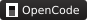</a>
  <a href="https://grok.com/"></a>
  <a href="https://github.com/can1357/oh-my-pi">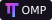</a><br />
  <a href="https://github.com/deepseek-ai/deepseek-harness"></a>
  <a href="https://github.com/QwenLM/qwen-code"></a>
  <a href="https://docs.devin.ai/cli">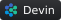</a>
  <a href="https://antigravity.google/product/antigravity-cli"></a>
  <a href="https://kiro.dev/docs/cli/">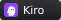</a>
  <a href="https://www.codebuddy.cn/home/">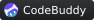</a><br />
  <a href="https://www.workbuddy.ai/docs/workbuddy/Quickstart">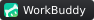</a>
  <a href="https://cursor.com/docs/cli/overview"></a>
  <a href="https://hermes-agent.nousresearch.com/docs"></a>
  <a href="https://qoder.com/cli"></a>
  <a href="https://moonshotai.github.io/kimi-code/"></a>
  <a href="https://zcode.z.ai/"></a>
  <a href="../harnesses/copilot/copilot-harness-integration.md"></a>
</p>

<p align="center"><a href="https://github.com/BytePioneer-AI/codex-host/releases"><strong>다운로드</strong></a> · <a href="#빠른-시작">빠른 시작</a> · <a href="#desktop">Desktop</a> · <a href="#agent-간-협업">Agent 간 협업</a> · <a href="#교류-그룹-참여">微信交流群</a> · <a href="../../README.md">English</a> · <a href="README.zh-CN.md">简体中文</a></p>

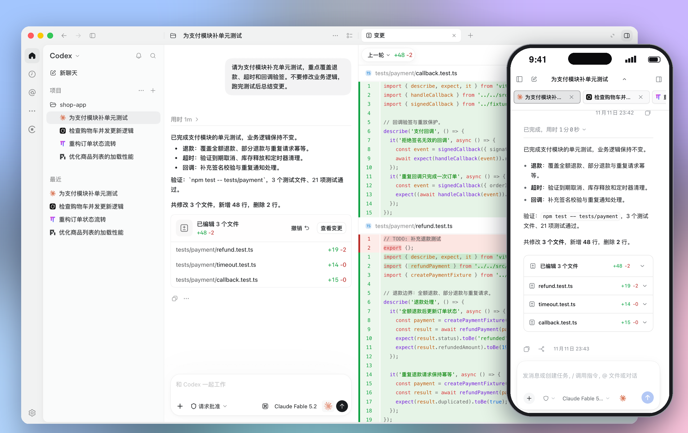

</div>

## 후원

<details open>
<summary>클릭하여 접기</summary>

<table>
<tr>
<td width="180"><a href="https://vibeapi.cc/sign-up?aff=AOYp">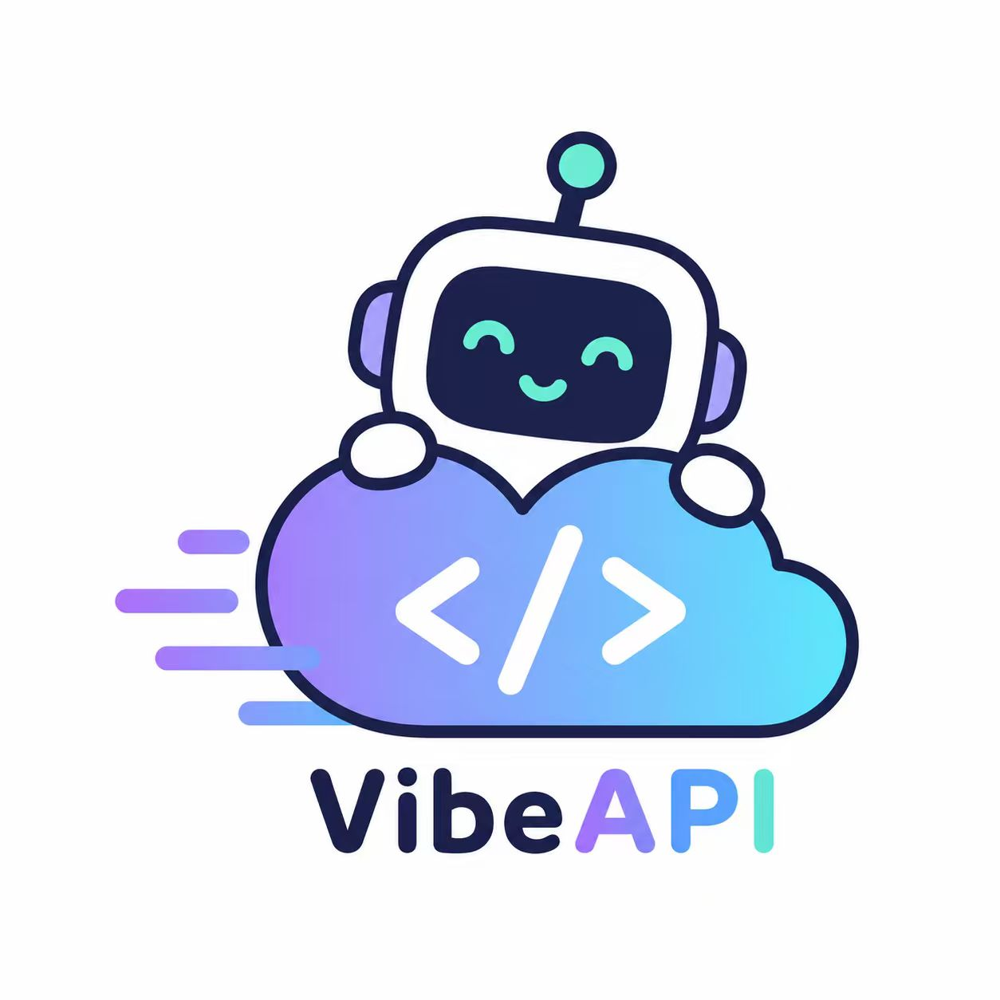</a></td>
<td>이 프로젝트를 후원해 주신 <b>VibeAPI</b>에 감사드립니다! VibeAPI는 AI를 집중적으로 활용하는 개발자와 팀을 위해 주요 AI 모델에 대한 통합 접근을 제공합니다. Codex와 Claude 시리즈를 중심으로, 출처를 추적할 수 있는 자체 구축 계정 풀을 운영합니다. 매우 빠른 첫 토큰 응답, 99.9% SLA 가용성, 95%+ 캐시 적중률을 제공하며, 연중무휴 24시간 전문 인력의 기술 지원과 법인 인보이스 발행 및 기업 협력을 지원합니다. <a href="https://vibeapi.cc/sign-up?aff=AOYp">사이버 혜택 받으러 가기 →</a></td>
</tr>
</table>
</details>

<a id="빠른-시작"></a>

## 빠른 시작

**방법 1: npm** (macOS / Windows / Linux)

```bash
npm install -g @codexhost/cli
codexhost          # Codex Desktop 시작
codexhost web      # Web을 시작하고 브라우저에서 열기
codexhost stop     # CodexHost의 모든 백그라운드 서비스 중지
```

**방법 2: 설치 프로그램** (macOS / Windows)

[Releases](https://github.com/BytePioneer-AI/codex-host/releases)에서 플랫폼에 맞는 설치 프로그램을 다운로드하세요. Web: 설치 후 codexhost를 열고 로컬에서 http://127.0.0.1:4400 에 접속합니다.

> Linux는 x64 / ARM64를 지원합니다. 자세한 내용은 [Linux 안내](../platforms/linux/linux.md)를 참고하세요.

**업그레이드와 중지**: `codexhost update`로 업그레이드하고, `codexhost stop`으로 모든 백그라운드 서비스를 중지합니다. npm으로 덮어써 설치하기 전에는 먼저 `codexhost stop`을 실행하세요.

<details>
<summary>설치 문제 해결</summary>

**codexhost가 시작되지 않거나, Codex는 열렸지만 codexhost 기능이 보이지 않는 경우**

`codexhost console`(Windows: 시작 메뉴 → "codexhost console")을 실행하면 로컬 콘솔 `http://127.0.0.1:4399/`이 열립니다. 마지막 시작 실패 원인, Codex Desktop 버전, Host Runtime 로그를 확인할 수 있고, Codex가 실행 중이 아닐 때 codexhost를 업데이트할 수 있습니다.

**macOS: 처음 열 때 "앱을 확인할 수 없음" 메시지가 표시됨**

```bash
xattr -dr com.apple.quarantine /Applications/codexhost.app
```

**Windows: 압축 해제형(포터블) Codex Desktop 사용**

1. `CODEXHOST_INSTALL_ROOT`를 Codex Desktop 압축 해제 디렉터리로 설정합니다:

   ```powershell
   [Environment]::SetEnvironmentVariable("CODEXHOST_INSTALL_ROOT", "D:\CodexPortable", "User")
   ```

2. Codex Desktop을 완전히 종료하고 새 터미널을 연 뒤 `codexhost`를 실행합니다.

</details>

<a id="desktop"></a>

## Codex Desktop에서 모든 Agent 사용하기

앱을 전환할 필요가 없습니다. **Pi, Claude Code, Grok Build 등 15개 이상의 Agent**가 하나의 Codex Desktop 창에서 실행되며, 모든 세션이 왼쪽 목록에 표시되고 입력창 오른쪽 아래에서 언제든 전환할 수 있습니다.

https://github.com/user-attachments/assets/c48192d7-23ff-4f6e-b61a-6345a655bb76

<table>
  <tr>
    <td width="33%" valign="top">
      <p><strong>Diff 검토 패널</strong><br /><sub>매 턴의 변경 사항이 자동으로 요약되며, 검토를 누르면 전체 Diff를 볼 수 있습니다</sub></p>
      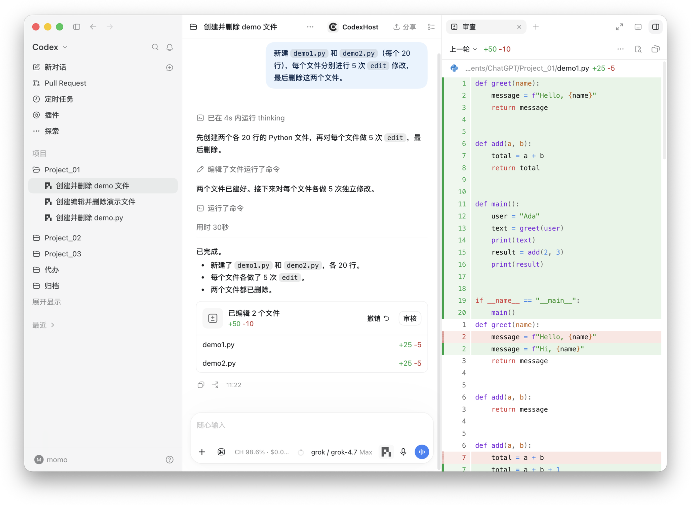
    </td>
    <td width="33%" valign="top">
      <p><strong>모든 메시지에서 Fork</strong><br /><sub>현재 작업 공간에서, 또는 새 Worktree에서 병렬로 개발합니다</sub></p>
      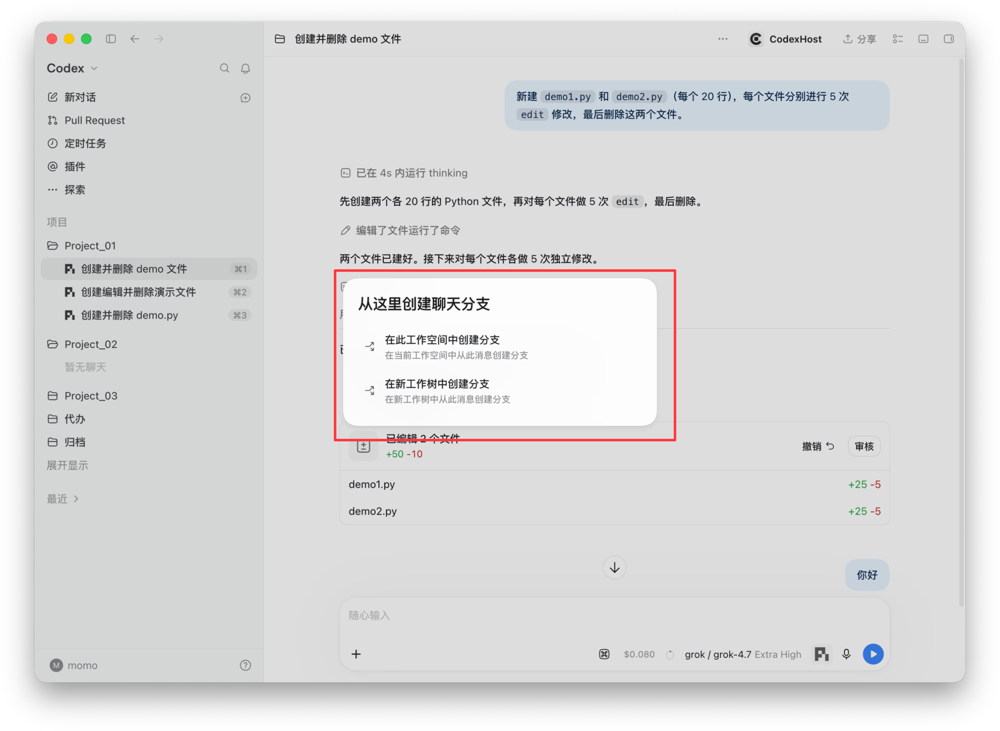
    </td>
    <td width="33%" valign="top">
      <p><strong>Subagent 확인</strong><br /><sub>각 Subagent에 고유 아이콘이 있고, 오른쪽에서 전체 대화를 볼 수 있습니다</sub></p>
      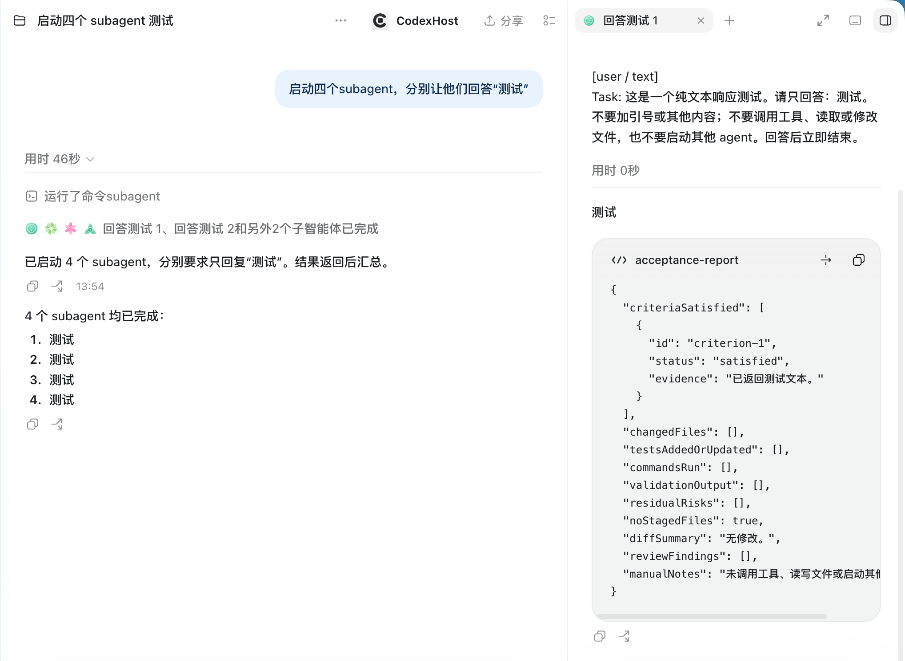
    </td>
  </tr>
</table>

<details>
<summary>더 보기: 도구 상세, 사용량, 계정 가져오기, 다이어그램 렌더링</summary>

<table>
  <tr>
    <td width="50%" valign="top">
      <p><strong>도구 호출과 사고 과정</strong><br /><sub>모든 편집, 명령, 사고 단계를 펼쳐 상세 내용을 볼 수 있습니다</sub></p>
      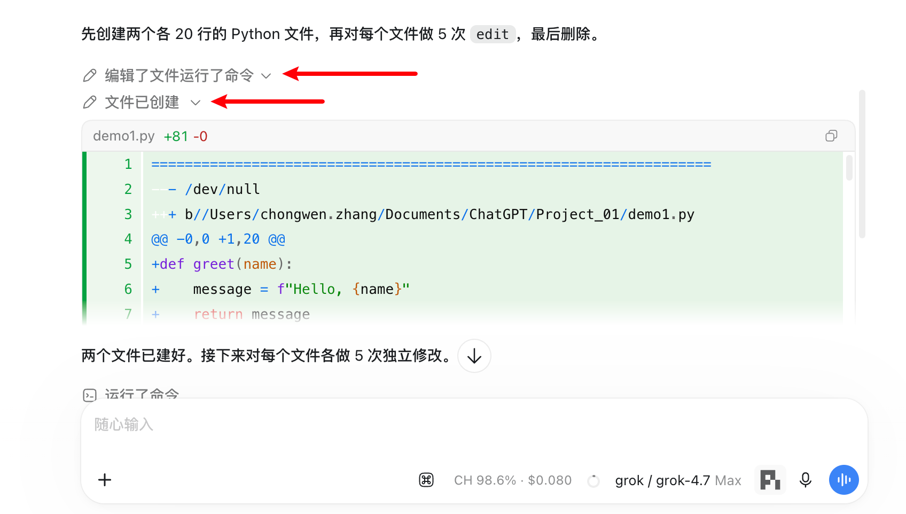
    </td>
    <td width="50%" valign="top">
      <p><strong>사용량을 한눈에</strong><br /><sub>캐시 적중률, 비용 추정, 컨텍스트 사용량을 실시간으로 표시합니다</sub></p>
      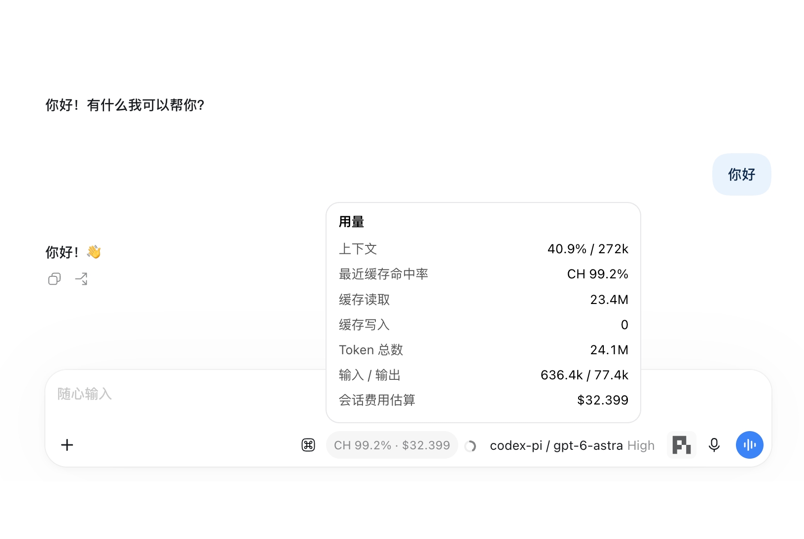
    </td>
  </tr>
  <tr>
    <td width="50%" valign="top">
      <p><strong>계정 원클릭 가져오기</strong><br /><sub>로컬에 로그인된 Codex, Grok 자격 증명을 Pi로 복사하고, 할당량을 실시간으로 확인합니다</sub></p>
      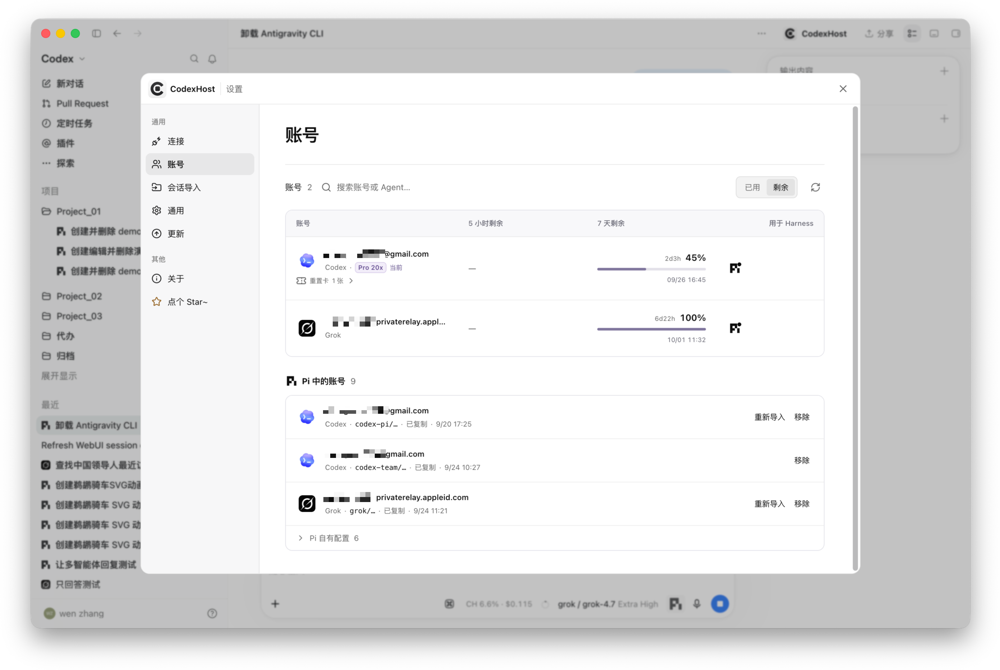
    </td>
    <td width="50%" valign="top">
      <p><strong>터미널보다 보기 좋게</strong><br /><sub>왼쪽: Codex Desktop + Pi에서 Mermaid 다이어그램이 바로 렌더링됨, 오른쪽: Pi TUI에서는 소스만 보임</sub></p>
      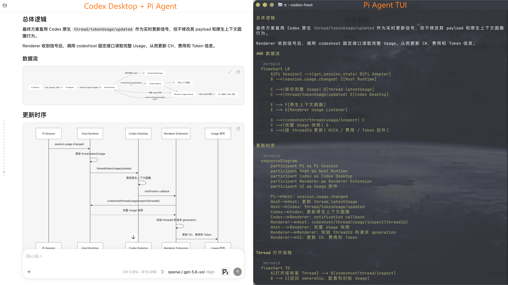
    </td>
  </tr>
</table>

</details>

<details>
<summary>Agent별 기능 지원 현황</summary>

| 기능 | <a href="https://pi.dev/"></a> | <a href="https://github.com/can1357/oh-my-pi"></a> | <a href="https://code.claude.com/docs/en/quickstart"></a> | <a href="https://opencode.ai/docs/"></a> | <a href="https://grok.com/"></a> | <a href="https://github.com/deepseek-ai/deepseek-harness"></a> | <a href="https://antigravity.google/product/antigravity-cli"></a> | <a href="https://www.codebuddy.cn/home/"></a> | <a href="https://www.workbuddy.ai/docs/workbuddy/Quickstart">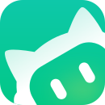</a> | <a href="https://cursor.com/docs/cli/overview"></a> | <a href="https://hermes-agent.nousresearch.com/docs"></a> | <a href="https://qoder.com/cli"></a> | <a href="https://moonshotai.github.io/kimi-code/"></a> | <a href="../harnesses/copilot/copilot-harness-integration.md">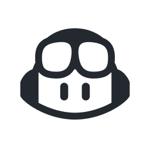</a> | <a href="https://github.com/QwenLM/qwen-code"></a> | <a href="../harnesses/devin/devin-cli-acp-integration.md"></a> |
| :--- | :---: | :---: | :---: | :---: | :---: | :---: | :---: | :---: | :---: | :---: | :---: | :---: | :---: | :---: | :---: | :---: |
| 스트리밍 응답 | ✅ | ✅ | ✅ | ✅ | ✅ | ✅ | ✅ | ✅ | ✅ | ✅ | ✅ | ✅ | ✅ | ✅ | ✅ | ✅ |
| 도구 상태 | ✅ | ✅ | ✅ | ✅ | ✅ | ✅ | ✅ | ✅ | ✅ | ✅ | ✅ | ✅ | ✅ | ✅ | ✅ | ✅ |
| Edit Diff | ✅ | ✅ | ✅ | ✅ | ✅ | ✅ | ✅ | ✅ | ✅ | ✅ | ✅ | ✅ | ✅ | ✅ | — | ✅ |
| 질문 / 취소 | ✅ | ✅ | ✅ | ✅ | ✅ | ✅ | ✅ | ✅ | ✅ | ✅ | ✅ | ✅ | ✅ | ✅ | ✅ | — / ✅ |
| Model / Thinking 선택 | ✅ | ✅ | ✅ | ✅ | ✅ | ✅ | ✅ | ✅ | ✅ | ✅ | ✅ | ✅ | ✅ | ✅ | ✅ / — | ✅ / ◐ |
| 도구 승인 | ✅ | ✅ | ✅ | ✅ | ✅ | ✅ | — | ✅ | ✅ | ✅ | ✅ | ✅ | ✅ | ✅ | ✅ | ✅ |
| 권한 모드 | — | ✅ | ✅ | ✅ | ✅ | ✅ | ✅ | ✅ | ✅ | ✅ | ✅ | ✅ | ✅ | ✅ | ✅ | ✅ |
| Agent 간 작업 협업 | ✅ | ✅ | ✅ | ✅ | ✅ | ✅ | ✅ | ✅ | — | ✅ | ✅ | ✅ | ✅ | ✅ | ✅ | ◐ |
| Usage | ✅ | ✅ | ✅ | ✅ | ✅ | ✅ | ✅ | ✅ | ✅ | — | ✅ | ✅ | ✅ | ✅ | ✅ | — |
| Fork | ✅ | ✅ | ✅ | ✅ | ✅ | ✅ | ✅ | ✅ | ✅ | ✅ | ✅ | ✅ | ◐ | ✅ | — | ◐ |
| 컨텍스트 압축 | ✅ | ✅ | ✅ | ✅ | ✅ | ✅ | — | ✅ | ✅ | — | ✅ | ✅ | ✅ | ✅ | — | — |
| 슬래시 명령 | ✅ | ✅ | ✅ | ✅ | ✅ | ✅ | ✅ | ✅ | ✅ | ✅ | ✅ | ✅ | ✅ | — | — | — |
| 이전 메시지 수정 | ✅ | ✅ | ✅ | ✅ | ✅ | ✅ | ✅ | ✅ | ✅ | ✅ | ✅ | ✅ | ✅ | ✅ | — | ◐ |

</details>

<a id="agent-간-협업"></a>

## Agent끼리 작업 나누기

채팅 입력창에 `#`을 입력하고 Agent를 선택해 독립적인 작업을 맡기세요:

> `#claude-code`에게 이 변경 사항을 독립적으로 검토하고 호환성 위험을 지적하도록 요청하세요.
>
> `#pi`에게 이 테스트가 간헐적으로 실패하는 원인을 조사하도록 요청하세요.
>
> 제가 문서를 정리하는 동안 `#omp`에게 이 기능을 구현하도록 요청하세요.

위임된 작업은 각각 대상 Agent의 독립적인 네이티브 세션으로 실행되고 대화 목록에 표시되므로, 언제든 열어서 진행 상황을 확인하거나 대화를 이어갈 수 있습니다. 작업이 끝나면 결과는 작업을 시작한 세션으로 돌아옵니다.

<table>
  <tr>
    <td width="50%" valign="top">
      <p><strong>여러 Agent를 병렬로</strong><br /><sub>각자 독립된 세션에서 서로 방해하지 않습니다</sub></p>
      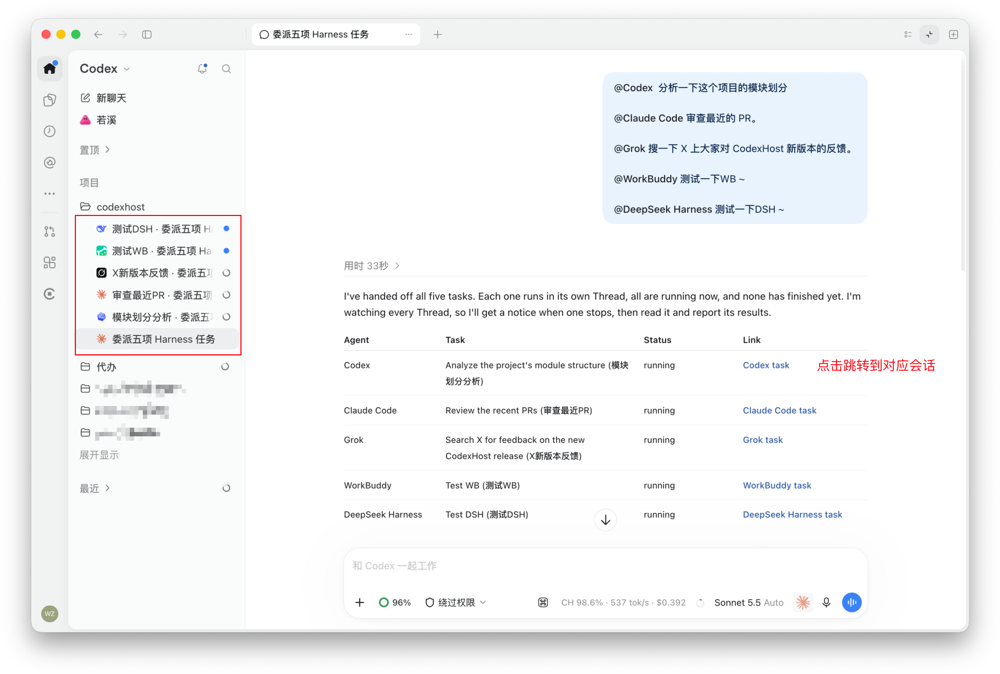
    </td>
    <td width="50%" valign="top">
      <p><strong>끝나면 자동 보고</strong><br /><sub>위임 작업이 끝나면 시작한 세션에 알려 줍니다</sub></p>
      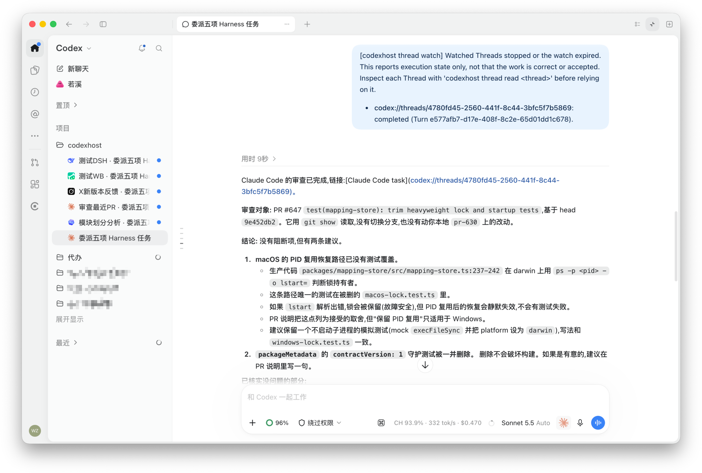
    </td>
  </tr>
</table>

**개발자용**: 터미널 스크립트, Claude Desktop, 상주 봇 같은 로컬 프로그램도 `codexhost delegate` / `codexhost thread` 명령이나 MCP로 이 Agent들에게 작업을 맡기고 결과를 기다릴 수 있습니다. 자세한 내용은 [외부 클라이언트](../architecture/external-clients.md)를 참고하세요.

<details>
<summary><h3 id="원격-harness">고급: 로컬 화면에서 다른 컴퓨터의 Agent 사용하기</h3></summary>

작업은 다른 컴퓨터에서 실행되고 UI는 로컬 Codex Desktop에 그대로 있습니다. 양쪽에 동일한 버전의 CodexHost를 설치해야 합니다.

| 제어 대상 컴퓨터 | 연결 방식 |
| --- | --- |
| macOS / Linux | [SSH 원격](#ssh-원격) |
| Windows | [Remote Control 원격](#remote-control-원격-실험) (실험) |

#### SSH 원격

전제 조건: Codex Desktop의 「설정 → 연결 → SSH」에서 제어 대상 컴퓨터를 추가해야 합니다. 클라이언트는 macOS / Linux / Windows를 지원합니다.

<div align="center">
  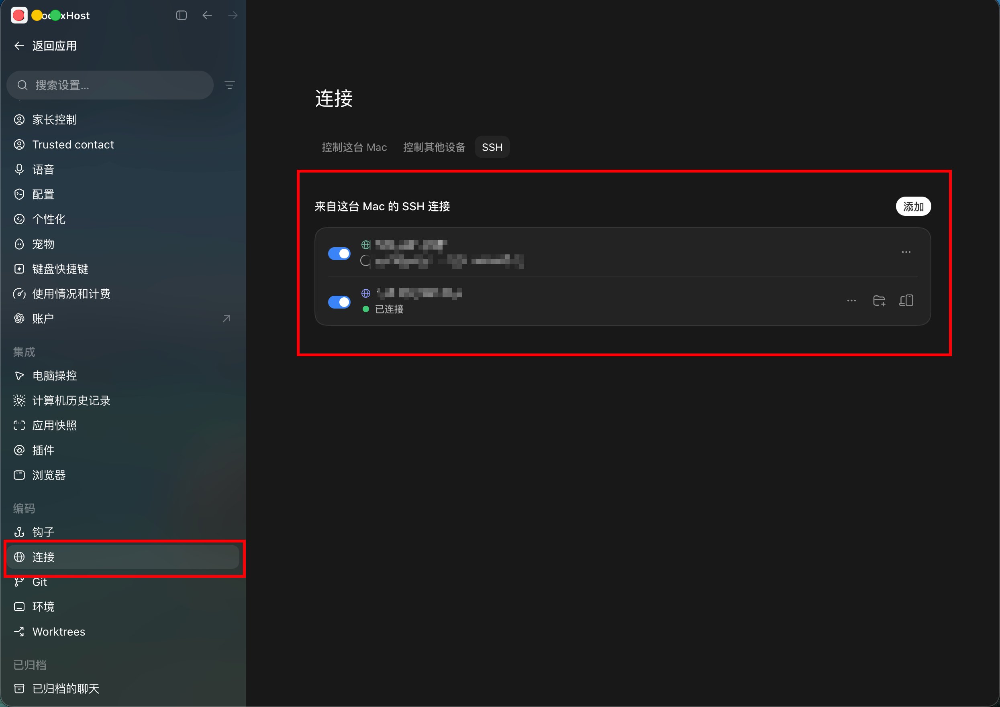
</div>

1. 제어 대상 컴퓨터에 설치하고 시작합니다:

   ```bash
   npm install -g @codexhost/cli
   codexhost remote install
   codexhost remote start
   codexhost remote status
   ```

2. 로컬에서 codexhost로 Codex Desktop을 실행하고 SSH 작업 공간을 엽니다.
3. 입력창의 Agent / Model 선택기에서 대상 Agent를 선택합니다.

[SSH 설정, 진단 및 제거 →](../platforms/remote/remote-ssh-host.md)

#### Remote Control 원격 (실험)

Codex Desktop 공식 Remote Control의 페어링과 인증을 재사용하여, 다른 컴퓨터에서 Windows의 Agent를 사용합니다.

전제 조건: 공식 Remote Control에서 Codex 작업이 정상적으로 실행되어야 합니다. 공개 서비스나 포트를 추가하지 않으며, Agent 자격 증명은 Windows에만 유지됩니다.

[Remote Control 설정, 전송 경계 및 진단 →](../platforms/remote/remote-control-host.md)

</details>

<a id="교류-그룹-참여"></a>

## 微信交流群

<table align="center">
  <tr>
    <td>
      <strong>微信交流群</strong><br />
      <sub>CodexHost 사용법과 기능에 관심 있는 개발자는 QR 코드를 스캔해 제 위챗을 추가해 주세요(메모: “CodexHost”). 위챗 그룹에 초대해 드립니다.</sub>
      <ul>
        <li><sub>설치 문제는 그룹에서 질문할 수 있습니다</sub></li>
        <li><sub>기능 제안과 피드백</sub></li>
        <li><sub>개발 관련 논의</sub></li>
        <li><sub>버그는 <strong>issue</strong>로 제출해 주세요</sub></li>
      </ul>
      <sub><strong>함께 기여해 주세요.</strong></sub>
    </td>
    <td align="center">
      
    </td>
  </tr>
</table>

<details>
<summary><h3>아키텍처와 개발</h3></summary>

#### 작동 방식

대부분의 멀티 에이전트 클라이언트는 자체 채팅 UI를 새로 만들고, 공통 프로토콜로 여러 Agent를 연결합니다. CodexHost는 다른 방식을 택합니다.

- **Desktop 측**: CDP / Electron Inspector로 공식 Codex Desktop을 확장하며, 채팅 UI를 다시 만들거나 공식 설치 프로그램을 수정하지 않습니다
- **프로토콜 측**: CLI Shim으로 공식 app-server에 연결하며, 네이티브 Codex 요청은 그대로 전달되어 영향을 받지 않습니다
- **Agent 측**: 각 Agent의 네이티브 인터페이스를 우선 사용하고(Pi는 RPC, Claude Code는 Agent SDK), 네이티브 인터페이스가 없으면 [ACP](https://agentclientprotocol.com/)로 연결합니다. 스트리밍 출력, 도구 상태, Diff, 승인, 질문은 모두 Codex Desktop 네이티브 UI에 투영됩니다
- **오케스트레이션 측**: 위임된 작업은 대상 Agent에서 독립적인 네이티브 세션으로 실행되며, 시작한 쪽은 결과를 기다리거나 백그라운드에서 실행하도록 선택할 수 있습니다
- **Web 측**: Desktop과 Web은 같은 백그라운드 Host에 연결되므로 세션, 승인, 질문이 하나만 존재하고 양쪽에서 같은 상태를 봅니다

#### 개발

Issue나 PR을 제출하기 전에 [기여 가이드](../../CONTRIBUTING.md)를 읽어 주세요. PR 제목 라벨, CI 요약, 릴리스 전 검증은 [저장소 유지보수 자동화](../operations/repository-maintenance.md)를 참고하세요.

요구 사항: 공식 Codex Desktop, Node.js 22.19+ 또는 24, Rust.

```bash
git clone https://github.com/BytePioneer-AI/codex-host
cd codex-host
npm ci
npm start
```

| 명령 | 용도 |
| --- | --- |
| `npm start` | Desktop을 빌드하고 시작합니다. |
| `npm start web` | Web을 빌드하고 시작합니다. Web UI 핫 리로드가 기본으로 켜집니다. |
| `npm start web -- --no-watch` | 핫 리로드 없이 Web을 빌드하고 시작합니다. |
| `npm stop` | 현재 사용자의 모든 작업 트리에서 실행 중인 로컬 codexhost 서비스를 중지합니다. |

#### 실행 아키텍처

Pi를 예로 듭니다. 왼쪽에서 오른쪽이 한 번의 요청 호출 체인입니다: Desktop → 공용 계층 → Pi 플러그인 → 네이티브 프로세스.

<div align="center">
  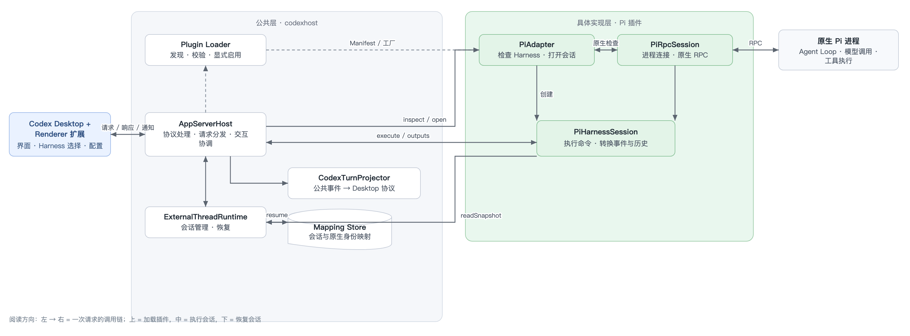
</div>

#### Harness 추가

주요 작업은 플러그인의 Manifest, 팩토리, Adapter, Session 및 네이티브 통신과 변환 로직을 구현하는 것입니다. 현재 Renderer에는 여전히 정적 연결이 있어, 완전한 Desktop 연동은 별도로 처리해야 합니다.
Harness를 추가할 때는 코딩 Agent가 저장소의 [codexhost-add-harness Skill](../../.agents/skills/codexhost-add-harness/SKILL.md)을 사용하도록 할 수 있습니다. 플러그인 구조, 공용 Adapter 인터페이스, 기능 구현과 테스트 요구 사항을 설명합니다.

</details>

## 감사의 글

- 지속적인 지원을 보내 주신 [LINUX DO](https://linux.do/) 커뮤니티에 감사드립니다.
- 멀티 Harness 통합 방식과 아키텍처에 영감을 주고 참고가 된 [Paseo](https://github.com/getpaseo/paseo) 프로젝트에 감사드립니다.
- [DSH(DeepSeek Harness)](https://github.com/deepseek-ai/deepseek-harness) 프로젝트에 감사드립니다. CodexHost의 Web은 DSH Web을 기반으로 개발되었습니다.

## 기여자

CodexHost에 기여해 주신 모든 개발자분들께 감사드립니다.

<a href="https://github.com/BytePioneer-AI/codex-host/graphs/contributors">
  
</a>

## Star History

<a href="https://www.star-history.com/?repos=bytepioneer-ai%2Fcodex-host&type=date&legend=top-left">
  <picture>
    <source media="(prefers-color-scheme: dark)" srcset="https://api.star-history.com/chart?repos=bytepioneer-ai/codex-host&type=date&theme=dark&legend=top-left" />
    <source media="(prefers-color-scheme: light)" srcset="https://api.star-history.com/chart?repos=bytepioneer-ai/codex-host&type=date&legend=top-left" />
    
  </picture>
</a>

