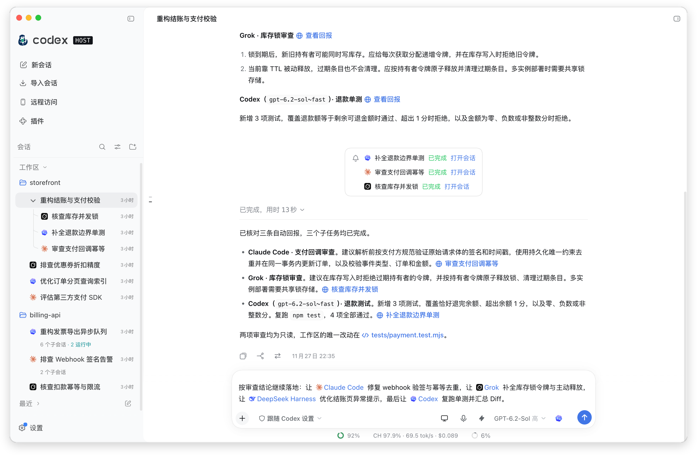
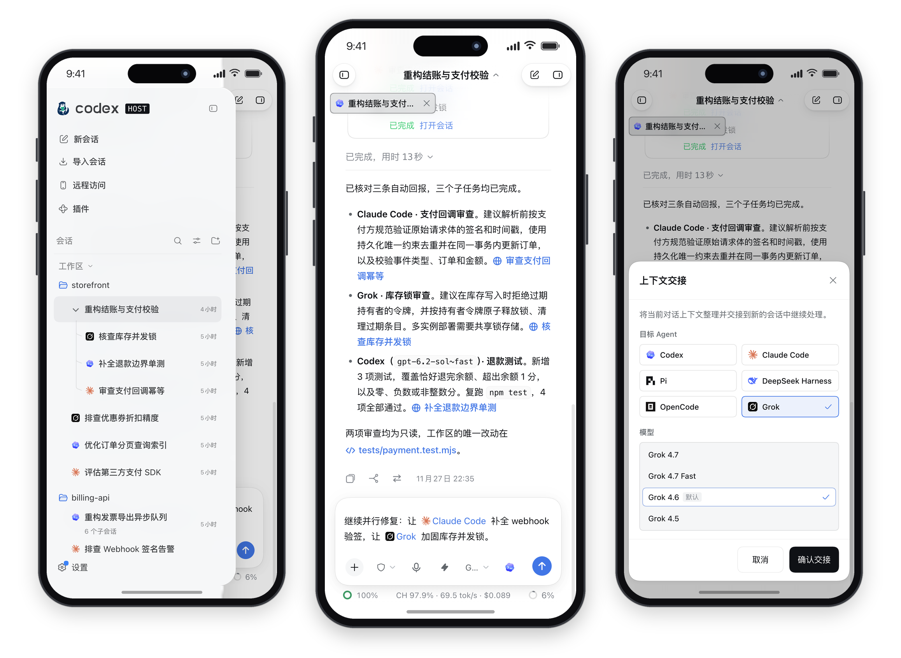
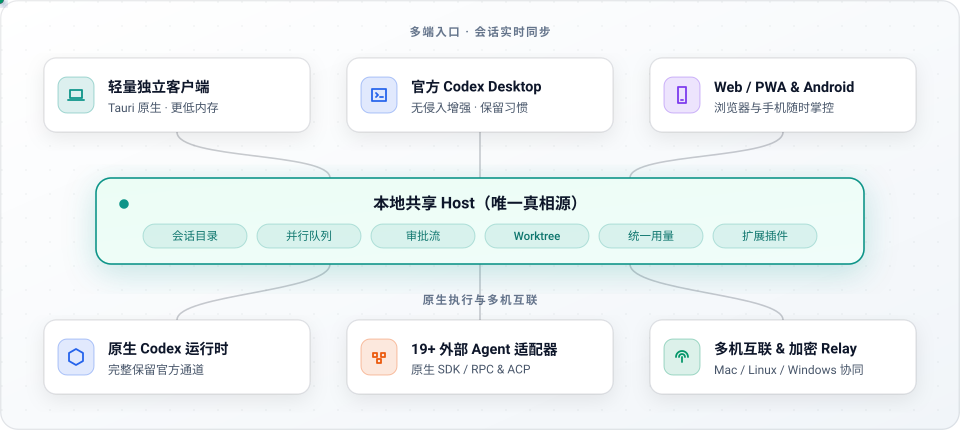
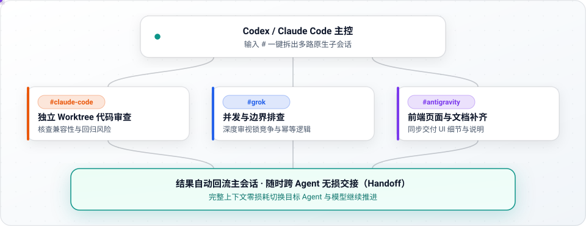
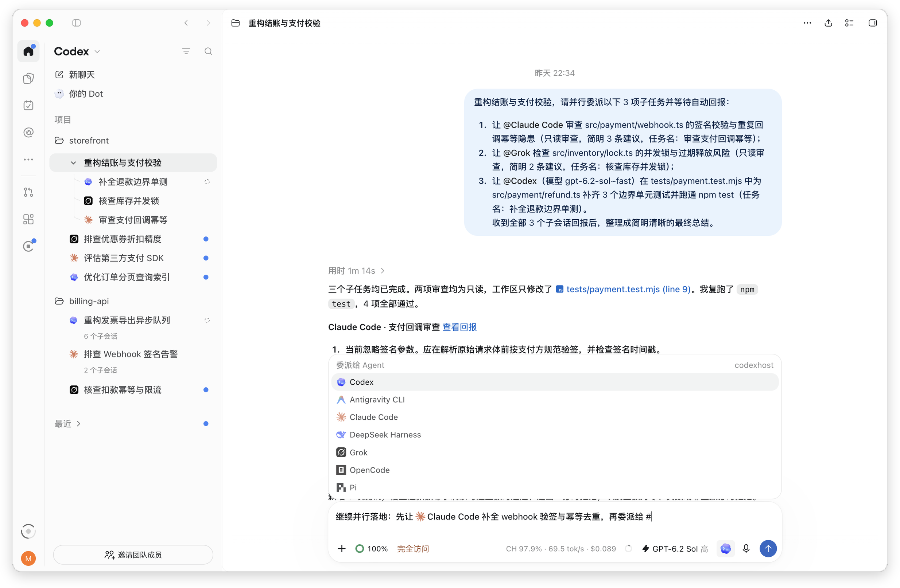
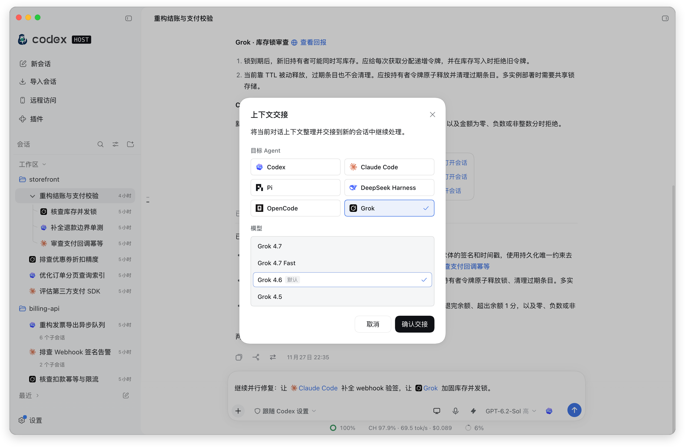
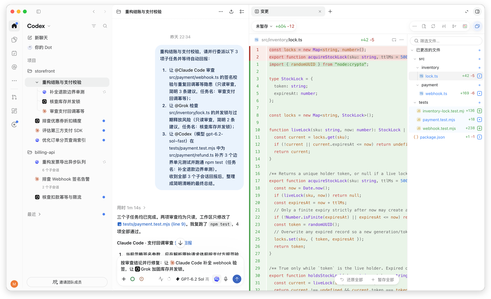
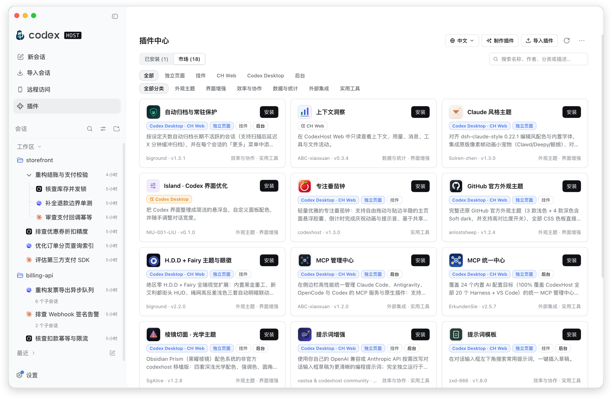
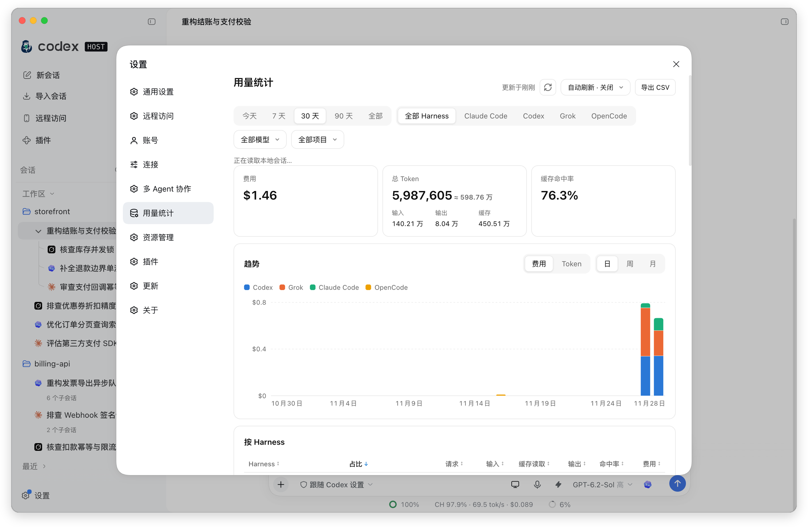
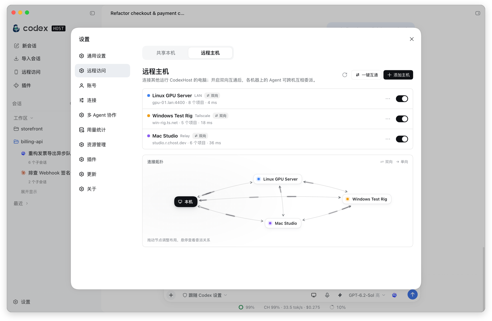

<div align="center">

<p>
  <picture>
    <source media="(prefers-color-scheme: dark)" srcset="../imgs/readme-lockup-dark.png" />
    <source media="(prefers-color-scheme: light)" srcset="../imgs/readme-lockup-light.png" />
    
  </picture>
</p>

<p>
  <a href="../../README.md">English</a> ·
  <strong>简体中文</strong> ·
  <a href="README.ko.md">한국어</a>
</p>

<h2>在 Codex 里，调度所有编程 Agent。</h2>

<p>
  把 <b>Codex</b>、<b>Claude Code</b>、<b>Antigravity</b>、<b>Pi</b>、<b>Grok</b> 等 19+ 款编程 Agent 聚进同一工作台；<br />
  自带独立桌面端（无需安装官方 Codex Desktop），也支持增强官方客户端，并与 Web、手机实时多机同步。
</p>

<p>
  <b><a href="#下载与安装">下载 CodexHost</a></b> &nbsp;·&nbsp;
  <b><a href="https://chost.dev">访问官网 →</a></b> &nbsp;·&nbsp;
  <a href="https://github.com/BytePioneer-AI/codex-host/tree/main/docs">文档</a> &nbsp;·&nbsp;
  <a href="#社区与交流群">微信交流群</a>
</p>

<br />

<picture>
  <source media="(prefers-color-scheme: dark)" srcset="../imgs/readme-hero-zh-dark.png" />
  <source media="(prefers-color-scheme: light)" srcset="../imgs/readme-hero-zh-light.png" />
  
</picture>

</div>

---

<a id="赞助"></a>

<details open>
<summary><b>赞助</b></summary>

<br />

<table>
<tr>
<td width="160" align="center"><a href="https://vibeapi.cc/sign-up?aff=AOYp"></a></td>
<td>感谢 <b>VibeAPI</b> 赞助本项目！面向开发者与团队提供 Codex、Claude 等主流 AI 模型统一接入，坚持自建可溯源号池，SLA 稳定性 99.9%、缓存命中率 95%+，支持 7×24 人工技术支持与企业对公开票。<a href="https://vibeapi.cc/sign-up?aff=AOYp">前往了解 VibeAPI →</a></td>
</tr>
</table>

</details>

---

## 核心特性

<table>
<tr>

<td width="25%" valign="top">

### 轻量多端，实时同步

自带轻量独立客户端，也兼容增强官方 Codex Desktop。

独立端、官方端、Web 与手机四端实时同步，不丢会话。

</td>

<td width="25%" valign="top">

### Agent 间真正分工

`#` 派发并行原生子会话，跑完自动回流结果。

聊到一半还能跨 Agent 无损交接上下文。

</td>

<td width="25%" valign="top">

### 多机互联，跨机委派

Mac、Linux、Windows 一键双向互通，不同机器上的 Agent 可跨机互相派活、自动回流结果。

离开电脑，用手机随时审批与接力。

</td>

<td width="25%" valign="top">

### 原生能力是一等公民

基于各家原生 **SDK / RPC** 接入；走 **ACP** 时也结合原生接口与 CLI 补全能力。

复用本机订阅与凭据，无账号门槛、无第三方代理。

</td>

</tr>
</table>

---

<a id="下载与安装"></a>

## 下载与安装

### 1. 安装包（推荐）

<table>
<tr>
<td width="50%" align="center">

[**官网下载（推荐） →**](https://chost.dev/download)<br /><sub>macOS · Windows · Linux · Android · iOS (PWA)</sub>

</td>
<td width="50%" align="center">

[**GitHub Releases →**](https://github.com/BytePioneer-AI/codex-host/releases/latest)<br /><sub>全部版本安装包 · <a href="../platforms/linux/linux.zh-CN.md">Linux 说明</a></sub>

</td>
</tr>
</table>

Windows WinGet：`winget install --id BytePioneer-AI.CodexHost --exact`

macOS 一键安装（推荐，免验证弹窗）：

```bash
curl -fsSL https://chost.dev/install.sh | bash
```

> [!NOTE]
> **macOS 手动装 `.dmg` 提示「无法验证」**：执行 `xattr -dr com.apple.quarantine /Applications/codexhost.app`，或在「系统设置 → 隐私与安全性」点「仍要打开」。
> **更新后不想重授系统权限**：在「设置 → 更新」开启「更新后保留系统权限」即可。

### 2. npm 安装

```bash
npm install -g @codexhost/cli
```

```bash
codexhost          # 启动桌面端（独立客户端或官方 Codex 增强模式）
codexhost app      # 直接打开轻量独立客户端
codexhost web      # 启动本地 Web 端
codexhost status   # 查看服务状态
codexhost update   # 升级到最新版本
codexhost shortcut install|remove|status  # 管理 macOS / Windows 桌面图标
codexhost stop     # 停止后台服务（npm 重装前先执行）
```

<details>
<summary><b>更多排查（本地控制台 / Windows 绿色版 Codex Desktop）</b></summary>

<br />

- **启动失败或官方 Codex Desktop 未加载功能**：运行 `codexhost console`（Windows：开始菜单 → `codexhost console`）打开本地控制台 `http://127.0.0.1:4399/` 查看日志与版本状态。
- **Windows 使用绿色解压版 Codex Desktop**：设置用户环境变量 `CODEXHOST_INSTALL_ROOT` 指向解压目录，完全退出进程后重开终端运行 `codexhost`：
  ```powershell
  [Environment]::SetEnvironmentVariable("CODEXHOST_INSTALL_ROOT", "D:\CodexPortable", "User")
  ```

</details>

---

## 一个后台，三种用法

CodexHost 的本地 Host 作为唯一真相源常驻运行，你可以按场景随时切换最顺手的入口：

<table>
<tr>

<td width="33%" valign="top">

### 轻量独立客户端

**开箱即用，更低内存。**

基于 Tauri 的轻量 CodexHost 原生桌面端，无需安装官方 Codex Desktop，macOS / Windows / Linux 体验一致。

</td>

<td width="33%" valign="top">

### 官方 Codex 增强

**保留习惯，能力倍增。**

无侵入增强官方 Codex Desktop，不修改官方安装包，原生 Diff 审查、Worktree 与审批体验原样保留。

</td>

<td width="33%" valign="top">

### Web 与手机端

**随时随地，实时接管。**

浏览器打开同款界面，搭配 Android 原生 APK 与 iOS PWA，离开工位照样查看进度、审批命令与回复。

</td>

</tr>
</table>

<p align="center">
  <picture>
    <source media="(prefers-color-scheme: dark)" srcset="../imgs/readme-ch-desktop-zh-dark.png" />
    <source media="(prefers-color-scheme: light)" srcset="../imgs/readme-ch-desktop-zh-light.png" />
    
  </picture>
  <sub>轻量 CodexHost 独立客户端（与上方官方 Codex 客户端共用同一本地 Host，实时同步完全一致的会话、委派树与进行中状态）</sub>
</p>

<p align="center">
  <picture>
    <source media="(prefers-color-scheme: dark)" srcset="../imgs/readme-feat-mobile-zh-dark.png" />
    <source media="(prefers-color-scheme: light)" srcset="../imgs/readme-feat-mobile-zh-light.png" />
    
  </picture>
  <sub><b>手机端随时掌控（Android APK / iOS PWA）</b> — 离开电脑照样查看工作区委派树、跟进多 Agent 汇报，并一键发起跨 Agent 交接与追问。</sub>
</p>

<p align="center">
  <picture>
    <source media="(prefers-color-scheme: dark)" srcset="../imgs/readme-diagram-arch-zh-dark.svg" />
    <source media="(prefers-color-scheme: light)" srcset="../imgs/readme-diagram-arch-zh-light.svg" />
    
  </picture>
</p>

---

## 多 Agent 协作：不只是并排，而是分工与接力

一个 Agent 忙不过来，或者不同任务适合不同模型——在输入框打 `#` 选择目标 Agent，即可拆出独立原生子会话并行执行；聊到一半也能用 **[跨 Agent 无损交接（Handoff）](../architecture/cross-harness-handoff.md)** 把完整上下文无缝交给另一款 Agent 接着干。

<p align="center">
  <picture>
    <source media="(prefers-color-scheme: dark)" srcset="../imgs/readme-diagram-teamwork-zh-dark.svg" />
    <source media="(prefers-color-scheme: light)" srcset="../imgs/readme-diagram-teamwork-zh-light.svg" />
    
  </picture>
</p>

> 让 `#claude-code` 独立审查这次修改并指出兼容性风险。  
> 让 `#grok` 排查这个模块的并发与边界隐患。  
> 让 `#antigravity` 补齐前端页面与使用文档。

<p align="center">
  <picture>
    <source media="(prefers-color-scheme: dark)" srcset="../imgs/readme-feat-hash-menu-zh-dark.png" />
    <source media="(prefers-color-scheme: light)" srcset="../imgs/readme-feat-hash-menu-zh-light.png" />
    
  </picture>
  <sub>输入框键入 <code>#</code> 即刻唤起本机全部可用 Agent（Codex、Antigravity CLI、Claude Code、DeepSeek Harness、Grok、OpenCode、Pi 等），直接在当前会话并行派发子任务。</sub>
</p>

<p align="center">
  <picture>
    <source media="(prefers-color-scheme: dark)" srcset="../imgs/readme-feat-handoff-zh-dark.png" />
    <source media="(prefers-color-scheme: light)" srcset="../imgs/readme-feat-handoff-zh-light.png" />
    
  </picture>
  <sub><b>跨 Agent 无损交接（Handoff）</b> — 任意轮次一键整理当前上下文，自由切换目标 Agent 与模型无缝接力。</sub>
</p>

---

## 原生工作台：Diff 审查、插件市场与用量洞察

<p align="center">
  <picture>
    <source media="(prefers-color-scheme: dark)" srcset="../imgs/readme-feat-diff-zh-dark.png" />
    <source media="(prefers-color-scheme: light)" srcset="../imgs/readme-feat-diff-zh-light.png" />
    
  </picture>
  <sub><b>原生 Git Diff 审查</b> — 边看多 Agent 结论边审代码，未暂存改动（<code>+604 -12</code>）、变更文件树与逐行红绿对比同屏呈现，支持一键暂存与还原。</sub>
</p>

<table>
  <tr>
    <td width="50%" valign="top">
      <p><strong>跨客户端插件市场</strong><br /><sub>主题外观、MCP 统一中心、侧栏委派树、上下文洞察等一键安装，同时覆盖 Codex Desktop 与 CH Web</sub></p>
      <picture>
        <source media="(prefers-color-scheme: dark)" srcset="../imgs/readme-feat-plugins-zh-dark.png" />
        <source media="(prefers-color-scheme: light)" srcset="../imgs/readme-feat-plugins-zh-light.png" />
        
      </picture>
    </td>
    <td width="50%" valign="top">
      <p><strong>多 Agent 统一用量与费用</strong><br /><sub>跨 Codex、Grok、Claude Code、OpenCode 统计费用、Token、缓存命中率与日趋势，支持导出 CSV</sub></p>
      <picture>
        <source media="(prefers-color-scheme: dark)" srcset="../imgs/readme-feat-usage-zh-dark.png" />
        <source media="(prefers-color-scheme: light)" srcset="../imgs/readme-feat-usage-zh-light.png" />
        
      </picture>
    </td>
  </tr>
</table>

---

## 多机互联，跨节点互相委派

不止是「远程查看另一台电脑」——开启**一键互通**后，Mac、Linux 服务器与 Windows 测试机组成一张网状协作网络，**不同机器上的 Agent 可以直接跨机互相委派任务**。例如：本机上的 Codex 写完代码，直接把编译测试派给 Linux 服务器上的 Claude Code、再交给 Windows 主机上的 Grok 做兼容回归，多节点并行跑完并自动回流结果。

<p align="center">
  <picture>
    <source media="(prefers-color-scheme: dark)" srcset="../imgs/readme-feat-mesh-zh-dark.png" />
    <source media="(prefers-color-scheme: light)" srcset="../imgs/readme-feat-mesh-zh-light.png" />
    
  </picture>
  <sub><b>原生多机连接拓扑（一键双向互通）</b> — 本机与 Linux GPU Server、Windows Test Rig、Mac Studio 实时互联，各节点上的 Agent 可跨机互相委派协作。</sub>
</p>

- **[多机互联与跨节点委派](../product/multi-remote-peers.md)**：把多台 Mac、Linux 与 Windows 收进同一侧栏，支持局域网、Tailscale 与加密中转混合组网，节点间双向互通。
- **[手机扫码即连](../product/web-remote-access.md)**：无需折腾公网端口，离开电脑同样随时审批与接力；对合规有要求的团队可一键部署 **[私有化自建 Relay](../product/self-hosted-relay.md)**。
- **本地优先与隐私边界**：代码、对话历史与各家 Agent 凭据全部留在你自己的机器上，直连官方模型服务，不经任何第三方代理。

<details>
<summary><b>进阶：SSH 远程与 Windows Remote Control 连接</b></summary>

<br />

除 Peer Hub 外，也支持复用官方 Codex Desktop 通道操控远端机器上的 Agent（两端需安装相同版本 CodexHost）：
- **macOS / Linux（SSH 远程）**：在被控机执行 `codexhost remote install && codexhost remote start`，详见 [SSH 远程配置与诊断 →](../platforms/remote/remote-ssh-host.zh-CN.md)
- **Windows（Remote Control 实验）**：复用官方 Remote Control 认证，不开放公网端口，详见 [Remote Control 说明 →](../platforms/remote/remote-control-host.zh-CN.md)

</details>

---

<a id="支持的-agent"></a>

## 支持的 Agent

原生支持 **Codex**，并通过官方 SDK / RPC 与 [ACP](https://agentclientprotocol.com/) 预装接入 **19+ 款编程 Agent**（自动复用本机已登录 CLI 与配置）：

<p align="center">
  <a href="https://openai.com/codex/"></a>
  <a href="https://code.claude.com/docs/en/quickstart"></a>
  <a href="https://pi.dev/"></a>
  <a href="https://opencode.ai/docs/"></a>
  <a href="https://grok.com/"></a>
  <a href="https://github.com/can1357/oh-my-pi"></a><br />
  <a href="https://github.com/deepseek-ai/deepseek-harness"></a>
  <a href="https://github.com/QwenLM/qwen-code"></a>
  <a href="https://docs.devin.ai/cli"></a>
  <a href="https://antigravity.google/product/antigravity-cli"></a>
  <a href="https://kiro.dev/docs/cli/"></a>
  <a href="https://www.codebuddy.cn/home/"></a><br />
  <a href="https://www.workbuddy.ai/docs/workbuddy/Quickstart"></a>
  <a href="https://cursor.com/docs/cli/overview"></a>
  <a href="https://hermes-agent.nousresearch.com/docs"></a>
  <a href="https://qoder.com/cli"></a>
  <a href="https://moonshotai.github.io/kimi-code/"></a>
  <a href="https://zcode.z.ai/"></a>
  <a href="../harnesses/copilot/copilot-harness-integration.md"></a>
</p>

<p align="center">
  <a href="../harnesses/capability-boundaries.md"><strong>各 Harness 能力边界文档 →</strong></a> &nbsp;·&nbsp;
  <a href="../../.agents/skills/codexhost-add-harness/SKILL.md">新增自定义 Harness →</a>
</p>

---

<a id="社区与交流群"></a>

## 社区与交流群

<table align="center">
  <tr>
    <td>
      <strong>微信交流群</strong><br />
      <sub>扫码添加微信（备注「CodexHost」）拉你进交流群，也欢迎直接提 <a href="https://github.com/BytePioneer-AI/codex-host/issues">GitHub Issue</a>：</sub>
      <ul>
        <li><sub>安装配置、远程连机与多 Agent 使用交流</sub></li>
        <li><sub>新 Agent 适配需求、功能建议与开发讨论</sub></li>
        <li><sub>Bug 反馈建议直接提交 <strong>GitHub Issue</strong></sub></li>
      </ul>
    </td>
    <td align="center">
      
    </td>
  </tr>
</table>

<details>
<summary><b>从源码构建与参与开发</b></summary>

<br />

环境要求：Node.js 22.19+ 或 24、Rust（如需调试官方桌面端增强模式，另需安装 Codex Desktop）。详见 [贡献说明](../../CONTRIBUTING.md) 与 [仓库维护自动化](../operations/repository-maintenance.md)。

```bash
git clone https://github.com/BytePioneer-AI/codex-host
cd codex-host
npm ci
npm run start:app   # 启动独立桌面端
```

| 命令 | 作用 |
| :--- | :--- |
| `npm run start:app` | 构建并启动独立桌面端 |
| `npm run start:web` | 构建并启动独立 Web 端（默认热更新） |
| `npm start` | 构建并启动官方 Codex Desktop 增强模式 |
| `npm stop` | 停止当前用户的本地 codexhost 后台服务 |

</details>

---

## 鸣谢与贡献者

感谢 [LINUX DO](https://linux.do/) 社区、[Paseo](https://github.com/getpaseo/paseo)（多 Harness 架构启发）、[DSH（DeepSeek Harness）](https://github.com/deepseek-ai/deepseek-harness)（Web 端基础）以及所有为 CodexHost 做出贡献的开发者。

<a href="https://github.com/BytePioneer-AI/codex-host/graphs/contributors">
  
</a>

## Star History

<a href="https://www.star-history.com/?repos=bytepioneer-ai%2Fcodex-host&type=date&legend=top-left">
  <picture>
    <source media="(prefers-color-scheme: dark)" srcset="https://api.star-history.com/chart?repos=bytepioneer-ai/codex-host&type=date&theme=dark&legend=top-left" />
    <source media="(prefers-color-scheme: light)" srcset="https://api.star-history.com/chart?repos=bytepioneer-ai/codex-host&type=date&legend=top-left" />
    
  </picture>
</a>

## 许可证

本项目采用 [LGPL-3.0](../../LICENSE) 开源许可证。
