<div align="center">

# CodexHost

**在 Codex Desktop 里用 Claude Code、Pi、Grok 等 15+ 个 Agent，不用来回切换应用**

它们和 Codex 一样有 Diff 审查、Fork 和审批，还能互相派活。

另有 **Web 端**：同样的 Codex 界面，占用内存更少，手机和任何电脑都能远程使用本机上的所有 Agent。

⭐ 如果这个项目对你有帮助，请给我们一个 Star！⭐

<p align="center">
  <a href="https://pi.dev/"></a>
  <a href="https://openai.com/codex/"></a>
  <a href="https://code.claude.com/docs/en/quickstart"></a>
  <a href="https://opencode.ai/docs/"></a>
  <a href="https://grok.com/"></a>
  <a href="https://github.com/can1357/oh-my-pi"></a><br />
  <a href="https://github.com/deepseek-ai/deepseek-harness"></a>
  <a href="https://github.com/QwenLM/qwen-code"></a>
  <a href="https://docs.devin.ai/cli"></a>
  <a href="https://antigravity.google/product/antigravity-cli"></a>
  <a href="https://kiro.dev/docs/cli/"></a>
  <a href="https://www.codebuddy.cn/home/"></a><br />
  <a href="https://www.workbuddy.ai/docs/workbuddy/Quickstart"></a>
  <a href="https://cursor.com/docs/cli/overview"></a>
  <a href="https://hermes-agent.nousresearch.com/docs"></a>
  <a href="https://qoder.com/cli"></a>
  <a href="https://moonshotai.github.io/kimi-code/"></a>
  <a href="https://zcode.z.ai/"></a>
  <a href="../harnesses/copilot/copilot-harness-integration.md"></a>
</p>

<p align="center"><a href="https://github.com/BytePioneer-AI/codex-host/releases"><strong>下载</strong></a> · <a href="#快速开始">快速开始</a> · <a href="#在-codex-desktop-里用所有-agent">Desktop</a> · <a href="#多-agent-分工">多 Agent 分工</a> · <a href="#加入交流群">微信交流群</a> · <a href="../../README.md">English</a> · <a href="README.ko.md">한국어</a></p>

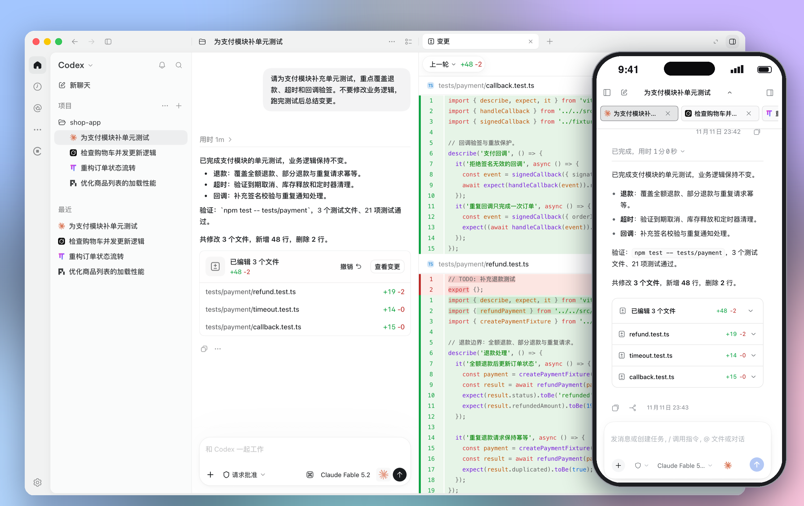

</div>

## 赞助

<details open>
<summary>点击收起</summary>

<table>
<tr>
<td width="180"><a href="https://vibeapi.cc/sign-up?aff=AOYp">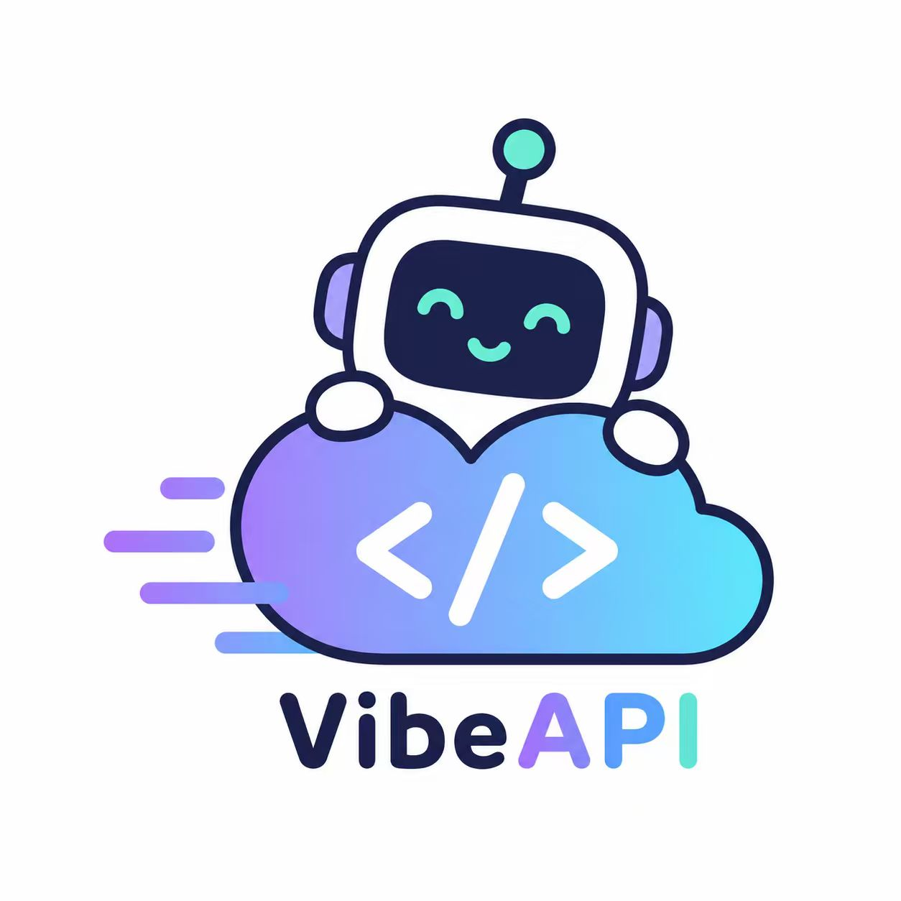</a></td>
<td>感谢 <b>VibeAPI</b> 赞助本项目！VibeAPI 主要面向重度开发者与团队，提供主流 AI 模型统一接入。主打 Codex 与 Claude 系列，坚持自建号池可溯源。首流响应极速，SLA 稳定性达 99.9%，缓存命中率高达 95%+。提供 7×24 小时人工技术支持，全面支持对公开票与企业合作。<a href="https://vibeapi.cc/sign-up?aff=AOYp">点此前往薅赛博鸡蛋</a></td>
</tr>
</table>
</details>

<a id="快速开始"></a>

## 快速开始

**方式一：npm**（macOS / Windows / Linux）

```bash
npm install -g @codexhost/cli
codexhost          # 启动 Codex Desktop
codexhost web      # 启动 Web 并在浏览器中打开
codexhost stop     # 停止 CodexHost 的全部后台服务
```

**方式二：安装包**（macOS / Windows）

从 [Releases](https://github.com/BytePioneer-AI/codex-host/releases) 下载对应平台的安装包。Web 端：安装后打开 codexhost，本地访问 http://127.0.0.1:4400 。

> Linux 支持 x64 / ARM64，详见 [Linux 说明](../platforms/linux/linux.zh-CN.md)。

**升级与停止**：运行 `codexhost update` 升级；`codexhost stop` 停止全部后台服务。用 npm 覆盖安装前，请先运行 `codexhost stop`。

<details>
<summary>安装问题排查</summary>

**codexhost 启动失败，或 Codex 打开了但没有 codexhost 功能**

运行 `codexhost console`（Windows：开始菜单 →“codexhost console”），打开本地控制台 `http://127.0.0.1:4399/`，可以查看上次启动失败的原因、Codex Desktop 版本、Host Runtime 日志，并在 Codex 未运行时更新 codexhost。

**macOS：首次打开提示「应用无法验证」**

```bash
xattr -dr com.apple.quarantine /Applications/codexhost.app
```

**Windows：使用绿色解压版 Codex Desktop**

1. 将 `CODEXHOST_INSTALL_ROOT` 设置为 Codex Desktop 的解压目录：

   ```powershell
   [Environment]::SetEnvironmentVariable("CODEXHOST_INSTALL_ROOT", "D:\CodexPortable", "User")
   ```

2. 完全退出 Codex Desktop，重新打开终端，再运行 `codexhost`。

</details>

<a id="在-codex-desktop-里用所有-agent"></a>

## 在 Codex Desktop 里用所有 Agent

不用切换应用：**Pi、Claude Code、Grok Build 等 15+ 个 Agent** 都在同一个 Codex Desktop 窗口里，每个会话都在左侧列表中，输入框右下角随时切换。

https://github.com/user-attachments/assets/c48192d7-23ff-4f6e-b61a-6345a655bb76

<table>
  <tr>
    <td width="33%" valign="top">
      <p><strong>Diff 审查面板</strong><br /><sub>每轮改动自动汇总，点「审核」查看完整 Diff</sub></p>
      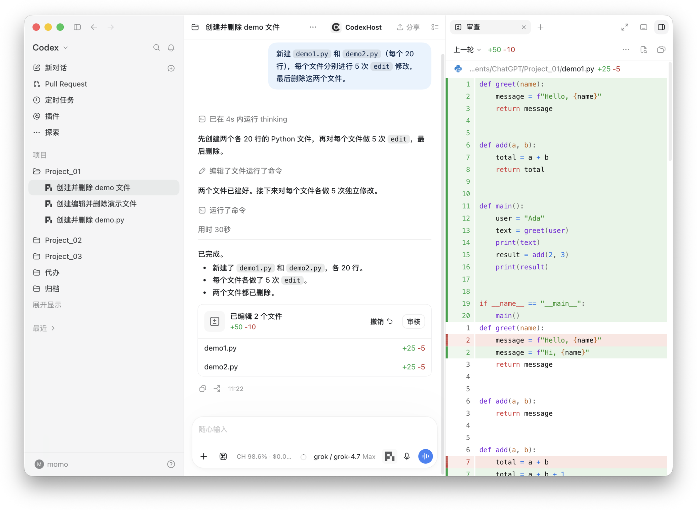
    </td>
    <td width="33%" valign="top">
      <p><strong>从任意消息 Fork</strong><br /><sub>在当前工作空间，或新建 Worktree 并行开发</sub></p>
      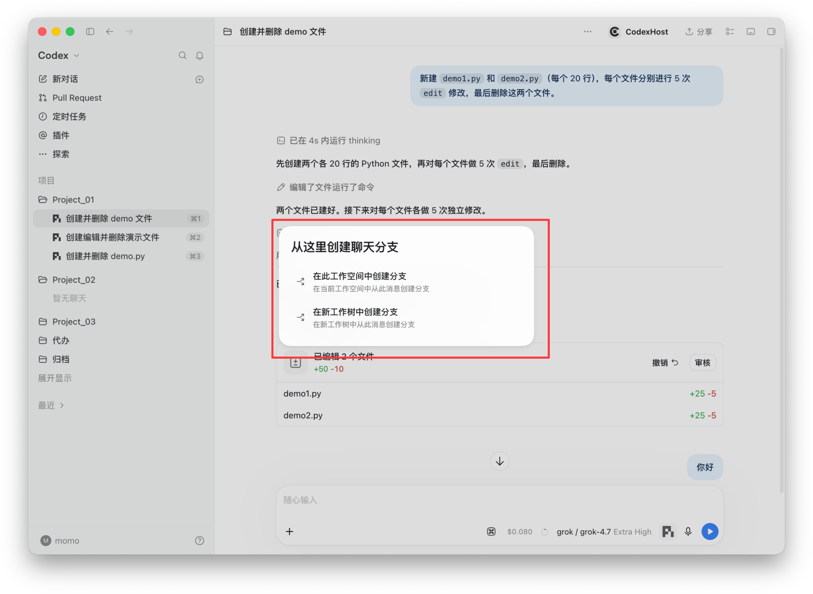
    </td>
    <td width="33%" valign="top">
      <p><strong>Subagent 可见</strong><br /><sub>每个 Subagent 有独立图标，可在右侧查看完整对话</sub></p>
      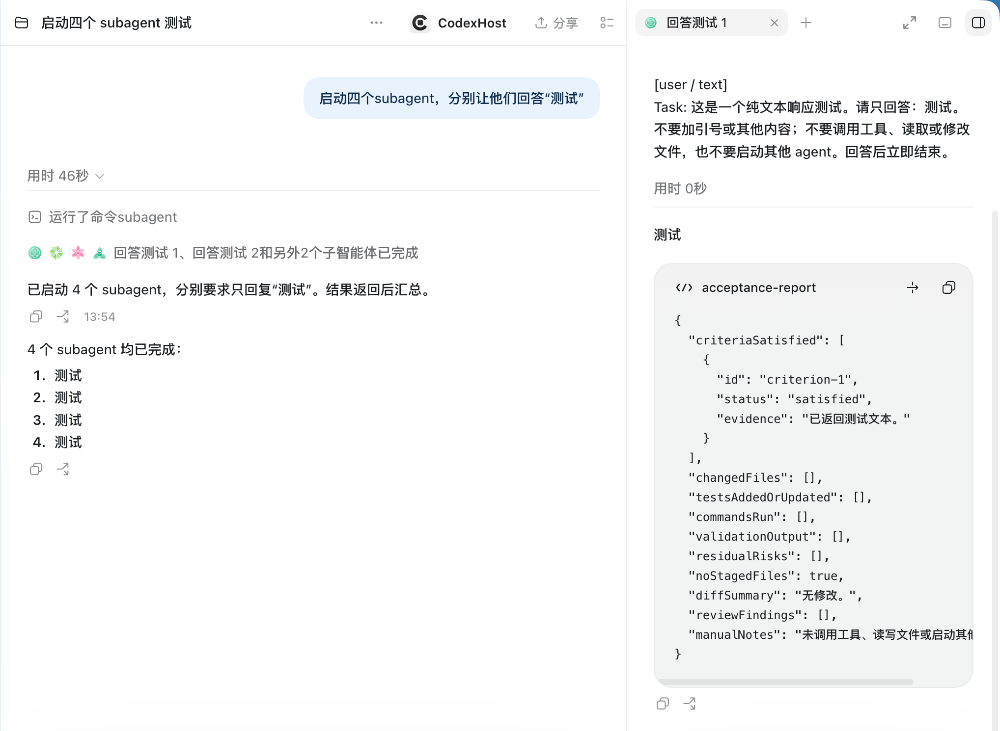
    </td>
  </tr>
</table>

<details>
<summary>更多：工具细节、用量、账号导入、图表渲染</summary>

<table>
  <tr>
    <td width="50%" valign="top">
      <p><strong>工具调用与思考过程</strong><br /><sub>每次编辑、命令、思考都可展开查看细节</sub></p>
      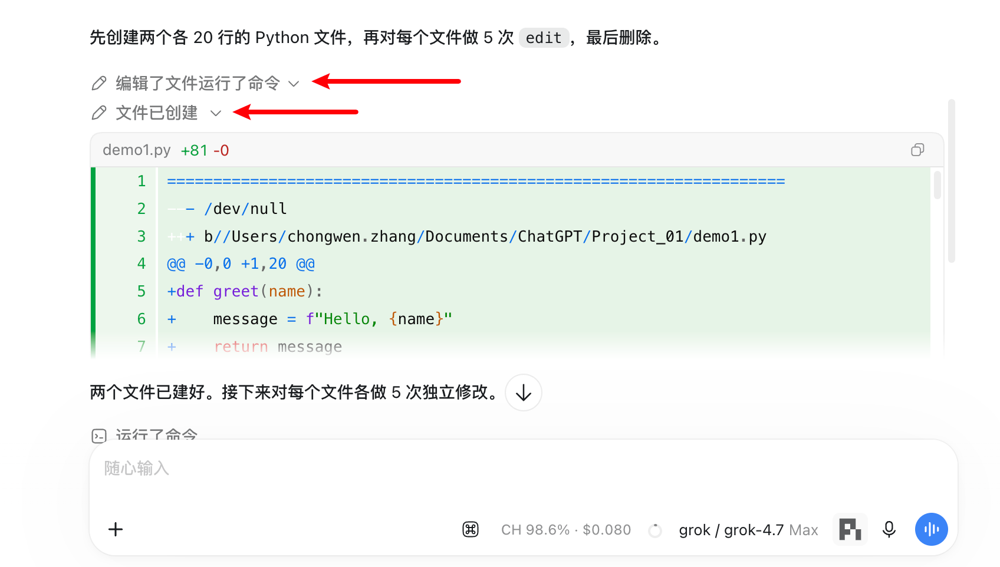
    </td>
    <td width="50%" valign="top">
      <p><strong>用量一目了然</strong><br /><sub>缓存命中率、费用估算、上下文占用实时显示</sub></p>
      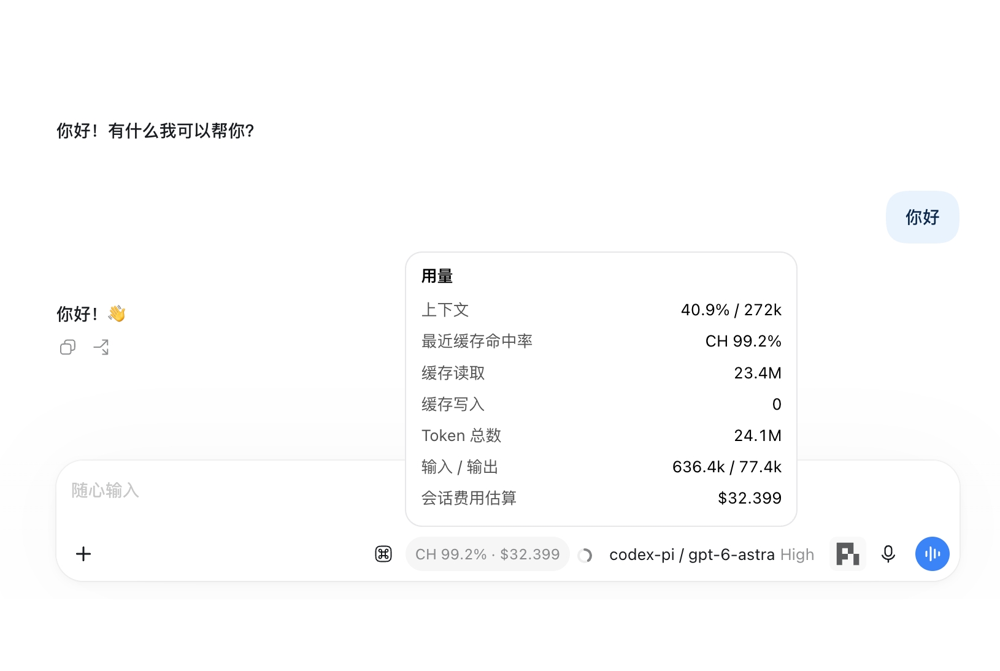
    </td>
  </tr>
  <tr>
    <td width="50%" valign="top">
      <p><strong>账号一键导入</strong><br /><sub>本机已登录的 Codex、Grok 凭证一键复制给 Pi，额度实时可见</sub></p>
      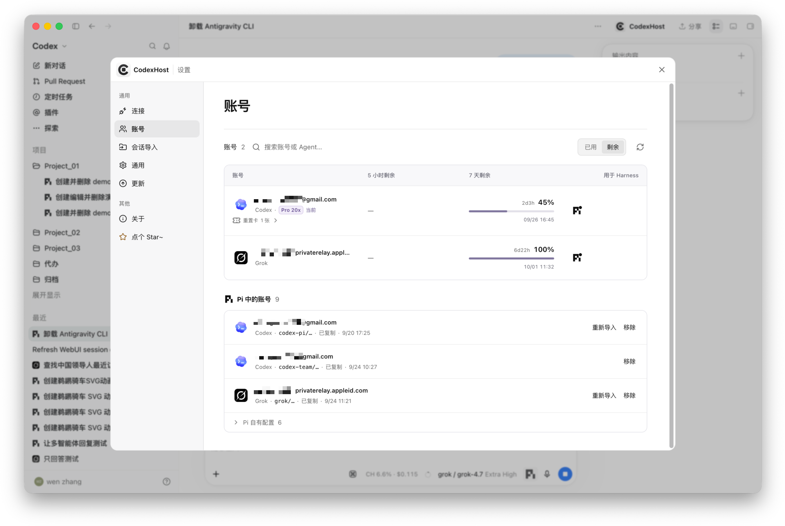
    </td>
    <td width="50%" valign="top">
      <p><strong>比终端更好看</strong><br /><sub>左：Codex Desktop + Pi，Mermaid 图表直接渲染；右：Pi TUI，只能看到源码</sub></p>
      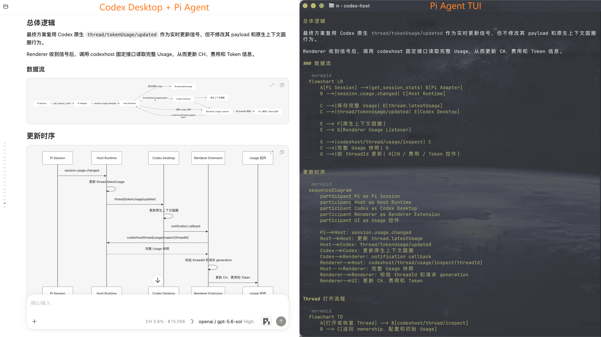
    </td>
  </tr>
</table>

</details>

<details>
<summary>各 Agent 功能支持情况</summary>

| 能力 | <a href="https://pi.dev/"></a> | <a href="https://github.com/can1357/oh-my-pi"></a> | <a href="https://code.claude.com/docs/en/quickstart"></a> | <a href="https://opencode.ai/docs/"></a> | <a href="https://grok.com/"></a> | <a href="https://github.com/deepseek-ai/deepseek-harness"></a> | <a href="https://antigravity.google/product/antigravity-cli"></a> | <a href="https://www.codebuddy.cn/home/"></a> | <a href="https://www.workbuddy.ai/docs/workbuddy/Quickstart"></a> | <a href="https://cursor.com/docs/cli/overview"></a> | <a href="https://hermes-agent.nousresearch.com/docs"></a> | <a href="https://qoder.com/cli"></a> | <a href="https://moonshotai.github.io/kimi-code/"></a> | <a href="../harnesses/copilot/copilot-harness-integration.md"></a> | <a href="https://github.com/QwenLM/qwen-code"></a> | <a href="../harnesses/devin/devin-cli-acp-integration.md"></a> |
| :--- | :---: | :---: | :---: | :---: | :---: | :---: | :---: | :---: | :---: | :---: | :---: | :---: | :---: | :---: | :---: | :---: |
| 流式回复 | ✅ | ✅ | ✅ | ✅ | ✅ | ✅ | ✅ | ✅ | ✅ | ✅ | ✅ | ✅ | ✅ | ✅ | ✅ | ✅ |
| 工具状态 | ✅ | ✅ | ✅ | ✅ | ✅ | ✅ | ✅ | ✅ | ✅ | ✅ | ✅ | ✅ | ✅ | ✅ | ✅ | ✅ |
| Edit Diff | ✅ | ✅ | ✅ | ✅ | ✅ | ✅ | ✅ | ✅ | ✅ | ✅ | ✅ | ✅ | ✅ | ✅ | — | ✅ |
| 提问 / 取消 | ✅ | ✅ | ✅ | ✅ | ✅ | ✅ | ✅ | ✅ | ✅ | ✅ | ✅ | ✅ | ✅ | ✅ | ✅ | — / ✅ |
| Model / Thinking 选择 | ✅ | ✅ | ✅ | ✅ | ✅ | ✅ | ✅ | ✅ | ✅ | ✅ | ✅ | ✅ | ✅ | ✅ | ✅ / — | ✅ / ◐ |
| 工具审批 | ✅ | ✅ | ✅ | ✅ | ✅ | ✅ | — | ✅ | ✅ | ✅ | ✅ | ✅ | ✅ | ✅ | ✅ | ✅ |
| 权限模式 | — | ✅ | ✅ | ✅ | ✅ | ✅ | ✅ | ✅ | ✅ | ✅ | ✅ | ✅ | ✅ | ✅ | ✅ | ✅ |
| Agent 间任务协作 | ✅ | ✅ | ✅ | ✅ | ✅ | ✅ | ✅ | ✅ | — | ✅ | ✅ | ✅ | ✅ | ✅ | ✅ | ◐ |
| Usage | ✅ | ✅ | ✅ | ✅ | ✅ | ✅ | ✅ | ✅ | ✅ | — | ✅ | ✅ | ✅ | ✅ | ✅ | — |
| Fork | ✅ | ✅ | ✅ | ✅ | ✅ | ✅ | ✅ | ✅ | ✅ | ✅ | ✅ | ✅ | ◐ | ✅ | — | ◐ |
| 上下文压缩 | ✅ | ✅ | ✅ | ✅ | ✅ | ✅ | — | ✅ | ✅ | — | ✅ | ✅ | ✅ | ✅ | — | — |
| 斜杠命令 | ✅ | ✅ | ✅ | ✅ | ✅ | ✅ | ✅ | ✅ | ✅ | ✅ | ✅ | ✅ | ✅ | — | — | — |
| 修订上一条消息 | ✅ | ✅ | ✅ | ✅ | ✅ | ✅ | ✅ | ✅ | ✅ | ✅ | ✅ | ✅ | ✅ | ✅ | — | ◐ |

</details>

<a id="多-agent-分工"></a>

## 多个 Agent 互相分工

在输入框输入 `#`，选一个 Agent，把一件独立的事交给它：

> 让 `#claude-code` 独立审查这次修改，并指出兼容性风险。
>
> 让 `#pi` 调查这个测试为什么偶发失败。
>
> 让 `#omp` 实现这个功能，我继续整理文档。

每个被委派的任务都是目标 Agent 的一个独立原生会话，出现在会话列表里，随时可以打开查看或接着聊。任务做完，结果会回到发起它的会话。

<table>
  <tr>
    <td width="50%" valign="top">
      <p><strong>多个 Agent 并行</strong><br /><sub>各自独立会话，互不打扰</sub></p>
      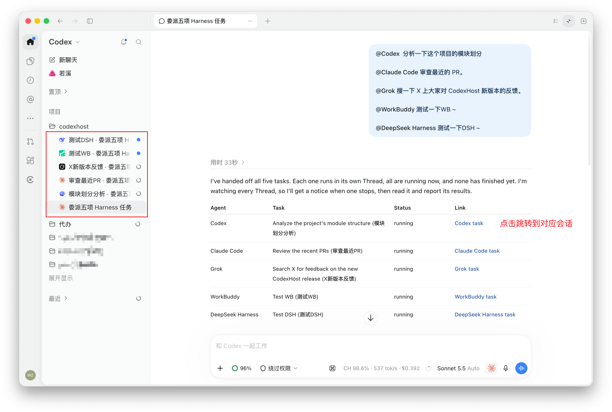
    </td>
    <td width="50%" valign="top">
      <p><strong>做完自动汇报</strong><br /><sub>委派任务结束后通知发起的会话</sub></p>
      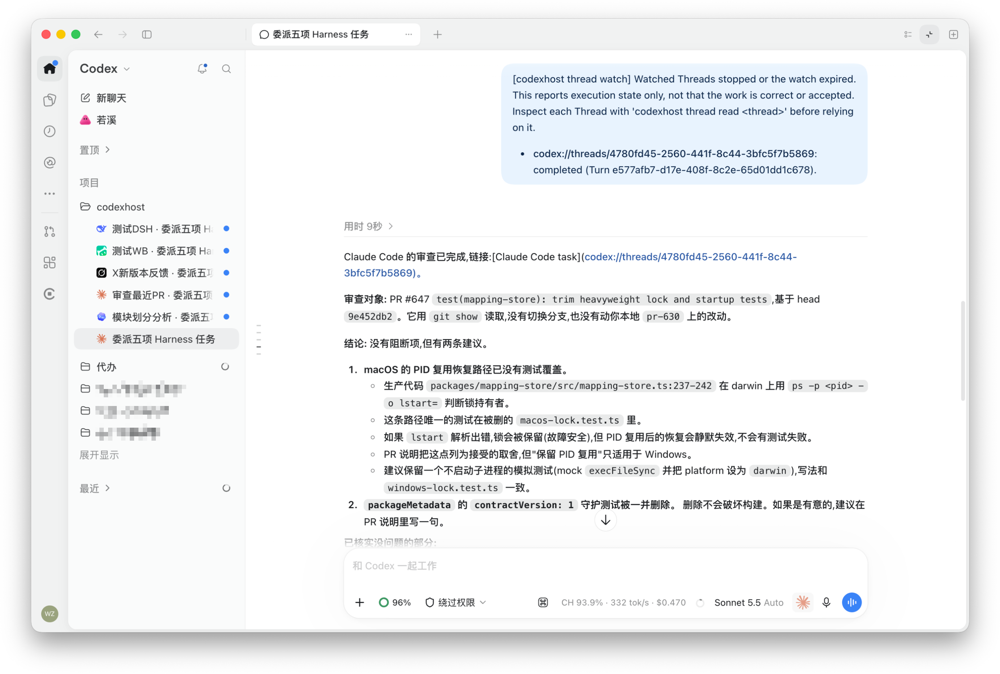
    </td>
  </tr>
</table>

**给开发者**：终端脚本、Claude Desktop、常驻 bot 等本机程序，也能通过 `codexhost delegate` / `codexhost thread` 命令或 MCP 给这些 Agent 派任务、等结果，详见[外部客户端](../architecture/external-clients.md)。

<details>
<summary><h3 id="远程连接-harness">进阶：在本机界面里用另一台机器上的 Agent</h3></summary>

任务在另一台机器上执行，界面仍是你本机的 Codex Desktop。两端需安装相同版本的 CodexHost。

| 被控机器 | 连接方式 |
| --- | --- |
| macOS / Linux | [SSH 远程](#ssh-远程) |
| Windows | [Remote Control 远程](#remote-control-远程实验)（实验） |

#### SSH 远程

前提：已在 Codex Desktop「设置 → 连接 → SSH」中添加被控机器。客户端支持 macOS / Linux / Windows。

<div align="center">
  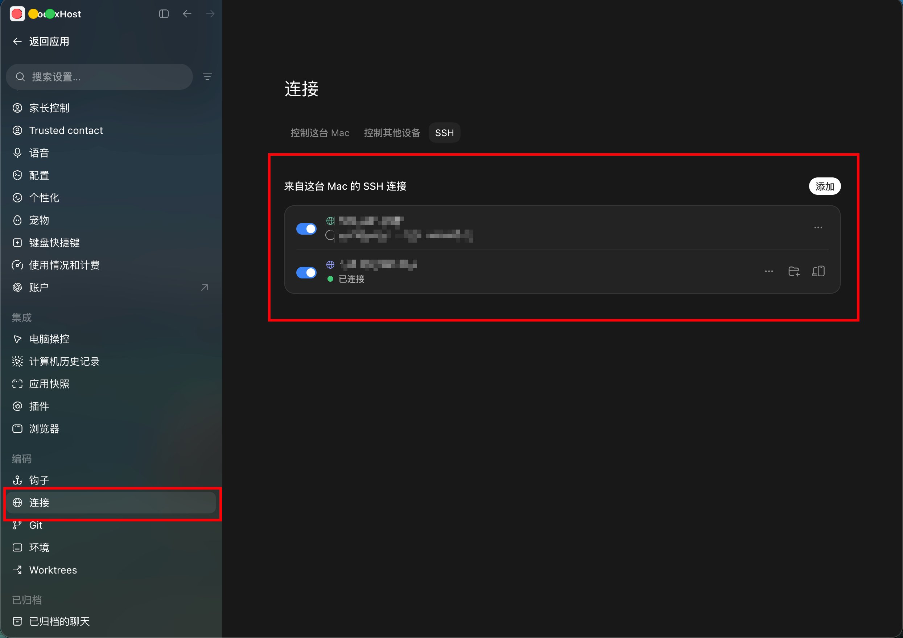
</div>

1. 在被控机器上安装并启动：

   ```bash
   npm install -g @codexhost/cli
   codexhost remote install
   codexhost remote start
   codexhost remote status
   ```

2. 在本地通过 codexhost 启动 Codex Desktop，打开 SSH 工作区。
3. 在输入框的 Agent / Model 选择器中选择目标 Agent。

[SSH 配置、诊断与卸载 →](../platforms/remote/remote-ssh-host.zh-CN.md)

#### Remote Control 远程（实验）

复用 Codex Desktop 官方 Remote Control 的配对与认证，在另一台电脑上使用 Windows 上的 Agent。

前提：官方 Remote Control 已能正常运行 Codex 任务。不新增公网服务或端口，Agent 凭据只保留在 Windows 上。

[Remote Control 配置、传输边界与诊断 →](../platforms/remote/remote-control-host.zh-CN.md)

</details>

<a id="加入交流群"></a>

## 微信交流群

<table align="center">
  <tr>
    <td>
      <strong>微信交流群</strong><br />
      <sub>对 CodexHost 用法、功能感兴趣的开发者可以扫码添加我的微信（备注“CodexHost”），我拉你进微信群交流。</sub>
      <ul>
        <li><sub>安装问题可以加群询问</sub></li>
        <li><sub>功能建议与反馈</sub></li>
        <li><sub>开发问题讨论</sub></li>
        <li><sub>Bug 问题建议提交 <strong>issue</strong></sub></li>
      </ul>
      <sub><strong>欢迎一起贡献~ </strong></sub>
    </td>
    <td align="center">
      
    </td>
  </tr>
</table>

<details>
<summary><h3>架构与开发</h3></summary>

#### 怎么做的

多数「多 Agent 客户端」会自己重做一套聊天界面，再用统一协议接入不同 Agent。CodexHost 的做法不同：

- **Desktop 侧**：通过 CDP / Electron Inspector 增强官方 Codex Desktop，不重做聊天界面，也不修改官方安装包
- **协议侧**：通过 CLI Shim 接入官方 app-server，原生 Codex 请求原样转发，不受影响
- **Agent 侧**：优先使用各自的原生接口（Pi 走 RPC，Claude Code 走 Agent SDK），没有原生接口的通过 [ACP](https://agentclientprotocol.com/) 接入；流式输出、工具状态、Diff、审批和提问统一投影到 Codex Desktop 的原生界面
- **编排侧**：委派任务在目标 Agent 中作为独立的原生会话运行，发起方可以选择等待结果或让它在后台运行
- **Web 侧**：Desktop 与 Web 连接同一个后台 Host，会话、审批和提问只有一份，两边看到的是同一个状态

#### 开发

提交 Issue 或 PR 前可阅读[贡献说明](../../CONTRIBUTING.md)；PR 标题标签、简短 CI 结果和发布前校验见[仓库维护自动化](../operations/repository-maintenance.md)。

环境要求：官方 Codex Desktop、Node.js 22.19+ 或 24、Rust。

```bash
git clone https://github.com/BytePioneer-AI/codex-host
cd codex-host
npm ci
npm start
```

| 命令 | 作用 |
| --- | --- |
| `npm start` | 构建并启动 Desktop |
| `npm start web` | 构建并启动 Web，默认开启 Web UI 热更新 |
| `npm start web -- --no-watch` | 构建并启动 Web，不开启热更新 |
| `npm stop` | 停止当前用户在所有工作树中的本地 codexhost 服务 |

#### 运行架构

以 Pi 为例。从左到右是一次请求的调用链：Desktop → 公共层 → Pi 插件 → 原生进程。

<div align="center">
  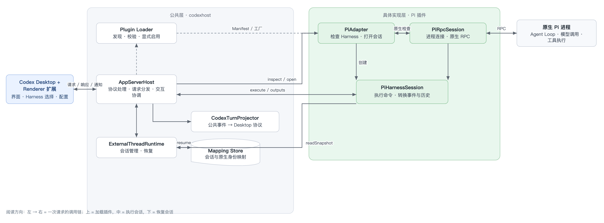
</div>

#### 新增 Harness

主要实现插件的 Manifest、工厂、Adapter、Session 及原生通信与转换逻辑。当前 Renderer 仍有静态接线，完整 Desktop 接入还需单独处理。
新增 Harness 时，可以让编码 Agent 使用仓库内的 [codexhost-add-harness Skill](../../.agents/skills/codexhost-add-harness/SKILL.md)。它说明了插件结构、公共 Adapter 接口、能力实现与测试要求。

</details>

## 鸣谢

- 感谢 [LINUX DO](https://linux.do/) 社区一直以来的支持。
- 感谢 [Paseo](https://github.com/getpaseo/paseo) 项目在多 Harness 接入思路与架构设计方面带来的启发与参考。
- 感谢 [DSH（DeepSeek Harness）](https://github.com/deepseek-ai/deepseek-harness) 项目，CodexHost 的 Web 端在 DSH Web 的基础上开发。

## 贡献者

感谢所有为 CodexHost 做出贡献的开发者。

<a href="https://github.com/BytePioneer-AI/codex-host/graphs/contributors">
  
</a>

## Star History

<a href="https://www.star-history.com/?repos=bytepioneer-ai%2Fcodex-host&type=date&legend=top-left">
  <picture>
    <source media="(prefers-color-scheme: dark)" srcset="https://api.star-history.com/chart?repos=bytepioneer-ai/codex-host&type=date&theme=dark&legend=top-left" />
    <source media="(prefers-color-scheme: light)" srcset="https://api.star-history.com/chart?repos=bytepioneer-ai/codex-host&type=date&legend=top-left" />
    
  </picture>
</a>

