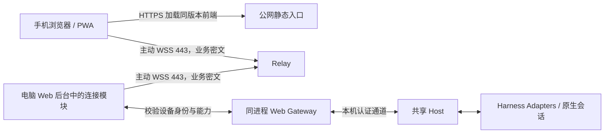
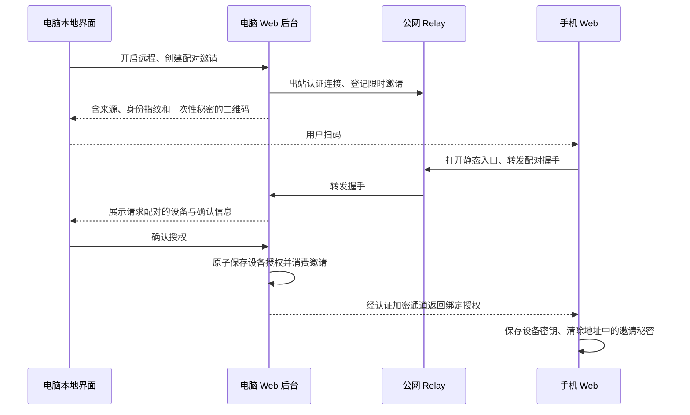

# Web 手机远程连接架构设计

> 状态：实施前设计，未实现、未部署。代码核对基线为 `dc657caf`，核对日期为 2026-10-19。本文中的新增目录、接口和命令均为拟议契约，不代表当前产品能力。
>
> 已确定的产品方向：普通办公电脑无需公网 IP；由项目提供默认公网中继；手机通过项目域名访问并扫码配对；任务在用户电脑执行。本文推荐首版免账号、逐设备授权和端到端加密。具体域名、部署区域、费用预算及密码库尚待实施前验证。

## 1. 目标与范围

手机在蜂窝网络或其他 Wi-Fi 下，可以连接已配对的办公电脑，查看外部 Thread、发送指令、停止任务和处理审批。电脑只需能够主动访问配置的公网服务，不要求公网 IPv4、入站 IPv6、端口映射、SSH 服务或手机 VPN。

用户流程为：电脑开启「手机远程访问」→ 手机扫码 → 电脑确认配对 → 手机直接进入该电脑的 Web 界面。后续电脑换 IP、手机切网络，不重新配对。界面持续显示当前电脑与连接状态；域名属于项目，执行机器属于用户。账号注册、充值和云端会话存储不属于首版。

首版边界：

- 仅访问当前 Web 已支持的本机 external Threads；官方 Codex Desktop Threads、既有 SSH Host 与官方 Remote Control 维持原有接入方式。
- 电脑需开机、联网，且共享 Host 与远程 Web 后台可运行。电脑休眠不能由一条已断开的中继连接可靠唤醒。
- 首先提供文字聊天、已有项目选择、模型/权限选择、审批与停止。附件、文件预览、终端、通知按阶段开放。
- 默认 Relay 为必达路径；P2P 仅是后续优化。企业网络禁止该域名、代理认证不兼容或 WSS 被阻断时，明确报告连接条件，不承诺任意网络均可达。
- 启用远程访问不会改变 Harness 原生权限、认证、计费和执行能力。

## 2. 当前代码与缺口

| 当前实现 | 可复用部分 | 远程接入缺口 |
| --- | --- | --- |
| [Web 入口](../../packages/web-server/src/main.ts) | 共享 Host 连接、HTTP 路由、DSH UI 注册、图片与上传入口 | 启动与路由集中在入口；没有远程 Principal、设备管理和出站 Relay 生命周期 |
| [AccessAuth](../../packages/web-server/src/auth.ts) | 本地 Web 的 Bearer / Cookie 认证 | 一个服务级 token；无法单独吊销某台手机，不能直接作为远程设备凭据 |
| [Web transport](../../packages/web-server/src/transport.ts) | RPC 注册表、`/api/remote.mux`、逻辑流与交互事件 | RPC 根据正文 `method` 分派；流可进入 DSH fallback；没有逐设备权限上下文，不能只按 URL 放行 |
| [通用客户端网关](../../packages/web-server/src/ch-client-gateway.ts) | `/api/ch/v1/{events,rpc,snapshot,respond}` | 仍依赖 Web 认证；当前 DSH UI 并非全部通过这四个接口工作 |
| [Host 通道](../architecture/host-client-channel.md) | 唯一执行所有者、epoch/cursor、快照、审批仲裁、有界回执 | 没有公网发现和持久 exactly-once；远程不能扩大其现有保证 |
| [Connection 客户端](../../apps/web-ui/packages/client/connection/src/client/index.ts) | `ClientTransportHooks` 的 `rpc/fetch/openStream`、连接恢复 | 要安装新的加密 carrier；`ownsHost` 不能因远程身份而设为 true |
| [Gateway 客户端](../../apps/web-ui/packages/api/gateway/src/client/index.ts) | 已有 `connection.rpc.open` 时绕过原生 WebSocket carrier | 需要实现远程逻辑流的取消、generation 和错误语义 |
| [前端资源组装](../../packages/web-server/src/web-assets.ts) | `WebAssets`、插件图、`__DSH_BOOT__`、发行资源导出 | 当前 HTML 由 Node 动态组装，不能简单把 Vite dist 上传 CDN 就完成远程入口 |
| [DSH 侧栏后端](../../packages/web-server/src/dsh-web-services.ts) | 文件、预览、PTY 与上游服务适配 | 具备系统用户级能力；不能把整个 DSH backend 自动列入远程权限 |
| [Web Push](../../packages/web-server/src/push.ts) | VAPID、订阅存储、完成/审批通知 | 订阅没有远程设备归属；当前通知发往所有订阅，需防止撤销后继续收到内容 |
| [原生 Host 生命周期](../../crates/launcher/src/host_service.rs) | 脱离前台、操作锁、就绪检测、进程监管 | 管理的是 Host，尚不等于 Web Gateway 也能托管运行 |
| [开发启动器](../../tools/dev-desktop/run.mjs) | 源码构建、Host/Web 重启 | `npm start web` 会重启 Host，不能用来实现产品中的「开启远程」或隧道重连 |

需要特别处理的现状：

1. Web 启动输出的二维码是带共享 token 的局域网/Tailscale URL，不是设备配对协议。底层 server 默认 loopback，开发/preview 入口可使用 `0.0.0.0`；远程托管模式明确使用 loopback，不沿用开发监听默认值。
2. `main.ts` 的 `/api/file?path=...` 可读取系统用户可访问的图片；侧栏文件读取和 PTY 也有系统用户级权限。首版远程不开放这些入口。详见[当前侧栏边界](../product/standalone-web.md)。
3. `sameOrigin()` 使用 forwarded host，而远程隧道没有可信浏览器到本机的原始 HTTP 请求。不得靠删 Origin、伪造 localhost 或设置 forwarded headers 取得本地权限。
4. [CodexHost 前端 API](../../apps/web-ui/packages/client/ui-codexhost/src/client/api.ts)、[偏好 API](../../apps/web-ui/packages/client/ui-model-selection/src/client/preferences-api.ts)、图片 URL 等还有直接 fetch/资源访问。仅替换 Connection RPC 不足以接通整个界面。
5. [现行隐私政策](../PRIVACY.md)明确写明项目不运营独立中继。设计阶段不改写为已上线；公开服务发布前必须同步修订该事实。

## 3. 目标拓扑与网址

图中的单向箭头表示建立连接的方向；WSS 建立后双向传输。Relay 通过电脑已建立的连接转发，不从公网连接办公电脑端口。

### 3.1 每台电脑独立的稳定来源

推荐地址形态为 `https://<connection-id>.remote.codexhost.example/`，其中域名仅为占位示例，`connection-id` 从随机生成的电脑身份公钥摘要派生，使用符合 DNS label 长度限制的固定编码，不是访问密码。Relay 注册和恢复登记均验证公钥与该标识的绑定及私钥持有证明，避免数据库丢失后任意密钥抢占旧地址。手机扫码直接打开该地址，无需登录官网工作台。默认服务由项目维护通配 DNS、TLS 与入口路由。

- 电脑的显示名称、IP 和 Web 本地端口可以改变，已分配的地址保持不变。
- 同一浏览器连接多台电脑时，各电脑使用不同 origin，隔离 IndexedDB、Service Worker、通知订阅与凭据；首版不提供跨电脑的云端目录。
- 不设置跨子域共享的认证 Cookie，不把可猜测的电脑名放到域名里。不存在或未授权的设备不返回可枚举的在线信息。
- 同一电脑身份对应一个明确的 Host 数据目录和 Web 数据目录；不能把同一身份同时指向两份执行环境。重装或主动重置身份生成新标识，旧标识不分配给另一用户。
- 自部署提供完整静态入口和 Relay，可用自己的域名；单电脑实例可以配置一个明确域名，多电脑部署使用独立子域。变更部署 origin 需要重新配对，不承诺跨 origin 自动迁移浏览器密钥。

### 3.2 页面由谁提供

推荐发布与本地 Web 同源代码构建的静态前端，由项目域名分发；所有项目、会话、模型目录和操作结果通过加密连接从电脑获取。电脑离线时，静态页面仍能显示离线及本机保存的配对信息。

这不是把现有 Node Gateway 搬到云端。静态发布需要从 `WebAssets` 提取可在构建期生成的 HTML、boot graph、插件组合及内容哈希资源；不得把整个 `codexhost-web` 发行目录、Node bundle、Harness 插件、工作区或本地数据上传到 CDN。

每个前端 build 对应受支持的 Gateway 协议区间，资源路径使用不可变 build ID。公共引导页先做设备认证和版本协商，再加载兼容的第一方资源；电脑不能给公共页面注入任意 JS、插件 URL 或 HTML。Harness 图标等运行时资源作为有类型和大小限制的数据读取，不作为可执行资源。

这一选择保留手机地址属于项目的产品事实，也避免从每台电脑重复传送整套前端。首版不做任意网站反向代理、Service Worker 全局 HTTP 劫持或整页 DOM 重写。

## 4. 三端职责与代码落点

| 端 | 必须负责 | 不承担 |
| --- | --- | --- |
| 电脑 Web 后台 | 本地管理入口、设备身份/授权存储、出站连接、解密、方法与资源校验、复用 Gateway、恢复和撤销 | 第二份 Adapter、第二份 transcript、把远程连接丢失解释为任务取消 |
| 手机 Web | 配对、密钥保存、设备认证、加密 carrier、连接状态、兼容版本加载、本地草稿、重连校验 | Harness 执行、持有 Host 私有 token、依赖永久后台 WebSocket |
| Relay | 电脑注册认证、配对消息投递、短期访问票据、连接路由、密文转发、限流与在线租约 | 解密业务数据、会话/审批仲裁、离线执行队列、任意地址代理 |
| 公网静态入口 | HTTPS、第一方版本化资源、PWA 更新、origin 隔离 | 用户文件或会话数据库、动态执行电脑提供的脚本 |

建议实现落点：

- `packages/web-server/src/remote-access/`：新增设备管理、授权策略、Relay client 和本地远程请求适配。连接模块与 Web Gateway 同一进程，直接调用带 Principal 的受限分派入口，不经一个携带本地总 token 的透明代理。`main.ts` 仅做装配。
- `packages/shared-contracts/src/web-remote-access.ts`：新增浏览器安全的版本、状态、授权能力及控制/密文帧 schema，经公共导出使用。不依赖 Node 或其他 Workspace 包，不承载密码实现。
- `apps/web-ui`：新增远程入口和浏览器 carrier，复用 Connection/Gateway 公开 hooks；将必要的直接 fetch 收敛到显式资源 carrier，不 monkey-patch 全局 fetch/WebSocket。
- `packages/remote-relay/`：新增独立部署的 Node 服务，只依赖公共契约与通用网络/存储库，不导入 `host-runtime`、Adapter 或本机文件服务。
- `crates/launcher/src/web_service.rs`：拟新增 Web 后台原生生命周期；复用 platform 进程监管能力。Rust 不解析配对密码协议、RPC 方法或 Harness 语义。
- `packages/renderer-extension` 与 `packages/console-server`：提供本机「手机远程访问」设置入口，经受认证的本机控制 API 调用同一个 Web 后台。Renderer 不持有私钥或引入 Node。
- `scripts/release/`：扩展 Web 打包产物和静态前端导出；发布 Relay 镜像与自部署说明。具体业务逻辑不进入脚本。

这里新增一个 Relay 服务，不建立通用远程执行框架。现有[依赖边界检查](../../tools/check-boundaries.mjs)须覆盖新增包；浏览器代码还要通过构建检查无 Node/Harness SDK 泄入。

## 5. 身份、配对与撤销

### 5.1 身份和数据

| 对象 | 持有者 | 生命周期与用途 |
| --- | --- | --- |
| 电脑身份密钥与 `connectionId` | 电脑 | 数据目录级稳定身份，重连不变化；与 Host 进程 epoch 不同 |
| 浏览器设备身份密钥与 `clientDeviceId` | 手机对应 origin | 一次配对建立；优先持久化不可导出的 CryptoKey。清除站点数据后重新配对 |
| 设备授权记录 `grantId` | 电脑权威存储，手机保存授权证明 | 绑定双方公钥、来源、能力与版本；可单独撤销 |
| 配对邀请 | 电脑产生，Relay 临时路由 | 高熵随机秘密、短有效期、一次性认领；不是永久设备密钥 |
| Relay 访问票据 | Relay 在验证授权证明后签发 | 短时、限定电脑/手机/用途；只允许建立运输通道，不代替电脑授权 |
| 会话加密密钥 | 电脑与手机内存 | 每条安全会话重新协商；断开后销毁，不作为长期配对凭据 |

电脑数据建议位于 Web 数据目录下的 `remote-access/`，与 `auth.json`、Host discovery token 分开。配置、授权与撤销版本使用串行原子写入；私钥使用受限权限存储，可复用原生安全存储能力但不改变密钥的业务所有权。Unix 文件 `0600`、目录 `0700`，Windows 使用相应用户 ACL。

Relay 持久保存注册公钥、路由关系、必要的授权撤销版本和过期时间；不保存电脑或手机私钥。手机保存每台电脑的身份指纹、授权、有限 UI 偏好；正文默认不持久缓存。关闭或删除远程功能不删除项目、Mapping Store 和原生历史。

### 5.2 首次配对

拟定邀请有效期 5 分钟，最多一位待确认申请者；参数可在验证后调整。秘密至少 128 位随机熵，建议 256 位，放在 URL fragment；Relay 只接收所需摘要/承诺，不接收秘密。网页读入后立即 `history.replaceState` 移除秘密，配对页无第三方脚本和分析埋点。

手机验证二维码指定的电脑身份，电脑验证邀请持有证明与手机公钥；握手转录绑定 `connectionId`、双方身份、邀请和协议版本。桌面显示来源于已认证握手的确认信息，设备名称仅作提示，不当作身份证明。用成熟协议实现带外秘密绑定，不用六位码独立承担认证。

电脑确认只可从本机管理入口提交。手机不能调用确认、增发邀请、重置身份、配置 Relay 或导出凭据。邀请认领失败、超时或被取消时清理临时状态；最终授权保存成功后才报告配对成功，重复完成消息返回同一结果，不重复发放授权。

### 5.3 后续连接

手机使用已配对身份的私钥证明请求者身份，获取绑定该设备、电脑和来源的短期 Relay 票据，再与电脑建立认证加密会话。电脑检查本地授权记录、撤销版本与能力，不因 Relay 说「已登录」便接受操作。

浏览器 WebSocket 不能设置任意 Authorization header；浏览器侧在 WSS 建立后的限时首帧提交一次性票据，认证完成前仅允许有界握手数据。票据不放在 query、日志或长期 Cookie 中。电脑侧可用支持的认证头或同样的握手机制。

初始票据可采用 60 秒有效期；长期通道通过租约和撤销推送管理，票据过期不会中断已确认执行的任务。握手的重放保护、会话序号与短时票据是不同职责，不能相互替代。

### 5.4 撤销与关闭

- 本机移除手机时，先落盘撤销、停止该设备的新分派并关闭其流/安全会话，再通知 Relay。Relay 不可达不阻止本机撤销生效，重连先同步撤销状态。
- 手机仍持有旧授权证明或 Relay 数据库回滚，也不能越过电脑端最新记录。已发送给 Harness 的指令不会因撤销自动回滚；尚未分派的请求拒绝。
- 关闭「远程访问」先持久化关闭状态，关闭出站连接与所有远程请求入口，保留配对记录以便用户再次开启；「移除所有设备并重置身份」是单独操作。
- 手机「忘记此电脑」优先经加密通道申请撤销自身授权，再清理本地密钥。电脑离线时仅报告本地已移除，不能声称服务器已撤销；用户可在电脑端移除记录。
- 备份恢复不自动恢复到已撤销授权的旧版本；无法证明撤销状态新鲜时重置远程身份并重新配对。复制整份身份到另一台电脑不作为支持的迁移方式。

## 6. 加密与信任边界

WSS 提供每一跳的 TLS；业务数据另外在手机与电脑之间加密，Relay 只转发密文。认证握手、AEAD、序号、方向分离、重放检查和密钥派生使用成熟协议与库，禁止自行设计密码学组合。

发布要求包括每次连接的临时密钥协商与前向保密、双向身份验证、协议降级防护，以及电脑/浏览器共享测试向量。阶段 0 需要验证候选库的 Node/WebCrypto 兼容性、许可证、维护与审计情况；不能用「二维码永久共享 AES 密钥」替代这些要求后直接公开上线。

Relay 能观察路由标识、连接时间、IP、密文长度和流量节奏，也能拒绝或延迟服务。端到端加密不保护已经被控制的电脑或浏览器，不隐藏全部元数据。

网页代码发布方仍在信任范围内。公共入口即使与 Relay 分开部署，也不能声称可防御恶意网页发布方；SRI/内容哈希不能解决入口 HTML 本身被替换。采用第一方不可变构建、严格 CSP、无第三方脚本和独立发布权限降低风险；签名原生客户端属于后续可选路线。

设备隔离由独立 origin、电脑本地授权和每会话密钥共同实现；origin 本身不是授权凭据。Relay 只允许配置的确切 Web origin，不使用任意来源 CORS，不接受客户端指定代理目标、任意 host/port 或转发认证头。

电脑注册使用随机挑战签名，并校验公钥派生的路由身份；客户端不能声明任意已有电脑 ID。长期身份密钥、临时会话密钥、邀请秘密和票据分别使用，不能共享一个全局主密钥。选择库时一并冻结密钥编码、域分离和协议转录格式，跨语言实现必须使用同一组测试向量。

## 7. 传输协议与 Gateway 接入

### 7.1 两层协议

| 层 | 拟议内容 | 校验方 |
| --- | --- | --- |
| Relay 控制层 v1 | 注册/挑战认证、邀请路由、授权票据、`connectionId`、随机安全会话 ID、连接租约、密文帧 | Relay 做结构、路由、签名和资源检查；不解析业务 |
| 加密应用层 v1 | 兼容性 hello、RPC 请求/结果、逻辑流打开/数据/关闭、受限资源传输 | 电脑和手机做解密、schema、身份/能力及请求关联校验 |

Relay 不需要看 Thread ID、RPC 方法、文件路径或审批答案。这些全部在加密载荷内。密文外层路由头须按密码协议绑定到认证数据，避免跨设备、跨会话调包。

首版不把所有 Web 流量伪装成通用 HTTP CONNECT。电脑上的远程 dispatcher 直接调用同一套 RPC/流服务，保留 DSH `client-request` / response 与流语义；`/api/ch/v1/*` 作为受限的另一种公开 carrier 共用授权策略，不能产生第二份执行实现。

手机 `fetch/openStream` carrier 保留响应格式、请求关联、取消和失败语义。取消一个订阅只取消网络消费；停止任务必须调用显式业务命令。普通传输超时不能自动转成 Harness 中断。

电脑的 Relay client 独立维护其出站连接；手机侧由一个明确的连接所有者驱动握手和 generation，接入现有 `ConnectionController` 恢复流程。引导页交接到应用时复用或明确关闭旧 carrier，不能同时留下 bootstrap、WebSocket mux 与应用层三套互相竞争的重试循环。安全连接代次、UI generation 和 Host epoch 分开记录，旧代异步回调不能把新连接标记为离线。

### 7.2 Principal 和首版能力面

Gateway 分派入口增加可信来源上下文，区分本机入口与经过加密握手的远程设备。远程上下文由本机连接模块构造，包含设备 ID、grant ID、当前授权版本与允许能力；不允许请求正文或 HTTP header 自报「本地」身份。

| 能力 | 首版远程策略 |
| --- | --- |
| 连接状态、受支持能力、Harness/Model 目录、已有项目、Thread 列表与历史 | 已配对设备可读，仍受现有本机 external Thread 归属校验 |
| 新建/继续任务、模型/Thinking/权限选择、队列、停止、审批与提问 | `operate` 能力；复用原有参数校验、原生权限与仲裁 |
| 必要的会话/配置事件、正文与状态流 | 逐 endpoint 放行；只投递该授权允许的事件 |
| 配对确认、添加设备、Relay 配置、身份重置、更新安装、Host shutdown | 仅本机管理，远程请求明确拒绝 |
| 终端、任意路径图片、目录浏览、文件读取/编辑、预览代理、DSH fallback | 首版拒绝并在远程 UI 隐藏；后续单独增加明确能力 |
| 附件与 Web Push | 在对应阶段开放，未开放时返回 capability 不支持 |

首版 `operate` 是对这台电脑当前支持的外部会话授权，不承诺项目级隔离：能够向 Harness 下指令本身就可能访问其原生权限允许的文件。将来若需要项目级授权，应同时限制列表、事件、执行与资源访问，不能只过滤侧栏。

方法白名单必须列出实际 RPC `method`、逻辑流 `endpoint` 和允许参数形状；HTTP 路径与 envelope 方法不一致时拒绝。检查发生在 DSH fallback 之前；远程未知方法 fail closed，不继承未知流静默保持的本地行为。事件总线也要过滤，不能放行 `$events` 后泄漏本机管理或未授权资源。

普通聊天命令是否可用仍由 Harness inspect 结果决定。应用能力表不能把没有 Fork、Steering 或其他原生能力的 Harness 伪装成支持。

### 7.3 流量、背压和网络条件

- 电脑建立一条常驻控制/交互连接；每台手机有独立安全会话与序号。业务请求关联 ID 不复用 Relay 帧 ID，也不复用 Host epoch。
- 初始工程参数：认证握手 10 秒超时，应用心跳 20 秒、约 60 秒无响应认定失联；指数退避加抖动，最大 30 秒。网络恢复立即重试，但业务错误不无限重连。数值必须经过实际办公代理与手机测试再冻结。
- 密文帧建议不超过 64 KiB；限制同时进行的请求/流数，按设备和全服务设置有界缓冲。长响应分块，慢消费者超限断开该流并允许重读，不能阻塞本地 Desktop。
- 首版限制以文档化配置提供，错误明确说明远程通道额度，不改变本地附件原有规则。后续文件上传使用独立的有界 bulk 连接，控制连接优先处理停止和审批，不能单靠一个 TCP 流内的队列优先级保证大文件不阻塞。
- 支持系统/显式代理并核验代理认证能力；使用受信任系统/企业 CA，不提供关闭证书验证的正常路径。禁 UDP 可正常工作；只支持 HTTP 但禁 WSS 的网络首版报告不支持，不静默降级成未经设计的轮询执行。
- 前端到 Relay 的 HTTPS/WSS 使用固定 origin；不从 HTTPS 手机页自动探测私网 HTTP，不把 LAN 发现或浏览器私网访问权限作为主链路。

### 7.4 版本协商

区分 Relay 协议版本、加密应用协议版本、Gateway 功能版本和 Host epoch。电脑与手机在业务分派前协商能力；旧版缺少逐设备授权时拒绝远程接入，不回退到共享总 token。

公共引导页按受支持的第一方 release manifest 选择兼容 UI build；不把客户端永远强制更新到 latest。建议发布阶段支持当前与上一兼容代，具体范围写进 manifest 并由兼容矩阵测试。无交集时显示需更新的一端，禁止发送业务请求。

PWA Service Worker 只缓存可公开的版本化静态资源；不缓存 API、密文载荷、配对秘密或敏感文档。前端更新不在写请求未决时强制 reload；运行中 Host 不因手机页面升级而重启。

## 8. 断线恢复与操作结果

状态至少区分：浏览器无网、正在连 Relay、电脑离线、正在认证、Host 暂未就绪、恢复快照、已连接、已撤销、版本不兼容。连接到 Relay 不等于能执行任务；缺心跳也不能准确区分电脑休眠与断电，统一显示离线和最后在线时间。

恢复顺序：重新建立安全会话 → 验证设备与版本 → 建立事件订阅 → 获取权威目录/当前 Thread 快照与 pending interactions → 处理读取期间的新失效通知 → 恢复操作。沿用现有 epoch/cursor/reset 规则，通知不是可重复拼接的 token。

| 故障 | 行为 |
| --- | --- |
| 手机切网、锁屏、页面被回收 | 结束旧网络 generation；恢复后重新认证与取快照，不要求永久后台 WS |
| Relay 重启或连接租约更换 | 重建运输连接，不取消 Harness、不创建新 Native Session |
| 电脑换 IP | 重连同一 Relay，以稳定身份登记；原配对与网址保持 |
| Web Gateway 重启、Host 仍运行 | 从唯一 Host 读取状态，已运行任务继续；临时上传回执/传输缓冲可失效 |
| Host 重启 | 按新 epoch 重读；不能保证重启前任务继续，不能自动重放命令 |
| 手机和 Desktop 同时回答审批 | 由 Host 仲裁；过期或已认领响应返回实际状态，不宣称该手机答案成功 |
| 离线发送、停止或审批 | 未提交请求留本地草稿/待用户确认，不在云端排队执行 |
| 分派后响应丢失 | 显示结果未知并查询现状；无可靠证据时不自动重发 |

`rpcId`、收到 Relay ACK 或“写入 WebSocket 成功”均不证明 Host 接受操作。保留 `clientUserMessageId` 的现有去重语义；有界进程内回执不是跨重启 exactly-once。UI 不用相同文本猜测某条消息已经提交。

读取可以在重建会话后重试；所有写操作由调用方显式处理未知结果，包括创建 Thread、发送、审批、配置及停止。首版不新增持久业务 outbox；若未来引入持久幂等，必须由业务所有者设计恢复与实际执行的一致性，而非 Relay 根据 request ID 猜测。

## 9. 后台生命周期与本机管理

开启远程需要托管 Web Gateway，而不仅是托管 Host。新增原生 Web 服务监督入口，按规范化 Web 数据目录串行 ensure/stop/status，校验 PID、启动身份、入口路径和带认证的 ready 探测，不按端口杀进程。可以借鉴 `host_service.rs`，但不让 Rust 读取业务授权记录。

拟议命令使用单独的 `web-service` 子命令，避免与已存在的 SSH `remote` 命令混淆；命令名在实现时确认。Node 拥有连接和设备配置，Rust 只接收明确的运行入口、目录、就绪和停机参数。

- 本机 Web、Desktop 设置和 Console 连接同一个受认证的本机控制入口。开关/配对接口不进入公网 dispatcher；仅检查 loopback 来源还不够，仍需本机管理凭据及 Origin/Host 校验。
- 本机管理可复用既有 `AccessAuth` 或原生桥提供的本机认证，但绝不把该 token 复制到手机或 Relay。跨进程本机描述文件遵守权限与防符号链接规则。
- 远程开关启用时 ensure 同一共享 Host 与 Web 后台，不执行 `npm start web`。已存在不受托管的开发 Web 实例不得静默接管；报告冲突，允许选择独立 Web 数据目录连接同一 Host，身份不得混用。
- 关闭 Desktop 窗口或手机页不停止 Web 后台。关闭远程只停止远程接入，保留本地 Web 与共享 Host；显式停止 Web 后台也不停止 Host 上的任务。
- 网络失联只重连 Relay。Gateway 进程崩溃由原生监督以有界退避恢复，并报告状态；不通过重启共享 Host 修复隧道。
- 保留当前打包快照方式，使运行入口不被下一次构建删掉。Gateway 重启或升级允许短时断线，不能重放未决业务请求。
- 首次开启可选择登录系统后自动启动；该选项按平台实现并明确验收。它不承诺注销后仍有用户凭据可用，也不承诺远程唤醒或自动禁止系统睡眠。

## 10. 附件与通知的后续接入

### 10.1 附件和文件

复用现有 `WebImages`、`WebFiles` 与上传 receipt；加密 carrier 把分块字节送到同一上传校验入口。客户端只能提交该设备在当前授权上下文下得到的回执；失效、未知结果或授权撤销后不得重用。保持未选择项目时上传不提前创建会话的现有行为。

图片展示通过受授权的 Thread 引用读取字节并在浏览器生成 Blob URL，切换电脑/撤销/卸载时释放。不将电脑绝对路径变成公网下载地址，不直接开放 `/api/file?path=`。普通文件读取、目录树、Office 转换、PTY 各自评估，不能因附件上传已经开放就自动开放。

远程上传单独声明大小、并发与带宽限制；这不修改本地普通文件无应用层配额的约定。大文件可后续增加断点续传，但续传状态与业务指令去重分开，不以重传文件触发重发消息。

### 10.2 Web Push

独立电脑 origin 使每个来源可以继续使用该电脑的 VAPID 身份；订阅经加密通道登记在电脑，绑定 `clientDeviceId/grantId`。当前 `PushNotifier` 必须按设备授权筛选订阅，撤销时停止发送并删除绑定。

首选由电脑向浏览器 Push Provider 直接出站发送，复用现有库；不要求 Relay 存储消息正文或手机后台保持 WS。通知默认仅显示「任务有更新／需要确认」等摘要，不含项目路径和输出，点击打开该电脑固定 origin 后读取真实状态。

`pushSubscribe` 不能接受任意内网 endpoint 作为服务器请求目标：远程启用前明确 HTTPS endpoint 校验、DNS/重定向限制、订阅归属和请求上限。VAPID key 变化时，前端核对并重新订阅，不能沿用不匹配的旧 subscription。

办公网无法访问 Push Provider 或平台不支持时，显示通知不可用；聊天连接仍可使用。公共通知代理仅在确有需求时另行设计。iOS 安装条件、浏览器后台限制和实际送达需要真机验收；当前桌面浏览器测试不能替代。

## 11. Relay 部署与运营

首版部署一套静态站点/TLS 入口和一个有状态 Relay 实例，明确是有限可用性的起点。Relay 单实例可使用 SQLite 持久保存身份与授权路由元数据，活动 socket 和短时缓冲放内存；反向代理放行 WSS，并配置匹配的空闲超时。未实现共享路由前不通过简单加副本假装高可用。

| 项目 | 要求 |
| --- | --- |
| 入口 | 公网 HTTPS/WSS 443，通配或明确设备域名，证书自动续期；只将经可信入口覆盖的 forwarded 信息用于诊断/限流 |
| 匿名注册 | 对注册、配对和认证按来源/设备限流，限制未配对设备存活期和资源；必要时对创建新注册增加挑战，不用所有客户端共享的内置 secret 作为防滥用认证 |
| 路由 | 已认证电脑连接独占该 connectionId 的在线租约，重连替换旧代；所有异步回调带代次防止旧连接覆盖新状态 |
| 配对与访问 | 未认证连接短超时；短期票据绑定双方、来源和用途；只有授权设备能查询状态，不提供公共电脑列表 |
| 数据 | 业务载荷只在有界内存转发，不记录、不落对象存储；清理过期邀请、票据与租约 |
| 日志 | 记录错误分类、连接时长、字节数和截断/哈希标识；过滤 query、fragment、票据、公钥之外的秘密和业务正文；入口访问日志同样配置 |
| 指标 | 配对/握手成功率、首连耗时、重连耗时、在线连接、收发字节、缓冲高水位、异常断开、拒绝原因 |
| 备份 | 备份必要注册元数据与配置；数据库恢复后电脑本地授权仍是最终依据。丢失路由元数据通过电脑身份挑战恢复，不按用户声明的 ID 重新认领 |
| 运维关闭 | 停止新连接、有限时间排空后关闭 socket；手机/电脑重连，本机任务继续。关闭入口不能当作取消任务 |
| 数据删除 | 本机注销/重置提交签名删除请求；离线时显示待同步。撤销仍先在本机生效，云端备份保留周期在隐私说明中明确 |

预算按实测出口字节、并发连接和历史响应大小估算。以中继计费出口总字节为口径计量，上传与下载分别记账；不以 Token 数直接推导网络费用。现有快照可能包含大工具输出，先测再决定增量协议与压缩，压缩若启用在端点完成，Relay 不解密压缩。

默认服务的区域和运营商需按目标用户网络实测选择；自部署支持企业控制出站域名和基础设施。初期不承诺多区域无缝切换。后续扩展需要共享在线租约/授权状态、跨节点路由与连接排空，先保持本机授权和协议不变，再引入所需存储，不预建完整微服务平台。

部署至少分开静态资源发布权限、Relay 运行权限和元数据备份权限。为证书到期、连接失败率、缓冲/内存高水位及出口预算配置告警；注册关闭或限流不能无条件踢掉全部已配对设备。单实例故障时承认暂时不可达，不缓存待执行指令制造假在线。

## 12. 分阶段实施与验收

以下阶段是依赖顺序，不是已承诺的时间表。公开测试的最小闭环为阶段 0–2；附件、通知与高级运维随后交付。

### 阶段 0：可行性与契约冻结

交付：仅用 Fake Harness/隔离数据的电脑—Relay—浏览器探针；验证成熟 E2EE 库与跨端测试向量、前向保密、浏览器持久密钥；选定首版方法/流白名单和 UI 功能面；记录真实网络条件、延迟及字节量。验证静态 boot graph 导出、版本匹配和所有直接网络访问点，不先改聊天业务。

验收：手机蜂窝网与无入站端口的办公电脑完成双向认证加密通信；禁 UDP、网络切换、代理至少有一组实测；Relay 日志/抓取只出现密文与声明的元数据。密码库、浏览器载体或部署区域不满足时在本阶段调整，不用降低认证要求掩盖。

### 阶段 1：本机设备授权与后台生命周期

交付：新增 Web 后台托管、远程设备存储、本机控制 API、Principal 与策略分派；本地 UI 可开启/关闭、显示配对和移除设备。协议与配置写入 OpenSpec，按包增加聚焦测试。现有本地 Web 保持可用，远程未知方法拒绝。

验收：两台手机凭据独立，撤销一台不影响另一台；Relay 离线仍可本地撤销；伪造 local 来源、方法/路径不一致、流 fallback 绕过、Host 私有入口、任意文件与终端请求被拒绝。并发 ensure 只有一个 Gateway；关闭界面或重启 Gateway 不重启 Host，也不新增 Adapter。

### 阶段 2：公网手机 Web 最小闭环

交付：匿名电脑注册、限时配对、默认 Relay、独立设备 origin、静态前端版本化发布、加密 RPC/流 carrier、必要的资源 carrier、连接诊断及原生重连。功能包括已有项目/会话、文字发送、模型/权限选择、停止、审批与提问。未开放的侧栏和附件入口按 capability 隐藏，后端同时拒绝。

验收：真实 iOS/Android 从蜂窝网扫码并完成操作；电脑换 IP 不重配；跨 origin 凭据/缓存隔离；手机锁屏恢复无重复消息；发出消息后断链、Relay 重启、Host epoch 变化均不自动重发；审批竞争只有一份有效响应；旧 UI/Gateway 不兼容有明确提示。

公开测试前完成限流、连接资源上限、密钥/日志检查和隐私政策更新。此阶段即形成可使用的手机远程控制产品，不以推送或文件能力作为聊天上线的隐藏依赖。

### 阶段 3：附件、通知与日常可用性

交付：受限图片/文件上传和展示、独立 bulk 传输、按设备绑定的 Push、通知脱敏、撤销清理、登录系统后自动启动及跨平台安装。按需扩展文件预览；PTY 和可访问任意本机资源的能力单独评估。

验收：大文件传输不使控制连接不可用，超过远程限额提示明确；猜测路径/回执不能读取数据；撤销设备不再收到通知；同手机配对多电脑的 VAPID/订阅无串用；真实通知和后台生命周期通过平台矩阵。

### 阶段 4：规模化与可选优化

根据阶段 2–3 的指标决定多区域/多实例、额外代理兼容、WebRTC 直连、大文件续传和原生 App。P2P 失败回到同一授权下的 Relay，不重新配对；不得同时在两条通道提交同一写请求。独立账号、付费套餐、团队权限和云端任务队列不自动进入本阶段，另行确定需求。

### 检查矩阵与仓库命令

| 范围 | 必须覆盖的行为 | 现有检查入口 |
| --- | --- | --- |
| 协议/授权 | 重放、过期、抢占、篡改、撤销、路径与 method 不匹配、未知流拒绝 | `packages/web-server/test/*.test.ts`，`npm run test:web`；实施时新增 Relay/公共契约测试脚本 |
| UI/传输 | 无认证泄漏、单连接 generation、失联恢复、未知提交结果、跨电脑来源、版本切换 | `packages/web-server/test/browser/`，`npm run test:web:browser` |
| 进程/发行 | 并发 ensure、关闭窗口、Gateway 崩溃、升级、原生子进程清理、不重启 Host | `npm run test:shared-host`、`npm run test:web:distribution`；新增 Web supervisor 聚焦用例 |
| 类型/边界 | 浏览器安全契约、包公共导出、Relay 不依赖 Harness、本地 Node bundle 不进入静态发布 | `npm run typecheck`、`npm run lint`、`npm run build:web:ui` |
| 原生修改 | 所属 crate 的生命周期与平台行为 | 根据根 `package.json` 和 Cargo features 选择聚焦检查，必要时 `npm run check:rust` |
| 网络/真机 | 办公网无入站、禁 UDP、代理、4G/5G、Wi-Fi 切换、睡眠、后台、WSS 被禁时诊断 | 独立实测记录，自动化视口测试不能代替 |

每阶段按实际 diff 选择检查，不默认全量运行；现有脚本的通过不能证明新增 Relay 或远程功能已经覆盖。开发 `npm start`/`npm start web` 有重启副作用，不用于普通验收。测试使用隔离凭据与假 Harness，真实网络测试与真实模型调用分开。

## 13. 发布、兼容和回退

实现发布时同步维护[独立 Web 文档](../product/standalone-web.md)、[Host 通道文档](../architecture/host-client-channel.md)、[隐私政策](../PRIVACY.md)、对应 OpenSpec、安装/自部署说明及索引。说明受支持的外部会话、远程功能子集、元数据保留、浏览器代码信任、通知条件与删除流程，不把规划能力写成已支持。

远程默认关闭。升级安装不会自动注册电脑、发放授权或建立公网连接；本机明确开启后才启用。生产服务由发布流程构建不可变产物，不引用某个开发工作树的活动文件。

回退顺序：本机关闭远程并确认持久化 → 终止远程连接 → 按需停 Web 后台或降级其版本；共享 Host 和原生会话保持原位。低版本不理解设备授权版本时拒绝启用远程，不按空配置重建或恢复旧权限。云端回退仅服务兼容的协议/静态 build，无法兼容时显示维护状态。

阶段 0 结束前需明确的发布参数：实际域名与证书所有者、默认部署区域和预算、密码协议/库与支持浏览器、代理支持范围、UI/Gateway 兼容窗口、连接/流量限额、云端元数据保留与备份周期。以上是实现前需要冻结的参数，不改变本文三端所有权与出站中继主拓扑。

## 14. 外部方案参考与适用边界

下列为 2026-10-19 查阅的公开资料，属于方案与实现参考，不表示已在我们的办公网、当前 DSH 版本或 codexhost 上实测。

| 参考 | 采用或借鉴 | 需要保留的区别 |
| --- | --- | --- |
| [april-jk/dsh-mobile-plugin](https://github.com/april-jk/dsh-mobile-plugin)、[dsh-relay](https://github.com/april-jk/dsh-relay) | 两端主动 WSS、公网与自部署 Relay、配对及密文承载 | 当前文档的二维码 PSK 无前向保密；DSH API 兼容不等于 CH API 兼容 |
| [yukiykchen/dsh-scan-remote](https://github.com/yukiykchen/dsh-scan-remote/blob/master/README.zh-CN.md) | 设备配对与双方出站会合 | 衍生自 april-jk；把 Relay 放电脑本机仍依赖 LAN，公网部署才覆盖异地；不能把两者当独立验证 |
| [guoyihub/deepseek-harness-mobile](https://github.com/guoyihub/deepseek-harness-mobile) | 手机只连网关、扫码与设备管理 | 跨网需要另配隧道，不提供完整默认公网可达性 |
| [mexiaosqwq/dsh-web-mobile](https://github.com/mexiaosqwq/dsh-web-mobile) | 可选手机交互适配 | 本身不是远程网络方案 |
| [lonesafe 的远程隧道](https://github.com/lonesafe/deepseek-harness-desktop/blob/master/apps/desktop/src/remote-tunnel.ts) | 固定本地目标、出站连接和受限 API | 不直接搬用 HTTP/WS 透明代理；CH 方法、流与资源权限必须单独检查 |
| [Grix](https://github.com/askie/grix) | 跨端任务、审批与在线状态体验 | 服务端拥有自己的消息/协作体系，不作为 CH 第二份会话所有者 |
| [Tailscale 连接机制](https://tailscale.com/docs/reference/connection-types) | Relay 保底、直连可选的分层 | 外部 VPN 可作高级用户替代，不作为扫码即用的前置条件 |
| [Cloudflare Quick Tunnel](https://developers.cloudflare.com/tunnel/get-started/quick-tunnels/) | 可用于独立网络试验 | 临时隧道不作为稳定产品入口；自部署选项需单独验证协议、网络与服务限制 |

