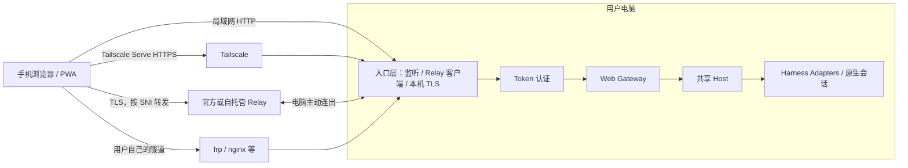

# Web 远程访问总体设计

> 状态：实施前设计，未实现、未部署。代码核对基线为 `557c4de91`，核对日期为 2026-11-02。本文中的新增目录、接口和命令均为拟议内容，不代表当前产品能力。
>
> 本文说明要做什么、做成什么样以及关键取舍。协议格式、数据结构、接口和参数由后续 Spec 确定。

## 1. 目标

用户在手机浏览器或 PWA 上，从任意网络连接自己的电脑，查看和操作电脑上的外部 Thread。任务继续在用户电脑上执行，Harness 的原生能力、认证和计费都不变。

产品形态为 Web，不开发 iOS/Android 原生 App：

- 手机打开一个网址并输入 token 即可使用，不需要应用商店或开发者账号。
- 电脑不需要公网 IP、端口映射或入站防火墙规则。
- 用户可以按自己的网络和信任偏好选择入口，所有入口的界面和功能一致。
- 用户可以随时删除任何一个 token，让对应设备失效。

### 不在范围内

- 原生 App，以及依赖原生 App 的 APNs、FCM 推送
- 公网静态前端和浏览器内应用层加密
- P2P 直连
- 云端保存会话、离线任务队列
- 唤醒休眠的电脑
- 经远程入口访问 Codex Desktop 原生 Thread 或既有 SSH Host
- 账号体系、付费套餐、团队权限

## 2. 五种访问方式

| # | 方式 | 手机访问地址 | 用户准备 | 中间方能否读内容 | 定位 |
| --- | --- | --- | --- | --- | --- |
| 1 | 局域网 | `http://192.168.x.x:4400` | 手机和电脑在同一网络 | 同网设备可能看到（明文 HTTP） | 产品功能 |
| 2 | Tailscale | `https://<电脑名>.<tailnet>.ts.net` | 手机和电脑都安装 Tailscale | 不能 | 产品功能，适合已在用或愿意配置 Tailscale 的用户 |
| 3 | 官方中转 | `https://<id>.<官方中转域名>` | 只需地址和 token | 不能，见[信任边界](#7-信任边界) | 产品功能，取决于网络实测 |
| 4 | 自托管中转 | `https://<id>.<用户的域名>` | 公网服务器和域名 | 不能 | 产品功能，复用官方中转的 Relay |
| 5 | 自备隧道 | 由用户的隧道决定 | 自行配置 frp、Tailscale Funnel、Cloudflare Tunnel、nginx 等 | 取决于所选工具 | 只提供配置项和文档 |

选择建议：

- 手机和电脑在同一网络：局域网。
- 已在用 Tailscale，或手机上没有 VPN 冲突：Tailscale。
- 不想在手机上安装软件，或手机已开着别的 VPN：官方中转。iOS 同一时间通常只有一个 VPN 配置生效，这是 Tailscale 最主要的门槛。
- 不想依赖官方服务：自托管中转。
- 已有自己的隧道或反向代理：自备隧道。

局域网的明文 HTTP 不是浏览器安全上下文，Service Worker、Web Push 和麦克风等能力不可用，界面要说明这一限制以及明文传输的风险。其他入口都使用 HTTPS。

## 3. 总体架构



设计原则：

1. **一套后端，多个入口。** 所有入口都进入同一个 Web Gateway 和 Token 认证，只有入口层不同。不为远程另建第二份会话、Adapter 或 transcript。
2. **页面由电脑提供。** 手机加载的页面和电脑上的 Gateway 总是同一版本，不需要公网静态前端和版本调度，现有 HTTP、WebSocket 协议也不用改。
3. **认证只看 token。** 经隧道转发的请求可能看起来来自本机，所以来源 IP 不能代替认证。Token 管理额外要求本机访问，判断规则见 [4.4](#44-管理入口)。
4. **断线不等于取消。** 传输断开不影响 Host 和运行中的任务，也不自动重发结果未知的写操作。

## 4. Token 认证

Token 认证是所有入口的前提。局域网、Tailscale 和隧道都依赖它，公网地址尤其如此，因为中转子域名会进入公开的证书透明日志，一定会被扫描。

### 4.1 Token 模型

- 用户可以创建多个 token，并各自命名，比如“我的手机”。
- 服务器只校验 token，不绑定浏览器或硬件。同一个 token 可以在多台设备上使用，删除时一起失效；想分开撤销，就一台设备一个 token。
- 所有 token 的日常权限相同。
- Token 是足够长的随机值，电脑上只保存哈希，创建时只显示一次。
- 列表显示用户创建的 token 的名称、创建时间和最近使用时间，用于发现异常使用。

现有 `auth.ts` 的服务级 token 成为本机 token，见 [4.2](#42-登录)。开发用的 `--no-auth` 只用于受信任的本机开发，不能与远程入口同时使用。

### 4.2 登录

1. 用户在电脑上创建 token，得到访问地址和 token。
2. 在手机或其他电脑上打开带 token 的链接，或者打开地址后在登录页粘贴 token。链接也可以显示为二维码，但扫码不是必需的。
3. 浏览器用 HttpOnly Cookie 记住 token，之后直接进入。

链接优先把 token 放在 URL fragment 中，避免发送到服务器和代理日志；页面读取后立即从地址栏移除。

本机访问不需要用户输入 token：启动命令打开浏览器时，自动带上保存在本机私有文件中的本机 token，浏览器记住后直接进入。换浏览器或清除网站数据后，再次运行启动命令即可恢复登录。

本机 token 由系统维护，不在 token 列表中展示，也不能删除。它只在满足 [4.4](#44-管理入口) 的本机访问条件时有效，从其他入口使用会被拒绝。启动时只打开本机页面，手机和其他设备要使用用户在管理页面创建的 token。

不提供免 token 的本机访问，因为 frp TCP 和 `ssh -R` 这类转发原样传递字节，与真正的本机访问无法区分，同一台电脑上的其他用户也能访问回环地址。

### 4.3 删除

删除 token 后立即生效：

1. 使用该 token 的 HTTP 请求全部被拒绝。
2. 服务器主动断开使用该 token 建立的 WebSocket 和事件流。现有校验只在建立长连接时执行，所以每条长连接都要记录所用的 token。
3. 页面跳转到登录页，并删除该 token 关联的 Web Push 订阅。

删除 token 不会停止电脑上运行中的任务，也不回滚已交给 Harness 的指令。关闭远程入口时保留 token，再次开启后可以继续使用。

### 4.4 管理入口

Token 管理页面放在 Web 设置中，所有访问方式都能看到菜单：

| 访问方式 | 菜单 | 点击后 | 接口 |
| --- | --- | --- | --- |
| 本机访问 | 显示 | 查看、创建、删除 token | 允许 |
| 其他访问（包括局域网、Tailscale、中转和隧道） | 显示 | 提示只有在这台电脑上通过 `http://127.0.0.1:<端口>` 访问时才能管理，不显示 token 列表 | 拒绝，返回明确的错误 |

本机访问同时满足以下条件才算成立，否则一律按非本机处理：

- 已通过 token 登录。
- 连接来自回环地址。
- `Host` 为 `127.0.0.1:<端口>` 或 `localhost:<端口>`。
- 请求不带 `x-forwarded-*`。

仅看来源地址不够，因为 Tailscale Serve 和 frp 等代理转发的请求同样来自 `127.0.0.1`。这条规则用于简化界面和防止手机上误操作，不是严格的安全边界：token 持有者可以通过终端或 Agent 在电脑上执行命令。

Token 管理不提供命令行。人在外面时无法新增或删除 token，只能回到电脑前操作；丢失设备后，在回到电脑前无法让它的 token 失效。界面要提示用户提前创建备用 token，以便在其他设备上继续使用。

### 4.5 功能范围

持有 token 的设备默认可以使用全部日常功能，包括文件上传下载和预览、终端 PTY。不设远程功能白名单，原因有两个：

- 拿到 token 的人可以直接指挥 Agent 执行命令，关闭文件和终端入口并不能带来实质的安全提升。
- 官方和自托管 Relay 看不到内容，无论开放哪些功能，它们能接触到的信息都一样。

入口之间的差异只来自流量成本和网络环境：

| 能力 | 局域网、Tailscale、自托管、自备隧道 | 官方中转 |
| --- | --- | --- |
| 聊天、审批、停止 | 开放 | 开放 |
| 文件上传、下载、预览 | 开放 | 开放，受流量额度限制 |
| 终端 PTY | 开放 | 开放 |
| 截图、侧栏浏览器推流 | 开放 | 可用，默认关闭，用户手动打开 |

### 4.6 不随功能开放而放宽的基础保护

- 所有入口都要求认证，公网隧道也一样。
- 下载和预览不能让用户文件以应用身份执行脚本。恶意 HTML 或 SVG 要通过下载响应头、CSP 或隔离来源处理。`/api/file` 只返回 PNG、JPEG、WebP、GIF 并带 `nosniff`，其他文件路径由 Spec 逐一核查。
- 只有明确配置为可信代理时才采信 `x-forwarded-*`。
- 下载必须经过 token 认证，不提供公开文件链接，避免子域名变成文件托管。
- 登录失败要限速。
- 局域网入口是明文 HTTP，token 可能被同网设备看到，而同一个 token 也能用于公网入口。界面要提示不要在不可信网络上使用局域网入口。

## 5. 各入口的实现

### 5.1 局域网

保留现有地址和二维码，改用命名 token。显式开启后才监听局域网地址。默认监听保持 `main.ts` 的 `127.0.0.1`。

### 5.2 Tailscale

Web 服务只监听本机，由 Tailscale Serve 提供 HTTPS 和 `ts.net` 地址：

- 检测 Tailscale 是否已安装、已登录，以及 Serve 是否可用。
- 用户确认后开启 Serve，并自动配置可信代理。
- 访问链接指向 Serve 地址，登录方式与其他入口相同。

### 5.3 官方中转和自托管中转

两者使用同一个 Relay 程序，区别只在部署者和域名。

```text
手机浏览器 ──TLS──▶ Relay（读取 SNI，转发字节）◀──出站连接，多路复用── 用户电脑（解开 TLS）
```

连接过程：

1. 电脑生成身份密钥，子域 ID 由公钥派生。换 IP 或换网络后地址不变。
2. 电脑通过出站 WSS（443 端口）连接 Relay，用私钥证明身份，注册子域。
3. 手机访问 `https://<id>.<域名>`。泛域名解析把请求送到 Relay，Relay 只读取 TLS ClientHello 中的 SNI，再把字节转发到对应电脑的一条复用流上。
4. 电脑在进程内用自己的证书解开 TLS，交给现有 HTTP 服务。电脑不新开监听端口。

电脑端职责：

- 身份和子域管理
- 维持出站连接，自动重连；重连不重启 Host
- 本机 TLS 和证书的申请、续期（`main.ts` 目前只有 `node:http`）
- 按流控制背压，大文件传输不能阻塞停止和审批

Relay 职责：

- 校验电脑身份，防止抢占子域
- 按 SNI 路由，转发字节，不持有证书，不落盘内容
- 按子域限制带宽和每日总流量

官方部署额外开启：

- 内测邀请码、注册频率限制、按 ID 封禁、举报入口
- 在线状态、容量和异常监控，只记录必要元数据
- 官网：产品介绍、教程、服务状态、隐私政策

这些运营功能在自托管时默认关闭。自托管只需要一台公网服务器和一条泛域名解析，部署物是与官方相同的 Relay 源码、Docker 镜像、compose 示例和一页文档。不提供单独的安装器或管理后台。

**证书：** 证书私钥只在用户电脑上。优先验证 TLS-ALPN-01：验证请求同样按 SNI 转发到电脑，这样无需为每台电脑开放 DNS 写入接口。如果原型验证不可行，改用由 Relay 代写记录的 DNS-01。

**官方中转的域名：**

- 与官网使用不同的注册域名，避免子域名滥用牵连官网。
- 申请加入 Public Suffix List。Let's Encrypt 按注册域名限制新证书（每 7 天 50 张，约每 202 分钟恢复 1 张，通过 ARI 协调的续期不计入），加入后每个子域按独立注册域名计算，同时获得 Cookie 隔离。
- 准备备用证书机构。

**流量额度：** 只有 Relay 层的带宽和总量限制是硬限制。文件大小提示等电脑端限制只改善体验，因为那部分代码在用户手里，且 Relay 无法区分流量属于哪个功能。具体额度在实测后确定。

### 5.4 自备隧道

用户配置公开地址和可信代理，访问链接指向该地址，登录方式不变。文档要说明：

- frp 可以把 TLS 终止在电脑上。
- Tailscale Funnel 的 TLS 同样终止在电脑上，但会把入口暴露到公网。
- Cloudflare Tunnel 的 TLS 终止在云端边缘，服务商能看到内容，且依赖出站 7844 端口。Quick Tunnel 不提供可用性保证，只适合测试。

## 6. 连接与生命周期

### 6.1 Web 后台的运行方式

阶段 1、2 沿用现有启动方式。`npm start web` 或发行目录的 `preview.mjs` 让 Web 服务在前台运行，共享 Host 由原生 Launcher 脱离前台独立运行。只要终端保持打开、电脑不休眠，手机就能连接。

这种方式的局限：Web 服务不脱离终端，崩溃后不自动重启，电脑重启后要手动启动。`npm start web` 还带有构建、Host 重启判断和前端热更新，只适合开发。

阶段 4 面向普通用户时，安装包和 npm 包提供一个统一的启动命令：

- 同一命令拉起 Host、Web 后台和 GUI。关闭终端或 GUI 窗口后，Host 和 Web 后台继续运行，只有用户主动停止时才全部退出。
- Web 后台默认只监听 `127.0.0.1`，发行入口不沿用 `preview-launch.ts` 的 `0.0.0.0` 默认值。Web 后台运行不代表可以远程访问，用户在设置中开启入口后才对外。
- GUI 不是必需项：提供只启动后台的选项，未安装 Codex Desktop 时也能正常启动。
- 界面显示后台运行状态，并提供统一的停止命令（拟为 `codexhost stop`）。停止前提示会中断运行中的任务。
- 更新时 Web 后台随之重启，不影响 Host 上运行中的任务。
- 重复运行启动命令时复用已运行的 Web 后台，只打开 GUI。端口被其他程序占用时提示失败，用户可用 `--port` 指定其他端口，不自动更换端口。
- Rust 负责 Web 后台的启动、监管和退出清理，可参考 `host_service.rs` 的现有机制，不解析 token 或 Harness 语义。
- 重启 Web 后台不重启 Host；启停、重连都不影响运行中的任务。

统一启动命令不覆盖电脑重启：重启后要再次运行启动命令，开机自启和崩溃重启的方式由 Spec 决定。发行前要测量纯空闲时 Web 后台的内存和 CPU 占用。

电脑上有统一的“手机远程访问”设置入口，由 Console 和 Web 管理界面提供。休眠的电脑无法连接，界面和教程要提示用户调整系统休眠设置。

### 6.2 断线恢复

沿用现有 Host 的 epoch、cursor 和 snapshot。

| 情况 | 行为 |
| --- | --- |
| 手机切网、锁屏、页面被回收 | 回到前台后重新连接，读取最新快照和待处理交互 |
| Relay 重启或出站连接中断 | 电脑自动重连，任务继续，不创建新的原生会话 |
| 电脑换 IP | 用同一身份重连，地址和 token 不变 |
| Web 后台重启，Host 仍运行 | 重新连接 Host，任务继续 |
| Host 重启 | 按新 epoch 重新读取；不保证中断的任务继续，不自动重发命令 |
| 手机和电脑同时回答审批 | 由 Host 仲裁，返回实际结果 |
| 发送后断线、结果未知 | 显示未知并重新读取状态，不自动重发 |
| 电脑休眠或断网 | 不可连接，界面显示离线 |

官方中转和自托管中转的 Relay 没有证书，电脑离线时无法返回提示页。`sw.js` 目前只处理推送和通知点击，要增加前端壳的离线缓存，让曾经访问过的手机能显示离线状态。首次访问时电脑必须在线。

### 6.3 通知

Web Push 由电脑直接发送给浏览器的推送服务，不经过 Relay，也不需要项目持有 APNs 或 FCM 密钥。

- 订阅关联到 token，token 删除后一并删除。`push.ts` 目前没有 token 归属。
- iOS 要先把网页添加到主屏幕，每个入口地址对应一个 PWA。
- 不依赖后台长连接，靠通知提醒用户回到前台后恢复。
- 需要 HTTPS，局域网 HTTP 下不可用。
- Android Chrome 的 Web Push 依赖 FCM，电脑也要能访问对应的推送服务，在大陆可能不可用，要纳入实测。

### 6.4 连接状态

手机端界面区分以下状态：无网络、连接中、电脑离线、Host 未就绪、恢复中、已连接、token 已失效。电脑端显示每个入口的开关状态、当前地址和连接诊断。

## 7. 信任边界

| 角色 | 能看到 | 不能做到 |
| --- | --- | --- |
| Relay 运营方（正常运行时） | 客户端和电脑 IP、子域名、连接时间、流量大小 | 解密内容，或替换页面（页面在 TLS 内） |
| 控制 DNS 的一方 | 同上，并有能力为子域签发证书 | 不留痕迹地做中间人攻击：假证书会进入证书透明日志，可以发现，但无法事先阻止 |
| 持有 token 的人 | 全部日常功能可见的内容 | 通过 Web 管理 token 或修改入口配置（非严格边界，见 [4.4](#44-管理入口)） |
| 拿到电脑控制权的人 | 全部内容 | 不在防御范围内 |

对外表述只能是“中转服务不解密内容”，不能说“项目方绝对无法读取”。官方中转上线前需要修订 `docs/PRIVACY.md`，并开始监控证书透明日志。

中转子域名是公开的，所以安全不能依赖地址保密。子域名只用于路由，不作为访问凭据。

## 8. 代码落点

| 位置 | 内容 |
| --- | --- |
| `packages/web-server/src/remote-access/`（新增） | Token 存储和管理、入口管理、Relay 客户端、本机 TLS 与证书。`main.ts` 只做装配 |
| `packages/web-server/src/auth.ts` | 从单一 token 改为多个命名 token，并判断本机访问；删除时断开长连接 |
| `packages/web-server/src/main.ts` | 可信代理配置；长连接记录所用 token；启动时只打开带本机 token 的本机页面 |
| `packages/web-server/src/push.ts` | 订阅关联 token |
| `packages/remote-relay/`（新增） | 独立部署的 Relay，不依赖 `host-runtime`、Adapter 或本机文件服务；纳入 `tools/check-boundaries.mjs` |
| `packages/shared-contracts/` | 浏览器安全的入口状态和 token 管理类型 |
| `apps/web-ui/` | 登录页、token 管理页及非本机提示、连接状态、离线缓存 |
| `packages/console-server/` | 电脑端的远程访问设置入口 |
| `crates/launcher/` | 阶段 4 的 Web 后台常驻和监管，不包含 token 或 Host 协议语义 |
| `scripts/release/` | Relay 镜像和 Web 后台发行内容 |

Web 现有的 HTTP RPC、`/api/remote.mux`、`/api/ch/v1/*` 保持不变，页面也由电脑提供，因此前端基本不用改网络层。

## 9. 实施路线

实施分为 7 个阶段，每个阶段的交付、完成标准和依赖见[实施计划](web-remote-implementation-plan.md)。

| 阶段 | 内容 | 完成后 |
| --- | --- | --- |
| 1 | Token 认证 | 局域网访问更安全 |
| 2 | Tailscale 和自备隧道 | 技术用户可以远程使用 |
| 3 | 可行性验证 | 决定官方中转做不做 |
| 4 | 统一启动和 Web 常驻 | 关掉终端也能远程访问 |
| 5 | 中转核心 | 手机不用装软件，通过子域名访问 |
| 6 | 官方服务上线 | 普通用户可以使用 |
| 7 | 开放自托管 | 用户可以部署自己的中转 |

## 10. 备选方案及取舍

| 方案 | 未采用的原因 | 可借鉴的部分 |
| --- | --- | --- |
| 公网静态前端加浏览器内加密 | 要新写加密 carrier，要改造所有直接网络访问，要维护前端和 Gateway 的版本兼容。而且只要页面由发布方提供，加密就无法防范发布方替换页面 | 无 |
| 原生 App 加 E2EE 中转（Alma 形态） | 需要上架、维护两端 App，推送还要项目持有密钥 | 出站多路复用、只存派生值的哈希、流控 |
| 直接使用 [alma-relay](https://github.com/yetone/alma-relay) | 在 HTTP 层转发，TLS 在 Relay 解开，内容安全依赖 App 内加密，对 PWA 不成立；按路径寻址，多台电脑共用同一来源；电脑端 agent 未开源 | 同上 |
| 以 Tailscale 作为唯一入口 | 手机要装客户端，并与其他 VPN 冲突，也有大陆网络问题 | 作为已在用 Tailscale 的用户的入口 |
| 以 Cloudflare Tunnel 作为默认 | 云端边缘解开 TLS，出站 7844 可能被封，大陆跨境可靠性差 | 作为自备隧道的一种 |
| P2P（iroh、WebRTC） | 浏览器上 iroh 全部走 Relay，WebRTC 也不能保证直连，而且页面来源问题还在 | 中转稳定后再评估 |
| Matrix | 引入 homeserver、账号和存储，RPC 和流映射成本高 | 无 |

P2P、Tailcat 和 Cloudflare Workers 中转的调研依据和重新评估条件见[暂缓方案记录](web-remote-deferred-options.md)。

SNI 转发方案有成熟先例：Home Assistant 的 Remote UI 通过 [SniTun](https://github.com/NabuCasa/snitun) 实现端到端 TLS，子域名形如 `myname.ui.nabu.casa`，证书来自 Let's Encrypt。

## 11. 主要风险

| 风险 | 影响 | 应对 |
| --- | --- | --- |
| 大陆网络干扰 SNI 或线路质量差 | 官方中转不可用 | 阶段 3 先实测；保留其他入口；准备备用域名和线路 |
| 子域名被用于钓鱼或恶意分发，而项目看不到内容 | 整个中转域名被浏览器拉黑 | 独立域名、Public Suffix List、邀请码、流量限制、按 ID 封禁 |
| 流量成本超预期 | 官方服务难以维持 | 按子域额度，推流默认关闭，实测后定额，可随时暂停注册 |
| 证书额度耗尽 | 新电脑无法开通 | Public Suffix List、备用证书机构、内测控制注册速度 |
| Token 被盗 | 对方获得全部日常能力 | 显示最近使用时间、删除时断开连接；建议一台设备一个 token。删除只能在电脑上操作，人在外面时无法立即撤销 |
| 个人维护者的运维压力 | 官方服务不稳定 | 故障不影响任务和其他入口；服务状态公开；提供自托管 |
| 官方推出能覆盖多 Harness 的方案 | 官方中转的价值下降 | 其他入口不依赖官方中转，投入可控 |

## 12. 留给 Spec 决定的问题

- Token 的长度和格式、是否支持过期时间
- 带 token 链接的具体格式，以及现有 `?token=` 链接的兼容方式
- Relay 控制协议、多路复用格式和流控参数
- Relay 是否向电脑传递客户端 IP 用于限速
- 证书存储位置、续期时机和失败提示
- 流量额度的具体数值和超额行为
- 下载和预览的具体隔离方式
- 前端壳离线缓存的范围，以及它和版本更新的关系
- Web 后台的开机自启和跨平台安装方式
- 远程功能的版本兼容策略

## 13. 参考资料

资料查阅日期为 2026-11-02，尚未在 codexhost 或大陆网络上实测。

- [SniTun](https://github.com/NabuCasa/snitun)、[Nabu Casa Remote UI](https://nabucasa.com/config/remote)
- [Tailscale Serve](https://tailscale.com/docs/features/tailscale-serve)、[Tailscale Funnel](https://tailscale.com/docs/features/tailscale-funnel)
- [frp https2http](https://gofrp.org/en/docs/examples/https2http/)
- [Cloudflare Tunnel 防火墙要求](https://developers.cloudflare.com/cloudflare-one/networks/connectors/cloudflare-tunnel/configure-tunnels/tunnel-with-firewall/)、[Quick Tunnel](https://developers.cloudflare.com/tunnel/get-started/quick-tunnels/)、[Cloudflare 中国网络](https://developers.cloudflare.com/china-network/)
- [alma-relay](https://github.com/yetone/alma-relay)、[alma-relay 协议](https://github.com/yetone/alma-relay/blob/main/docs/PROTOCOL.md)
- [Paseo Relay 安全说明](https://github.com/getpaseo/paseo/blob/main/docs/relay-endpoint-security.md)、[T3 Connect](https://github.com/pingdotgg/t3code/blob/main/docs/internals/t3-connect.md)、[Happy 加密说明](https://github.com/slopus/happy/blob/main/docs/encryption.md)
- [Claude Code Remote Control](https://code.claude.com/docs/en/remote-control#connection-and-security)
- [Let's Encrypt 速率限制](https://letsencrypt.org/docs/rate-limits/)、[Public Suffix List](https://publicsuffix.org/)、[TLS-ALPN-01（RFC 8737）](https://www.rfc-editor.org/rfc/rfc8737)
- [WebKit：iOS Web Push 与 Home Screen Web App](https://webkit.org/blog/16574/webkit-features-in-safari-18-4/)
